# 01 AI辅助文档写作

[官网课程](https://www.datawhale.cn/learn/content/382/7917)

> 用时：首次30分钟，长期15分钟
> 
> 
> 
> 产出：结构稳定、语气一致、可以继续修改的文档初稿。
> 
> 
> 
> 下一步：生成后再用差异化反馈继续修改，而不是每次从头生成。

## 第一部分

1. 安装办公类AI Agent

常用企微、腾讯文档、腾讯会议选[Workbuddy](<https://www.workbuddy.cn/?fromSource=gwzcw.17039508.17039508.17039508&utm_medium=cpc&utm_id=gwzcw.17039508.17039508.17039508>) 
常用钉钉文档选[千问办公](<https://qwenwork.cn/>)

常用飞书文档选[豆包工作](<https://www.doubao.com/work>) 
想按APIKEY计费，用过各种CLI，希望和Obsidian等开源工具联动选[Claude Code +DeepSeek](<https://api-docs.deepseek.com/zh-cn/quick_start/agent_integrations/claude_code/>)

没有内存了[千问办公](<https://qwenwork.cn/>) 支持网页版，提供个人网盘功能区，也能打通飞书文档

1. 安装文档相关skill（可跳过）

[SkillHub](<https://www.skillhub.cn/>)上有很多办公效率、文档处理、表格处理、PPT 生成和会议纪要相关技能。

| Skill 名称 | 适合处理 | 本章怎么用 | 注意点 |
| --- | --- | --- | --- |
| Word / DOCX | Word 文档 | 创建、检查、编辑 DOCX，处理标题、编号、表格、修订记录。 | 适合本地 docx 文件。 |
| Office Document Specialist Suite | Word / Excel / PPT | 综合处理 Office 文件，适合自动化报告和多文件联动任务。 | 复杂任务建议分步验收。 |
| wps | WPS 三件套 | 面向中国用户的 WPS Office 工作流，覆盖文字、表格、演示。 | 适合 WPS 生态用户。 |
| 腾讯文档 TENCENT DOCS | 在线文档协作 | 创建、读取、编辑、搜索腾讯文档，覆盖在线 Word、Excel、幻灯片。 | 通常需要 API Key 或授权。 |
| kdocs skill | 金山文档 / WPS 云文档 | 处理 WPS 云文档、智能文档、表格、PPT、PDF、知识库。 | 通常需要 API Key。 |
| Markdown Converter | 材料解析 | 把 PDF、Word、PPT、Excel 转成 Markdown，方便模型先理解内容。 | 适合读材料，不等于最终排版。 |
| 腾讯会议 | 会议到文档 | 预约会议、获取转写、获取 AI 纪要，再转成 Word 纪要、Excel 待办、PPT 汇报。 | 需要会议平台授权。 |

### 给 WorkBuddy 的安装指令

```text
请先阅读并按 https://skillhub.cn/install/skillhub.md 的说明安装 SkillHub 商店。
然后在 SkillHub 中依次搜索并安装：
Word / DOCX、Office Document Specialist Suite、腾讯文档 TENCENT DOCS、Markdown Converter、腾讯会议；
如果我的日常文件也在 WPS / 金山文档中，再安装 wps 和 kdocs skill。
安装后请逐项验证能否调用，并用表格返回 Skill 名称、安装状态、适用任务和缺失的授权；
没有找到的 Skill 不要用相似名称代替，标为“未找到”。
```

### 给千问办公的安装指令

```text
请先阅读并按 https://skillhub.cn/install/skillhub.md 的说明安装 SkillHub 商店。
我的主要办公环境是钉钉与本地 Office，
请优先安装 Word / DOCX、Office Document Specialist Suite、wps、kdocs skill 和 Markdown Converter；
如果需要处理腾讯文档或腾讯会议材料，再安装腾讯文档 TENCENT DOCS 与腾讯会议。
安装完成后，请分别测试“读取一份 DOCX”“把一份材料转为 Markdown”“创建一份可编辑文档”三个最小任务，并返回测试结果、所需授权和失败原因。
```

### 给豆包工作的安装指令

```text
请先阅读并按 https://skillhub.cn/install/skillhub.md 的说明安装 SkillHub 商店。
在保留飞书文档原生能力的基础上，
优先安装 Word / DOCX、Office Document Specialist Suite 和 Markdown Converter，
用于本地 Office 文件与材料解析；
需要跨平台协作时，再安装腾讯文档 TENCENT DOCS、kdocs skill、wps 和腾讯会议。
安装后请列出“飞书原生能力直接完成”“需要 Skill 完成”“仍需人工授权”三类任务，并各跑一个最小示例验证。
```

1. 确认办公任务的需求

| 问题 | 要说清什么 | 示例 |
| --- | --- | --- |
| 目标 | 这份材料要帮助谁做什么决定 | 给部门负责人看，用于判断项目是否继续投入。 |
| 受众 | 阅读者是谁，懂不懂背景 | 管理层只看结论；项目组需要过程和责任人。 |
| 材料 | 哪些文件是事实来源，哪些只是参考 | data.xlsx 是唯一数据口径，旧版 PPT 只参考结构。 |
| 格式 | 要 Word、Excel、PPT，还是三者联动 | 输出一份项目复盘 Word、一张风险台账 Excel、一份 8 页汇报 PPT。 |
| 验收 | 怎么判断结果可用 | 数字能回到源文件，表格公式可刷新，PPT 投屏不溢出。 |
| 文档类型 | 语气和结构 | 正式方案：活动策划、项目方案、营销方案、培训方案。<br>管理文档：制度、通知、申请、会议纪要、复盘报告、周报月报。<br>产品材料：PRD、需求说明、竞品分析、用户访谈总结。 |

```text
# 任务：评估中国 AI 办公软件市场是否仍值得进入

## 决策目标
为产品负责人和创业团队判断：现在进入中国 AI 办公软件市场，应该“建议进入”“不建议进入”还是“继续验证”；如果值得进入，优先从哪个细分场景切入。

## 受众与写作口径
受众是不了解全部行业背景的管理层。先给结论和证据，再展开分析；避免空泛介绍行业概念。

## 研究范围
- 地域：中国市场。
- 时间：过去 24 个月；涉及更早资料时只用于说明基线。
- 客群：个人办公用户与 500 人以下中小企业。
- 产品：WPS、飞书、钉钉、腾讯生态、通用模型/办公智能体及代表性垂直产品。

## 优先材料
上市公司财报与公告、政府和权威统计、产品官网与官方定价、企业客户案例；用户反馈和第三方报告作为补充。若我提供文件，以提供材料为事实口径，旧版 PPT 只参考结构。

## 必答问题
1. 市场增长主要来自哪里，哪些增长是用户数、付费或使用深度的增长？
2. 主要玩家的目标客户、产品定位、定价方式、分发入口和护城河是什么？
3. 个人和中小企业愿意付费的具体任务是什么，频率、替代成本和可量化收益如何？
4. 获客、部署、权限、数据接入、交付与续费的难点是什么？
5. 现有产品最常被抱怨的问题是什么，证据来自哪里？
6. 未来一年可能改变竞争格局的产品、模型、监管和渠道变量是什么？

## 证据规则
- 将内容标成“已证实事实 / 行业观点 / 你的推断”。
- 每条关键事实注明来源机构、发布日期和链接；没有可靠来源的数字不要写成事实。
- 产品宣传只能证明功能或定价，不能单独证明实际效果。
- 证据冲突时并列说明口径差异，不替用户做无依据取舍。

## 输出格式
1. 300 字以内执行摘要与明确判断。
2. 市场增长来源。
3. 主要玩家对比表。
4. 付费场景优先级表（任务、用户、频率、当前替代方案、付费理由、风险）。
5. 获客与交付难点。
6. 用户抱怨与证据强度。
7. 未来一年关键变量。
8. 建议进入 / 不建议进入 / 继续验证，以及对应的 30 天验证计划。
9. 仍需人工核实的 5 个问题。

## 验收标准
结论能回溯到来源；事实、观点和推断不混写；建议落到细分用户、具体任务、交付方式和验证指标；不要用未经证实的“市场规模”数字支撑结论。
```

### 示例运行结果（首轮）

**判断：继续验证，偏向进入。**不建议复制通用办公套件或聊天入口；更值得验证的是“细分行业高频流程 + 交付服务 + 可审计结果”，按具体任务成果收费。

- **已证实事实：**截至 2025 年末，中国生成式 AI 用户规模为 6.02 亿，普及率 42.8%，较 2024 年末增长 141.7%（CNNIC，2026-02）。
- **已证实事实：**金山软件 2025 年办公软件及服务收入为 59.287 亿元，同比增长 16%；钉钉披露截至 2026-03-31 已有超过 783 万家企业与组织采用并集成 AI。
- **行业观点：**竞争正在从“有没有 AI 功能”转向能否嵌入知识、表格、会议和审批等真实工作流，并稳定交付可复核结果。
- **推断：**个人端的独立工具获客成本高、易被套件吸收；中小企业仍可能为会议到交付包、合同/制度比对、企业知识问答、表格批处理和跨系统自动化付费。
- **30 天验证：**访谈 20 家专业服务、电商或制造业中小企业，筛选一个每周至少发生、单次节省不少于 2 小时的流程，完成 3 家付费试点，记录激活率、8 周留存、人工介入时长和毛利。

**仍需人工核实：**客户愿意为独立 AI 付费还是只接受套件增购；真实获客成本与渠道分成；私有数据与权限接入周期；高频使用后的推理成本；试点 8 周后的留存与扩席意愿。

**示例运行效果图：**以下截图展示首轮输出的结论、证据、机会场景、交付难点与验证方案。

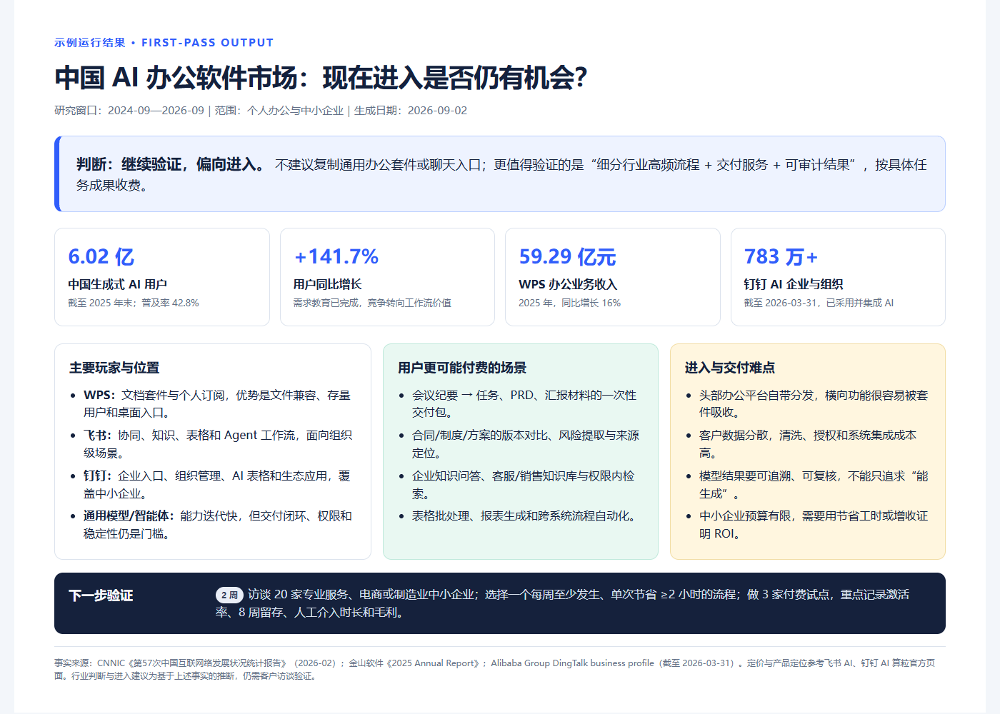

参考来源：

1. [CNNIC：第 57 次《中国互联网络发展状况统计报告》](<https://www3.cnnic.cn/n4/2026/0304/c88-11549.html>)，2026-02
2. [金山软件：2025 Annual Report](<https://ir.kingsoft.com/static-files/999c2fb6-9739-4c00-a3d7-ec00dc5430b6>)
3. [Alibaba Group：DingTalk business profile](<https://www.alibabagroup.com/en-US/about-alibaba-businesses-1747694273635024896>)
4. [飞书 AI：产品能力与官方定价](<https://www.feishu.cn/service/ai>)
5. [钉钉 AI 算粒：产品能力与官方定价](<https://page.dingtalk.com/wow/dingtalk/default/dingtalk/BZhQ296sirYP0Cuisaugx?dd_mini_app_id=5000000004997171>)
   资料访问日期：2026-09-02。产品功能与价格可能调整，正式使用前请以官网最新页面为准。

---

## 第二部分

可收藏：你已经完成了例题，下次开始前可参照以下步骤与AI协作，**别再把模糊的工作扔给它。**

| 步骤 | AI 做什么 | 人要确认什么 |
| --- | --- | --- |
| 1 | 读取材料，列出可用信息和缺失项。 | 哪些材料是事实来源，哪些只是参考。 |
| 2 | 生成文档大纲和写作口径。 | 读者是谁，文档是汇报、审批还是执行。 |
| 3 | 按大纲生成 Word 初稿。 | 标题层级、章节顺序、关键信息是否完整。 |
| 4 | 根据反馈润色、补充、删减。 | 哪些内容可以定稿，哪些必须标“待确认”。 |
| 5 | 输出可编辑 docx 和修改说明。 | 是否能直接发给同事审阅。 |

### 进阶案例1：差异化修改

```text
帮我生成一份公司团建活动策划的 Word 文档框架。
公司约 80 人，包含：活动目标、活动主题建议、整体流程安排（含时间节点）、分组与互动游戏建议、预算构成清单、人员分工、风险预案和注意事项。
语言简洁实用，不需要写得过于详细，重点把整体框架和关键决策项列清楚，适合直接拿去和领导确认活动方向。
```

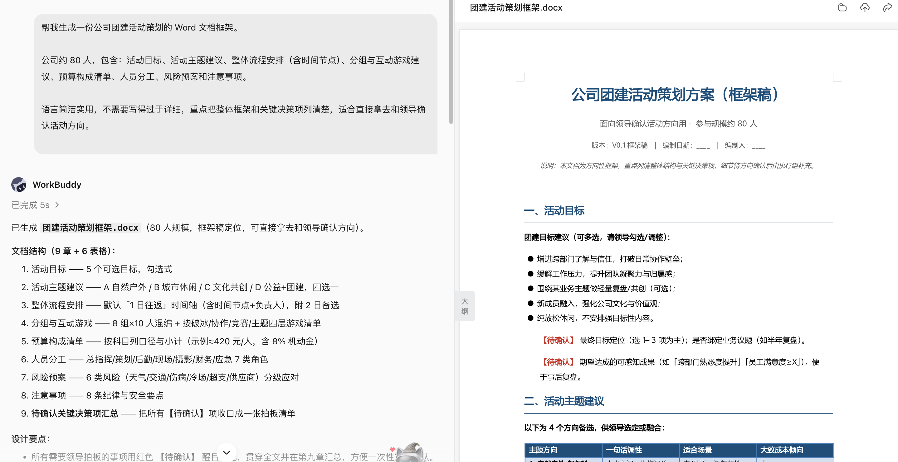

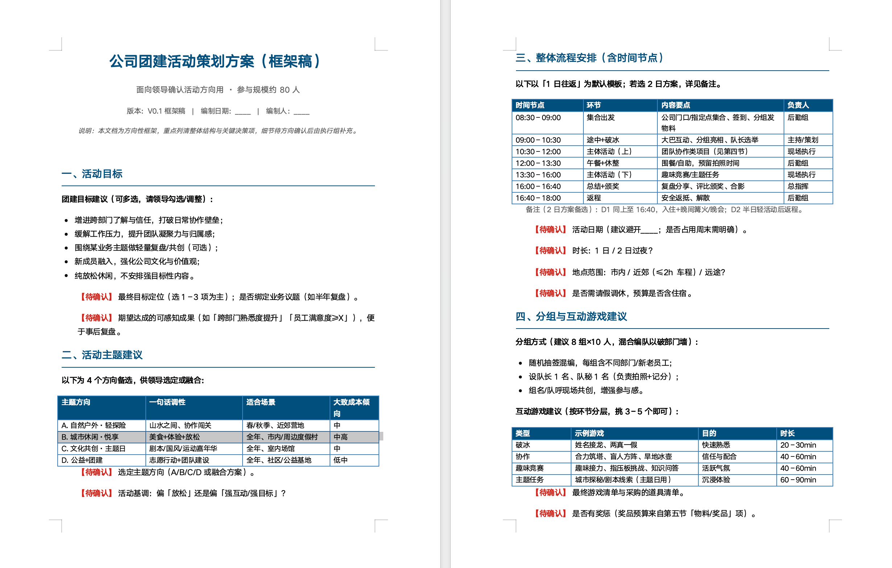

二次修改不要重写，要说差异

```text
请在上一版公司团建活动策划 Word 文档基础上进行修改，不要重新生成整篇。
修改要求：将活动目标压缩为 3 条，每条不超过 50 字；
将流程安排改成表格，列为：时间、环节、主要内容、负责人、所需物料；
在节目类型建议中增加适合 100 人规模公司的互动环节，并删除执行难度过高的方案；
将预算构成进一步细化，增加：预算项目、预计金额、数量、单价、备注，并补充预算总额；
新增风险预案部分，覆盖人员迟到、设备故障、节目超时和突发安全问题；
整体语言更加正式、简洁，适合直接提交给领导审批。
输出修改后的 v2 版 Word 文档，并在 changelog.md 中列出本次修改内容。
```

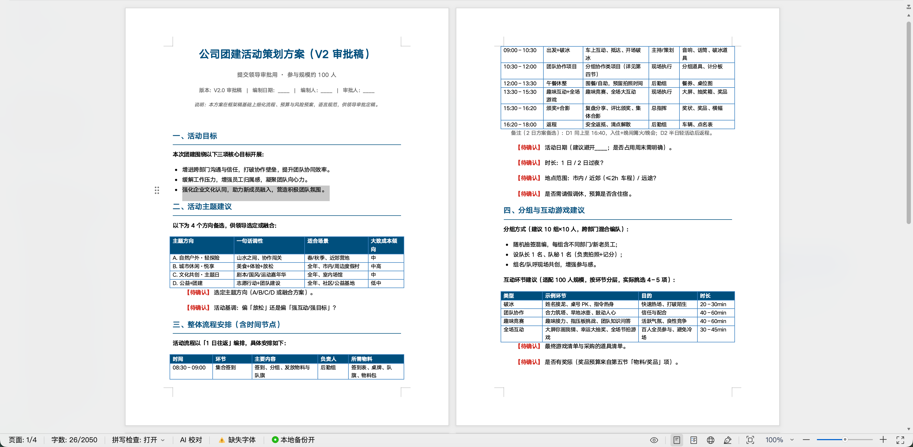

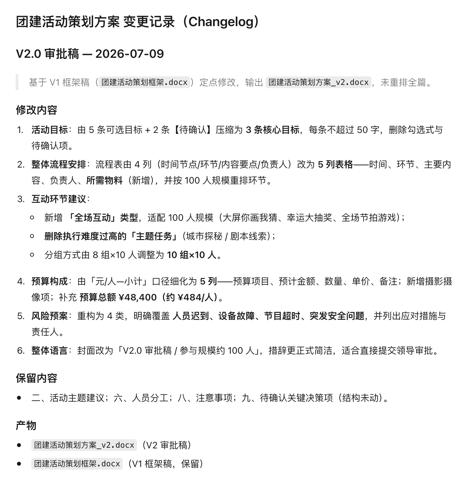

### 进阶实战2：比较两版制度、合同或方案

```text
比较 policy-v3.docx 与 policy-v4.docx。
输出新增、删除、修改和仅格式变化四类差异，附章节和原文定位。
重点标记金额、日期、责任主体、审批条件、例外和否定表达。
生成影响清单和待确认问题，不给法律结论，不修改原文件。
```

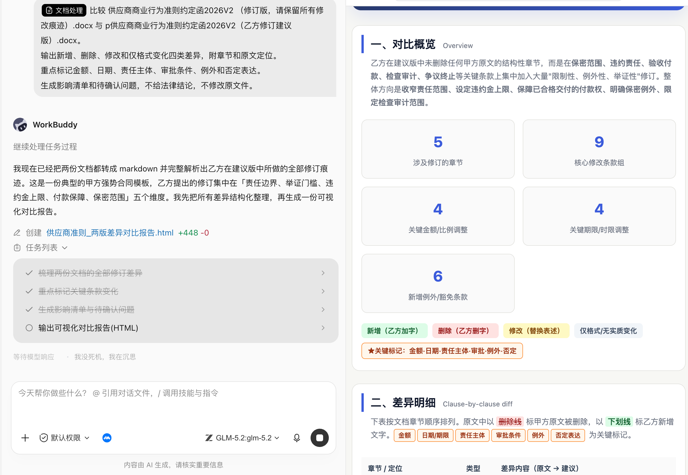

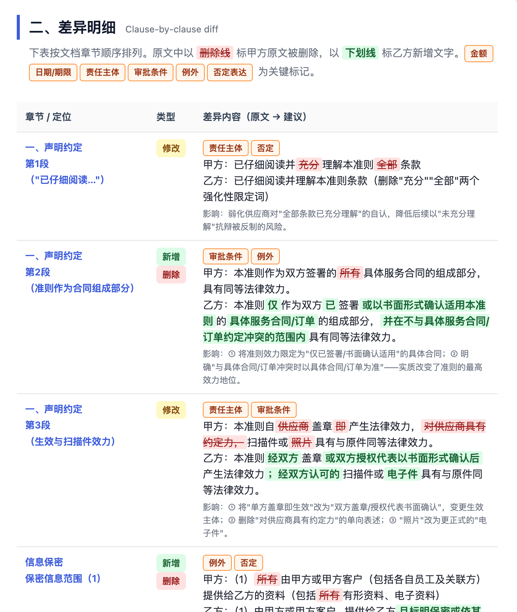

文档对比适合发现变化，不替代法务、财务或制度责任人的最终判断。

### 进阶实战3：会议纪要联动excel、ppt

```text
请读取本次产品评审会议的原始转写和 AI 纪要，把会议内容转成可推进研发的办公交付包。

第一步只输出预览，等我确认后再生成文件。预览必须包含：
1. 已达成的明确结论，并标注来自原始转写还是 AI 纪要；
2. 尚未达成一致的问题，以及各方观点和分歧点；
3. 行动项表格预览，字段为事项、负责人、优先级、截止日期、依赖、状态、验收标准、来源；
4. 会议提到但尚无人负责的风险点，责任人写“待指定”；
5. Word、Excel、PPT 三个交付物的大纲与字段预览；
6. 一份可直接发到工作群的行动清单。

我确认预览后，再生成：
- Word：output/feature-prd.docx，包含背景、目标用户、核心问题、需求列表、流程说明、验收标准、风险和待确认问题；
- Excel：output/action-items.xlsx，字段沿用预览中的行动项表；
- PPT：output/review-summary.pptx，6 页以内，面向管理层，突出会议决议、资源请求、依赖和风险；
- 群消息：一份简洁的行动清单，可直接复制发送。

约束：
- 原始转写与 AI 纪要冲突时并列呈现，不自行裁决；
- 没有明确确认的内容不能写成既定结论；
- 人名、日期、功能范围和数字必须保留来源；
- 缺少负责人、截止日期或验收标准时标为“待确认”，不要编造；
- Word、Excel、PPT 的结论与行动项必须一致；
- 先预览、后生成，未确认前不要创建最终文件。
```

### 进阶实战4：用AI排版Word文档

如果你不知道 html 是干嘛的，那就不用管，只要知道，它可以用来排版就行。DeepSeek 会输出下图的结果，点击一下红框里的“运行”。

```text
将上述内容，转化为html的格式，格式要求如下：
标题：使用三号微软雅黑字体，加粗，蓝色。
正文：使用四号微软雅黑字体，不加粗，黑色。
重点概念：使用红色标出。纯字体内容排版，排版中不要出现其它元素。
```

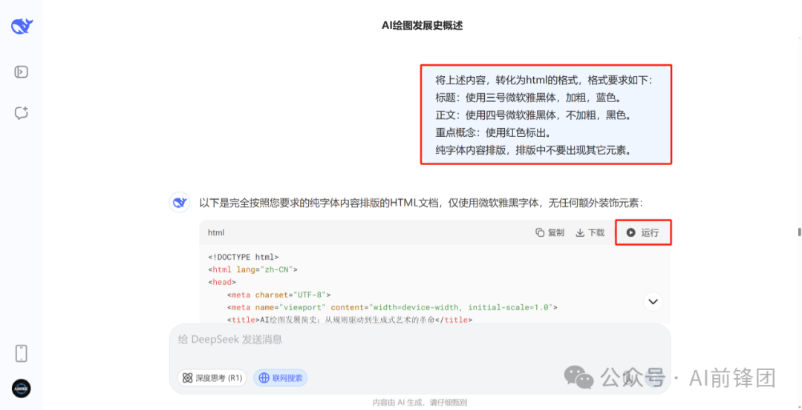

接着文字就排版好了。你看，就像下图这种样子。重点标题突出，关键词会用红色标注，比最初的排版好看多了。

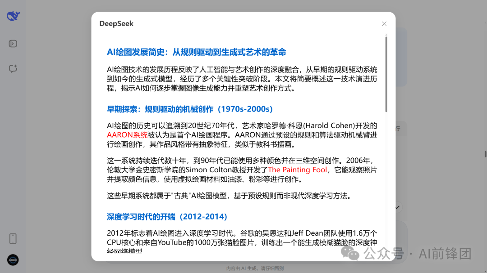

之后，你把排版后的内容复制下来，粘贴到 Word 文档里，就可以了。像下图这种操作。

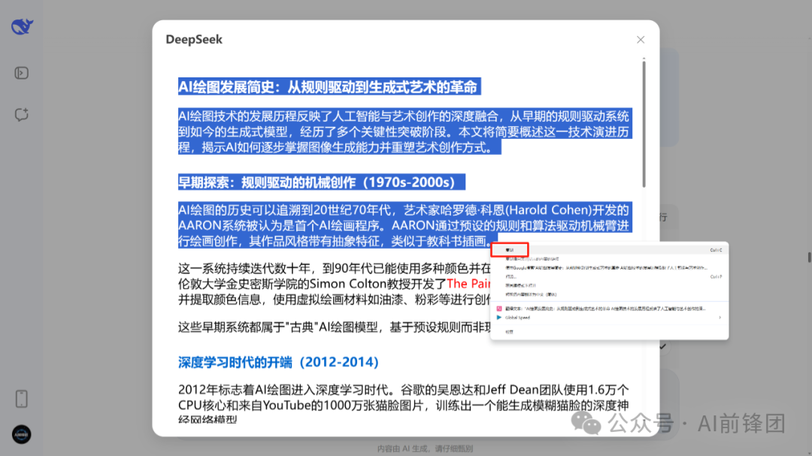

复制到 Word 里，最终的效果是下面这样。

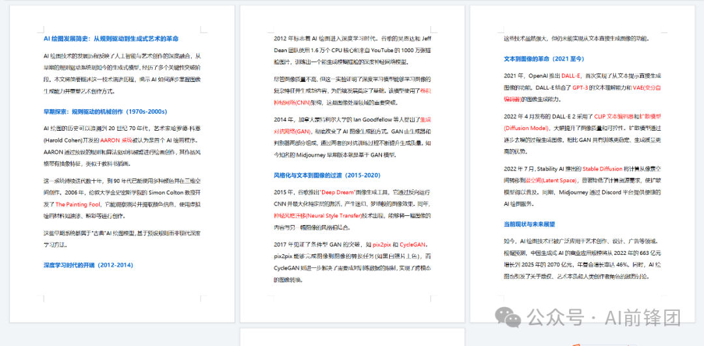

**第二部分 其他细节**

还有5个小细节。

**第一，除了 AI 生成的内容，写在其它地方的文字，也都可以用 AI 排版**比如，你在 Word 文档里写的内容，也可以复制给 AI，让AI排版之后再复制到 Word 文档里。这样节省了排版的时间。**第二，排版使用的字体，我建议用下面这些。**宋体、Times New Roman、黑体、微软雅黑、Arial、仿宋。这些是 Windows 系统自带的字体，排版时不会出现问题。如果你输入了一种小众字体，电脑上没有这种字体。那 AI 可能会给你随机出一种字体。你复制到 Word 里效果会很差，就像下面这种。

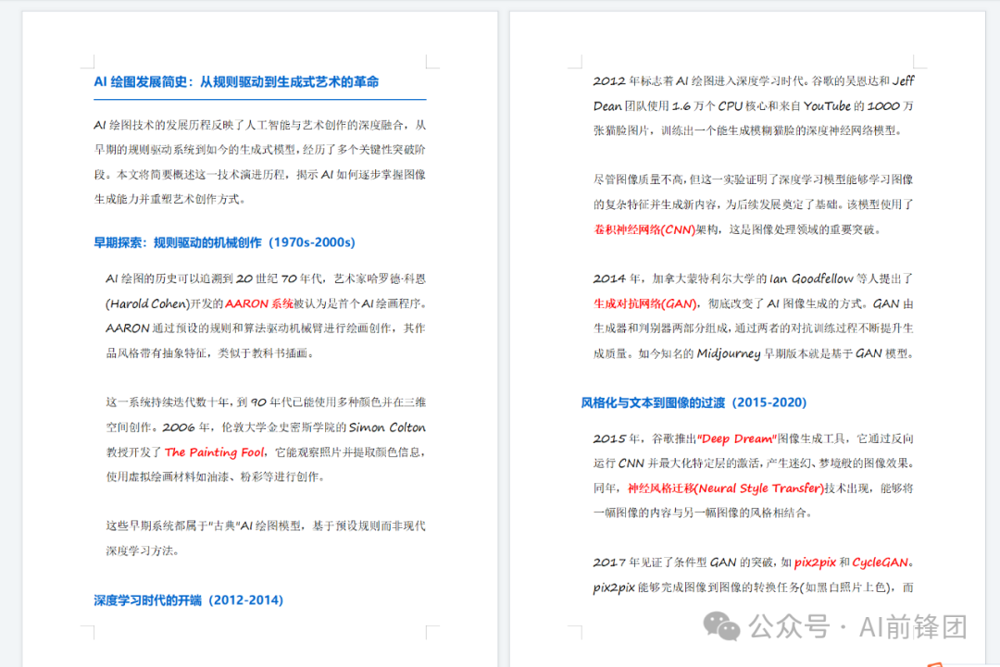

所以排版时，最好用上面推荐的字体，等复制到 Word 后，再换成你喜欢的字体。**第三，把排版后的内容粘贴到Word 时，一定注意是带格式粘贴。**这样粘贴过去，才是排版后的内容，不然就只有文字，没有格式。

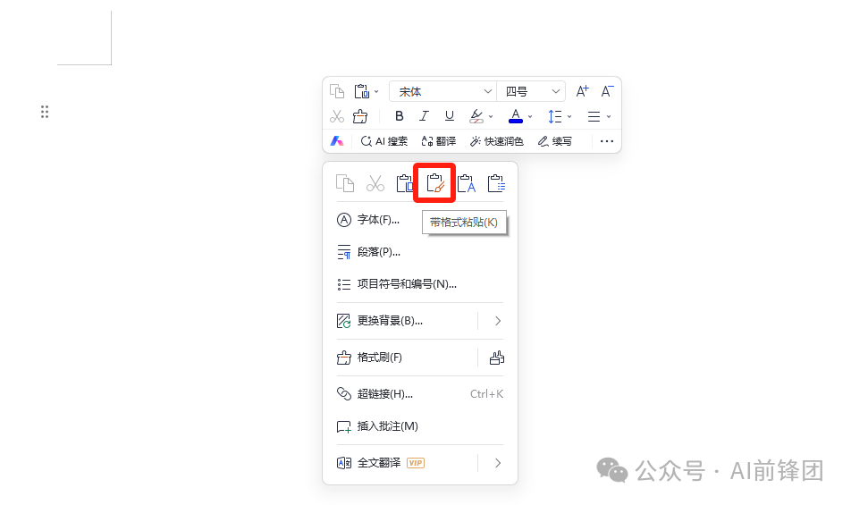

**第四，除了字体、标题、颜色，AI 还可以排版行间距、段间距等内容。**AI 的能力很强大，你有不同的排版需要，都可以尝试一下。**第五，如果你的文字内容比较少，也可以排版之后直接截图，这样会更好看。**我这里输入的提示词是：“把杜甫的诗《望岳》排版成html格式的海报形式。”输出是下图这种形式，直接把中间截个图，会更好看。

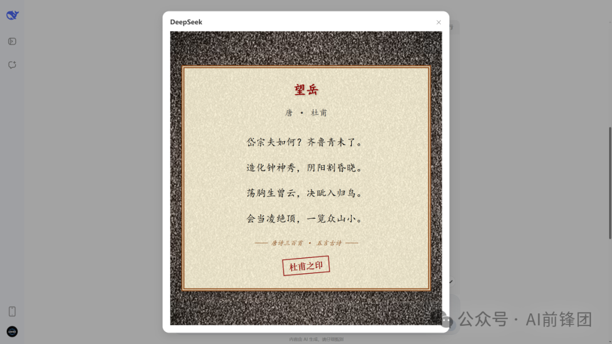

## 参考来源

1. [WorkBuddy 蓝皮书：办公三件套——Word、Excel、PPT](<https://workbuddy.homes/bluebook/第二篇 案例篇：从一项任务到一支 AI 团队/第 11 章 办公三件套：Word、Excel、PPT/>)
2. [豆包完整教程](<https://www.jxxy.net/ai/articles/doubao-full-tutorial/>)
3. [SkillHub 技能商店](<https://www.skillhub.cn/>)及[安装说明](<https://skillhub.cn/install/skillhub.md>)
