# 02 辅助PPT与演示

[官网课程](https://www.datawhale.cn/learn/content/382/7921) · [飞书源稿](https://datawhaler.feishu.cn/docx/V1B9dSjL4o6Pvixpo3qcKDXAnAe)

## 第一部分

### 需要制作PPT的场景：

- 项目汇报：项目进展、阶段复盘、里程碑计划、风险与资源请求。
- 经营汇报：月度经营分析、销售复盘、预算执行、用户增长复盘。
- 培训课件：新人培训、产品培训、客户培训、内部分享。
- 方案展示：客户方案、竞标材料、商业计划、产品发布。

### AI辅助PPT制作的环节

| 步骤 | AI做什么 | 人要确认什么 |
| --- | --- | --- |
| 1 | 把 Word、Excel、图片、旧 PPT 转成材料摘要。 | 哪些内容必须保留，哪些可以删。 |
| 2 | 生成 6-10 页故事线和每页标题，体现出框架、逻辑、节奏。 | 汇报对象、时长、决策目标。 |
| 3 | 根据确认后的大纲制作 PPT。 | 每页是否只有一个核心观点。 |
| 4 | 补图表、备注、来源映射和导出版本。 | 关键数字是否来自 Excel。 |
| 5 | 做版式检查：文字溢出、图片缺失、字号、颜色。 | 投屏后是否能读，是否适合现场讲。 |

### 产品组合推荐

先试 [WPS AI](<https://ai.wps.cn/>)（如果没装 WPS，就试[即触](<https://jcppt.com>)或[豆包](<https://www.doubao.com/>)）

→ 如果生成后数据被改了不能接受，换 [即触](<https://jcppt.com>)

→ 如果需要云端协作，用 千问

→ 如果追求设计感且不赶时间，用 [WorkBuddy](<https://www.workbuddy.cn>) 或 [Gamma](<https://gamma.app>)

### 最基础案例：做汇报PPT

#### 第一步 汇总原始素材发给AI

```text
我要做一份课堂小组汇报PPT，主题是[你的主题]，受众是[老师+同学]，时长[5-8分钟]。
以下是我准备的内容素材：

[把你要讲的内容随便写几条，不用管格式]
比如老师给的课程作业要求
小组分工名单
小组组员给你的word
小组讨论的录音转文字记录
等等

请帮我生成PPT大纲，要求：
总共6-8页，每页写清楚标题和核心内容
第一页是封面，最后一页是总结/致谢
中间页面要有1-2个核心观点和数据支撑
每页2-3个要点，不要太长，口语化
在需要放图表的地方标注[图表：XX]
风格建议：简洁学术风，不要花哨
```

#### 第二步 看AI输出给你的内容

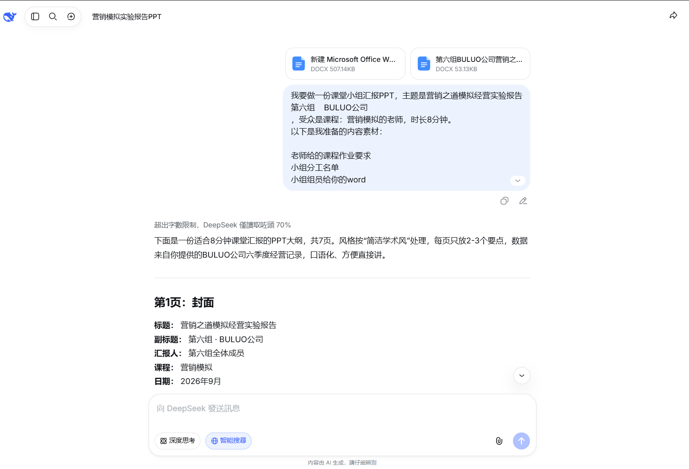

#### 第三步 套模板

拿这个大纲，去Gamma（免费AI PPT工具）或者WPS灵犀（lingxi.cn）里，选个模板套上去。每页的标题和要点已经有了，只需要调整措辞和配图。

```text
第1页：封面
标题： 营销之道模拟经营实验报告 菠萝手机，越用越甜。
副标题： 第六组 · BULUO公司
汇报人： 第六组全体成员
课程： 营销模拟
日期： 2026年9月
核心内容：
实验平台：营销之道模拟经营系统
经营周期：第1季度—第6季度
汇报主线：我们怎么从120万现金起步，做到第6季度末837.6万现金
[图表：封面背景可用简洁商务风，不放复杂图]
第2页：实验目标与小组分工
标题： 我们做了什么：目标与分工
核心内容：
实验目标：在模拟市场中完成产品设计、渠道布局、定价促销、生产配送和财务结算，最终看谁经营得更稳、更赚。
小组分工：
CEO/决策统筹：负责每季度整体策略和最终决策
市场与渠道：负责市场开发、互联网/专卖店/大卖场策略
产品与研发：负责产品设计、研发投入和产品组合
生产与配送：负责产能购买、原料生产、渠道配送
财务与数据：负责借款、贴现、税费、返利和现金跟踪
一句话总结：我们不是“拍脑袋”经营，而是每季度看现金、看库存、看渠道，再决定下一步。
[图表：小组分工表，5列即可]
第3页：六季度经营成果总览
标题： 从120万到837.6万：现金增长轨迹
核心内容：
第1季度初现金：120.0万；第1季度末现金：87.47万。
第2季度末现金：91.59万；第3季度末现金：99.94万。
第4季度末现金：224.19万；第5季度末现金：459.09万；第6季度末现金：837.63万。
关键转折：第4季度开始，国际市场和互联网渠道放量，现金明显跳升。
[图表：六季度末现金柱状图，横轴1-6季度，纵轴现金万元]
口语化讲法：
“前三个季度我们其实在打基础，现金一直在90万到100万左右。真正爆发是第4季度以后，尤其是国际市场打开之后，现金从200多万一路冲到800多万。”
第4页：核心策略一：渠道布局——从互联网到国际市场
标题： 渠道越铺越宽，销量才起得来
核心内容：
第1季度：开设互联网渠道，开始做线上销售。
第2季度：开设专卖店渠道，进入线下零售；同时继续做市场开发。
第3季度：继续开发国际市场、东北、西北、西南；开始做渠道库存转移。
第4—6季度：重点放量国际市场，同时在大卖场、专卖店、互联网多渠道路径上铺货。
数据支撑：第4季度国际市场配送量明显放大，单季出现多笔大额交付，如 菠萝Phone 1、菠萝Phone 1 Pro 各配送数百件，带动现金快速上升。
[图表：渠道开设时间轴，标注互联网、专卖店、大卖场、国际市场]
口语化讲法：
“我们不是只守一个渠道。互联网先试水，专卖店做形象，大卖场冲销量，国际市场最后成了我们的现金牛。”
第5页：核心策略二：产品与定价——多产品组合+促销返利
标题： 产品多做几个，价格跟着市场走
核心内容：
产品设计：先后设计了 菠萝Phone 1、菠萝Phone 1 Pro、菠萝Note 6、菠萝Note 7、菠萝Max 7 等多款产品，覆盖不同消费群体。
定价策略：互联网渠道定价从719元逐步调整到720元、730元、880元、930元等；专卖店和大卖场也随行就市调整。
促销与返利：对经销商和大卖场设置返利，比如 菠萝Phone 1 返利0.01%，菠萝Note系列 返利10%—12%，刺激渠道推货。
数据支撑：第6季度末，仅华东市场1号经销商就产生多笔返利，其中 菠萝Phone 1、菠萝Phone 1 Pro 返利0.01%，菠萝Note 6/Note 7/Max 7 返利12%，说明渠道返利确实拉动了销量。
[图表：产品价格调整折线图，选 菠萝Phone 1 在互联网渠道的定价变化]
口语化讲法：
“我们的逻辑很简单：产品多设计几款，价格别定死，渠道返利给到位，经销商才愿意帮你卖。”
第6页：财务与风险控制——借款、贴现、税费和返利
标题： 会赚钱，也要会管钱
核心内容：
银行借款：第1、2、3、4、5、6季度都申请了短期借款，每笔10万，利率5%，实际到账9.5万。
应收票据贴现：第3、4、5、6季度大量贴现，第6季度贴现率2%—4%，加速现金回笼。
税费上缴：第6季度上缴增值税49.6万，城建税、教育附加、所得税合计约70.2万，说明公司已经进入盈利期。
返利支付：第6季度支付大量渠道返利，虽然减少了现金，但换来了渠道持续进货。
风险点：第1季度末现金降到87.47万，说明前期投入大；第4季度后现金充裕，抗风险能力明显增强。
[图表：现金余额与借款/贴现金额对比图]
口语化讲法：
“我们不是只看利润表。借款、贴现、税费、返利，每一笔都影响现金。前三个季度现金紧张，后面靠回款和贴现才缓过来。”
第7页：总结与致谢
标题： 我们的收获与不足
核心内容：
做对的事：多产品组合、多渠道布局、灵活定价、返利刺激、及时贴现回笼现金。
不足的地方：前期产品设计有些反复，撤销和重新设计浪费了一部分费用；部分季度广告投入波动较大，投放节奏还可以更稳。
最终成果：第6季度末公司现金837.63万，相比第1季度初120万，增长约6倍。
致谢：感谢老师指导，感谢第六组每一位同学的配合。
[图表：一句话总结页，可放“120万→837.6万”大字]
口语化讲法：
“这次实验让我们真正体会到，营销不是只做广告，而是产品、渠道、定价、促销、财务一起配合。我们组配合得不错，但也踩过坑，这些坑以后就是经验。”
汇报时间建议（8分钟）
第1页：30秒
第2页：40秒
第3页：1分30秒
第4页：1分30秒
第5页：1分30秒
第6页：1分30秒
第7页：50秒
合计约8分钟。
风格建议
背景：白色或浅灰，标题用深蓝/深灰。
字体：标题用黑体/微软雅黑加粗，正文用微软雅黑。
每页文字不超过6行，能用图就不用表。
图表颜色：蓝、灰、橙三色即可，不要超过三种主色。
动画：尽量少用，翻页即可。
如果还想更贴合“菠萝手机”的品牌感，可以在封面或总结页加一句口号，比如：“菠萝手机，越用越甜。” 需要我再帮你写一版更活泼的讲稿吗？
```

**效果图****与输出文件****：**

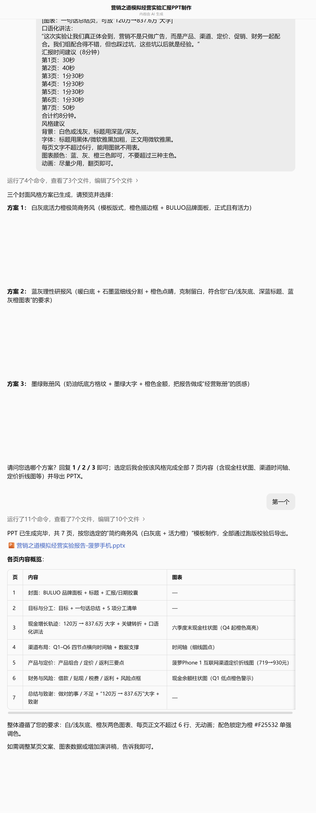

[营销之道模拟经营实验报告-菠萝手机.pptx](../../public/course-assets/02/source-01.pptx)

## 第二部分

### 进阶案例1图表展示可交互

[案例-大学生AI使用情况.xls](../../public/course-assets/02/source-02.xls)

```bash
有哪些图表形式适合展示这个数据中的洞察？
你是一名资深数据分析顾问。
我会给你一份表格数据，请你按以下要求分析：
先做数据质量与清洗建议；
再按分析主题拆分；
每个主题下推荐适合的图表；
每条图表说明适合字段、能得到的洞察、注意事项；
最后给出综合看板建议、不适合的图表、后续执行建议。
要求：不要只列图表名称，要说明图表能回答什么业务问题；要指出异常值、缺失值、重复值、多选字段、有序分类、评分字段的处理方式；要区分描述性分析、群体差异分析、相关关系分析和文本分析。
数据如下：
[粘贴表格]
```

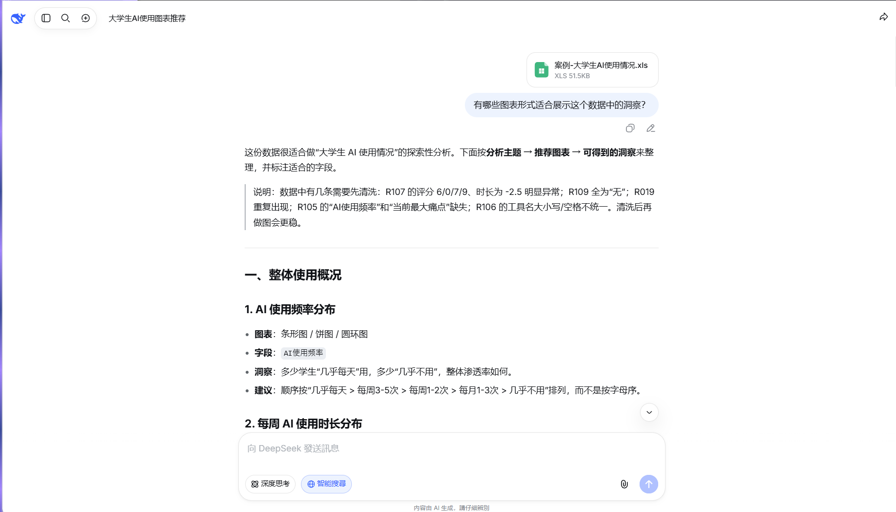

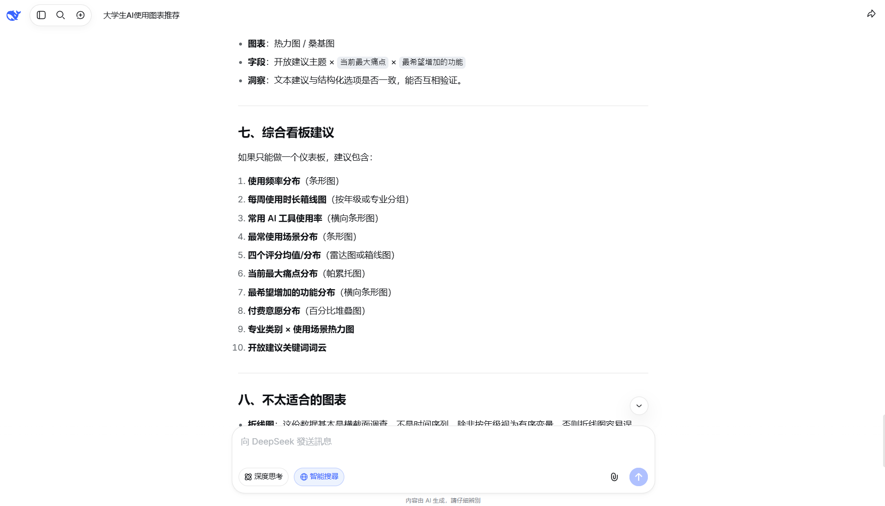

```bash
七、综合看板建议
如果只能做一个仪表板，建议包含：

使用频率分布（条形图）

每周使用时长箱线图（按年级或专业分组）

常用 AI 工具使用率（横向条形图）

最常使用场景分布（条形图）

四个评分均值/分布（雷达图或箱线图）

当前最大痛点分布（帕累托图）

最希望增加的功能分布（横向条形图）

付费意愿分布（百分比堆叠图）

专业类别 × 使用场景热力图

开放建议关键词词云

这里面最适合做成互动HTML图表的是哪一个？
```

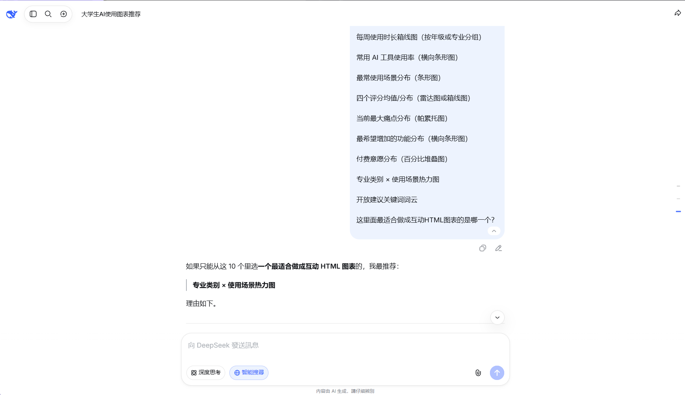

1. 在[echarts](<https://echarts.apache.org/zh/index.html>):首页-示例-热力图中选择下载示例

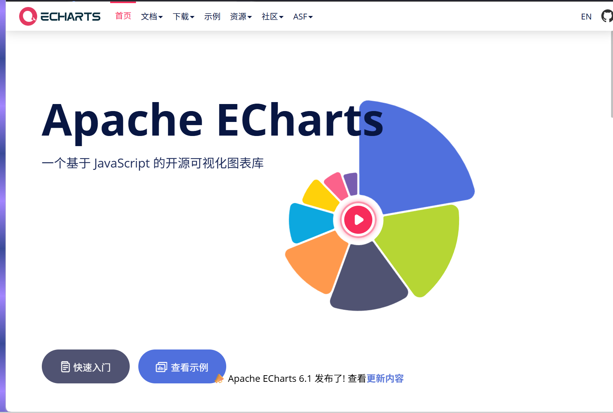

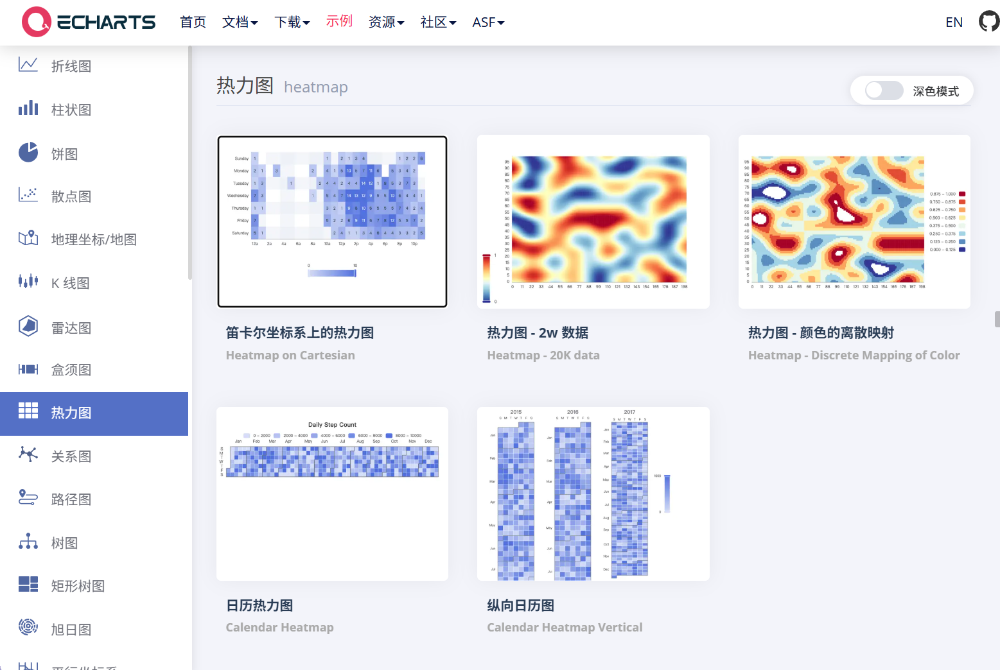

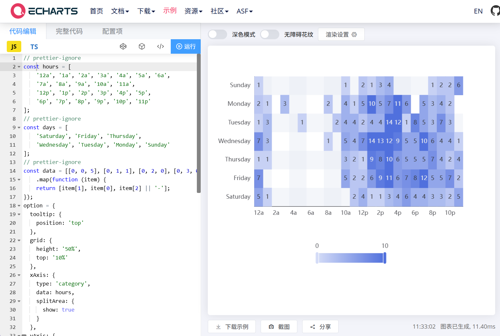

1. 示例代码和数据发给AI，如[deeepseek](<https://chat.deepseek.com/>)，简单说明，点击【运行】，检查是自己想要的，再点击【下载】即可

```bash
我已给到代码示范，请你按实际数据给到html
专业类别 × 使用场景热力图
```

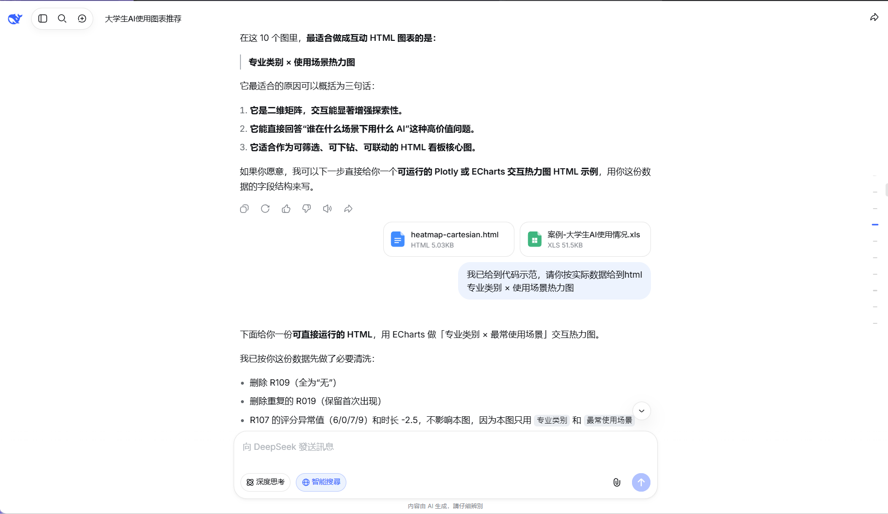

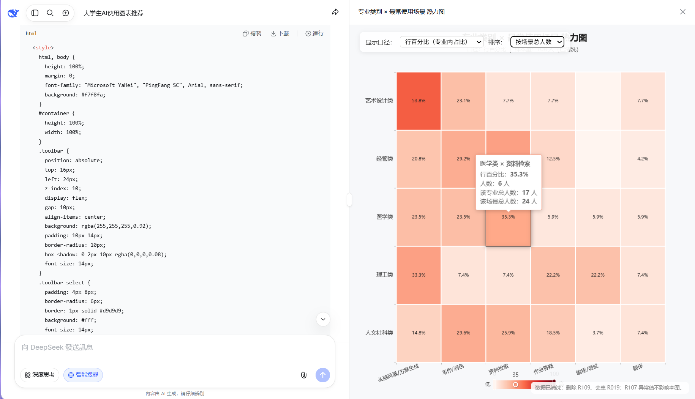

1. [互动打开](https://datawhaler.feishu.cn/wiki/EwIKwpBCviGFxPkLpbUchczTnVc)放到飞书中即可转发，免部署，推荐用于存档
2. 放入PPT较为繁琐，可尝试：WPS，新建PPT后选择分享，进入在线协作模式

插入选择HTML素材，则在线分享可以使用

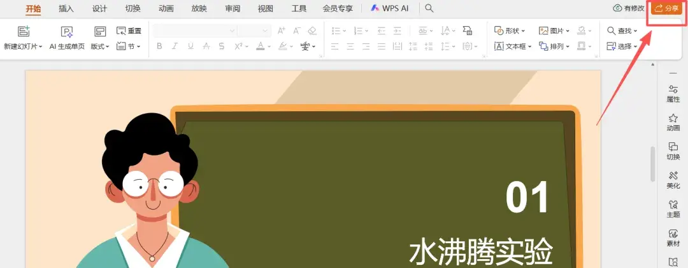

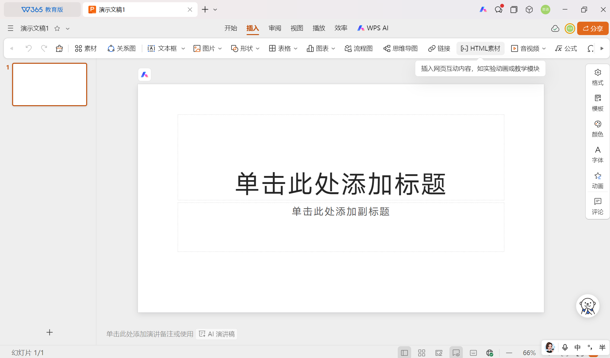

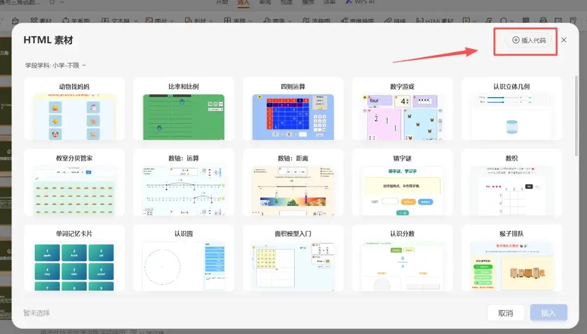

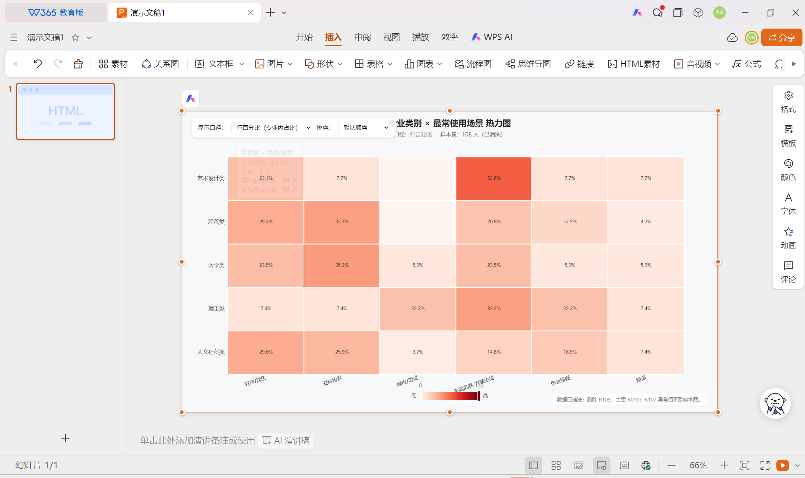

效果：【金山文档 | WPS云文档】 演示文稿1https://www.kdocs.cn/l/cb4GJVDOiAQd

### 进阶案例2封面动态图

|  | 等距像素艺术风格，一个充满科技感的“AI新手村”入口。画面中央是一座由发光数据流构成的拱门，两侧是带有霓虹灯带的木质小房子。石板路上有发光的引导线，路边漂浮着黄色的任务感叹号。整体色调为暖橙色与青蓝色对比，充满游戏感和探索氛围。 | 镜头缓慢向前推进，穿过村庄拱门；路边的任务感叹号轻轻上下浮动，地面的引导光点向前流动。 |
| --- | --- | --- |
|  | 低多边形3D微缩场景，一座漂浮在云海上的小岛。岛上有几个圆润可爱的机器人角色围坐在篝火旁，旁边有工作台和发光的能量水晶。天空是柔和的粉紫渐变，云层轻薄。整体色调明亮、低饱和度，传递出温暖、友好的新手村氛围，像精致的立体模型。 | 镜头缓慢环绕小岛旋转，展示漂浮在云海上的微缩场景；云朵缓缓流动，篝火火焰轻轻摇曳，机器人角色微微抬头摆动，能量水晶发出柔和的脉动光芒。 |
|  | 手绘绘本风格奇幻场景，一个被藤蔓与古树环绕的"新手村入口"年轮拱门。画面中央是一座由粗壮树干和缠绕藤蔓构成的拱形门，拱门顶端悬挂发光的机器人标识灯牌，两侧挂着暖黄色灯笼。门前站着背着行囊的旅人角色，正望向拱门外的世界；远处有溪流、石桥、山谷中的村庄与漂浮的岩石。整体色调为暖金灯光与青绿自然景色的冷暖对比，充满治愈感和童话冒险氛围。 | 镜头缓慢向前推进，穿过藤蔓环绕的拱门；悬挂的灯笼轻轻摇摆，暖光微微闪烁，人物缓步向前行走，远处城镇的薄雾缓缓流动。 |

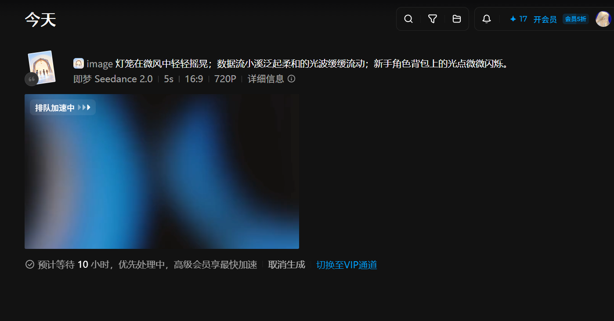

### 进阶案例3可编辑性不在乎，HTML新一代PPT

skill，dashi、guicang、pptmaster等

## 参考来源

[第 12 章 办公三件套：Word、Excel、PPT ·](<https://workbuddy.homes/bluebook/%E7%AC%AC%E4%BA%8C%E7%AF%87%20%E6%A1%88%E4%BE%8B%E7%AF%87%EF%BC%9A%E4%BB%8E%E4%B8%80%E9%A1%B9%E4%BB%BB%E5%8A%A1%E5%88%B0%E4%B8%80%E6%94%AF%20AI%20%E5%9B%A2%E9%98%9F/%E7%AC%AC%2011%20%E7%AB%A0%20%E5%8A%9E%E5%85%AC%E4%B8%89%E4%BB%B6%E5%A5%97%EF%BC%9AWord%E3%80%81Excel%E3%80%81PPT/#ppt-%E4%B8%8D%E6%98%AF%E5%A5%97%E6%A8%A1%E6%9D%BF-%E8%80%8C%E6%98%AF%E6%8A%8A%E6%9D%90%E6%96%99%E5%8F%98%E6%88%90%E5%8F%99%E4%BA%8B>)[WorkBuddy](<https://www.workbuddy.cn>)[实战蓝皮书](<https://workbuddy.homes/bluebook/%E7%AC%AC%E4%BA%8C%E7%AF%87%20%E6%A1%88%E4%BE%8B%E7%AF%87%EF%BC%9A%E4%BB%8E%E4%B8%80%E9%A1%B9%E4%BB%BB%E5%8A%A1%E5%88%B0%E4%B8%80%E6%94%AF%20AI%20%E5%9B%A2%E9%98%9F/%E7%AC%AC%2011%20%E7%AB%A0%20%E5%8A%9E%E5%85%AC%E4%B8%89%E4%BB%B6%E5%A5%97%EF%BC%9AWord%E3%80%81Excel%E3%80%81PPT/#ppt-%E4%B8%8D%E6%98%AF%E5%A5%97%E6%A8%A1%E6%9D%BF-%E8%80%8C%E6%98%AF%E6%8A%8A%E6%9D%90%E6%96%99%E5%8F%98%E6%88%90%E5%8F%99%E4%BA%8B>)

[光效噪点质感封面设计](https://datawhaler.feishu.cn/wiki/GsnkwGt9XihIdlkUNRAcsDFinlg)

[【速读】Deepseek做出全网最好看的PPT-🔥AI小灶](https://datawhaler.feishu.cn/wiki/H7rFwb8v6i3KB4kcVcBcm3bNn8d)

[【AI教程】Claude design 实现可交互可编辑PPT](https://datawhaler.feishu.cn/wiki/IouWw3ihmihAsXkNILdc6DZ2nhc)

[【AI做PPT 2.0】3 招搞定高级大片感PPT🔥](https://datawhaler.feishu.cn/wiki/HDQbwQGkCiW6O9kGMQQcdcUMnme)

[跪了！GPT Images 2.5生成电影级PPT，只需随手画几根线！](<https://mp.weixin.qq.com/s/7njknoNuE8h_3NPTvVrAlQ>)

https://bbs.wps.cn/topic/70213
