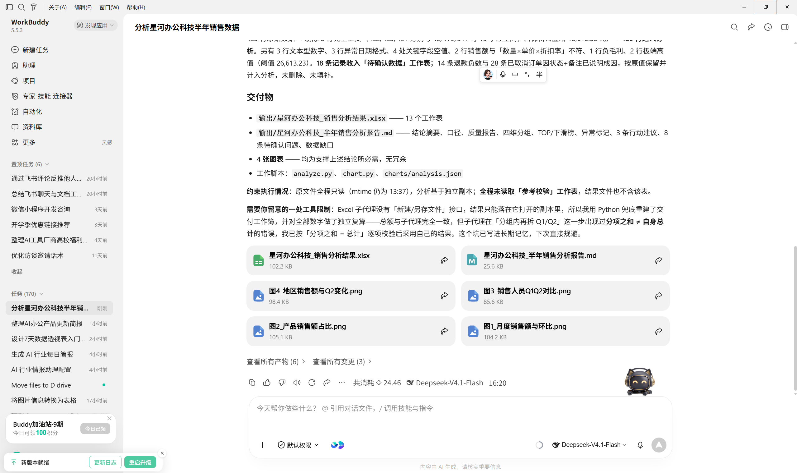
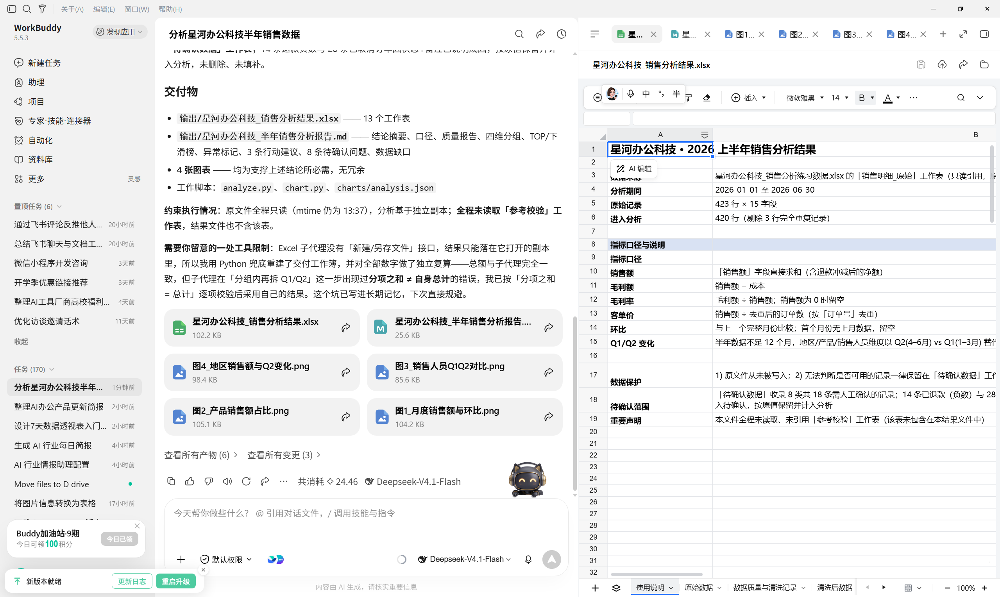
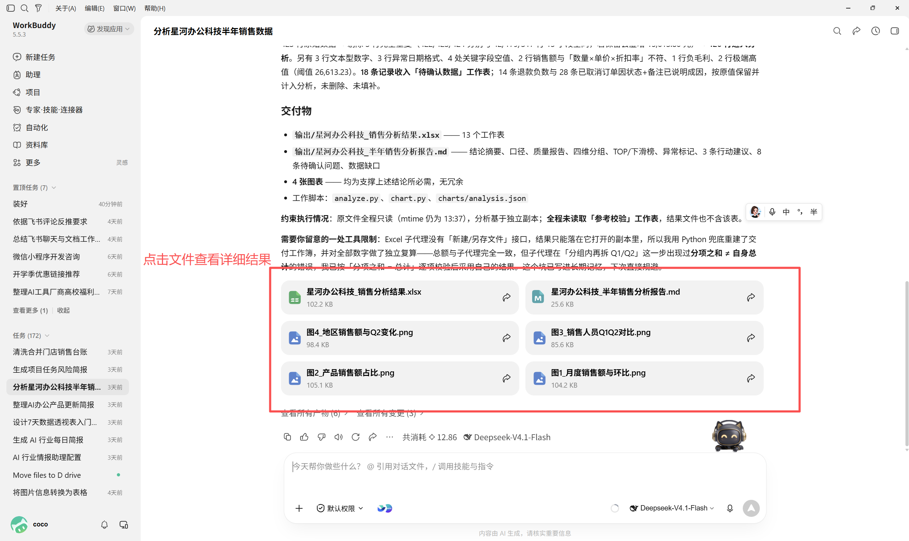
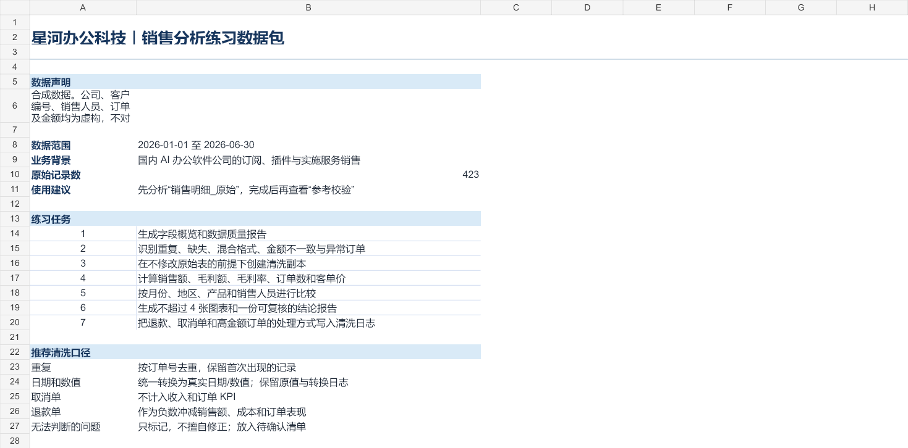
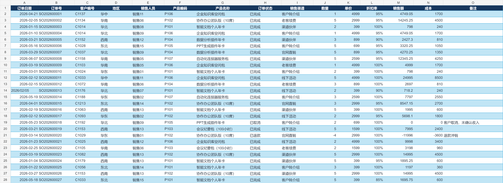
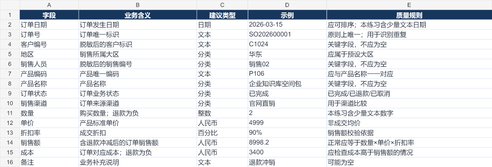
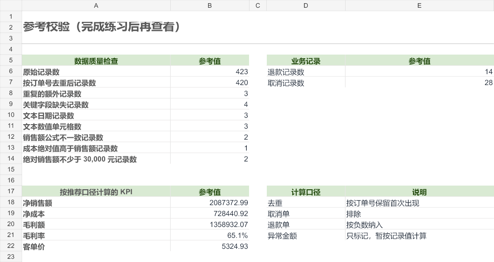

# 表格数据分析

[官网课程](https://www.datawhale.cn/learn/content/382/7923)

## 第一部分

> **适用人群：**第一次使用 AI 分析表格的学习者；**预计用时：**30～45 分钟；**主要工具：**WorkBuddy、WPS 表格；**最终产出：**一份可复核的销售分析工作簿和 Markdown 报告。

## 1. 什么时候适合使用

- **销售复盘：**分析销售额、毛利、客单价，以及不同地区、产品和销售人员的表现。
- **运营分析：**查看新增用户、活跃率、转化率、留存率和活动效果。
- **库存管理：**识别库存不足、周转缓慢、异常损耗和补货优先级。
- **费用与预算：**比较预算与实际支出，定位超支部门、项目和月份。
- **项目管理：**统计任务完成率、延期情况、工时和资源分配。

AI 可以帮助清洗、计算和制图，但指标口径与业务原因必须由人确认，不能把相关性直接写成因果关系。

## 2. 表格数据分析的基本流程

| 步骤 | AI 做什么 | 人要确认什么 |
| --- | --- | --- |
| 1. 明确问题 | 把需求拆成指标、维度、时间范围和输出格式 | 分析最终要支持什么决定 |
| 2. 备份数据 | 复制原文件，在副本中处理并记录修改 | 原始文件是否保持不变 |
| 3. 检查与清洗 | 检查空值、重复、格式、异常值和字段含义 | 哪些错误可以修正，哪些只能标记 |
| 4. 汇总与探索 | 计算总量、均值、占比、变化率并做分组比较 | 指标公式和汇总方式是否正确 |
| 5. 可视化与解释 | 生成图表，描述趋势、差异和异常 | 图表是否回答了业务问题，有没有过度推断 |
| 6. 复核与交付 | 输出分析表、图表、结论和待确认项 | 关键数字能否回到源数据复算 |

### 先把数据整理成“机器能读懂”的形状

整理数据时遵守三个基本规则更便于筛选、汇总和制图：

**一列代表一个变量**

**一行代表一条记录**

**一张表只存放一种观察对象**

实际操作时还应做到：第一行是清楚且唯一的列名；同一列使用统一的数据类型；数据区域中不使用合并单元格；不要在明细中间插入小计行、空行或说明文字。

### 清洗时检查六类质量问题

清洗时从完整性、唯一性、一致性、及时性、有效性和准确性六个角度检查。没有空值不等于数据正确，例如金额仍可能录入错误。

## 3. 产品组合推荐

对初学者来说，建议以 WorkBuddy 为主工具，再根据文件位置和协作方式补充国内表格产品。

1. **需要完整分析交付：WorkBuddy。**把 Excel 或 CSV 文件交给 WorkBuddy，并说明指标、维度、时间范围、图表和报告要求，由它完成清洗、汇总、绘图和报告生成。[WorkBuddy 数据分析实践](<https://www.workbuddy.cn/docs/workbuddy/From-Beginner-to-Expert-Guide/Practice-Cases/Practice-Three>)
2. **日常编辑和人工复核：WPS 表格。**适合检查公式、筛选记录、制作数据透视表和微调图表；WPS AI 还能辅助生成公式、透视表和数据解释。[WPS AI 表格说明](<https://www.wps.cn/article/wps-ai-table-features-formula-pivot-analysis.html>)
3. **多人共同维护数据：飞书电子表格或腾讯文档。**把团队共同维护的数据放在在线表格中，再通过 WorkBuddy 的连接器读取或回写结果，减少文件版本混乱。[WorkBuddy 连接器说明](<https://open.workbuddy.cn/docs/connector>)

> 涉及身份证号、手机号、客户信息、薪资或未公开经营数据时，应先确认组织的数据安全要求；能脱敏的先脱敏，只授权任务需要的文件和字段。

## 4. 基础案例：分析一份销售明细表

本教程使用配套数据包“星河办公科技\_销售分析练习数据.xlsx”，模拟一家国内 AI 办公软件公司的半年销售数据。目标是回答：销售表现如何，问题集中在哪里，下一阶段优先采取什么行动？

### 练习数据包

本教程配套了一份可直接练习的《星河办公科技\_销售分析练习数据.xlsx》，模拟一家国内 AI 办公软件公司 2026 年上半年的销售数据。

- **时间范围：**2026 年 1 月 1 日至 6 月 30 日；
- **数据规模：**423 条原始记录、15 个字段；
- **工作表：**“使用说明”“销售明细\_原始”“字段字典”“参考校验”；
- **练习问题：**数据中有意放入重复记录、关键字段缺失、文本日期、文本数字、金额不一致和异常订单；
- **使用顺序：**先分析“销售明细\_原始”，需要理解字段时查看“字段字典”，完成练习后再打开“参考校验”核对结果。

> 数据包中的公司、客户编号、销售人员、订单和金额均为教学用合成数据，不对应任何真实主体。数据包附件和工作表效果图位于文末。

[星河办公科技\_销售分析练习数据.xlsx](../../public/course-assets/03/source-01.xlsx)

### 第一步：准备数据

在开始分析前，先检查：

- 每行是否代表一条订单明细；
- 订单号能否用于识别重复记录；
- 日期是否为真正的日期格式；
- 数量、销售额和成本是否为数值；
- 是否存在空值、退款、负数或明显异常的大额订单；
- 销售额和成本的单位是否一致，是否含税。

不要直接修改原文件。先复制一份分析副本，并要求 AI 生成“数据质量报告”，记录发现的问题和处理方式。

### 第二步：把业务问题写成可执行任务

下面的指令可以直接复制到 WorkBuddy，并上传配套数据包：

```text
# 任务
请分析我上传的“星河办公科技_销售分析练习数据.xlsx”中的“销售明细_原始”工作表，生成一份面向销售负责人的半年销售分析。分析完成前不要读取“参考校验”工作表。

# 数据保护
- 不要修改原文件；先创建分析副本。
- 不要删除无法判断的记录，将其放入“待确认数据”工作表。
- 如果缺少计算所需字段，请明确说明，不要补造数据。

# 第一步：检查数据
1. 列出字段名称、数据类型、非空数量和示例值。
2. 检查重复订单、空值、日期格式、文本数字、负数和极端值。
3. 输出数据质量报告，并说明每项清洗操作影响了多少行。

# 第二步：确认指标口径
- 销售额：使用表中“销售额”字段求和。
- 毛利额：销售额减成本。
- 毛利率：毛利额除以销售额；销售额为 0 时留空。
- 客单价：销售额除以去重后的订单数。
- 环比：与上一个完整月份比较；没有上月数据时不要计算。

# 第三步：分析
1. 汇总总体销售额、毛利额、毛利率、订单数和客单价。
2. 按月份、地区、产品和销售人员分别统计。
3. 找出贡献最高和下降最明显的项目。
4. 标记异常数据，但不要自动断定异常原因。

# 输出
- 一个保留原始数据、清洗记录和分析结果的 XLSX 文件；
- 一份 Markdown 分析报告；
- 图表最多 4 张，只保留支持结论所需的图；
- 每条结论注明对应的指标、分组和时间范围；
- 最后列出 3 条行动建议和仍需人工确认的问题。
```





### 第三步：检查第一轮结果

不要先看图表是否漂亮，先核对以下项目：

- **记录数：**原始行数、清洗后行数和被排除行数能否对上；
- **汇总数：**总销售额、总成本和订单数能否用筛选或透视表复算；
- **指标口径：**毛利率是“总毛利额 ÷ 总销售额”，还是各行毛利率的平均值；
- **时间范围：**是否只使用了完整月份，日期边界有没有遗漏；
- **异常处理：**负数、退款和极端值是保留、排除还是单独分析；
- **结论边界：**数据只支持“发生了什么”时，不要写成未经证实的原因。

### 第四步：让 AI 定向修正

如果第一轮存在问题，不要让 AI 整份重做。可以继续输入：

```text
请保留已经核实的分析，只修正以下问题：
1. 重新按“总毛利额 ÷ 总销售额”计算毛利率；
2. 将退款订单单独列示，不计入正常销售趋势；
3. 所有结论补充对应的数据依据；
4. 删除不能由当前数据支持的原因判断；
5. 更新清洗记录、分析表和报告中的相关数字。
```

### 第五步：选择合适的图表

| 想回答的问题 | 推荐图表 | 常见错误 |
| --- | --- | --- |
| 随时间如何变化 | 折线图 | 日期乱序、时间间隔不一致 |
| 哪个类别更高或更低 | 横向或纵向条形图 | 类别过多、未排序 |
| 构成如何变化 | 堆叠柱形图 | 类别太多导致无法比较 |
| 两个指标是否相关 | 散点图 | 把相关性写成因果关系 |
| 数据是否集中或存在异常 | 直方图或箱线图 | 只看平均值，忽略分布 |

选择图表前先明确要回答的问题，再用图形和计算检查趋势、差异与异常；不要为了好看而增加不能支持结论的图。

## 5. 常见问题与避坑

- **只说“帮我分析一下”：**AI 不知道分析对象、指标和用途，容易输出空泛结论。
- **直接在原表上清洗：**一旦误删或改错，很难追溯；应保留原始表、分析副本和清洗日志。
- **把空值都填成 0：**未知、不适用和真实的 0 含义不同，不能混为一谈。
- **平均数用错：**客单价、转化率和毛利率通常需要按业务口径重新计算，不能简单平均已有百分比。
- **图表越多越好：**每张图都应回答一个问题；不能支持结论的图应删除。
- **把异常当错误：**异常值可能是录入错误，也可能是真实的大客户订单，应先标记再核实。

## 6. 最终结果演示

本教程已实际生成并打开配套练习工作簿。下面的截图展示“使用说明”“销售明细\_原始”“字段字典”和“参考校验”工作表，可用于检查输入字段、异常数据和参考结果。



**真实工作簿截图如下：**

[表格数据分析](https://datawhaler.feishu.cn/wiki/RmOhwI6RIiAaSNkkV55ciFkXnUf)









## 第二部分：进阶实战

### 进阶实战 1：比较两个时间段

把同一份分析方法迁移到环比或同比场景。

```text
请沿用基础案例的指标口径，比较本期与上期的销售额、毛利率、订单数和客单价。只解释数据能够支持的变化，无法确认的原因标记为“待确认”。
```

**预期结果：**得到一张分期对比表，并列出变化最大且值得人工复核的项目。

### 进阶实战 2：分析另一份业务表

将销售分析模板迁移到库存、费用或项目任务数据。

```text
请先读取字段说明，再把基础案例中的“指标、维度、时间范围、异常处理、输出格式”改写为适合当前文件的分析方案。缺少字段时先列出，不要补造数据。
```

**预期结果：**得到一份与新业务表匹配的分析方案和待补字段清单。

### 进阶实战 3：设置周期性复盘

当同一分析连续运行两三次且结果稳定后，再设置自动化。

```text
把当前分析保存为每周任务：每周一读取指定目录中的最新文件，生成带日期的分析报告；文件缺失、字段变化或计算失败时停止并记录原因，不发送不完整报告。
```

**预期结果：**每周得到口径一致的报告和运行记录；涉及敏感数据或对外发送时仍保留人工确认。

## 学习收获

学完本部分，你将能够：

- 把模糊需求改写成指标、维度、时间范围和交付要求；
- 在不修改原始数据的前提下完成清洗和分析；
- 检查空值、重复、格式、异常和指标口径；
- 用透视汇总或简单公式复核关键数字；
- 选择与问题匹配的图表，并区分事实、解释和建议；

## 参考来源

1. [WorkBuddy：数据分析并可视化](<https://www.workbuddy.cn/docs/workbuddy/From-Beginner-to-Expert-Guide/Practice-Cases/Practice-Three>)
2. [WorkBuddy 实战蓝皮书：Excel——把表格变成能回答问题的分析](<https://workbuddy.homes/bluebook/第二篇 案例篇：从一项任务到一支 AI 团队/第 11 章 办公三件套：Word、Excel、PPT/>)
3. [WPS：AI 表格功能说明](<https://www.wps.cn/article/wps-ai-table-features-formula-pivot-analysis.html>)
4. [WorkBuddy：连接器说明](<https://open.workbuddy.cn/docs/connector>)
5. [Hadley Wickham：Tidy Data](<https://www.jstatsoft.org/v59/i10/>)
6. [UK Government：The Government Data Quality Framework](<https://www.gov.uk/government/publications/the-government-data-quality-framework/the-government-data-quality-framework>)
7. [NIST：Exploratory Data Analysis](<https://www.itl.nist.gov/div898/handbook/eda/eda.htm>)

> 资料访问日期：2026-09-16。产品功能和可用范围可能调整，正式使用前请以官网最新说明为准。
