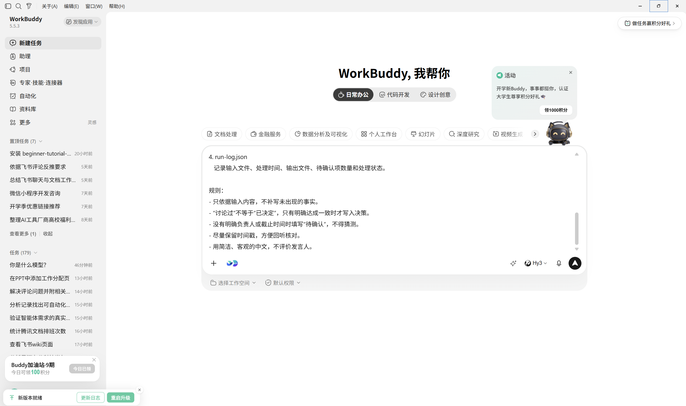
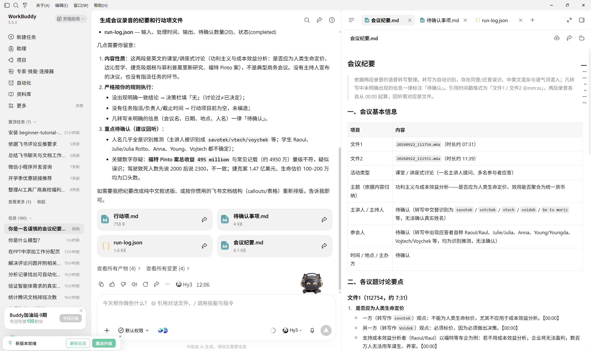
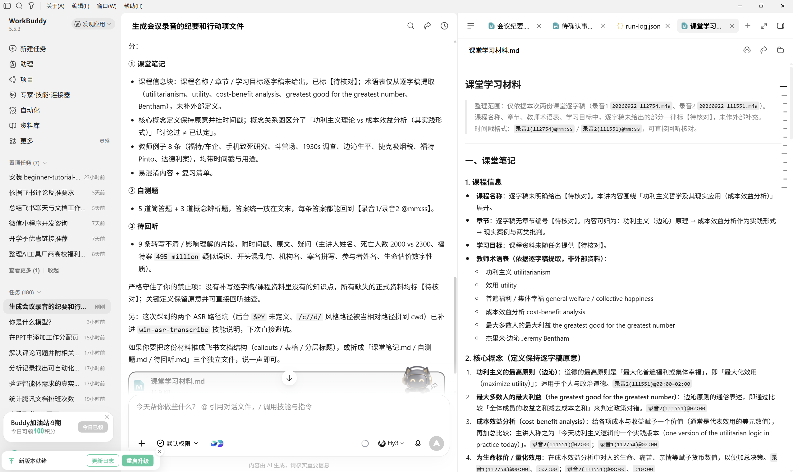

# 会议纪要自动化

[官网课程](https://www.datawhale.cn/learn/content/382/7925)

## 第一部分：会议纪要自动化入门

## 1. 什么时候适合使用

- **项目周会**：整理进展、风险、决策和下一步行动。
- **客户访谈**：提取需求、异议、承诺事项和待确认问题。
- **培训或宣讲**：沉淀重点内容、问答记录和后续任务。
- **线上会议**：利用会议平台已有的录音和转写结果快速生成纪要。
- **课堂录音**：把课程录音整理为课堂笔记、自测题和待回听片段。

> 使用前应获得录音和处理许可。涉及个人信息、商业秘密、未公开研究材料时，只使用组织批准的工具和存储位置。

## 2. 会议纪要自动化的 7 个基本环节

| 环节 | AI 或工具负责 | 人需要确认 |
| --- | --- | --- |
| 1. 准备输入 | 接收录音、视频或逐字稿 | 是否获得授权，文件是否完整 |
| 2. 语音转写 | 将录音转成带时间戳的文字 | 专有名词、数字和说话人是否正确 |
| 3. 清洗文本 | 删除口头重复，划分主题和段落 | 是否改变原意或漏掉关键信息 |
| 4. 提取信息 | 识别事实、结论、决策、风险和待确认项 | 哪些内容已经正式确认 |
| 5. 生成纪要 | 按固定模板生成纪要和行动项 | 负责人、截止时间是否真实明确 |
| 6. 审核归档 | 生成文件并放入指定目录 | 是否可以发送，权限是否合适 |
| 7. 自动运行 | 定时处理新文件并记录结果 | 异常时是否停止并提醒人工处理 |

## 3. 核心方法与规范

**先转写，后整理。**先用会议平台或语音工具生成带时间戳的逐字稿，再让 AI 提取信息。转写质量不稳定时，不要直接进入自动发布。

**区分讨论、结论和行动项。**“有人建议”不等于“已经决定”。只有原文明确达成一致的内容才能写入决策；任务必须有真实负责人和截止时间，否则标为“待确认”。

**保留可追溯依据。**重要数字、日期、专有名词、决定和行动项尽量附原文片段或时间戳，便于人工回听核对。

**自动化逐步上线。**同一流程先手动运行两三次；输入、输出和核验规则稳定后，再增加定时处理。自动发送、发布或删除前必须保留人工确认。

**先确认授权和隐私边界。**处理录音前取得必要许可；涉及个人信息、商业秘密或未公开材料时，只使用组织批准的工具和存储位置。

## 4. 产品组合推荐

初学者先根据会议发生的平台和数据所在位置选择一个主工具，避免为了凑组合反复上传文件。只有需要跨文件、多步骤处理或定时执行时，再补充一个自动化工具。

| 使用环境 | 主工具 | 何时增加补充工具 |
| --- | --- | --- |
| 团队主要使用飞书 | [飞书妙记](<https://www.feishu.cn/product/minutes>) | 需要跨文件整理、固定模板输出或定时处理时再补充 AI 执行工具 |
| 会议主要在腾讯会议进行 | [腾讯会议](<https://meeting.tencent.com/>) | 平台纪要不能满足自定义字段或归档要求时再补充 |
| 长录音、课程或访谈较多 | [通义听悟](<https://www.tingwu.cn/>) | 需要进一步生成特定格式的学习材料或访谈清单时再补充 |
| 会议内容敏感 | 组织批准的本地或受控转写方案 | 仅将允许处理且已脱敏的文本交给后续工具 |

## 5. 基础案例：自动整理一次项目周会

**案例目标：**把一份项目周会逐字稿整理成结构化纪要、行动项、待确认事项和运行日志。

- ` 会议纪要.md `
- ` 行动项.md `
- ` 待确认事项.md `
- ` run-log.json `

本案例不要求你准备复杂系统。一份 10～20 分钟的测试录音或已经转写好的文本就足够。

### 第一步：准备输入

先准备录音或逐字稿。如果使用 WorkBuddy，可以把允许处理的录音拖入聊天框；使用其他工具时，按其支持的输入格式上传。

[20260922\_111551.m4a](../../public/course-assets/04/source-01.m4a)

[20260922\_112754.m4a](../../public/course-assets/04/source-02.m4a)



### 第二步：使用提示词

把录音或逐字稿交给当前使用的工具，并复制下面的提示词。本案例截图以 WorkBuddy 为例，使用其他具备相应能力的工具也可以完成。

```text
你是一名谨慎的会议纪要助手。请读取录音，生成以下 4 个文件：

1. 会议纪要.md
   - 会议基本信息
   - 各议题的讨论要点
   - 已确认的结论或决策
   - 风险与阻塞项

2. 行动项.md
   使用表格，字段为：任务、负责人、截止时间、依据、状态。

3. 待确认事项.md
   收集无法从原文确认的人名、数字、负责人、截止时间和含义不清的表述，
   尽量附上原文片段或时间戳。

4. run-log.json
   记录输入文件、处理时间、输出文件、待确认项数量和处理状态。

规则：
- 只依据输入内容，不补写未出现的事实。
- “讨论过”不等于“已决定”，只有明确达成一致时才写入决策。
- 没有明确负责人或截止时间时填写“待确认”，不得猜测。
- 尽量保留时间戳，方便回听核对。
- 用简洁、客观的中文，不评价发言人。
```



### 第三步：检查结果

至少核对下面四类信息：

1. 决策是否真的在会议中确认；
2. 行动项是否包含真实的负责人和截止时间；
3. 数字、日期、产品名和否定表达是否准确；
4. 待确认内容是否保留了原文依据或时间戳。

### 第四步：定向修正

不要只说“重新整理”。指出错误位置和修改边界，例如：

```text
请只修改以下内容，其他部分保持不变：

发言者1姓名改为xxx
```

### 第五步：保存与复用

当同一模板连续成功运行 2～3 次后，可以建立固定任务：每周在约定时间读取 ` input ` 中的新逐字稿，生成结果到 ` output `，成功后写入日志；缺少文件、无法识别或待确认项过多时停止发送并提醒人工检查。

## 第二部分：进阶实战

### 进阶实战 1：把课堂录音整理成学习材料

练习把同一套“转写—提取—核验”方法迁移到课堂场景，输出笔记、自测题和待回听片段。

```text
# 任务
把课堂逐字稿整理为学习材料。

# 输入或处理范围
仅使用本次课堂逐字稿、课程名称、章节、教师术语表和学习目标。

# 处理规则
1. 提取核心概念、概念关系、教师例子、易混淆内容和复习清单。
2. 生成 5 道简答题和 3 道概念辨析题，参考答案统一放在文末。
3. 转写不清或可能影响理解的片段写入“待回听”，附时间戳、原文和疑问。

# 输出格式
输出“课堂笔记”“自测题”“待回听”三个部分。

# 核验要求
关键定义保持原意；抽查内容能够回到原文或时间戳。

# 禁止事项
不得补写逐字稿和课程资料中没有的知识点；不确定内容标为“待核对”。
```

**预期结果：**得到一份可复习的课堂笔记、8 道自测题，以及能够定位原文的待回听清单。



### 进阶实战 2：整理客户访谈

练习从访谈逐字稿中分离客户事实、需求、异议、承诺和待确认问题。

```text
# 任务
把客户访谈逐字稿整理为访谈纪要。

# 输入或处理范围
仅处理本次访谈逐字稿和用户提供的客户背景。

# 处理规则
分别提取客户现状、明确需求、原话证据、异议、双方承诺和待确认问题；相似需求合并，但保留不同语境。

# 输出格式
先输出 200 字以内摘要，再输出结构化表格，字段为“类别、内容、原文依据、负责人、下一步”。

# 核验要求
需求和承诺必须能定位到原文；没有负责人或下一步时写“待确认”。

# 禁止事项
不得把推测写成客户需求，不得虚构客户态度、预算或购买意向。
```

**预期结果：**得到一份可追溯的访谈纪要，所有需求和承诺都有原文依据或“待确认”标记。

**预期结果：**得到一份包含试运行、失败处理和人工确认点的周会自动化方案。

## 6. 学习收获

- 能够把录音或逐字稿整理成结构化纪要、行动项和待确认清单；
- 能够区分讨论、决策与任务，并用原文片段或时间戳复核关键信息；
- 能够根据会议平台、数据位置和隐私要求选择主工具，而不是默认绑定某个产品；
- 能够在手动流程稳定后设计包含日志、失败提醒和人工确认的自动化方案。

## 参考来源

1. [WorkBuddy 官方文档：文件处理与会议纪要实践](<https://www.workbuddy.cn/docs/workbuddy/From-Beginner-to-Expert-Guide/Practice-Cases/Practice-One>)
2. [WorkBuddy 蓝皮书：自动化任务](<https://workbuddy.homes/bluebook/第一篇 方法篇：从会用到用好 WorkBuddy/第 10 章 WorkBuddy 自动化任务/>)
3. [飞书妙记产品介绍](<https://www.feishu.cn/product/minutes>)
4. [腾讯会议帮助中心：录制与转写](<https://meeting.tencent.com/support/topic/1860/>)
5. [Association for Psychological Science：有效学习方法综述](<https://www.psychologicalscience.org/publications/journals/pspi/learning-techniques.html>)
6. [全国人大网：《中华人民共和国个人信息保护法》](<https://www.npc.gov.cn/npc/c2/c30834/202108/t20210820_313088.html>)
7. [通义听悟](<https://www.tingwu.cn/>)

资料访问日期：2026-09-22。产品功能和平台规则可能调整，请以官网最新说明为准。
