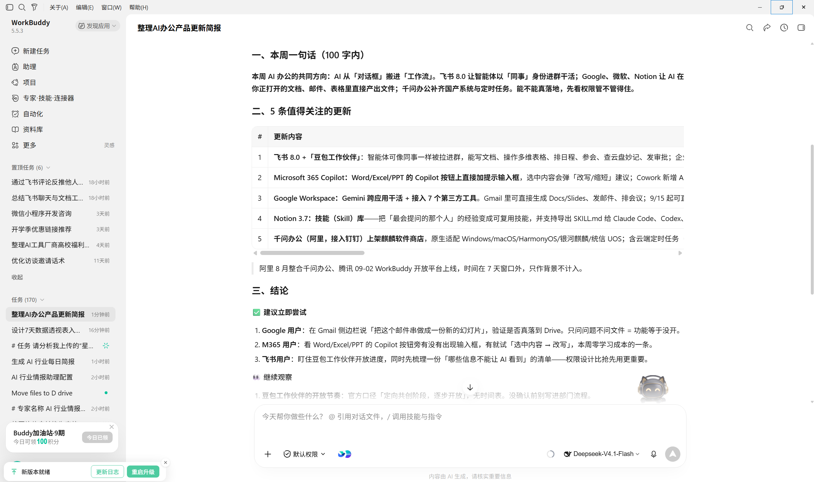
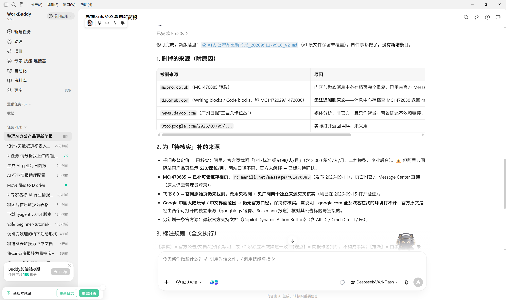
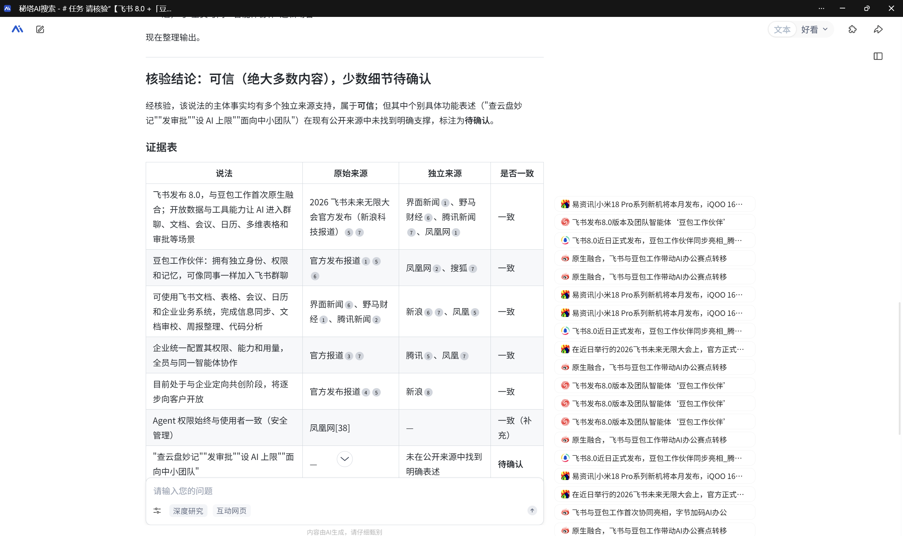
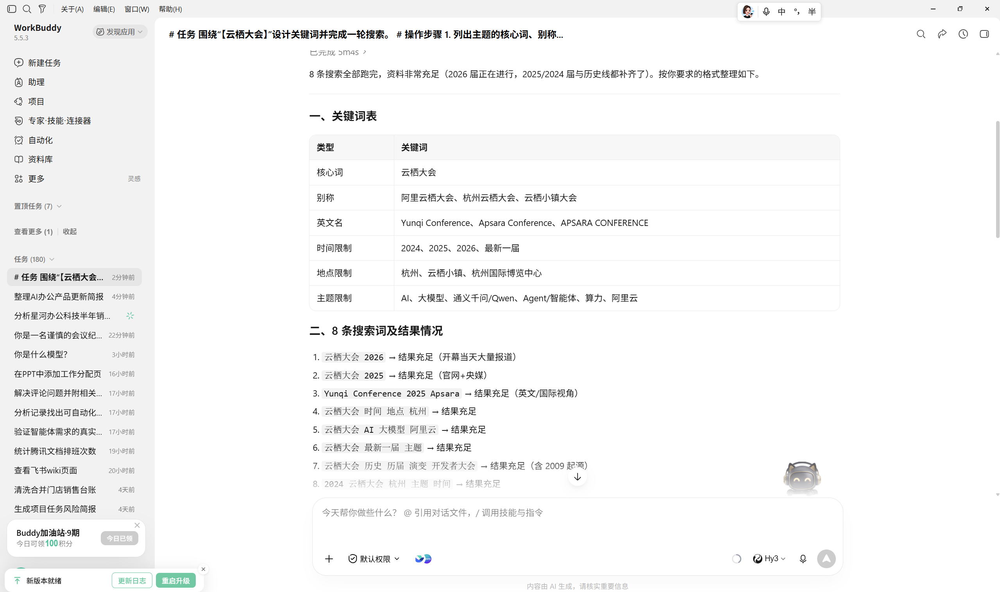

# 05 信息检索与整理

[官网课程](https://www.datawhale.cn/learn/content/382/7928) · [飞书源稿](https://datawhaler.feishu.cn/docx/ANOQdeGYroVmaQxy1CncAMg3n8g)

## 第一部分

## 1. 什么时候适合使用

- **行业动态追踪：**定期了解重要新闻、市场变化和新产品发布。
- **竞品监控：**比较竞品的功能、价格、客户案例和版本更新。
- **政策与合规检索：**查找政策原文、实施时间、适用范围和权威解读。
- **技术与学术调研：**跟踪论文、技术文档、开源项目和最佳实践。
- **内容选题与事实核查：**寻找热点、补充背景，并核对数字、引语和出处。

法律、医疗、投资等高风险信息，AI 只负责检索整理，关键结论需人工核对原始来源。

## 2. 信息检索与整理的基本环节

| 步骤 | AI 做什么 | 人要确认什么 |
| --- | --- | --- |
| 1. 明确问题 | 把主题拆成时间、范围、受众、必答问题和输出格式 | 明确信息收集的目标，约束和范围，这份材料最终要支持什么决定。 |
| 2. 收集信息 | 从官网、政府、论文、媒体等渠道寻找候选材料 | 是否遗漏关键来源或内部资料 |
| 3. 去重与筛选 | 合并重复报道，按相关性、时效性和可信度排序 | 筛选标准是否符合实际业务 |
| 4. 摘要与核查 | 提取结论、数据、日期和出处，并寻找交叉证据 | 关键数字能否在原文中找到，是否断章取义 |
| 5. 交付与归档 | 生成简报、表格或文档，保留链接和待核实项 | 结论是否可执行，来源是否可访问 |

### 一个简单的来源判断方法

可以使用 SIFT 四步核查法：

Stop（先停一下，不急着转发）；Investigate the Source（了解发布者及其可信度）；Find Better Coverage（寻找更可靠、相互独立的报道）；Trace Claims to the Original（把结论、引语或图片追溯到原始出处和完整语境）。

对初学者而言，可以先记住一条规则：**重要结论至少保留一个可打开的原始来源；有争议的结论再找一个独立来源交叉验证。**

### 3. 产品组合推荐

不要同时安装很多检索工具。对初学者，建议沿着“[WorkBuddy](<https://www.workbuddy.cn/>)执行任务 → [秘塔AI搜索](<https://metaso.cn/>)/[Perplexity](<https://www.perplexity.ai/>)补充核验 → [飞书文档](<https://docs.feishu.cn/docs>)交付归档 → [WorkBuddy](<https://www.workbuddy.cn/>)自动化”的路线练习。

资料较多时再增加[Zotero](<https://www.zotero.org/>)，用它管理题录、全文、标签和笔记；普通新闻简报不必安装。

## 4. 最基础案例：制作一份“本周 AI 办公产品更新”简报

本案例先做一次性简报，不急着配置自动通知。确认检索结果稳定后，再把同一任务改成每周自动执行。

### 第一步：创建并确认工作空间

WorkBuddy 需要一个真实存在的本地文件夹来读取和保存文件。开始前，请先在电脑上创建一个独立文件夹，例如 Windows 的“文档\\WorkBuddy\\AI办公周报”，或 macOS 的“文稿/WorkBuddy/AI办公周报”。

1. 在 WorkBuddy 电脑端主界面点击“新建任务”。
2. 将刚创建的文件夹选择为当前任务的工作空间；也可以让 WorkBuddy 自动创建任务目录。
3. 进入任务后，打开右侧“工作空间文件”，确认能够看到当前文件夹。
4. 点击“打开文件夹”，确认系统文件管理器可以正常打开它，再继续下一步。

不要把应用安装目录、桌面根目录或存放重要原件的文件夹直接设为练习工作空间。需要处理已有材料时，先把材料副本放进这个独立文件夹。

> **提示“工作目录找不到”怎么办：**不要继续运行检索指令。请新建一个任务，并重新选择刚创建的文件夹。升级或重启后原工作空间消失时，可在 Windows 的 C:\\Users\\你的用户名\\workbuddy，或 macOS 的 /Users/你的用户名/WorkBuddy 中查找历史任务文件夹，再重新打开。

### 第二步：把模糊需求写成可执行任务

下面的指令可以直接复制到 WorkBuddy。第一次运行时，建议把时间范围控制在 7 天、结果控制在 5 条，便于人工核对。

```text
# 任务
请检索并整理过去 7 天值得关注的 AI 办公产品更新，生成一份中文简报。

# 受众
读者是刚开始了解 AI 办公工具的普通职场人，请用通俗语言解释。

# 检索范围
- 关注文档、表格、PPT、会议纪要、知识库和办公智能体。
- 优先使用产品官网、官方博客、更新日志和开发者文档。
- 媒体报道和用户讨论只作补充，不能代替官方来源。

# 筛选规则
- 合并同一事件的重复报道。
- 最多保留 5 条真正影响功能、价格、使用门槛或工作流程的更新。
- 每条注明发布日期、来源机构和原文链接。
- 找不到原始来源时标为“待核实”，不要补写不存在的链接。

# 输出格式
1. 先用 100 字以内总结本周最重要的变化。
2. 用表格列出：更新内容、适合谁、可能带来的影响、发布日期、来源。
3. 最后列出“建议立即尝试”“继续观察”“待人工核实”三类结论。<br/><br/># 输出位置<br/>将结果保存为当前工作空间中的 ai-office-weekly.md，不要写入工作空间以外的路径。
```



### 第三步：检查第一轮结果

不要先看文字是否流畅，先逐项检查：

- 每条更新是否有可打开的链接；
- 链接是否指向原文，而不是搜索结果页或转载汇总；
- 标题、发布日期、产品名称和数字是否与原文一致；
- “事实”“媒体观点”和“AI 推断”是否被明确区分；
- 是否确实发生在指定的 7 天内。

### 第四步：让 AI 修正，而不是整篇重做

发现问题后，可以继续输入：

```text
请保留已经核实的条目，只修改以下问题：
1. 删除无法打开或无法追溯到原文的来源；
2. 为“待核实”条目寻找官方来源或第二个独立来源；
3. 将事实、观点和推断分开标注；
4. 不要增加新的条目。
```



### 第五步：保存可复用的成果

将最终结果保存为 Markdown，并至少保留以下字段：主题、检索日期、时间范围、检索规则、正文、来源和待核实项。后续再次执行时，只需替换日期范围，无须重写整套要求。

当单次任务连续运行两三次都能稳定产出，再设置为自动化任务，并为数据源失败、无结果和推送失败预先设置处理方式。

## 第二部分：进阶实战

适合已经完成一次基础检索，希望进一步提高可信度、稳定性和复用效率的读者。

### 进阶实战 1：为一条重要信息做多源核验

适合遇到“来源是否可信、多个页面说法不一致”的情况；重点不是增加搜索数量，而是把事实、观点和推断分开。

```text
# 任务
请核验“【填写需要核验的信息】”是否可靠。

# 检索要求
1. 先找原始来源，如官网公告、政策原文或论文。
2. 再找 1 个独立来源进行对照。
3. 检查双方的日期、数字和主要结论是否一致。

# 输出格式
- 核验结论：可信、存在争议或待确认。
- 证据表：说法、原始来源、独立来源、是否一致。
- 补充说明：列出冲突或缺失的信息。

# 注意
- 保留原文链接和发布日期。
- 不得编造来源；无法确认的内容标为“待确认”。
```

**预期结果：**得到一张能追溯到原文的证据表；读者可以看出哪些内容已经证实、哪些存在冲突，以及下一步需要人工确认什么。



![图片展示的是Workbuddy平台界面，任务标题为“整理AI办公产品更新问题”。任务要求检索飞书飞书飞书飞书飞书飞书飞书飞书飞书飞书飞书飞书飞书飞书飞书飞书飞书飞书飞书飞书飞书飞书飞书飞书飞书飞书飞书飞书飞书飞书飞书飞书飞书飞书飞书飞书飞书飞书飞书飞书飞书飞书飞书飞书飞书飞书飞书飞书飞书飞书飞书飞书飞书飞书飞书飞书飞书飞书飞书飞书飞书飞书飞书飞书飞书飞书飞书飞书飞书飞书飞书飞书飞书飞书飞书飞书飞书飞书飞书飞书飞书飞书飞书飞书飞书飞书飞书飞书飞书飞书飞书飞书飞书飞书飞书飞书飞书飞书飞书飞书飞书飞书飞书飞书飞书飞书飞书飞书飞书飞书飞书飞书飞书飞书飞书飞书飞书飞书飞书飞书飞书飞书飞书飞书飞书飞书飞书飞书飞书飞书飞书飞书飞书飞书飞书飞书飞书飞书飞书飞书飞书飞书飞书飞书飞书飞书飞书飞书飞书飞书飞书飞书飞书飞书飞书飞书飞书飞书飞书飞书飞书飞书飞书飞书飞书飞书飞书飞书飞书飞书飞书飞书飞书飞书飞书飞书飞书飞书飞书飞书飞书飞书飞书飞书飞书飞书飞书飞书飞书飞书飞书飞书飞书飞书飞书飞书飞书飞书飞书飞书飞书飞书飞书飞书飞书飞书飞书飞书飞书飞书飞书飞书飞书飞书飞书飞书飞书飞书飞书飞书飞书飞书飞书飞书飞书飞书飞书飞书飞书飞书飞书飞书飞书飞书飞书飞书飞书飞书飞书飞书飞书飞书飞书飞书飞](../../public/course-assets/05/img-04.png)

### 进阶实战 2：用关键词矩阵减少漏检

适合主题较宽、只搜一个词容易漏掉重要资料的情况；关键词矩阵是把同一问题拆成多组可组合的搜索词。

```text
# 任务
围绕“【填写检索主题】”设计关键词并完成一轮搜索。

# 操作步骤
1. 列出主题的核心词、别称、英文名和限制条件。
2. 组合成 5～8 条搜索词，并逐条搜索。
3. 记录有用资料的标题、日期和原文链接。
4. 结果太少就减少限制，结果太多就增加时间或地区限制。

# 输出格式
- 关键词表：类型、关键词。
- 资料清单：标题、来源、日期、链接。
- 未找到的内容：还缺什么资料。

# 注意
- 不得编造搜索结果或链接。
- “没有搜到”不代表“信息不存在”。
```

**预期结果：**得到一份可复查的关键词矩阵和检索记录，能看出搜索覆盖了哪些表达方式、还有哪些问题没有找到资料。



## 6. 学习收获

完成基础教程和进阶实战后，你将能够：

- 说清楚检索主题、时间范围、读者和使用目的；
- 用原始来源和独立来源核验重要信息，并标记证据冲突；
- 检查日期、出处、原始链接和事实口径；
- 设计关键词矩阵、组合检索式并记录检索路径，减少漏检；
- 区分“未检索到”“资料未提及”和“明确不存在”，如实标记不确定性。

## 参考来源

1. [WorkBuddy 实战蓝皮书：资讯整合](<https://workbuddy.homes/bluebook/第二篇 案例篇：从一项任务到一支 AI 团队/第 15 章 资讯整合：把信息流变成每日通知/>)
2. [WorkBuddy 产品介绍](<https://www.workbuddy.cn/docs/workbuddy/From-Beginner-to-Expert-Guide/Product-Guide>)
3. [WorkBuddy：技能说明与安全提示](<https://www.workbuddy.cn/docs/workbuddy/From-Beginner-to-Expert-Guide/Function-Description/Skills-Market>)
4. [WorkBuddy：自动化任务](<https://workbuddy.homes/bluebook/第一篇 使用手册：先把 WorkBuddy 用起来/第 10 章 WorkBuddy 自动化任务/>)
5. [WorkBuddy：连接器说明](<https://open.workbuddy.cn/docs/connector>)
6. [NoteExpress：产品说明](<https://www.inoteexpress.com/CompanyWeb/product.do>)
7. [HHMI BioInteractive：SIFT Method](<https://www.biointeractive.org/classroom-resources/evaluating-science-news-sift-method>)

### 公众号参考文章

1. 图寻AI：[WorkBuddy基础教程：核心功能详解](<https://mp.weixin.qq.com/s?__biz=MzY4NjA1MTY1Mw==&mid=2247483956&idx=1&sn=3c59768ab68d61f19b9e0da5fe2604c6>)
2. [一句话让AI替你打工：WorkBuddy 128个通用指令全解析](<https://mp.weixin.qq.com/s/0Sraq0ahIMz7zZlku2HhnQ>)
3. [别再让 AI 猜，给 WorkBuddy 一本操作手册](<https://mp.weixin.qq.com/s/b9Zbc98bZHKKCACVznJ8lg>)
4. [WorkBuddy + Academic-Research-Skills：保姆级图文教程](<https://mp.weixin.qq.com/s/uh66xy8BulhA01YLGNDtnA>)
5. ima：[我用“ima+WorkBuddy”AI工作流，十分钟做出了一个小程序](<https://mp.weixin.qq.com/s/KjYCYvJ0qj6RdXP06iwafg>)
6. [跨电脑跨 Codex/WorkBuddy 如何设置同一个定时任务](<https://mp.weixin.qq.com/s/rr37i_kYdLyMQK5ugu7fkQ>)
7. AI教员：[什么？WorkBuddy 可以直接操作电脑了？](<https://mp.weixin.qq.com/s/g7gw7msJQh85mugdKnsG7g>)
8. chooseAI：[公众号从 0 到发布，WorkBuddy 全包了！](<https://mp.weixin.qq.com/s/6v8nd6gE3ZZyq4mJ5R970w>)
