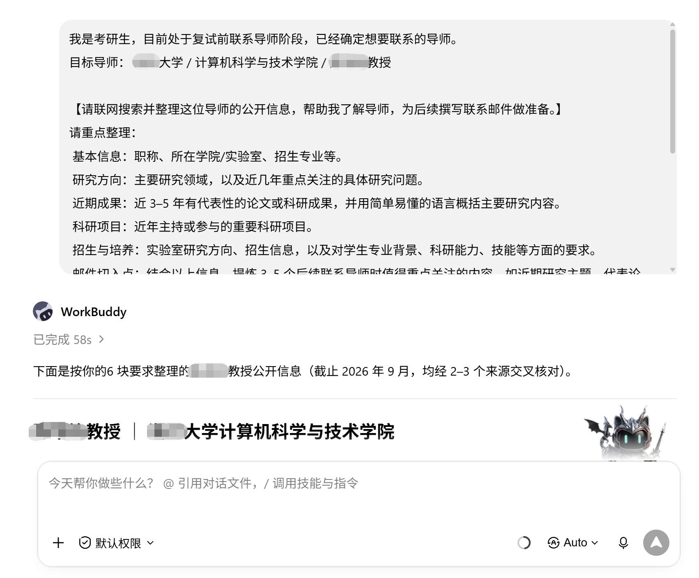
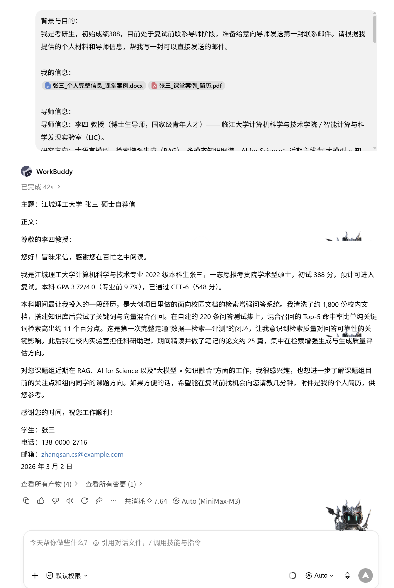
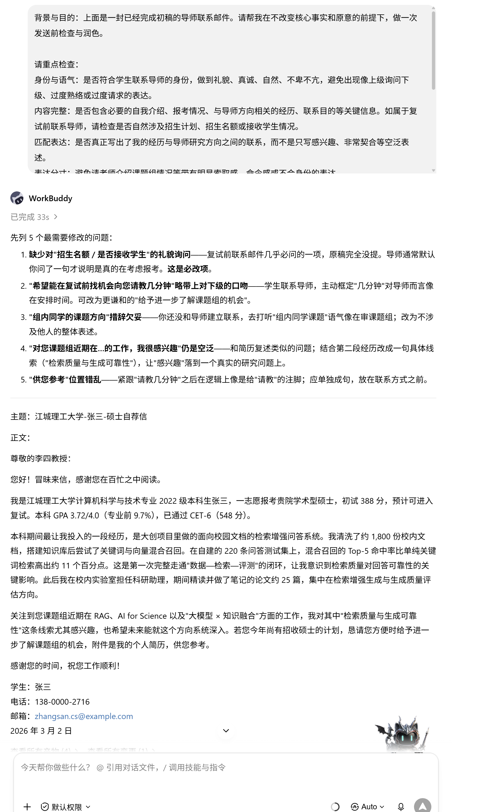
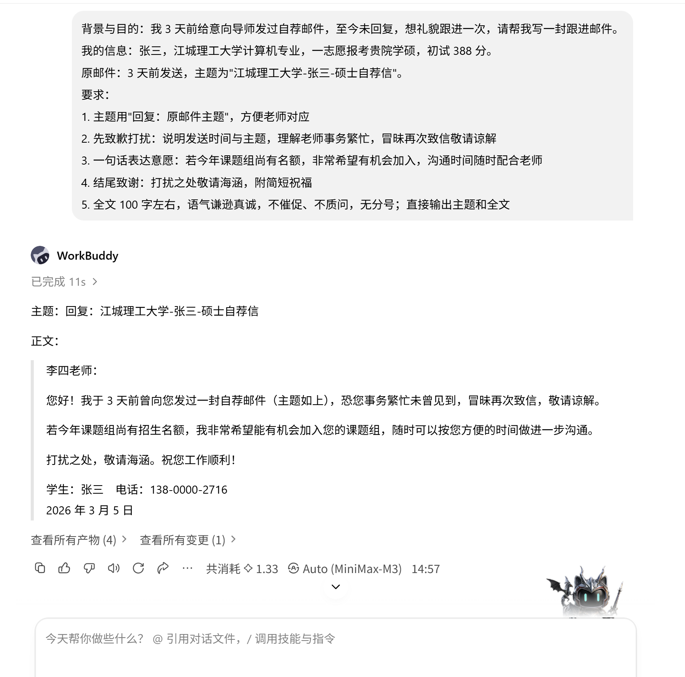

# 06 AI辅助撰写保研考研邮件

[官网课程](https://www.datawhale.cn/learn/content/382/7930) · [飞书源稿](https://datawhaler.feishu.cn/docx/W1K2dXwJVohuVoxjJk8cmRlenee)

> **让 AI 帮你写出主题清晰、内容对口、没有低级错误的联系导师邮件。**
> 
> 
> 
> **读完本教程并跟着课堂案例动手，你能独立、高效完成一封可以直接发送的自荐邮件。**

## **一、总览**

### **Part 1｜主要应用场景**

| **场景** | **典型时间点** | **核心诉求** |
| --- | --- | --- |
| 保研·夏令营联系 | 夏令营申请前 1–2 个月 | 提前与意向导师建立联系，争取入营与面试机会 |
| 保研·预推免联系 | 预推免开始前 2 周左右 | 确认导师招生名额，争取最终录取 |
| 考研·复试前联系 | 初试成绩公布后 | 让导师提前认识你，为复试加分 |
| 考研·调剂联系 | 调剂系统开放前后 | 短时间内向多位老师发送差异化邮件 |
| 考研·初试前咨询 | 备考中后期（8–11 月） | 了解课题组情况与招生名额，判断报考价值 |

### **Part 2｜AI 辅助的主要环节**

| **序号** | **环节** | **AI 做什么** | **人做什么** |
| --- | --- | --- | --- |
| 1 | 破冰信起草 | 按你的背景和目的，生成主题清晰、结构完整的第一稿 | 准备真实的个人信息、导师信息与邮件目的 |
| 2 | 个性化定制 | 结合导师研究方向，把“研究兴趣”写得具体、对口 | 提供导师论文、项目等真实信息 |
| 3 | 格式与雷区体检 | 按“避坑清单”检查主题、称呼、字数、错别字，输出修改清单 | 确认每条信息真实无误，决定是否采纳 |
| 4 | 多版本差异化 | 为不同导师分别生成定制版本，避免一封通投 | 核对信息不张冠李戴，选择发送对象 |
| 5 | 回复复盘与跟进 | 判断导师回复类型（肯定 / 迂回 / 拒绝），生成回应或跟进草稿 | 决定下一步：安心复试、礼貌跟进或换人联系 |

### **Part 3｜可以使用什么工具**

国内工具：

→ 写邮件：[豆包](<https://www.doubao.com>) / [DeepSeek](<https://www.deepseek.com>) / [Kimi](<https://kimi.moonshot.cn>) / [通义千问](<https://tongyi.aliyun.com>) / [腾讯元宝](<https://yuanbao.tencent.com>)等（任选其一即可）

→ 发邮件：学校 edu 学号邮箱，或 [163 邮箱](<https://mail.163.com>)等（自带“已读回执”，能知道导师是否已读）

→ 查导师：[秘塔 AI 搜索](<https://metaso.cn>) / 目标院校官网“师资队伍”栏目 / [中国知网](<https://www.cnki.net>)等

**推荐路线：**任一通用AI写邮件 + 163 / edu 邮箱发送 → 需要了解导师近况时配合秘塔 AI 搜索 → 简历附件需要润色时再回到 AI

## **二、动手实操：完成一封得体的自荐邮件**

案例主角张三是考研生（初试 388 分，复试前联系导师）。保研的同学只需替换邮件目的，流程完全一致。

### **第一步｜准备个人材料，搜集导师信息**

**参考以下要点，准备好必要的个人信息材料：   **

```text
【必要】基本信息：姓名、本科院校、专业、年级
【必要】考研情况：报考院校与专业、初试总分、各科成绩（如有必要）
【必要】学习情况：GPA / 均分、专业排名、核心课程及成绩
【可选】科研经历：大创、实验室经历、科研项目、论文、专利等；没有正式科研也可以写课程项目
【可选】项目 / 竞赛经历：项目名称、自己具体负责什么、用了什么方法、取得什么结果
【可选】实习 / 实践经历：与申请方向相关的实习、社团或实践经历
【可选】技能基础：编程语言、软件工具、实验技能、英语能力等
【可选】读研意向：感兴趣的研究方向，以及为什么对这个方向感兴趣
【可选】可补充材料：奖学金、荣誉、GitHub、作品集、成绩单等
```

**本案例：张三是考研生，初试 388 分，目前处于复试前联系导师**阶段。课堂练习时，直接使用提供的《张三个人信息》和《张三简历》即可。

**素材下载：**

[张三\_个人完整信息\_课堂案例.docx](../../public/course-assets/06/source-01.docx)

[张三\_课堂案例\_简历.pdf](../../public/course-assets/06/source-02.pdf)

**搜集导师信息：**

最基础的方法是查看**学校官网、学院官网和导师个人主页，**如果想进一步了解导师最近具体在研究什么，可以继续查看其**近几年的论文、科研项目和实验室主页**。

也可以使用 [秘塔 AI 搜索](<https://metaso.cn/>) / [Google Scholar](<https://scholar.google.com/>) / [中国知网](<https://www.cnki.net/>) / 学校官网 + AI 辅助完成。

```text
我是考研生，目前处于复试前联系导师阶段，已经确定想要联系的导师。
目标导师： XXX大学 / XXX学院 / XXX老师

【请联网搜索并整理这位导师的公开信息，帮助我了解导师，为后续撰写联系邮件做准备。】
请重点整理：
 基本信息：职称、所在学院/实验室、招生专业等。
 研究方向：主要研究领域，以及近几年重点关注的具体研究问题。
 近期成果：近 3–5 年有代表性的论文或科研成果，并用简单易懂的语言概括主要研究内容。
 科研项目：近年主持或参与的重要科研项目。
 招生与培养：实验室研究方向、招生信息，以及对学生专业背景、科研能力、技能等方面的要求。
 邮件切入点：结合以上信息，提炼 3–5 个后续联系导师时值得重点关注的内容，如近期研究主题、代表论文、科研项目等。

要求:
【真实准确】：优先参考学校/学院官网、导师个人主页、实验室主页、论文原文、Google Scholar 等可靠来源，重要信息附上来源链接。
【禁止编造】：不得虚构导师经历、论文、项目或招生信息；无法核实的内容标注为未检索到可靠信息，存在冲突的信息请明确指出。
【注意时效】：研究方向、论文和项目尽量以近 3–5 年为主；招生名额、招生要求等可能变化的信息标注为需进一步核实。
```

**效果与输出：**

基于隐私考虑，此处不展示真实导师完整信息



**输出的导师信息（模拟版）**

```text
导师信息：李四 教授（博士生导师，国家级青年人才）—— 临江大学计算机科学与技术学院 / 智能计算与科学发现实验室（LIC）。
研究方向：大语言模型、检索增强生成（RAG）、多模态知识图谱、AI for Science；近期主线为"大模型 × 知识融合"与"AI for Science"。
代表成果：2025 Nature Machine Intelligence（AgentLab，多智能体自主科研实验）；ICML 2024（MMGraph，多模态知识图谱医学推理）；ACL 2024 综述《Beyond Chain-of-Thought》；ICLR 2024 RAG-Synth。
在研重大项目：科技部"创新2030"新一代人工智能国家科技重大专项"面向科学发现的大模型智能体平台及应用"（首席科学家）。
```

### **第二步｜撰写邮件初稿**

**上传 个人经历 + 导师信息 +提示词**

**参考提示词：**

```markdown
背景与目的：
我是考研生，初始成绩XXX，目前处于复试前联系导师阶段，准备给意向导师发送第一封联系邮件。请根据我提供的个人材料和导师信息，帮我写一封可以直接发送的邮件。

我的信息：
粘贴个人信息文件或输入个人信息：学校/专业/年级/初试成绩/排名/英语情况/科研项目/竞赛或实习/技能基础/研究兴趣。

导师信息：
粘贴导师信息文件或输入导师信息：姓名/职称/学校与院系/研究方向/近期代表论文或科研项目/实验室情况。未知的信息写未知，不要自行补充。

邮件目的：
让导师快速了解我的基本情况、研究基础和报考意向，同时自然表达我希望进一步了解导师研究方向和课题组情况。

写作结构：
1、开头：简短问候 + 自我介绍 + 报考信息 + 初试成绩。
2、经历与方向：选择 1–2 项与导师方向最相关的经历，用自然语言说明自己做过什么、接触过什么问题。
3、导师衔接：在介绍个人经历后，自然过渡到导师的研究方向或近期成果，说明为什么这些内容引起了我的进一步关注。
4、联系目的：表达希望在研究生阶段继续深入相关方向，并礼貌询问老师是否方便进一步了解课题组或研究方向。
5、结尾：感谢老师阅读，说明已附个人简历，使用简洁礼貌的祝福语。
“经历与方向” 、 “导师衔接” 顺序可按需调整，自然流畅即可

语言要求：
1、自然衔接：不要使用生硬、模板化的衔接句。优先采用先讲自己的经历，再自然引出导师研究方向的写法。
2、具体不空泛：不要只表达对导师研究方向感兴趣，要结合真实项目经历、研究问题或导师的具体研究内容来说明。
3、语气克制：真诚、礼貌、自然，不卑不亢。避免带有直接索取感的表达。
4、联系方式柔和：可以表达希望进一步了解导师的研究方向和课题组情况，或希望在复试前有机会进一步请教。
5、句式简洁：尽量使用自然的中文短句和中等长度句子，全文不要使用分号。
6、避免套话：少用拜读、久仰、受益匪浅、深感荣幸、十分契合等容易显得夸张或模板化的词。
7、真实准确：不得编造或夸大个人科研成果，也不要假装读过没有明确说明已阅读的论文。
8、避免复述简历：个人材料只用于筛选信息，正文优先保留最相关的 1–2 项经历。

篇幅要求：
正文控制在 300–450 字 左右，重点清楚，方便导师快速阅读。
邮件主题：
采用 学校-姓名-硕士自荐信 的格式。
【直接输出】：邮件主题 + 邮件正文，不需要解释写作思路。
```

**演示及效果图：**



## **三、进阶**

### 技巧 1｜检查与润色邮件初稿

```text
背景与目的：下面是一封已经完成初稿的导师联系邮件。请帮我在不改变核心事实和原意的前提下，做一次发送前检查与润色。

请重点检查：
身份与语气：是否符合学生联系导师的身份，做到礼貌、真诚、自然、不卑不亢，避免出现像上级询问下级、过度熟络或过度请求的表达。
内容完整：是否包含必要的自我介绍、报考情况、与导师方向相关的经历、联系目的等关键信息。如属于复试前联系导师，请检查是否自然涉及招生计划、招生名额或接收学生情况。
匹配表达：是否真正写出了我的经历与导师研究方向之间的联系，而不是只写感兴趣、非常契合等空泛表述。
表达分寸：避免请老师介绍课题组情况等带有明显索取感、命令感或不合身份的表达。
语言自然：删掉生硬、模板化、AI 腔明显的句子，减少套话和重复，使表达更像真实学生写的邮件。
真实准确：不要新增、夸大或编造我没有提供的经历、成果、论文阅读情况和导师信息。
篇幅与格式：保持简洁，方便导师快速阅读。全文不要使用分号。

【修改原则】：尽量保留原邮件中自然、有效的内容，只修改确实需要调整的地方，不要为了润色而大幅重写。

【输出要求】：
先列出 3–5 个最需要修改的问题，并说明原因。
再给出一版润色后的完整邮件。
```

**演示图：**



### **技巧 2｜3 天没回复？生成一封礼貌跟进邮件**

**提示词：**

```text
背景与目的：我 3 天前给意向导师发过自荐邮件，至今未回复，想礼貌跟进一次，请帮我写一封跟进邮件。
我的信息：张三，XX大学计算机专业，一志愿报考贵院学硕，初试XXX分。
原邮件：3 天前发送，主题为"江城理工大学-张三-硕士自荐信"。
要求：
1. 主题用"回复：原邮件主题"，方便老师对应
2. 先致歉打扰：说明发送时间与主题，理解老师事务繁忙，冒昧再次致信敬请谅解
3. 一句话表达意愿：若今年课题组尚有名额，非常希望有机会加入，沟通时间随时配合老师
4. 结尾致谢：打扰之处敬请海涵，附简短祝福
5. 全文 100 字左右，语气谦逊真诚，不催促、不质问，无分号；直接输出主题和全文
6. 规范邮件格式
```

**演示及效果图：**



## **参考资料**

1. [速取！多套各阶段联系导师邮件模板](<https://mp.weixin.qq.com/s/BHOWPXlyJQi-lYYPidX30w>) —— WeLearn考研

2. [谁还不会联系导师发邮件？（附邮件模板）](<https://mp.weixin.qq.com/s/pPE7tknKnekMmdASA8fIzw>) —— 章鱼烧

3. [真心建议大家这样联系导师！（附邮件模板）](<https://mp.weixin.qq.com/s/KCvLmlAQh766unt-vIdzFw>) —— 考研满分苗子

4. [联系导师邮件咋写？手把手带写（复试第一上岸版）](<https://mp.weixin.qq.com/s/_uOYVlAxdavXrTDrtCFRPw>) —— 鸟山学长

5. [当导师选择已读不回，没有一个保研人是无辜的……](<https://mp.weixin.qq.com/s/Ejr0-Rz4VFQnj6JByB4l8Q>) —— 保研人

6. [保研联系导师邮件模板（五类情景适用）附发送时机与避坑指南](<https://www.gaodun.com/baoyan/1747748.html>) —— 高顿教育

7. [保研联系导师邮件怎么发？不踩雷话术](<https://www.gaodun.com/baoyan/1757704.html>) —— 高顿教育

8. [如何联系保研意向导师？邮件模板与注意事项](<https://www.houbaoyan.cn/m/articles/baoyan-contact-advisor>) —— 后保研
