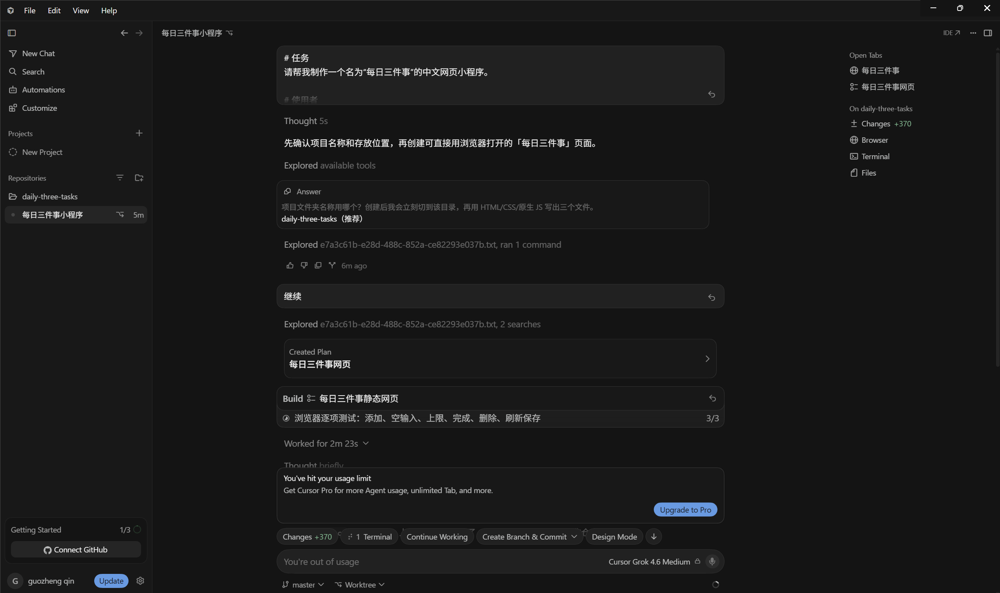
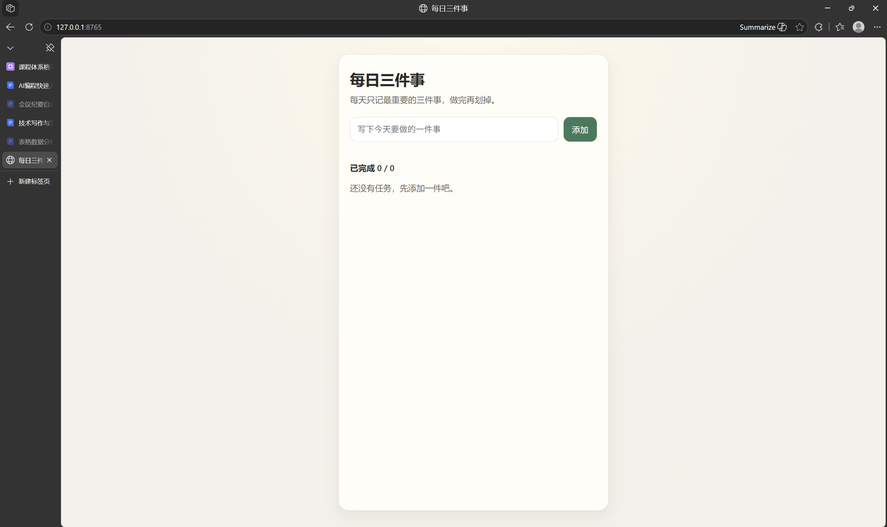
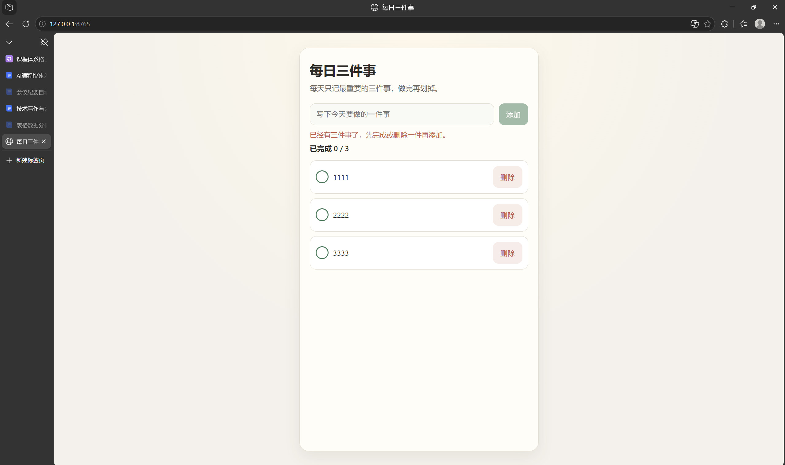

# AI编程快速入门

[官网课程](https://www.datawhale.cn/learn/content/382/7931)

> 目标：用 Cursor 或 Bolt 制作“每日三件事”网页，支持添加、完成、删除和浏览器本地保存。预计用时 20～40 分钟，两个工具任选其一。

## 第一部分：AI 编程基础教程

## 1. 什么情况下适合用 AI 编程

- **个人小工具**：待办清单、倒计时、记账页、学习打卡页。
- **简单网页**：个人主页、活动介绍页、作品展示页。
- **想法验证或小项目修改**：先做出可点击版本，再决定是否继续投入。

初学阶段不要处理支付、真实账号、企业数据、医疗、金融或复杂权限；先做不需要数据库、不收集个人信息的小应用。

## 2. 从想法到可运行程序的基本环节

| 步骤 | 你要完成的环节 | AI 可以帮你做什么 | 你需要确认什么 |
| --- | --- | --- | --- |
| 1 | 确定任务 | 把想法拆成具体功能 | 第一版是否足够小 |
| 2 | 写清需求 | 生成开发指令 | 功能和限制是否明确 |
| 3 | 生成并运行 | 创建文件并打开预览 | 页面能否正常显示 |
| 4 | 测试与修改 | 定位并修复问题 | 每项功能是否有效 |
| 5 | 保存或发布 | 整理文件、发布网页 | 内容和公开范围是否安全 |

## 3. 初学者最重要的方法：先做一个最小可运行版本

先做“最小可运行版本”：只保留核心功能，但必须能打开、能点击、能保存。不要在第一版同时加入登录、数据库、支付和消息提醒。\[来源 1\]\[来源 4\]

本案例只使用三种基础网页文件：

- ` index.html `：决定页面上有什么；
- ` style.css `：决定页面看起来怎么样；
- ` script.js `：决定按钮点击后发生什么。

## 4. 产品组合推荐：Cursor 和 Bolt 应该怎么选

| 工具 | 更适合谁 | 这次会怎样使用 | 使用前需要知道 |
| --- | --- | --- | --- |
| Cursor | 希望把程序保存在自己电脑上，并逐渐学习文件和代码的人 | 在本地文件夹中生成三个网页文件，再用浏览器打开 | 需要下载安装桌面应用并登录 |
| Bolt | 不想安装开发工具，希望直接在浏览器中看到结果的人 | 在网页对话框中输入需求，在 Preview 中测试 | 需要登录；生成和修改会消耗套餐额度 |

两个工具任选其一，下面的需求和检查清单通用。

## 5. 基础案例：制作“每日三件事”

### 第一步：准备输入

支持添加、完成、删除、三条上限和刷新保存，并适配电脑与手机。不做登录、云同步、消息提醒和数据库。

### 第二步：使用提示词

将下面的指令粘贴到 Cursor 或 Bolt：

```text
# 任务
请帮我制作一个名为“每日三件事”的中文网页小程序。

# 使用者
这是给第一次接触编程的人使用的个人任务清单，页面要简单、友好。

# 核心功能
1. 页面最多显示三条任务。
2. 用户可以输入文字并添加任务。
3. 点击任务或勾选按钮可以切换“已完成/未完成”。
4. 用户可以删除任务。
5. 页面显示“已完成数量/任务总数”。
6. 使用浏览器 localStorage 保存任务，刷新页面后内容不能消失。
7. 输入为空时给出明确提示；已经有三条任务时，不允许继续添加。

# 技术限制
- 只使用 HTML、CSS 和原生 JavaScript。
- 创建 index.html、style.css 和 script.js 三个文件。
- 不使用数据库、登录功能、后端服务和第三方框架。
- 不安装额外依赖。
- index.html 可以直接在浏览器中打开运行。

# 页面风格
- 使用清晰的中文标题和按钮。
- 页面在电脑和手机宽度下都能正常显示。
- 已完成任务使用删除线区分。

# 完成前检查
请实际运行程序，并依次测试：添加任务、空输入、三条上限、标记完成、删除任务和刷新后保存。
发现问题时请先修复，再告诉我生成了哪些文件，以及我应该如何打开程序。
```





### 第三步：执行并打开程序

#### 第一步：安装并打开 Cursor

从 [Cursor 下载页面](<https://cursor.com/downloads>)安装并登录。

#### 第二步：创建并打开项目文件夹

新建一个空文件夹：

```text
my-first-ai-app
```

在 Cursor 中选择“打开文件夹”，打开该文件夹。

#### 第三步：把任务交给 Agent

在 Windows 或 Linux 中按 ` Ctrl+I `，在 macOS 中按 ` Cmd+I `，打开 Agent 面板。\[来源 2\]

粘贴指令并发送。只批准与当前文件夹和网页预览有关的操作，生成后查看文件差异。Agent 可以修改工作区文件，不要向它开放敏感数据。\[来源 6\]

完成后应出现：

```text
my-first-ai-app/
├── index.html
├── style.css
└── script.js
```


#### 第四步：打开程序

双击 ` index.html `，用浏览器打开。

页面异常时输入：

```text
请检查 index.html 是否正确引用了 style.css 和 script.js。
不要更换技术方案，也不要安装框架。修复后告诉我应该重新打开哪个文件。
```

Cursor 的 Agent 也可以使用浏览器工具打开、点击和截图测试网页。\[来源 3\]


### 第四步：检查结果与定向修正

- 页面第一次打开时能看到示例任务；
- 输入一条任务后可以成功添加；
- 输入为空时会显示提示；
- 已有三条任务时不能继续添加；
- 点击任务后，完成数量会发生变化；
- 删除任务后，可以重新添加；
- 刷新页面后，刚才的任务和完成状态仍然存在；
- 缩小浏览器宽度后，文字和按钮没有重叠。

失败时按“操作—预期—实际”描述问题：

```text
我已经添加了三条任务。
预期：继续添加时显示“三条上限”的提示，并且列表仍然只有三条。
实际：第四条任务也被添加了。
请定位原因，只修复任务数量限制，并重新测试。
```

#### 补充：认识这三个文件

程序跑通后，输入：

```text
我是编程初学者。请用通俗中文带我认识这三个文件：
1. 每个文件分别负责什么；
2. 添加任务的代码在哪里；
3. 浏览器保存任务的代码在哪里；
4. 如果我要把“三条”改成“五条”，应该修改哪里。
先解释，不要直接修改文件。
```

### 真实功能检查结果

| 检查项目 | 实际结果 |
| --- | --- |
| 首次打开 | 正常显示3条示例任务 |
| 标记完成 | 完成数量从1变为2 |
| 删除后添加 | 列表保持3条，可以添加新任务 |
| 刷新页面 | 新任务和完成状态仍然存在 |



以上结果来自自动化浏览器实际操作。

### AI 与人工分别完成了什么

| 角色 | 本案例中的工作 |
| --- | --- |
| AI | 根据需求创建页面、样式和交互代码，并根据明确的问题修改程序 |
| 人 | 打开实际页面，逐项点击测试，核对刷新保存效果，并在发布前检查隐私与公开范围 |

生成结果可能不同，以实际运行和检查清单为准。

正式发布前，应补充一张 Cursor 或 Bolt 的实际操作截图。

### 第五步：保存与复用

保留项目文件、最终提示词和检查记录。后续增加功能时，每次只修改一个明确目标，并在修改后重新执行检查清单。

## 第二部分：进阶实战

### 进阶实战 1：增加“清除已完成任务”按钮

练习在现有项目中增加一个独立、可验证的小功能。

```text
# 任务
在现有“每日三件事”网页中增加“清除已完成任务”按钮。

# 处理规则
1. 只有存在已完成任务时按钮才可用；
2. 点击后只删除已完成任务；
3. 未完成任务必须保留；
4. 清除结果要同步保存到 localStorage。

# 输出与核验
说明修改了哪些文件，并实际测试“无已完成任务”“部分任务已完成”和“刷新页面”三种情况。

# 禁止事项
不要改变原有添加、完成、删除和三条上限逻辑。
```

**预期结果：**用户可以一次清除所有已完成任务，未完成任务和刷新后的数据保持正确。

### 进阶实战 2：发布前完成移动端检查

练习根据明确标准检查手机宽度下的页面，而不是只凭视觉判断。

```text
# 任务
检查“每日三件事”网页在 375px 宽度下的显示效果。

# 检查范围
标题、输入框、添加按钮、任务文字、完成状态、删除按钮和数量统计。

# 处理规则
1. 先列出发现的问题；
2. 只修复文字截断、按钮重叠、横向滚动和点击区域过小的问题；
3. 不改变桌面端功能和整体配色。

# 核验要求
修复后重新检查 375px 和桌面宽度，并分别说明结果。
```

**预期结果：**页面在手机和电脑宽度下都可正常阅读与操作，没有按钮重叠或横向滚动。

## 6. 学习收获

- 能够把一个简单想法缩小为可运行、可检查的网页任务；
- 能够用包含功能、限制、输出和核验要求的提示词驱动 AI 编程；
- 能够通过真实点击、边界输入和刷新操作检查程序，而不是只看页面是否打开；
- 能够限定修改范围，让 AI 在保留现有功能的前提下完成小步迭代。

## 参考来源

1. Cursor：《Quickstart》，介绍安装、打开项目、小范围修改和检查结果，https://prod.cursor.com/docs/get-started/quickstart
2. Cursor：《Agent mode》，介绍 Agent 的打开方式、文件编辑与命令执行能力，https://prod.cursor.com/help/ai-features/agent
3. Cursor：《Browser》，介绍使用浏览器工具打开、点击、检查和截图测试网页，https://prod.cursor.com/docs/agent/tools/browser
4. Bolt：《Bolt QuickStart guide》，介绍从提示词创建、预览、测试和发布第一个网页应用，https://support.bolt.new/building/quickstart
5. Bolt：《Publish your project to a live website》，介绍发布、可见范围和更新方式，https://support.bolt.new/cloud/hosting/publish
6. Cursor：《Agent Security》，介绍 Agent 的工作区修改权限、人工审批与敏感数据保护，https://prod.cursor.com/docs/agent/security

### 公众号参考文章

1. Datawhale：[Cursor 使用方法与应用场景](<https://mp.weixin.qq.com/s/aYmB44xqwgb1RtQ3nTXdNQ>)（发布日期与互动数据待确认；热度数据不可见）

> 资料访问日期：2026-09-18。产品界面、套餐额度、功能名称和发布方式可能调整，请以官方最新说明为准。
