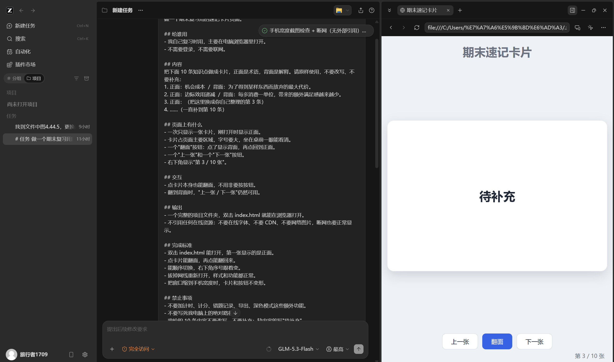
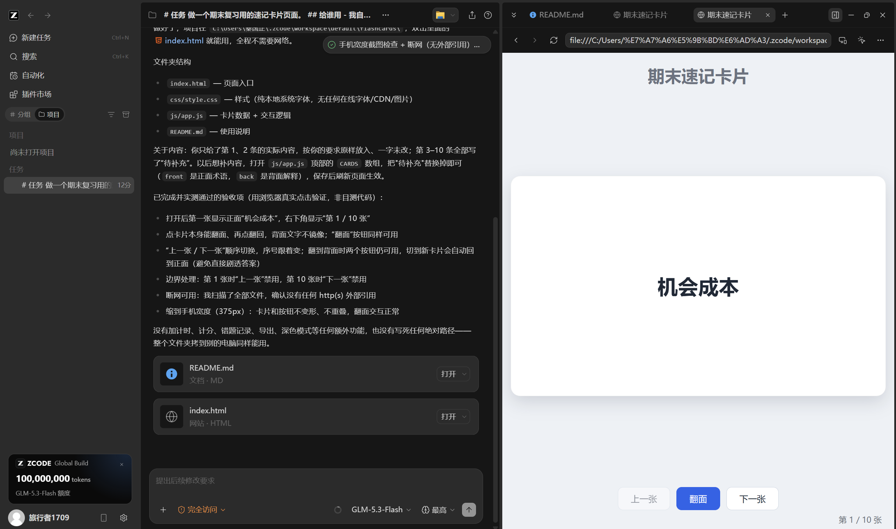

# 08 应用快速开发

[官网课程](https://www.datawhale.cn/learn/content/382/7933) · [飞书源稿](https://datawhaler.feishu.cn/docx/SyDwdstoko6XpAx58MbcDekUnrG)

> 用时：首次约 50 分钟（含下载安装），熟悉后 20 分钟
> 
> 
> 
> 产出：一个双击就能打开的小工具，不用联网、不用注册、不用服务器。
> 
> 
> 
> 下一步：先照着基础案例做一遍，再把里面的内容换成你自己的资料。

## 1. 什么时候适合使用

- **期末复习**：把老师发的 10 页重点变成能翻面、能顺序过一遍的卡片，坐在书桌前打开就能背。
- **错题管理**：按科目记录错题、错误原因、正确解法和复习次数，期末前筛出"还没掌握"的那批。
- **作业和 ddl 看板**：把各门课的作业截止时间整理成一打开就看到的页面，不用每天翻群消息。
- **个人作品集**：把做过的项目、写过的文章整理成一页网页，投简历或加社团时把文件发出去。
- **项目式学习**：把调研到的数据做成能筛选、能看图的展示页，答辩时比翻 PPT 直观。
- **答辩演示工具**：做一个能演示某个知识点的互动小页面（比如输入参数就看到结果变化）。

**这三个地方必须你自己看：**

- 卡片、页面里的知识点、数字、日期，跟你手上的原始资料对不对得上。AI 会顺手"补全"内容，复习资料写错了比没做更麻烦。
- 生成的项目里有没有写死你电脑上的路径。写死了，你自己能用，拷给同学就打不开。
- 项目文件夹放在哪，别把你不想被读到的目录一起授权给工具。

## 2. 完成任务的基本环节

最多 7 步，第一次做按这个顺序走就不会乱。

| 步骤 | 你要完成的环节 | AI 可以帮你做什么 | 你需要确认什么 |
| --- | --- | --- | --- |
| 1 | 说清要做什么 | 把你的想法整理成"打开看到什么、点一下发生什么" | 这句话里两个动作是不是都写清楚了 |
| 2 | 准备材料 | 判断需要哪些文字、表格和图片 | 材料齐不齐，有没有不能外传的内容 |
| 3 | 生成第一版 | 生成页面、样式和逻辑代码 | 双击能不能打开，核心动作能不能走通 |
| 4 | 自己走一遍 | 列出该测哪几处 | 每个按钮点下去是不是真的做了它该做的事 |
| 5 | 只改差异 | 只改你指出的那一处 | 你没提到的部分有没有被顺手改掉 |
| 6 | 试着"离开你这台电脑" | 找出依赖网络或本机路径的地方 | 断网还能不能用，拷给别人能不能打开 |
| 7 | 保存复用 | 把项目放固定文件夹，存下这次的说法 | 下次还想改，能不能找到它 |

## 3. 一个重要方法：把需求压成一句话

**为什么重要。** 你只给一句话，剩下的部分 AI 要自己补。你写得越笼统，它补出来的功能就越多。功能一多，跑不通的地方就多，而且改一个容易碰坏另一个。

**常错在哪。** 一上手就说完"翻面、抽题、计时、记错题、导出、深色模式"。结果第一版有六个功能，三个是坏的，你不知道该先修哪个。

**怎么检查。** 数一数第一版里有几个"用户要做的动作"。只允许一个。出现两个以上，先砍到最想要的那一个。

**怎么修正。** 把需求改写成这一句，再重新生成：

> 打开这个页面，我看到一张卡片；点一下卡片，翻到背面看答案；再点一下，翻回来。

跑通之后，再一个个加"上一张 / 下一张""随机抽一题"。

加功能时用同样的节奏：**加一个动作，就跑一次，确认原来的动作还在。** 一次加两个，出了问题你不知道是哪个引起的。

## 4. 产品组合推荐

**一般任务：**[**ZCode**](<https://zcode.z.ai/>)**（智谱）。**桌面端 AI 开发环境，说需求就自动拆步骤、写文件、跑命令，项目在你自己电脑上，可微信/飞书远程指挥。需装客户端，有免费试用额度，续用需订阅 GLM Coding Plan（价格见官网）。

**要手机能用的正式链接：**[**秒悟 Meoo**](<https://meoo.com/>)**（阿里）。**云端生成前后端完整应用并一键上线，报名页、问卷这类用它做，个人轻量版免费。

**要"能回答问题的助手"：**[**扣子**](<https://www.coze.cn/>)**（字节）。**上传资料搭知识库问答助手，可发布到豆包、飞书，个人免费。

**想换开发工具：**[**Trae**](<https://www.trae.cn/>)（字节，个人免费）、[**Qoder**](<https://qoder.com/>)（阿里，可切多个国产模型）。与 ZCode 同类，选一个顺手的就行，不用都装。

## 5. 最基础案例：做一页期末速记卡片

这次只做一个动作：**打开页面看到一张卡片，点一下翻到背面看答案。**

不做计分、不做错题记录、不做导出、不做登录、不做深色模式。

**准备这些材料：**

- 一门课的 8 到 10 个知识点，每个写成"正面是术语，背面是解释"两行
- 直接用老师给的重点或自己整理的笔记，**先放 10 条**，不要一次把整本书塞进去

**先把需求说清楚：**

| 项目 | 内容 |
| --- | --- |
| 目标 | 一页能在电脑上双击打开的复习卡片 |
| 受众 | 你自己，复习时在电脑上打开 |
| 输入 | 上面那 10 条知识点 |
| 输出 | 一个项目文件夹，双击里面的 index.html 就能用 |
| 完成标准 | 双击能打开；点卡片能翻面；断网也能用；窗口缩到手机宽度不乱 |

**复制下面这段发给它：**

```text
# 任务
做一个期末复习用的速记卡片页面。

## 给谁用
- 我自己复习时用，主要在电脑浏览器里打开。
- 不需要登录，不需要联网。

## 内容
把下面 10 条知识点做成卡片，正面是术语，背面是解释。请原样使用，不要改写、不要补充：
1. 正面：机会成本 ／ 背面：为了得到某样东西而放弃的最大代价。
2. 正面：边际效用递减 ／ 背面：每多消费一单位，带来的额外满足感越来越少。
3. 正面：（把这里换成你自己整理的第 3 条）
4. ……（一直补到第 10 条）

## 页面上有什么
- 一次只显示一张卡片，刚打开时显示正面。
- 卡片占页面主要区域，字号要大，坐在桌前一眼能看清。
- 一个"翻面"按钮：点了显示背面，再点回到正面。
- 一个"上一张"和一个"下一张"按钮。
- 右下角显示"第 3 / 10 张"。

## 交互
- 点卡片本身也能翻面，不用非要按按钮。
- 翻到背面时，"上一张 / 下一张"仍然可用。

## 输出
- 一个完整的项目文件夹，双击 index.html 就能在浏览器打开。
- 不引用任何在线资源：不要在线字体、不要 CDN、不要网络图片，断网也要正常显示。

## 完成标准
- 双击 index.html 能打开，第一张显示的是正面。
- 点卡片能翻面，再点能翻回来。
- 能顺序切换，右下角序号跟着变。
- 拔掉网线重新打开，样式和功能都正常。
- 把窗口缩到手机宽度时，卡片和按钮不变形。

## 禁止事项
- 不要加计时、计分、错题记录、导出、深色模式这些额外功能。
- 不要写死我电脑上的绝对路径。
- 我给的 10 条内容不要改写、不要补充；缺内容的写"待补充"。
```



**哪些可以替换：** 10 条知识点、页面标题、按钮文字，换成你自己的。

**哪些限制不要删：** "不引用在线资源""不要写死我电脑上的绝对路径""不要加额外功能""内容不要改写"。

**为什么需要这些要求：** "不引用在线资源"决定它断网能不能用；"不写死绝对路径"决定拷贝给同学能不能打开；"不要加额外功能"是为了第一版能跑通；"内容不要改写"是因为复习卡片里内容错了比没做更糟。

**第一次运行后，检查这五处：**

1. 双击 index.html 能打开，第一张是正面。
2. 点卡片能翻面，再点能翻回来。
3. "上一张 / 下一张"正常，右下角序号跟着变。
4. 断开网络重新打开，页面样式正常。（如果字体忽然变丑，说明它偷偷加载了在线字体，要让 AI 改掉。）
5. 把窗口拉到手机宽度，按钮没有跑出屏幕。

**发现问题，只说你看到的那一处：**

```text
在上一版基础上修改，不要重写整个项目。
1. 断网打开时字体变成了默认字体，请把字体改成不依赖网络的写法，用系统自带字体。
2. 卡片翻面时希望有一个轻微的过渡效果，不要瞬间切换。
其他文件保持不变，改完告诉我改了哪两处。
```

**保存和分享：**

1. 建一个固定文件夹（比如电脑 D 盘的"复习卡片"文件夹），把整个项目放进去。
2. 双击 index.html，完整过一遍 10 张卡片。
3. 想发给同学：把整个文件夹压缩打包发过去，对方解压后双击 index.html 就能用。
4. **手机上的同学打不开这种文件。** 如果你需要的是"发一条链接，大家在手机上点开就能用"，回到第 4 节用秒悟 Meoo 做。
5. 把这次用的提示词存成一个 txt 放在项目文件夹里，下次想加内容直接找它。

## 6. 最终结果演示



**你可以从结果中看到什么：**

- AI 完成的是"写页面、写样式、写交互逻辑"；你要做的是"说清需求、检查结果"。
- 交付物是你电脑上的一个文件夹，不是代码截图，也不是别人的服务器上的东西。
- 断网可用、拷给别人可用，这两件事不会自动达成，要自己验证。
- 下次加知识点，把提示词里的内容换掉重跑一次就行，不用从零开始。

## 7. 两个进阶案例

基础案例跑通之后再做这两个。每个只比基础案例多一步：一个多接了你的数据文件，一个换了工具。

### 进阶案例一：把课程数据变成能筛选的展示页（继续用 ZCode）

**准备**：把要展示的数据导出成 CSV（比如"课程名、学分、类型、周课时"），放进项目文件夹。

```text
# 任务
做一个课程一览页面，数据来自项目文件夹里的 courses.csv，一共几十行。

## 页面上有什么
- 顶部一行筛选按钮：全部 / 必修 / 选修 / 实践。点了只显示对应类型的课程。
- 下面是表格，四列：课程名、学分、类型、周课时。
- 表格上方显示"共 12 门，合计 26 学分"，跟着筛选结果一起变。

## 规则
- 只读 courses.csv，不要修改这个文件。
- 读不到文件时显示"未找到 courses.csv，请检查它是否和页面在同一个文件夹"，不要自己编数据。

## 输出
- 一个项目文件夹，双击 index.html 就能打开，不引用任何在线资源。

## 禁止事项
- 不要加搜索框、排序、图表、导出这些额外功能。
- 不要改写或补全 CSV 里的数据，缺值显示"待补充"。
```

**预期结果**：双击打开能看到课程表格，点"必修"只剩必修课，上方的合计数字跟着变。

**提醒**：CSV 里如果有手机号、身份证号这类字段，先在文件里删掉，再交给它生成。

### 进阶案例二：把报名表做成一条能发群里的链接（换成秒悟 Meoo）

**准备**：先想清楚要收集哪几个字段、谁能看到提交记录。这个案例的目标是"发出去就能用"，所以不用 ZCode，换成能直接部署上线的工具。

```text
# 任务
做一个社团招新报名页面，我会把链接发到班级群。

## 给谁用
- 本校学生，绝大多数用手机打开。
- 页面只需要一屏，不要导航栏、不要动画。

## 页面上有什么
- 标题：星光社 2026 秋招报名
- 说明：面试时间 9 月 25 日晚 7 点，地点 3 教 201
- 填写项：姓名、学号、意向部门（下拉选择：宣传部、组织部、外联部）
- 一个提交按钮

## 提交后发生什么
- 显示"报名成功，请等通知。"
- 提交内容要保存下来；只有我能看到全部记录，其他人只能提交，不能查看。

## 完成标准
- 手机上打开排版正常，按钮没有被挤出屏幕。
- 提交后能看到成功提示，按钮变成不可再点。

## 禁止事项
- 不要加登录、注册、统计图、后台管理页面。
- 不要编造面试时间、地点和主办方信息，材料里没有的写"待补充"。
```

**预期结果**：拿到一条可以点开的链接，同学在手机上填完提交，你能看到所有提交记录。

**提醒**：链接发出去之前，自己先用手机完整填一次，确认只有你能看到记录，再发到群里。

## 8. 学习收获

完成本教程后，你将：

- 知道什么样的需求适合做成自己用的小工具，什么样的应该换成联网工具或交给学校系统。
- 学会把"想做个复习卡片"这类想法，压成"打开看到什么、点一下发生什么"的一句话。
- 能够跟着案例，用一段说清的需求让 ZCode 生成第一版，并双击打开验证。
- 知道第一版生成后要自己走哪五处，才算确认它真的能用。
- 知道要在什么时候问自己一句：这个文件离开我的电脑，还能不能跑。

## 参考来源

1. ZCode 官方文档与更新日志，https://zcode.z.ai/docs ——安装方式、Goal 模式、远程控制等能力以官方文档为准。
2. 智谱开放平台 GLM Coding Plan（模型订阅与计费说明），https://bigmodel.cn/
3. 安全与权限说明：桌面端 Agent 会读写你授权的文件夹。装好之后先确认它的工作目录范围，不要指向存放证件、账号密码的目录；安装第三方插件或 Skill 前先查看发布者和申请权限。

> 资料访问日期：2026-09-22。产品功能、价格和可用地区可能调整，正式使用前请以官网最新说明为准。
