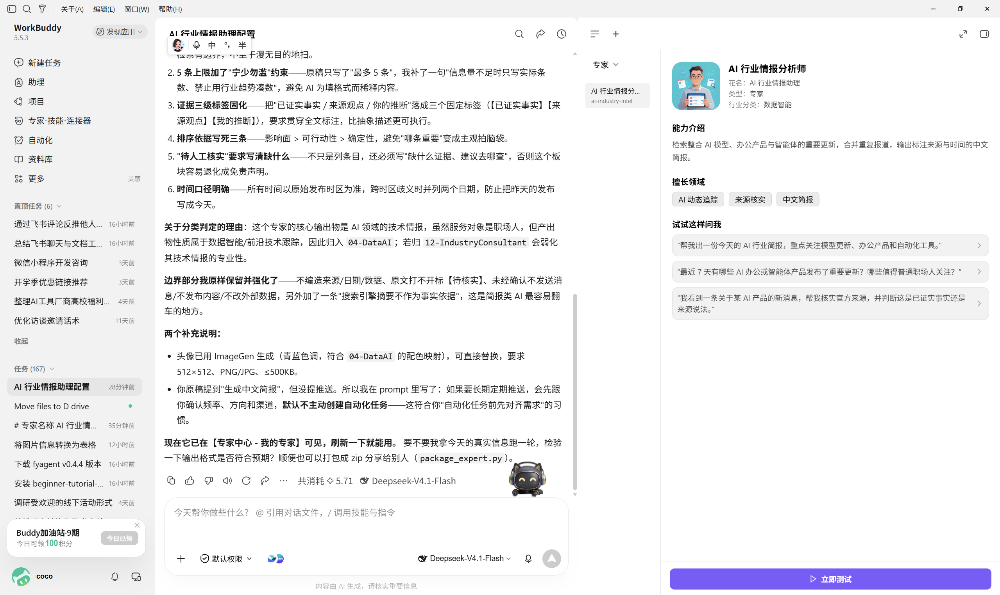
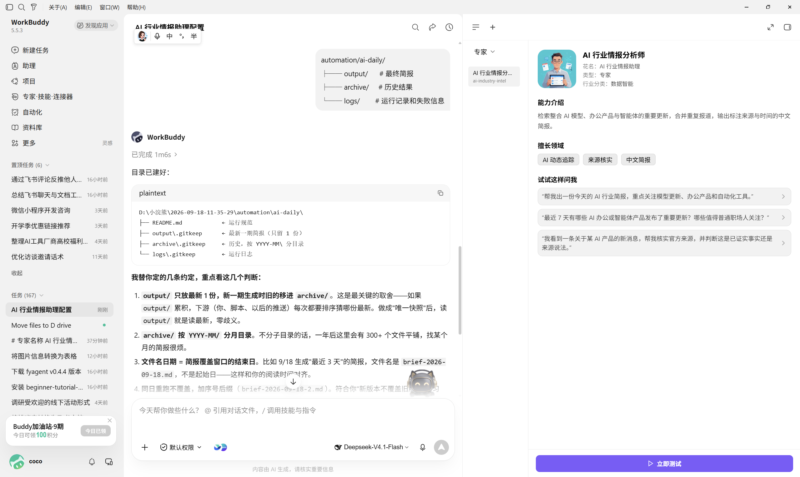
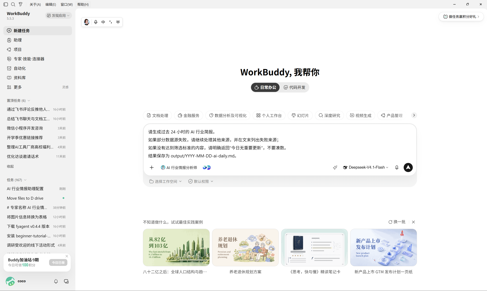
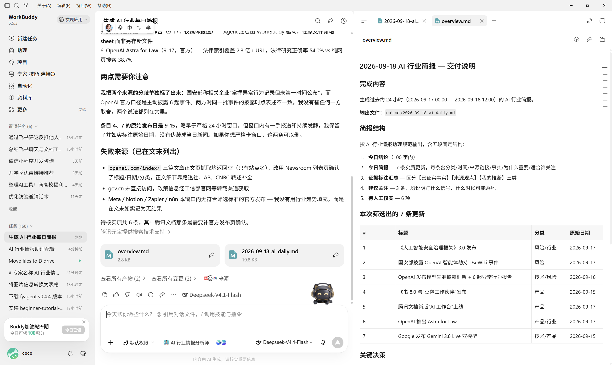
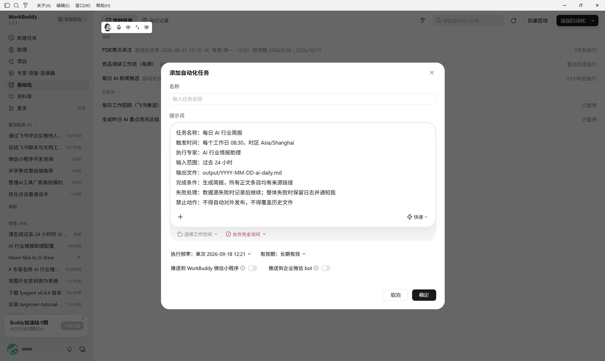
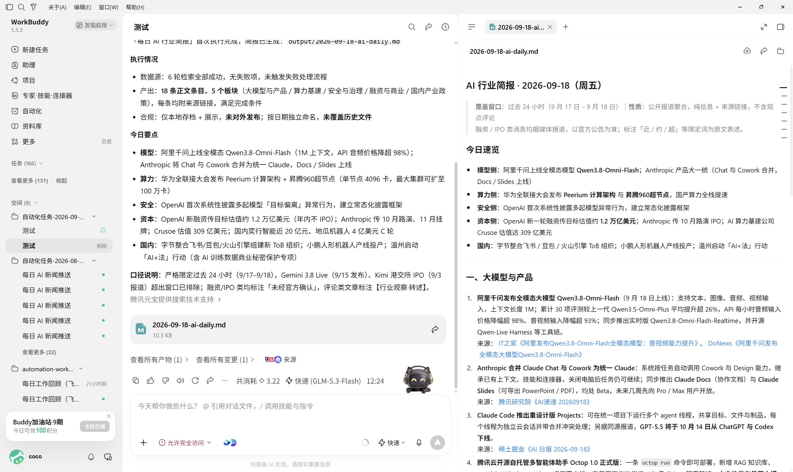
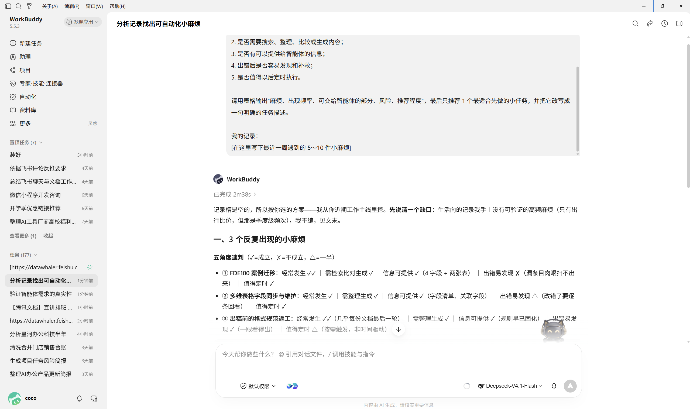
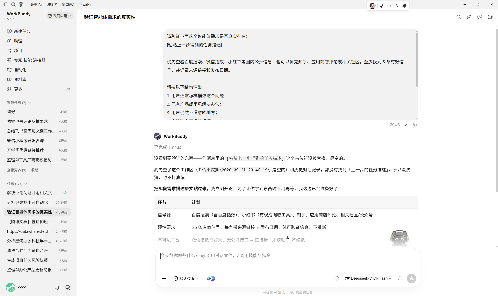

# 智能体与自动化搭建

[官网课程](https://www.datawhale.cn/learn/content/382/7934)

## 第一部分：搭建第一个智能体与自动化任务

> **适用人群：**第一次搭建智能体和自动化任务的学习者；**预计用时：**30～45 分钟；**主要工具：**WorkBuddy；**最终产出：**一个可手动测试、可定时运行的 AI 行业情报助理及真实简报。

## 1. 什么时候适合使用

- **行业情报简报：**定时收集新闻、政策、竞品和产品更新，去重后生成日报或周报。
- **文档整理**：读取指定目录中的合同、制度、会议纪要或项目材料，提取字段并生成汇总。
- **知识库问答**：基于公司制度、产品手册或培训资料回答问题，同时给出原文依据。
- **运营与客户服务**：对用户反馈进行分类、摘要和优先级判断，生成回复草稿或待办事项。
- **数据巡检**：定期检查表格、接口、日志或任务状态，发现异常后生成提醒。
- **团队例行工作**：自动整理周报、会议待办、项目风险和未完成任务，并发送给相关人员。

付款、删除数据、对外发布及医疗、法律、投资等高风险操作必须保留人工审批。

## 2. 先分清智能体、工作流和自动化

| 概念 | 主要作用 | 适合什么任务 |
| --- | --- | --- |
| 智能体（Agent） | 根据目标和现场信息，自主选择工具与下一步行动 | 输入变化大、需要理解和判断的任务 |
| 工作流（Workflow） | 按预先规定的步骤、条件和分支执行 | 步骤清楚、需要稳定输出的任务 |
| 自动化（Automation） | 按时间或事件触发智能体或工作流 | 每天、每周或满足某个条件时重复执行 |

成熟实践通常不会让智能体自由决定所有事情，而是采用“**固定流程做骨架，智能体处理不确定环节，关键动作由人确认**”的组合。Anthropic 的工程实践也建议从最简单的方案开始：步骤确定的任务优先使用工作流，只有在确实需要灵活决策时才增加智能体自主性。

## 3. 搭建智能体与自动化的基本环节

| 步骤 | AI 做什么 | 人要确认什么 |
| --- | --- | --- |
| 1. 定义任务 | 将目标拆成输入、处理规则、输出和完成标准 | 任务是否值得重复，成功如何判断 |
| 2. 选择形态 | 判断使用普通提示词、工作流还是智能体 | 是否真的需要智能体自主决策 |
| 3. 配置能力 | 配置模型、知识库、Skill、连接器和工作目录 | 权限是否遵循最小必要原则 |
| 4. 手动测试 | 使用正常、缺失、冲突和异常输入运行任务 | 错误是否可发现，结果能否人工核对 |
| 5. 增加控制 | 设置审批点、超时、重试、失败出口和日志 | 哪些动作必须由人确认 |
| 6. 设置自动化 | 配置触发时间、运行频率、输出位置和通知方式 | 是否会重复执行、重复发送或覆盖文件 |
| 7. 持续复盘 | 记录成功率、人工修改和失败原因 | 是否需要调整提示词、工具或停用任务 |

### 一个必要的避坑原则：先做工作流，再逐步放权

初学者最容易犯的错误，是一开始就让智能体“自己规划并完成所有工作”。更可靠的做法是：

1. 先用固定步骤跑通一次任务；
2. 只把分类、摘要、判断和工具选择等不确定环节交给模型；
3. 读取操作可以低风险自动执行，写入、发送、删除和付费操作默认要求确认；
4. 为每次运行保留输入、输出、工具调用和失败记录；
5. 自动化任务使用唯一批次号或日期文件名，避免重跑时重复发送和覆盖结果。

LangGraph 的持久化和中断机制、Dify 的人工审核与运行追踪，都体现了“任务可暂停、可检查、可恢复”的成熟做法。

## 4. 选择工具

先看你平时主要把资料放在哪里，不需要同时安装多个工具：

常用企业微信、腾讯文档或腾讯会议，选[WorkBuddy](<https://www.workbuddy.cn/work/>)。

常用钉钉和本地 Office，选[千问办公](<https://qwenwork.cn/>)。

主要使用飞书文档和飞书知识库，选[豆包工作](<https://www.doubao.com/work>)。

**本教程路线：**[WorkBuddy](<https://www.workbuddy.cn/work/>) → 创建“专家” → 配置必要的 Skill 和连接器 → 手动运行 2～3 次 → 结果稳定后设置自动化。

如果你没有明确的办公生态，直接跟随本教程使用 WorkBuddy。先走通这一条路线，不需要同时学习工作流平台或私有部署框架。

## 5. 最基础案例：搭建“每日 AI 行业情报助理”

~~本案例~~先创建一个职责明确的专家，再把验证通过的任务设置成自动化。最终每天生成一份带来源的 Markdown 简报，但不自动对外发布。

### 第一步：写清楚智能体定义

进入 WorkBuddy 的“专家—我的专家—创建专家”，输入下面的创建要求：

```text
# 专家名称
AI 行业情报助理

# 主要职责
检索并整理 AI 模型、办公产品、智能体和自动化领域的重要更新，
生成面向普通职场人的中文简报。

# 工作方法
1. 优先检索产品官网、官方博客、更新日志、政府或研究机构资料。
2. 合并同一事件的重复报道。
3. 按“产品、技术、行业、风险”分类。
4. 每条信息写明发布时间、来源机构和原文链接。
5. 区分已证实事实、来源观点和你的推断。

# 输出要求
- 先给出 100 字以内的今日结论。
- 正文最多保留 5 条重要信息。
- 每条说明发生了什么、为什么重要、适合谁关注。
- 最后列出“建议关注”和“待人工核实”。

# 权限与边界
- 不编造来源、发布日期和产品数据。
- 无法访问原文时标记为“待核实”。
- 未经确认，不发送消息、不发布内容、不修改或删除外部数据。
```

WorkBuddy 官方将专家定义为“人设 + 方法论 + 工具链”；Skill 提供工具能力，连接器负责接入外部服务。[WorkBuddy 专家说明](<https://www.workbuddy.cn/docs/workbuddy/From-Beginner-to-Expert-Guide/Function-Description/Expert-Center>)、[连接器说明](<https://www.workbuddy.cn/docs/workbuddy/From-Beginner-to-Expert-Guide/Function-Description/Connector>)



### 第二步：只配置必要能力

根据实际来源选择搜索、新闻、公众号或 AIHOT 等 Skill。先不要授予发送消息、修改文件或访问整个磁盘的权限。工作目录使用单独文件夹，例如：

```text
automation/ai-daily/
├── output/      # 最终简报
├── archive/     # 历史结果
└── logs/        # 运行记录和失败信息
```

安装第三方 Skill 前，应检查发布者、申请权限和脚本内容，优先选择官方推荐或来源明确的 Skill。[WorkBuddy Skill 说明](<https://www.workbuddy.cn/docs/workbuddy/From-Beginner-to-Expert-Guide/Function-Description/Skills-Market>)



### 第三步：手动运行并测试异常情况

先连续手动运行两三次，不要立即定时。至少测试：

- 正常情况：当天有多条有效信息；
- 空结果：当天没有值得收录的内容；
- 来源冲突：两个来源对同一事件说法不同；
- 来源失败：部分网页或数据源无法访问；
- 重复运行：同一天再次运行时不能重复写入或重复通知。

可以使用下面的测试指令：

```text
请生成过去 24 小时的 AI 行业简报。
如果部分数据源失败，请继续处理其他来源，并在文末列出失败来源；
如果没有达到筛选标准的内容，请明确返回“今日无重要更新”，不要凑数。
结果保存为 output/YYYY-MM-DD-ai-daily.md。
```





### 第四步：配置自动化任务

手动结果稳定后，在 WorkBuddy 自动化页面创建任务：

```text
任务名称：每日 AI 行业简报
触发时间：每个工作日 08:30，时区 Asia/Shanghai
执行专家：AI 行业情报助理
输入范围：过去 24 小时
输出文件：output/YYYY-MM-DD-ai-daily.md
完成条件：生成简报，所有正文条目均有来源链接
失败处理：数据源失败时记录后继续；整体失败时保留日志并通知我
禁止动作：不得自动对外发布，不得覆盖历史文件
```

WorkBuddy 自动化支持配置提示词、工作空间、模型与技能、定时规则和通知方式；任务会沿用当前登录身份执行，因此正式启用前应再次检查账号与权限。[WorkBuddy 自动化说明](<https://www.workbuddy.cn/docs/workbuddy/From-Beginner-to-Expert-Guide/Function-Description/Automation-Guide>)



### 第五步：上线前检查

- 任务是否使用独立工作目录；
- 是否设置清楚的时间范围和最大条数；
- 是否保留原始来源；
- 是否覆盖了空结果和数据源失败；
- 是否避免重复文件和重复通知；
- 对外发送、删除和付费操作是否仍需人工确认；
- 是否能在运行历史中找到成功、失败和耗时记录。

## 6. 最终结果演示



## 第二部分：进阶实战

### 进阶实战 1：从生活痛点发现智能体需求

这一次先不选工具。回想最近一周反复遇到的小麻烦，从中找到一个适合交给智能体处理的任务。

```text
你是“智能体需求探险助手”。请根据我接下来提供的生活或工作记录，找出 3 个反复出现的小麻烦。

请从以下角度逐项判断：
1. 是否经常发生；
2. 是否需要搜索、整理、比较或生成内容；
3. 是否有可以提供给智能体的信息；
4. 出错后是否容易发现和补救；
5. 是否值得以后定时执行。

请用表格输出“麻烦、出现频率、可交给智能体的部分、风险、推荐程度”，最后只推荐 1 个最适合先做的小任务，并把它改写成一句明确的任务描述。

我的记录：
[在这里写下最近一周遇到的 5～10 件小麻烦]
```

**预期结果：**得到一个范围小、可以验证的智能体任务，而不是从“我要做一个万能智能体”开始。



### 进阶实战 2：用公开信号验证需求

有了候选任务后，再去搜索引擎和社交平台寻找同类问题，确认它不是只有你一个人遇到。

```text
请验证下面这个智能体需求是否真实存在：
[粘贴上一步得到的任务描述]

优先查看百度搜索、微信指数、小红书等国内公开信息，也可以补充知乎、应用商店评论或相关社区。至少找到 5 条有效信号，并记录来源链接和发布日期。

请按以下结构输出：
1. 用户通常怎样描述这个问题；
2. 已有产品或常见解决办法；
3. 用户仍然不满意的地方；
4. 支持这个需求的证据；
5. 反对或削弱这个需求的证据；
6. 结论：继续验证、缩小范围或暂时放弃；
7. 一个可以在 1 天内完成的最小测试。

如果某个平台无法访问，直接标记“未获取”，不要编造数据。
```

**预期结果：**得到一份带来源的需求验证记录，并明确下一步是做一个最小版本、继续观察，还是停止投入。



## 学习收获

学完这一部分，你将能够：

- 分清智能体、工作流和自动化；
- 用“角色、方法、工具、输出、边界”定义一个简单智能体；
- 手动测试正常、空结果、冲突和失败情况；
- 把稳定任务设置为定时自动化；
- 为高风险动作设置人工确认，并能查看运行结果和失败记录。

## 参考来源

进阶案例来源：[Datawhale：从哄哄模拟器到 Rizz，用“探险”的方式发现 To C 小确幸需求](<https://www.datawhale.cn/learn/content/220/4940>)

**教程类**

1. [Datawhale 开源教程：Hello-Agents（从零开始构建智能体）](<https://github.com/datawhalechina/hello-agents>)
2. [Datawhale 开源教程：handy-n8n（n8n 入门教程）](<https://github.com/datawhalechina/handy-n8n>)
3. [Datawhale：AI 自动化神器 n8n，保姆级教程来了！](<https://blog.csdn.net/Datawhale/article/details/148884419>)
4. [n8n 中文教程：简单易懂的现代魔法](<https://n8n.akashio.com/>)
5. [用 AI 搭建「每日资讯简报」定时 Agent（Coze / n8n）](<https://clawpk.net/tutorials/379-ai-daily-briefing-agent>)

**实践类**

1. [Anthropic：Building Effective AI Agents](<https://www.anthropic.com/engineering/building-effective-agents>)
2. [搭 AI Agent 团队踩了 18 个坑，总结出这 5 个关键步骤](<https://juejin.cn/post/7623604104620539910>)
3. [用 Coze 搭建 AI 新闻自动汇总工作流：从 RSS 抓取到飞书推送的完整实践](<https://blog.csdn.net/weixin_29043895/article/details/164654876>)
4. [n8n 自动化流程设计：10 个最佳实践与系统架构指南](<https://ohya.co/blog/n8n-workflow-design-guide>)

> 资料访问日期：2026-09-21。教程与实践类文章的内容和平台功能会持续更新，引用前请核对原文最新版本。
