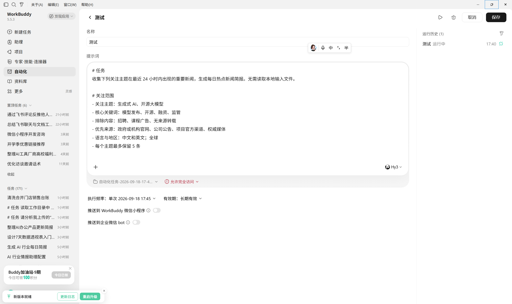
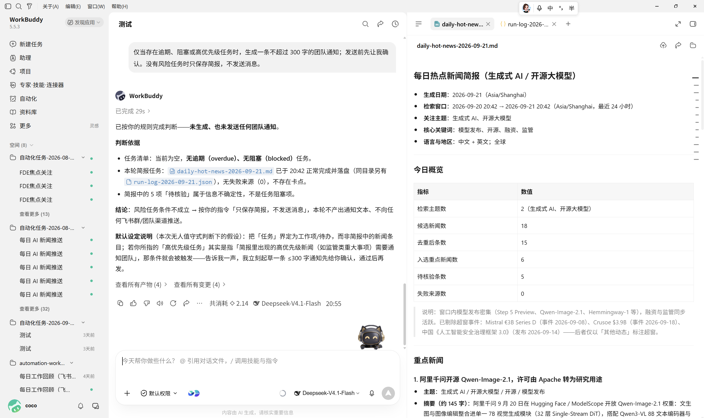
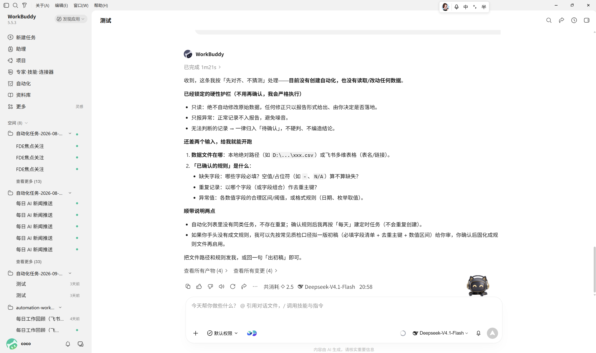

# 10 工作流自动化设计

[官网课程](https://www.datawhale.cn/learn/content/382/7935)

> **适用人群：**第一次设计自动化流程的学习者；**预计用时：**25～35 分钟；**主要工具：**WorkBuddy；**最终产出：**一个可定时运行的关注热点新闻收集流程及验收标准。

## 第一部分：完成一个基础自动化案例

## 1. 哪些任务适合自动化

- **定期简报**：每天整理行业新闻，每周生成项目周报；
- **数据检查**：定时检查逾期任务、缺失字段和异常数据；
- **文件整理**：按日期、项目或文件类型进行归档和重命名；
- **内容汇总**：整理会议纪要、客户反馈或团队日报；
- **消息提醒**：发现高风险事项后，发送到企微、飞书或其他工作群。

## 2. 设计自动化的 7 个基本环节

一项自动化不是“设置一个时间”就结束了。你还需要说明输入、处理规则、输出和失败后的处理方式。

| 步骤 | 你要完成的环节 | AI 可以帮你做什么 | 你需要确认什么 |
| --- | --- | --- | --- |
| 1 | 选择重复任务 | 找出重复步骤并判断是否适合自动化 | 任务是否真的会重复发生 |
| 2 | 设置触发条件 | 把自然语言时间转换成定时规则 | 执行日期、时间和时区是否正确 |
| 3 | 固定输入 | 读取指定文件夹、表格或连接器数据 | 输入位置和字段是否稳定 |
| 4 | 写清处理规则 | 分类、筛选、汇总并生成建议 | 规则是否符合真实业务 |
| 5 | 规定输出和检查标准 | 生成固定名称、格式和内容的成果 | 怎样才算运行成功 |
| 6 | 手动试运行 | 按同一规则执行并记录结果 | 结果是否准确，是否存在副作用 |
| 7 | 定时运行与检查 | 保存任务、运行日志和失败信息 | 失败由谁处理，任务如何暂停 |

## 3. 最重要的原则：先跑稳定，再设置自动化

初学者最容易犯的错误，是提示词刚写完就立即设置为每天运行。更稳妥的方法是：**先用同一份提示词手动运行两到三次，确认输入、输出和检查规则稳定，再开启定时任务。**

在设置自动化前，至少回答下面七个问题：

1. **什么时候触发？**例如每周一上午 9 点。
2. **读取什么？**例如工作目录中的 ` tasks.csv `。
3. **怎样处理？**例如识别逾期、阻塞和三天内到期任务。
4. **生成什么？**例如带日期的 Markdown 风险简报。
5. **怎样算成功？**例如成功读取全部记录，并生成简报与运行日志。
6. **失败怎么办？**例如保留错误原因，不生成看似正常的空报告。
7. **谁来确认？**例如项目负责人检查任务状态和建议顺序。

如果其中任何一个问题无法回答，先不要急着自动化。继续缩小任务范围，通常比增加更多工具更有效。

## 4. 产品组合怎么选

不要在第一次练习时同时搭建多个平台。本教程建议沿用一条固定路线：先用 [WorkBuddy](<https://www.workbuddy.cn>) 跑通任务，再用 [飞书多维表格](<https://www.feishu.cn/product/base?view_name=project>)/ [Power Automate](<https://learn.microsoft.com/zh-cn/power-automate/flow-types>) 承接结构化结果，最后用 [飞书](<https://www.feishu.cn/>) 发送团队通知。只有当前一步已经稳定，才进入下一步。

**团队已经统一使用企业微信。**只把最后的通知工具替换为 [企业微信](<https://work.weixin.qq.com/>)，前面的 WorkBuddy 和飞书多维表格不变。不要为了通知渠道重新设计整条流程。

判断标准很简单：现有工具能够稳定读取输入、保存结果并留下运行记录，就不要为了“功能更多”更换平台。

## 5. 基础案例：自动收集关注领域的热点新闻

这个案例把关注范围直接写在提示词中，每天从公开网页检索最近 24 小时的新闻，完成筛选、去重、交叉核验和摘要，并在系统自动分配的任务空间中生成热点新闻简报。你不需要提前创建或选择本地工作目录。

### 第一步：直接写清关注范围

不需要创建本地文件。第一次练习只设置 2～3 个主题，并把主题、关键词和来源要求直接写进任务提示词。可以参考下面这些字段：

| 字段 | 示例 | 用途 |
| --- | --- | --- |
| 关注主题 | 生成式 AI、开源大模型 | 限定每天需要跟踪的领域 |
| 核心关键词 | 模型发布、开源、融资、监管 | 提高检索召回率 |
| 排除词 | 招聘、课程广告、无来源转载 | 过滤低相关或营销内容 |
| 优先来源 | 机构官网、公司公告、权威媒体 | 规定核验时优先采用的来源 |
| 语言与地区 | 中文和英文；全球 | 控制检索边界 |
| 单主题上限 | 5 条 | 防止简报被单一主题占满 |

这些字段只是帮助你把关注范围写清楚，不需要保存成表格或文件。如果暂时没有固定来源，先用“来源优先级 + 交叉核验规则”约束结果，运行几次后再补充可靠来源。

### 第二步：先手动运行一次

在 WorkBuddy 中直接新建任务，不选择本地工作目录，然后复制下面的指令。系统会自动创建独立任务空间，用来保存简报和运行日志：

```text
# 任务
收集下列关注主题在最近 24 小时内出现的重要新闻，生成每日热点新闻简报。无需读取本地输入文件。

# 关注范围
- 关注主题：生成式 AI、开源大模型
- 核心关键词：模型发布、开源、融资、监管
- 排除内容：招聘、课程广告、无来源转载
- 优先来源：政府或机构官网、公司公告、项目官方渠道、权威媒体
- 语言与地区：中文和英文；全球
- 每个主题最多保留 5 条

# 时间范围
以任务实际运行时间为基准，使用 Asia/Shanghai 时区。优先收集最近 24 小时发布或发生实质更新的内容；明确区分“新闻发布时间”和“事件发生时间”。

# 检索与筛选规则
1. 仅检索无需登录即可访问的公开网页，不绕过付费墙、登录或访问限制。
2. 来源优先级依次为：政府或机构官网、公司公告或项目官方渠道、权威媒体、专业行业媒体。
3. 同一事件被多个来源报道时合并为一条，不按文章数量重复计算热度。
4. 重要事实尽量由两个相互独立的来源交叉核验；只有单一来源时，必须明确标注“单一来源，待核验”。
5. 旧闻重新传播但没有实质更新的内容不纳入热点；标题党、纯观点、营销软文和无来源转载默认排除。
6. 按“与关注主题的相关度、事件影响范围、来源可靠性、时效性”综合排序。
7. 不得编造新闻、数字、引语、时间、机构立场或原文链接。无法确认的内容放入“待核验”，不要写成确定事实。

# 输出格式
在系统自动分配的任务空间中生成 daily-hot-news-YYYY-MM-DD.md，内容包括：
- 今日概览：检索主题数、候选新闻数、入选新闻数、待核验数；
- 重点新闻：标题、主题、100～150 字摘要、为什么值得关注、发布时间、事件时间、来源名称和原文链接；
- 其他动态：每条用一句话概括并附原文链接；
- 待核验：说明缺少什么证据；
- 今日趋势：基于已核验新闻归纳 2～3 条趋势，并明确标注这是综合判断。

# 文件与日志
- 使用系统自动分配的任务空间，无需手动选择本地工作目录；
- 同一天重复运行时覆盖当天简报，不生成多个重复文件；
- 另存 run-log-YYYY-MM-DD.json，记录检索主题、候选条数、去重条数、入选条数、待核验条数、失败来源和输出文件名。

# 失败处理
- 无法访问某个来源时记录失败原因，继续处理其他来源；
- 没有符合条件的新闻时仍生成简报，并明确写“本次未发现符合条件的热点新闻”；
- 无法核验的重大消息不得进入“重点新闻”。

# 完成标准
完成所有关注主题的检索、去重和来源核验，生成带可访问原文链接的 Markdown 简报与 JSON 运行日志，并返回文件名和各阶段条数。
```

这段指令把“搜新闻”拆成了时间范围、来源优先级、去重、核验、排序、输出和失败处理。对新闻自动化而言，最关键的不是收集得多，而是每条内容都能追溯到来源，并且不会把重复转载当成多个热点。



### 第三步：检查第一次结果

任务完成后，先不要设置定时运行。请逐项检查：

- 每条重点新闻是否属于提示词中设置的关注主题；
- 新闻发布时间和事件发生时间是否被正确区分；
- 同一事件的多篇报道是否已合并；
- 标题、摘要和关键数字是否能从原文找到依据；
- 原文链接是否可访问，并且指向具体报道而不是网站首页；
- 只有单一来源或证据不足的消息是否进入“待核验”；
- 趋势判断是否与事实摘要分开表达；
- 关注范围是否按提示词执行，运行日志是否完整记录失败来源。


### 第四步：修正重复、旧闻和低质量来源

如果第一次结果中出现重复新闻、旧闻翻炒或来源质量不稳定，可以继续输入：

```text
请保留已经核验且相关的新闻，只修正以下问题：
1. 以“同一主体 + 同一事件 + 相近发生时间”为去重依据，合并重复报道；
2. 若新文章只是在转述旧事件且没有新增事实，移出今日热点；
3. 聚合页、搜索结果页和无署名转载不能作为主要来源；
4. 每条重点新闻至少保留一个最接近事实源头的链接；
5. 摘要只写来源能够支持的事实，分析和趋势必须明确标注；
6. 在运行日志中补充去重条数、待核验原因和访问失败来源。
```


### 第五步：保存为自动化任务

当同一套规则已经手动运行两到三次，并且新闻相关性、去重和来源核验都能通过检查后，再设置定时任务。你可以继续告诉 WorkBuddy：

```text
把刚才的热点新闻收集任务保存为自动化：
- 名称：每日关注热点新闻
- 时间：每天 08:30
- 时区：Asia/Shanghai
- 工作空间：使用系统自动分配的自动化空间，不需要我手动选择本地目录
- 检索范围：最近 24 小时
- 失败时：保留日志并通知我，不生成看似正常的空简报
- 运行成功后：返回简报文件名、候选新闻数、去重数、入选数和待核验数
- 不自动发送到群聊，先由我检查简报
```

创建后，连续观察几次运行记录。如果某个主题经常产生噪声，优先调整关键词、排除词和来源优先级，而不是不断增加更复杂的提示词。

## 6. 预期结果与验收标准

一次合格运行会生成两类文件：

- ` daily-hot-news-YYYY-MM-DD.md `：每日热点新闻简报；
- ` run-log-YYYY-MM-DD.json `：检索、去重、核验和失败来源日志。

简报应先给出今日概览，再按重要性展示经过核验的重点新闻，最后列出其他动态、待核验消息和趋势判断。每条重点新闻都必须保留来源名称、发布时间和可访问的原文链接。

| 验收项目 | 通过标准 |
| --- | --- |
| 相关性 | 入选内容与关注主题直接相关，排除词有效 |
| 时效性 | 属于规定时间窗口，旧闻若无新增事实不会入选 |
| 去重 | 同一事件只保留一条，多个来源合并展示 |
| 可追溯性 | 重点事实均能回到具体原文链接核查 |
| 核验 | 重大消息有交叉来源；证据不足的内容明确进入待核验 |
| 边界 | 事实、摘要和综合判断清楚区分，不编造内容 |
| 可运维性 | 简报与日志成功落盘，失败来源和各阶段条数可检查 |

自动收集的结果适合作为信息筛选入口，不应直接替代人工判断。涉及投资、法律、公共安全或对外发布时，仍需回到原文和官方来源进行复核。

## 第二部分：进阶实战

### 进阶实战 1：增加团队通知

基础简报稳定后，再增加通知动作。

```text
仅当存在逾期、阻塞或高优先级任务时，生成一条不超过 300 字的团队通知；发送前先让我确认。没有风险任务时只保存简报，不发送消息。
```

**预期结果：**得到待确认的通知草稿，避免重复提醒或把错误结果直接发到群里。



### 进阶实战 2：改成每日数据巡检

把相同设计迁移到缺失字段、异常数值或接口状态检查。

```text
每天读取指定数据文件，按已确认的规则检查缺失字段、重复记录和异常值；只报告异常，不自动修改原始数据；无法判断的记录放入“待确认”。
```

**预期结果：**得到每日异常清单和运行日志，原始数据保持不变。



## 8. 学习收获

学完本教程，你将能够：

- 知道哪些重复工作适合作为第一个自动化任务；
- 学会用触发条件、输入、处理规则和输出来描述一项工作流；
- 能够为自动化任务补充完成标准和失败处理；
- 会先手动试运行并检查结果，再开启定时任务；
- 知道如何保留运行日志，并为高风险操作设置人工确认。

## 参考来源

1. WorkBuddy：《自动化》，介绍任务名称、提示词、工作空间、权限模式、定时规则、通知和安全注意事项，访问日期：2026-09-17。https://www.workbuddy.cn/docs/workbuddy/From-Beginner-to-Expert-Guide/Function-Description/Automation-Guide
2. WorkBuddy 实战蓝皮书：《自动化工作流的可靠性》，介绍先手动验证、再定时运行，以及失败出口、日志和告警设计，访问日期：2026-09-17。https://workbuddy.homes/bluebook/%E7%AC%AC%E4%B8%80%E7%AF%87%20%E4%BD%BF%E7%94%A8%E6%89%8B%E5%86%8C%EF%BC%9A%E5%85%88%E6%8A%8A%20WorkBuddy%20%E7%94%A8%E8%B5%B7%E6%9D%A5/%E7%AC%AC%2010%20%E7%AB%A0%20WorkBuddy%20%E8%87%AA%E5%8A%A8%E5%8C%96%E4%BB%BB%E5%8A%A1/
3. Microsoft Learn：[Planning a Power Automate project](<https://learn.microsoft.com/en-us/power-automate/guidance/planning/introduction>)，介绍规划、设计、制作、测试、部署与持续改进的基本阶段，访问日期：2026-09-17。

> 产品功能、界面、价格和可用范围可能调整，正式使用前请以产品官网最新说明为准。
