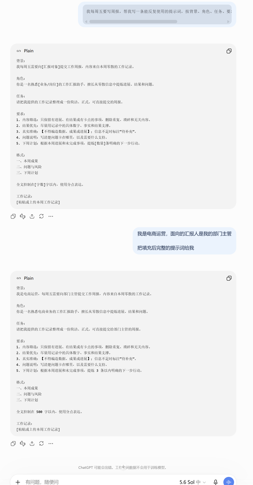
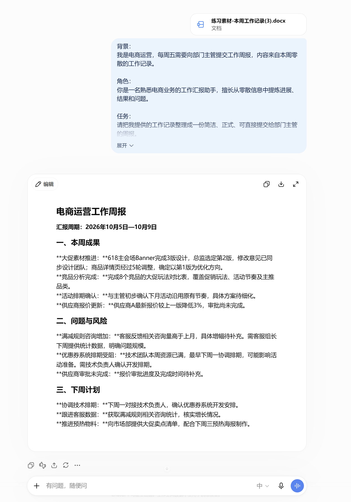
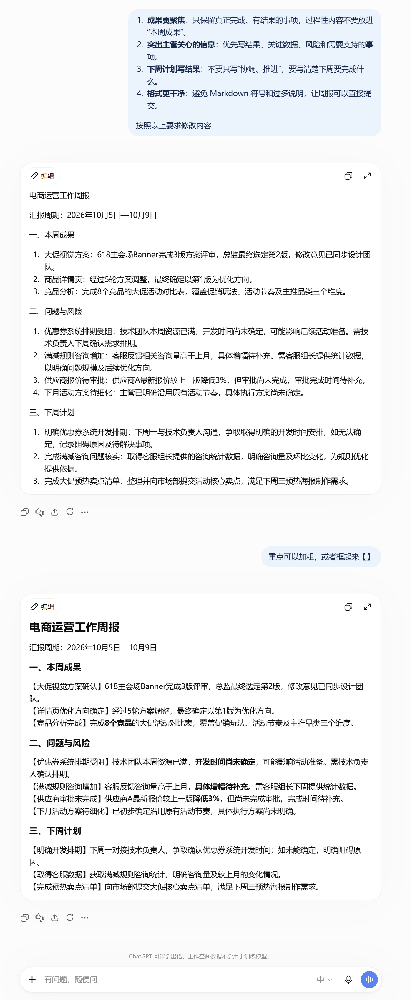

# 11 如何写好AI提示词

[官网课程](https://www.datawhale.cn/learn/content/382/7936)

## **一、总览**

## **Part 1｜主要应用场景与人群**

| **主要场景** | **典型任务** | **主要人群** |
| --- | --- | --- |
| 日常汇报 | 写周报、日报、工作汇报、会议纪要 | 职场新人、各岗位员工 |
| 职场沟通 | 写邮件、通知、申请、催进度、婉拒需求 | 行政、运营、市场、销售 |
| 方案与策划 | 活动方案、项目计划、复盘总结 | 运营、产品、项目负责人 |
| 资料整理 | 把长文、聊天记录、访谈稿变成结构化文档 | 行政、运营、研究类岗位 |
| 内容创作 | 起标题、写文案、改写润色、做脚本 | 新媒体运营、市场推广 |

## **Part 2｜写提示词的 5 个关键环节**

| **序号** | **环节** | **AI 做什么** | **人做什么** |
| --- | --- | --- | --- |
| 1 | **想清楚任务** | 帮你拆解需求，追问补齐缺失的信息 | 明确目的、对象和用途 |
| 2 | **设定角色** | 切换到对应领域的知识和口吻 | 选一个贴合任务的角色 |
| 3 | **说清目标** | 按可验收的标准产出结果 | 定义怎样算“做好了” |
| 4 | **划定红线** | 遵守约束：不编造、不确定就标注 | 列出绝对不能出现的错误 |
| 5 | **规定格式并迭代** | 按规定格式输出，按你的意见改稿 | 检查结果，指出具体改哪里 |

## **Part 3｜使用什么工具**

写提示词不需要专门的软件，一个能对话的 AI 就够了。

→ 写提示词、执行任务（推荐路线）：[DeepSeek](<https://www.deepseek.com/>) / [豆包](<https://www.doubao.com/>) / [Kimi](<https://www.kimi.com/>) / [腾讯元宝](<https://yuanbao.tencent.com/>) / [通义千问](<https://tongyi.aliyun.com/>)，任选其一，都是免费对话入口，支持粘贴文字和上传文件

→ 有条件使用国外工具：[ChatGPT](<https://chatgpt.com/>)（中文日常任务，国内工具已足够）

→ 需要把结果变成正式文档：配合 [WPS](<https://www.wps.cn/>) / [腾讯文档](<https://docs.qq.com/>)

## **二、动手实操：撰写/润色制作周报的提示词**

**场景：**周五下班前要交周报。你手头只有一堆零散记录——记事本里随手记的、跟同事聊的、几封邮件。

**下载素材：**

[练习素材-本周工作记录.docx](../../public/course-assets/11/source-01.docx)

## **第一步｜让AI参考** RTFC 公式拆解并撰写提示词

| 要素 | 这一案例怎么写 | 作用 |
| --- | --- | --- |
| R｜Role 角色 | 你是一名熟悉电商业务、擅长向管理者汇报工作的业务主管 | 让 AI 用“管理者看结果”的方式筛选和表达内容 |
| T｜Task 任务 | 把零散、口语化的工作记录整理成一份周报 | 明确 AI 要完成的核心任务 |
| F｜Format 格式 | 按“本周成果 / 问题与风险 / 下周计划”输出，分点表达，500 字以内 | 约束输出结构和篇幅 |
| C｜Context 上下文 | 我是一名电商运营，每周五要向部门经理提交周报；只保留有进展、有结果、有卡点的内容；有事实就写事实，没有就不要编 | 补充使用场景、筛选标准和准确性要求 |

**RTFC 格式的提示词无需自己编写，只需将具体需求告诉 AI，即可由 AI 自动生成符合 RTFC 框架的提示词，例如：**

```text
我每周五要写周报，帮我写一条能反复使用的提示词，按背景、角色、任务、要求、格式组织，需要替换的信息用[]标出。
```

**效果图：**





## **第二步｜提具体意见，让 AI 修改**

第一版不满意很正常。修改的时候要指出具体哪里不对、改成什么样。

**提示词示例：**

```text
根据以下要求修改内容：
1、成果更聚焦：只保留真正完成、有结果的事项，过程性内容不要放进“本周成果”。
2、突出主管关心的信息：优先写结果、关键数据、风险和需要支持的事项。
3、下周计划写结果：不要只写“协调、推进”，要写清楚下周要完成什么。
4、格式更干净：避免 Markdown 符号和过多说明，让周报可以直接提交。
```

**效果图：**



## **三、进阶技巧**

## **技巧一｜不知道提供哪些信息时，让 AI 反过来问你**

不知道该提供哪些信息时，让 AI 通过多轮提问帮你理清需求，避免遗漏关键信息和反复返工。

```text
我需要制定一份下周的大促活动方案，但目前还不清楚需要提供哪些信息。
请你先不要开始写方案，而是【通过提问帮我梳理需求】。
具体要求：
分轮提问：每次最多问我 3 个最关键的问题，不要一次性抛出所有问题。
逐步追问：根据我的回答，判断还有哪些信息需要补充，再继续提问。
确认需求：当你认为信息足够时，先总结你对需求的理解，让我确认。
开始执行：得到我的确认后，再正式撰写活动方案。
现在，请先向我提出第一轮问题。
```

## **技巧二｜给示例**

参考示例+结构化的提示词具体要求，可以让这段提示词的效果更加稳定。

```text
请参考下面的示例，把【本周工作记录】整理成周报。
示例：【粘贴一段你认为写得好的周报或汇报】
要求：
1、结构、句式、语气与示例一致；
2、内容全部换成我的真实工作，不要照搬示例里的事实。
```

## **技巧三｜撰写/修改提示词时的实用tip**

```text
先说清背景和任务：告诉 AI 你在什么场景下、要完成什么任务，以及希望达到什么结果。
尽量简洁：提示词不需要写得很长，重点是信息完整、要求明确。
适度结构化：复杂要求可以分点表达，比如每点前加一个简短概括，例如“真实准确：……”“表达风格：……”。
突出关键要求：特别重要、不能忽略的内容，可以用【】标出来，帮助 AI 抓住重点。
具体要求要分点：有多项要求时，建议用序号列出，减少遗漏和理解偏差。
尽量写得通用：避免过度绑定单一案例，让提示词在同类任务中也能直接复用。
```

## 四、参考资料

1. [刘润《研究了快 3 年的 AI 提示词，心得都在这儿了》](<https://ima.qq.com/wiki/?shareId=b8a48e75eaff0615fbc17f1e6928236f9d8775666040d814b570812718f9f8b7&mediaId=wechatarticle_7cbde5407345fe2ec230bfa1f80b7303_87d68946d42091f6e7344be45a3d79697502273005490529&action=openDetailDrawer&webFrom=10000171>)
2. [沃垠 AI《编写 Kimi 提示词，看这一篇就够了（附 52 套模板）》](<https://mp.weixin.qq.com/s?__biz=MzIwMTU5OTQ1Nw&mid=2653712280&idx=1&sn=0e24df60586172d3da4e1dec3308c698&chksm=8d33bf16ba443600058500d460c62926e037a6444089f0fa302d116a820b71698865a93851fe&scene=21>)
3. [沃垠 AI《52 套 AI 提示词模板 PDF》](<https://github.com/user-attachments/files/18681509/AIprompt52.pdf>)
4. [《如何写出完美的 Prompt（提示词）？》](<https://mp.weixin.qq.com/s/sl2MuDpW9mawh2axLuGxNw>)
5. [阿里妹《23 招教你掌握大模型提示词技巧》](<https://developer.aliyun.com/article/1658100>)
6. [JavaGuide《大模型提示词工程》](<https://javaguide.cn/ai/agent/prompt-engineering.html>)
7. [今日头条《新手写 AI 提示词，先把这 6 件事说清楚》](<https://m.toutiao.com/article/7650760881319445042>)
8. [webprompts.org](<https://webprompts.org/learn/lessons/04-prompt-formula.html>)[《The 4-Part Prompt》](<https://webprompts.org/learn/lessons/04-prompt-formula.html>)
9. [Geeky Script《Prompt Structure and Formatting》](<https://geekyscript.com/tutorial/prompt-engineering/prompt-structure-and-formatting>)
10. [texttoany.com](<https://texttoany.com/zh/blog/how-to-write-ai-prompts>)[《如何编写 AI 提示词：初学者获得更好结果的指南》](<https://texttoany.com/zh/blog/how-to-write-ai-prompts>)
11. [今日头条《AI 提示词不会写？三步填完就能出图》](<https://m.toutiao.com/article/7677949775827730988>)
12. [UOC Library《Guidelines for AI Prompts 信息图》](<https://biblioteca.uoc.edu/en/news/news/Guidelines-for-AI-prompts-an-infographic-with-tips-and-examples/>)
13. [CSDN《NanoBanana Pro 高质量信息图提示词》](<https://devpress.csdn.net/v1/article/detail/156367937>)
14. [ThorneLabs《The Anatomy of an Effective Prompt》](<https://thornelabs.io/blueprint/the-anatomy-of-an-effective-prompt>)
15. [DevTools《LLM Prompt Engineering Cheat Sheet》](<https://www.devtools.tools/cheatsheets/prompt-engineering>)
16. **工具官网：** [DeepSeek](<https://www.deepseek.com/>)｜[豆包](<https://www.doubao.com/>)｜[Kimi](<https://www.kimi.com/>)｜[腾讯元宝](<https://yuanbao.tencent.com/>)｜[通义千问](<https://tongyi.aliyun.com/>)｜[ChatGPT](<https://chatgpt.com/>)｜[WPS](<https://www.wps.cn/>)｜[腾讯文档](<https://docs.qq.com/>)
