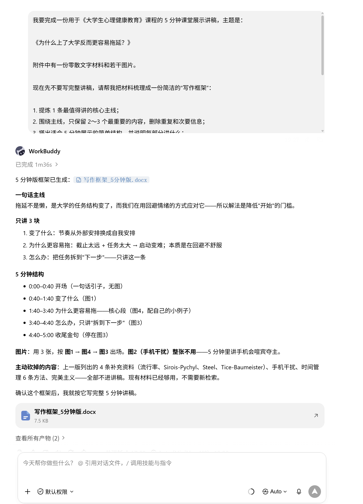
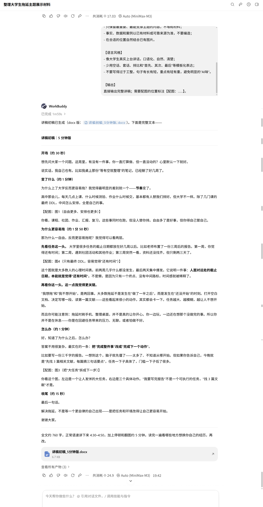
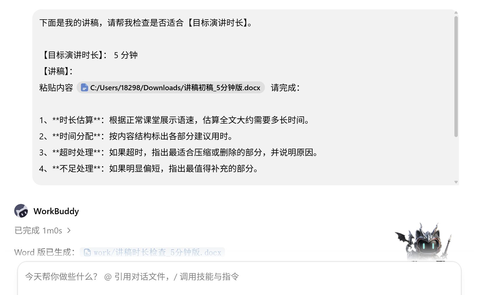
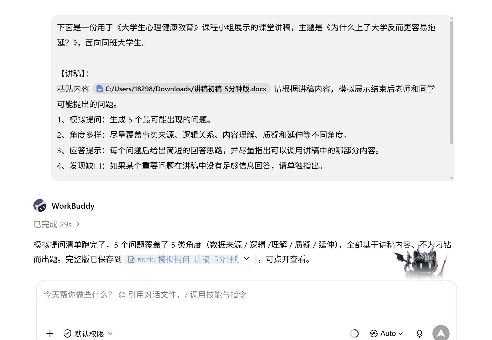
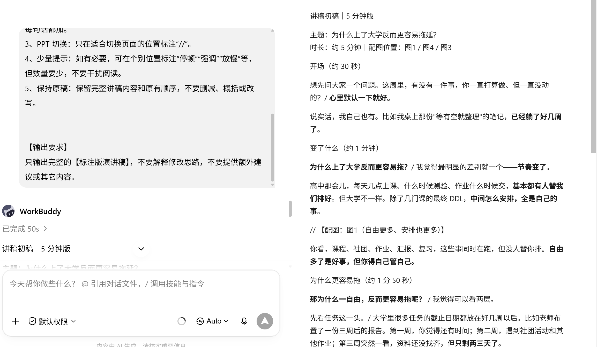

# 12 AI辅助写作全流程

[官网课程](https://www.datawhale.cn/learn/content/382/7937)

## 第一部分 总览

面对一个陌生的写作任务，如何借助 AI，从我不知道写什么、手里只有一堆零散材料，一步步走到目标清楚、素材完整、结构合理，并最终形成一篇可以交付的稿子。

## Part 1｜主要应用场景与人群

| 主要场景 | 典型任务 | 主要人群 |
| --- | --- | --- |
| 课程作业与小组项目 | 根据老师的要求和小组资料，确定主题、整理观点、搭建框架，完成课程报告、小组作业、案例分析等 | 大学生、研究生 |
| 校园活动与组织宣传 | 根据活动方案、现场记录、采访材料和照片说明，完成公众号推文、活动新闻稿、活动总结等 | 学生组织、社团、班委、新媒体成员 |
| 演讲与展示内容 | 把零散的想法、资料或报告内容整理成演讲稿、课堂展示稿、答辩讲稿等 | 大学生、研究生 |
| 内容创作 | 从一个模糊想法出发，寻找角度、设计结构，完成推文、博客文章、短视频脚本等 | 学生、自媒体创作者、内容运营 |

## Part 2｜AI 辅助的主要环节

| 序号 | 环节 | AI 做什么 | 人做什么 |
| --- | --- | --- | --- |
| 1 | 明确写作方向 | 拆解任务、头脑风暴，提供不同选题和切入角度 | 明确写作目的，选择真正想表达的方向 |
| 2 | 整理写作素材 | 阅读资料，提取重点、分类整理、发现信息缺口 | 提供真实材料，判断哪些信息可信、重要 |
| 3 | 搭建文章结构 | 提炼核心信息，生成和调整文章提纲 | 确定文章主线，决定内容取舍和顺序 |
| 4 | 辅助写成初稿 | 根据素材和结构扩写、改写，帮助组织语言 | 提供观点和细节，控制文章实际表达的内容 |
| 5 | 修改与检查 | 从逻辑、表达、语气、冗余等方面提出修改建议，标记待核实信息 | 判断是否采纳修改，并完成事实核查和最终定稿 |

## Part 3｜可以使用什么工具

**找方向 → 整理素材 → 搭结构 → 写初稿 → 修改检查**

→ **日常写作、整理资料、修改文章**：可用 [WorkBuddy](<https://www.workbuddy.com/>) / [千问](<https://www.qianwen.com/>) 等

→ **如果已经习惯其他国内 AI：**[Kimi](<https://www.kimi.com/>) / [腾讯元宝](<https://yuanbao.tencent.com/>) / [DeepSeek](<https://www.deepseek.com/>) 等，任选一个即可

→ **如果在国外，或者有条件：**[ChatGPT](<https://chatgpt.com/>) / [Claude](<https://claude.ai/>) 等

→ **最后排版和正式交付：**[Microsoft Word](<https://www.microsoft.com/microsoft-365/word>) / [WPS Office](<https://www.wps.cn/>)

**参考路线**

**国内：**WorkBuddy + Word / WPS

**海外或有条件使用：**ChatGPT + Word / WPS

## 第二部分 动手实操：用 AI 完成一份课堂汇报稿

**任务解释及背景：**目前手上有一份关于《为什么上了大学反而更容易拖延？》的资料，包含零散文字材料的合集word + 若干图片，你需要整理这份资料，完成一份用于《大学生心理健康教育》课程，**5分钟的课堂展示讲稿**。

**素材下载：**

[小组作业素材包\_大学生为什么更容易拖延.zip](../../public/course-assets/12/source-01.zip)

## 第1步｜整理材料、梳理思路

**先让 AI 整理现有资料，如果信息不足，再检索可靠来源补充，最后提炼主线并搭出结构。**

### 提示词

```markdown
我要完成一份用于《大学生心理健康教育》课程的 5 分钟课堂展示讲稿，主题是：《为什么上了大学反而更容易拖延？》

附件中有一份零散文字材料和若干图片。

现在先不要写完整讲稿，请帮我把材料梳理成一份简洁的写作框架：
1. 提炼 1 条最值得讲的核心主线；
2. 围绕主线，只保留 2～3 个最重要的内容，删除重复和次要信息；
3. 搭出适合 5 分钟展示的简单结构，并说明每部分讲什么；
4. 标出哪些现有图片适合放在哪一部分。

如果现有资料确实缺少支撑主线的关键信息，可以检索补充，但只补必要内容并注明来源。

要求：
- 5 分钟是硬性限制，宁可少讲，也不要堆砌信息；
- 面向普通大学生，避免过于学术；
- 这一阶段只需要主线和结构，不需要展开成讲稿，也不要提供过多理论和延伸资料。
```

**演示及效果图：**



[写作框架\_5分钟版.docx](../../public/course-assets/12/source-02.docx)

## 第2步 | 形成初稿

**根据已经确定的主线、结构和素材，把内容展开成一份符合具体使用场景、可以实际使用的完整初稿。**

### 提示词

```text
请根据前面已经确定的主线、结构和素材，完成一份完整初稿。

【任务背景】
- 文稿类型：课堂展示讲稿
- 使用场景：《大学生心理健康教育》课程小组展示
- 主题：《为什么上了大学反而更容易拖延？》
- 面向对象：同班大学生
- 时长：5分钟左右

【内容要求】
- 按照已有主线和结构展开，不随意增加新的分支；
- 只保留最重要、最能支撑主题的内容，不堆砌材料；
- 事实、数据和案例以已有材料或可靠来源为准，不要编造；
- 在合适的位置自然结合已有图片。

【语言风格】
- 像大学生真实上台讲话，口语化、自然、清楚；
- 少用空话、套话、排比和“首先、其次、最后”等模板化表达；
- 不要写得过于工整，句子有长有短，重点有轻有重，避免明显的“AI味”。

【输出】
直接输出完整讲稿；需要配图的位置标注【配图：……】。
```

**通用模板：**

```markdown
请根据前面已经确定的主线、结构和素材，完成一份完整初稿。

【任务背景】
- 文稿类型：【填写】
- 使用场景：【填写】
- 面向对象：【填写】
- 篇幅/时长：【填写】

【内容要求】
- 按照已有主线和结构展开，不随意增加新的内容；
- 只保留与主题最相关的信息，重点讲清楚，不堆砌材料；
- 事实、数据和案例以已有材料或可靠来源为准，不要编造。

【语言风格】
- 符合真实使用场景，自然、清楚、具体；
- 少用空话、套话、排比和模板化表达；
- 不要写得过于工整，句子和段落要有轻重，避免明显的“AI味”。

【输出】
直接输出完整初稿；如需配图，在对应位置标注【配图：……】。
```

**演示与效果：**



**输出文件：**

[讲稿初稿\_5分钟版.docx](../../public/course-assets/12/source-03.docx)

## 第三部分 进阶案例

### **技巧 1｜按演讲时长检查并调整讲稿**

重点：估算时长 → 标记各部分时间 → 找出需要压缩/可以补充的位置。

**怎么操作（提示词）：**

```text
下面是一份用于《大学生心理健康教育》课程小组展示的课堂讲稿，主题是《为什么上了大学反而更容易拖延？》，面向同班大学生。

【目标演讲时长】：例如 5 分钟
【讲稿】：
粘贴内容

请帮我检查这份讲稿是否适合目标时长。

1、时长估算：根据正常课堂展示语速，估算全文大约需要多长时间。
2、时间分配：按内容结构标出各部分建议用时。
3、超时处理：如果超时，指出最适合压缩或删除的部分，并说明原因。
4、不足处理：如果明显偏短，指出最值得补充的部分。

【重要】
不要直接重写整篇讲稿，先以检查和调整建议为主；实际时长最终以本人试讲为准。
以word形式输出修改后完整的演讲稿，不需要“解释原因”等多余内容
```

**演示及效果图：**



**输出文件：**

[讲稿时长检查\_5分钟版.docx](../../public/course-assets/12/source-04.docx)

### **技巧 2｜模拟现场提问，提前准备可能被问到的问题**

重点：让 AI 根据讲稿，从事实来源、逻辑、质疑、延伸等角度模拟老师和同学提问。

**怎么操作（提示词）：**

```text
下面是一份用于《大学生心理健康教育》课程小组展示的课堂讲稿，主题是《为什么上了大学反而更容易拖延？》，面向同班大学生。

【讲稿】：
粘贴内容

请根据讲稿内容，模拟展示结束后老师和同学可能提出的问题。
1、模拟提问：生成 5 个最可能出现的问题。
2、角度多样：尽量覆盖事实来源、逻辑关系、内容理解、质疑和延伸等不同角度。
3、应答提示：每个问题后给出简短的回答思路，并尽量指出可以调用讲稿中的哪部分内容。
4、发现缺口：如果某个重要问题在讲稿中没有足够信息回答，请单独指出。

【重要】
问题要基于讲稿内容和课堂场景，不要为了刁钻而提出与主题无关的问题。
以word形式输出
```

**演示及效果图：**



**输出文件：**

[模拟提问\_讲稿\_5分钟版.docx](../../public/course-assets/12/source-05.docx)

### 技巧 3｜给完整讲稿加上关键演讲提示

**描述：**
完整讲稿写好后，可以让 AI 只在真正需要的位置加上少量提示，例如【重点词】【关键停顿】【PPT 切换点】。这样既保留完整讲稿，又能在上台时快速抓住重点，不会因为标记太多反而影响阅读。

**怎么操作（提示词）：**

```text
下面是一份用于《大学生心理健康教育》课程小组展示的课堂讲稿，主题是《为什么上了大学反而更容易拖延？》，面向同班大学生。

【讲稿】：
粘贴内容

请在【不删减、不改写原文】的前提下，把这份讲稿整理成一份可直接上台使用的【标注版演讲稿】。

1、重点提示：只对最需要强调、帮助我快速定位内容的关键词或短语进行加粗。
2、关键停顿：只在确实需要停顿、转折或强调的位置标注“/”，不要给每句话都加。
3、PPT 切换：只在适合切换页面的位置标注“//”。
4、少量提示：如有必要，可在个别位置标注“停顿”“强调”“放慢”等，但数量要少，不要干扰阅读。
5、保持原稿：保留完整讲稿内容和原有顺序，不要删减、概括或改写。

【输出要求】
只输出完整的【标注版演讲稿】，不要解释修改思路，不要提供额外建议或其它内容。
```

**演示图：**



## 参考材料

1. [OpenAI 官方提示工程指南（Prompt Engineering Guide）](<https://platform.openai.com/docs/guides/prompt-engineering>)
2. [吴恩达 &amp; OpenAI《面向开发者的 Prompt 工程》中文版（Datawhale）](<https://github.com/datawhalechina/prompt-engineering-for-developers>)
3. [六步写出清晰的 Prompt（飞书文档）](<https://docs.feishu.cn/article/wiki/ClV0wN3LOi2ekokfVf0cOdd0nDh>)
4. [演讲稿与简报字数规划指南（](<https://www.wordcount.hk/blog/speech-presentation-word-count.html>)[WordCount.HK](<https://www.wordcount.hk/blog/speech-presentation-word-count.html>)[）](<https://www.wordcount.hk/blog/speech-presentation-word-count.html>)
5. [TimeMyWords 演讲时间计算器](<https://www.timemywords.com/zh>)
6. [How to Use AI Voice Mode to Practice for a College Presentation（Vertech Academy）](<https://www.vertechacademy.ca/blog/ai-voice-mode-practice-presentation>)
7. [DeepSeek 模拟答辩老师提问（今日头条）](<https://m.toutiao.com/article/7504102594408514088>)
8. [AI Speech Writer: Write Powerful Speeches in Minutes（UseAIWriter）](<https://www.useaiwriter.com/articles/ai-speech-writer-free.html>)
9. [How to prompt ChatGPT to write a speech without sounding robotic（The Toast）](<https://thetoast.io/?p=12150/>)
10. [AI 赋能教学教研：怎么撰写演讲稿（ima 知识库）](<https://ima.qq.com/wiki/?shareId=9cc437ac3cef8ec65e1d19fb70cb6ee872df4b6e1ba09188be3e9185acf94dbe&mediaId=note_b5a9f63d3f9398ac558eb92abb1ebd33_74340393885660307419715567761146&action=openDetailDrawer&webFrom=10000171>)
