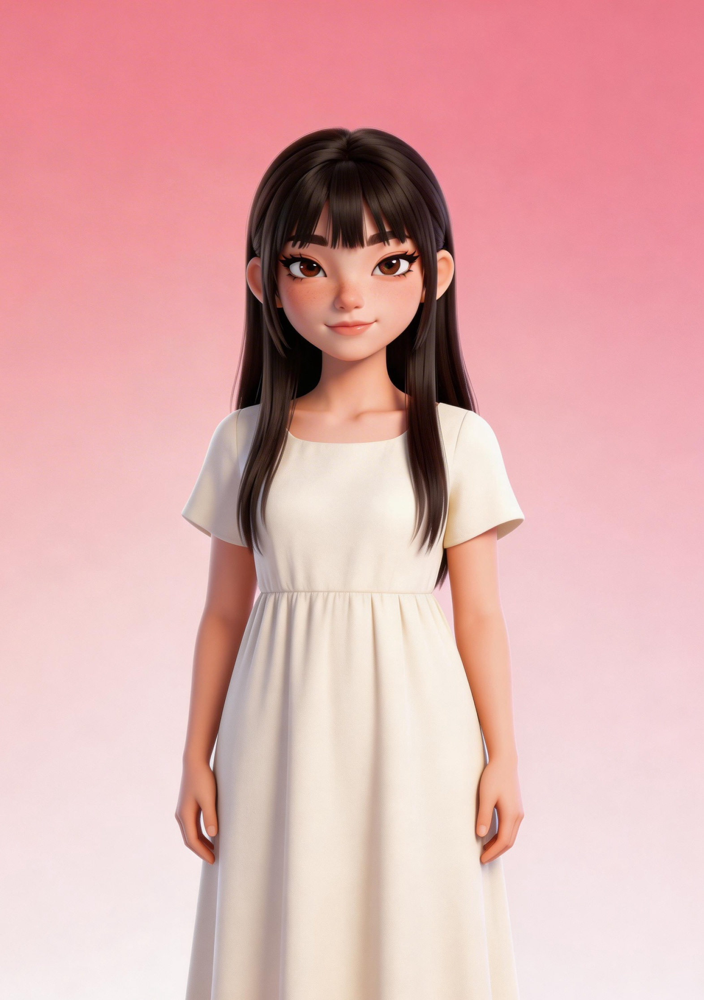
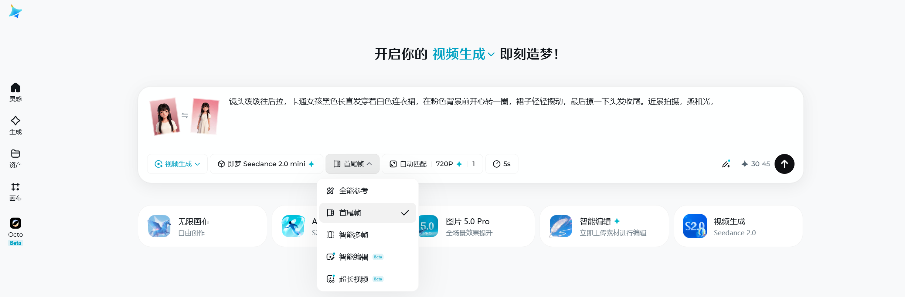
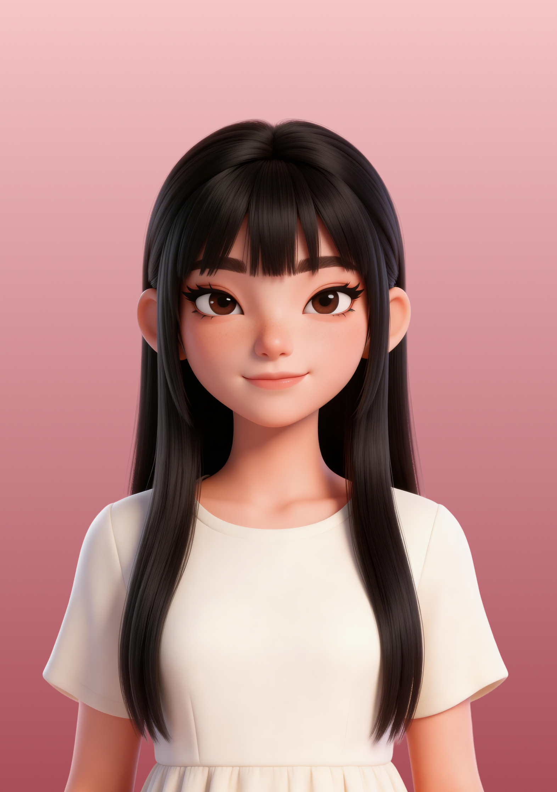
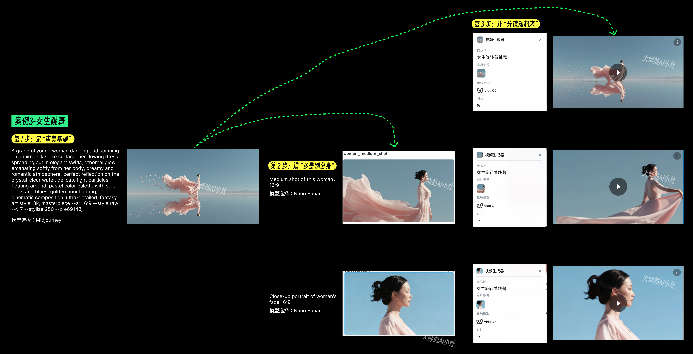
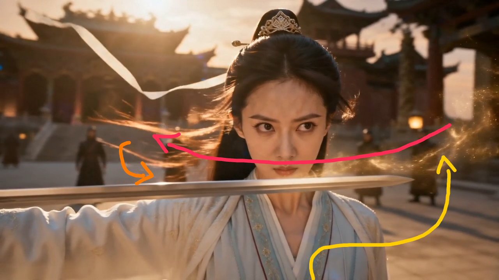
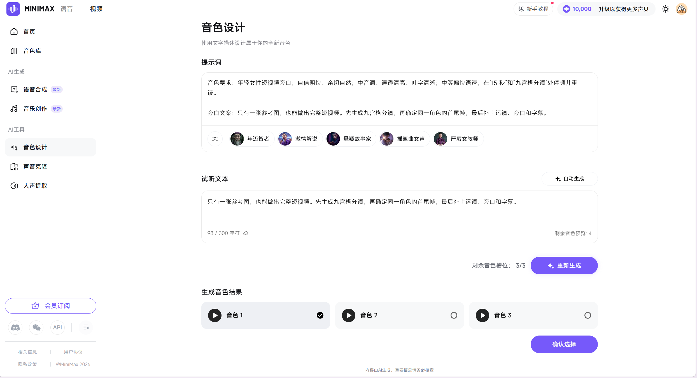

# 13 短视频策划与AI制作

[官网课程](https://www.datawhale.cn/learn/content/382/7938) · [飞书源稿](https://datawhaler.feishu.cn/docx/Rqy4dsdSOoz24bx2wvFcvLUZnTh)

> **解决的问题：**短视频制作时没有分镜、角色前后不一致、运镜不可控、旁白生硬、剪辑顺序不清楚。
> 
> 
> 
> **最终产物：**一条 15 秒、9:16、1080×1920 的竖屏短视频；同时保留九宫格分镜、角色首尾帧、5 秒视频片段和旁白音频。
> 
> 
> 
> **学习时长：**独立场景，每个 8～15 分钟。
> 
> 
> 
> 提醒：AI生图具有随机性，同样提示词生成效果会有不同！

## 第一部分：开始前安装

只需准备下面 4 个工具：

1. [豆包](<https://www.doubao.com/>)：生成分镜提示和剪辑清单。
2. [即梦 AI](<https://jimeng.jianying.com/>)：生成角色图片、首尾帧和短视频。
3. [可灵 AI](<https://klingai.kuaishou.com/>)：即梦不可用时，用于图生视频。
4. [剪映专业版](<https://www.capcut.cn/download-guidance>)：拼接片段、加入配音、字幕和导出视频。
5. [MiniMax](<https://www.minimaxi.com/audio>)：制作文本、语音、视频、图像和音乐。

即梦 AI 与可灵 AI 二选一即可。

## 第二部分：微场景：生成同一角色的首帧和尾帧

**做出的东西：**两张 9:16 图片，分别作为视频首帧和尾帧，同时这两张作品生成一个视频

下面这段是“发给 AI”的完整提示词，先放在手边，第三步会用到。

```text
使用上传图片中的角色作为唯一参考，生成两张 9:16 画面。A 首帧：角色正面全身站立，居中构图，柔和光，纯色背景。B 尾帧：同一角色向右转身，裙摆轻微摆动，镜头拉近到半身。两张图必须保持五官、发型、服装、背景和光线一致；不要新增人物或物体。
```

1. 打开[即梦 AI](<https://jimeng.jianying.com/>)，进入“图片生成”。
2. 上传挑好的参考图，在“智能参考／参考图”里把它指定为“角色参考”，不要选“风格参考”——这是把脸钉住的关键一步。
3. 画面比例选 9：16，把上面那段提示词粘贴进对话框发送。一次多生成几张，再从中挑。
4. 从结果里挑最像参考图的两张，分别定为首帧和尾帧。
5. 逐张核对五官、发型、服装、背景四项，任一不对就重抽。
6. 分别下载，文件名存成`  首帧  `和`  尾帧  `  。

### 首尾帧做出来后，怎么用

现在你手上有两张角色一致的横屏图，下一步有三条路：

- **走“首尾帧”视频：**在即梦选首尾帧入口，首帧传 start-frame.jpg、尾帧传 end-frame.jpg，中间的 5 秒动作会在两帧之间平滑过渡，全程不换人。
- **只传首帧自由发挥：**不想限定终点时，只用首帧做图生视频，尾帧当风格参考留着。
- **当角色设定卡存档：**两张图就是一份角色档案，下次做这个角色的新镜头直接拿出来传，比重新描述省一大截。

### 一次跑通，检查这几项

| 核对项 | 该长什么样 |
| --- | --- |
| 五官 | 同一张脸，眉眼口鼻不“跳戏” |
| 发型 | 颜色、长度、刘海一致 |
| 服装 | 同款同色，褶皱可以动，款式不能换 |
| 背景 | 同场景同光线；你自己想换背景的，属于主动要求，不算漂移 |
| 尺寸 | 两张都是 9:16，分辨率一致，进视频才不会拉伸 |

如果首尾帧还是换脸变装，别急着反复抽卡，先回头看两处：参考图够不够干净、提示词里有没有写清“唯一参考”。问题多半出在入口。

### 参考案例：

首先我们先上传我们的参考图片：输入我们的提示词，


于是生成两张首尾帧的图片：




首帧和尾帧生成后，点击视频生成：

这时候把首帧和尾帧上传

然后输入提示词：` 镜头缓缓往后拉，卡通女孩黑色长直发穿着白色连衣裙，在粉色背景前开心转一圈，裙子轻轻摆动，最后撩一下头发收尾。近景拍摄，柔和光， `



| 素材 | 提示词 | 结果 |
| --- | --- | --- |
| <br> | 镜头缓缓往后拉，卡通女孩黑色长直发穿着白色连衣裙，在粉色背景前开心转一圈，裙子轻轻摆动，最后撩一下头发收尾。近景拍摄，柔和光， | [3月22日 (1).mp4](../../public/course-assets/13/source-01.mp4) |

## 第三部分：延伸学习

### 延伸 1：把一张参考图变成九宫格分镜（12 分钟）

**解决的问题：**只有一张图，不知道下一镜拍什么。

1. 打开[豆包](<https://www.doubao.com/>)，新建对话。
2. 点击输入框旁的“上传”，上传 1 张人物、产品或场景图片。
3. 复制下方“发给 AI”的全部文字，粘贴并发送。
4. 确认输出包含 9 个镜头，且人物、服装、背景一致。
5. 下载图片，文件名保存为 storyboard-grid.png。

```text
分析我上传图片中的人物、物体和空间关系。
生成一张 3×3 电影分镜网格，每格 16:9，依次包含：
超远景、全景、中远景、中景、近景、特写、极特写、低机位、背面远景。
保持同一人物、服装、场景、光线和色调，不新增人物或物体。
每格标注镜号、景别和建议时长。
总时长控制在 15 秒以内。
```

**效果示范：**从审美基调到多景别，再到视频片段。



**效果示范：**分镜网格成品。


### 延伸 2：让角色按指定动作和运镜生成 5 秒视频（15 分钟）

**解决的问题：**生成的视频人物乱动、镜头突然切换、运镜方向不可控。

**做出的东西：**一个 5 秒、9:16 的图生视频片段。

1. 打开[即梦 AI](<https://jimeng.jianying.com/>)或[可灵 AI](<https://klingai.kuaishou.com/>)，选择“首尾帧”或“图生视频”。
2. 首帧上传 start-frame.jpg，尾帧上传 end-frame.jpg。
3. 时长选择 5 秒，比例选择 9:16。
4. 复制下方“发给 AI”的全部文字，粘贴并生成。
5. 下载视频，文件名保存为 shot-01.mp4。

```text
在最终视频中移除红线、箭头和所有辅助标记。
红色路径仅用作相机运动参考。创建一个第一人称一镜到底的FPV无人机镜头，具有电影感、速度分层节奏一次性完成的运动。相机应紧密沿图像上的红色路径移动。保持路线顺序不得跳过路段，不得简化路径。
从画面左侧贴地高速切入，进入剑范围后骤然减速，以升格慢动作逆时针紧密环绕剑连续盘旋，呈现表演者细节，始终保持与剑外缘贴近但不穿入，随后骤然加速向右下方俯冲，贴近持剑者身体侧面。最终画面定格于表演者左后方低角度(描述可自己替换)。
超现实逼真，速度节奏:快慢一快，空间衔接清晰。黄昏逆光，升格段落层次丰富，烟雾粒子清晰可辨。不得有红线、箭头、文字、水印，不要失真人体比例，不要多余人物。
```

**效果示范：**人物移动和镜头方向。



[视频 (2)\_副本2.mp4](../../public/course-assets/13/source-02.mp4)

### 延伸 3：生成 10～15 秒旁白（10 分钟）

**解决的问题：**配音语速、音色和情绪不匹配。

**做出的东西：**一段可放进短视频的旁白音频。

1. 打开[MiniMax](<https://www.minimaxi.com/audio>)，点击语言大模型中的“音色设计”打开[剪映专业版](<https://www.capcut.cn/download-guidance>)，新建草稿。
2. 点击“文本”→“新建文本”，粘贴下方旁白文案。
3. 点击“文本朗读”，选择年轻女声。
4. 若工具支持音色描述，同时粘贴“音色要求”；不支持则按要求选择最接近的音色。
5. 导出音频，文件名保存为 voiceover.wav。

```text
音色要求：年轻女性短视频旁白；自信明快、亲切自然；中音调、通透清亮、吐字清晰；中等偏快语速，在“15 秒”和“九宫格分镜”处停顿并重读。

旁白文案：只有一张参考图，也能做出完整短视频。先生成九宫格分镜，再确定同一角色的首尾帧，最后补上运镜、旁白和字幕。
```

**输入结构示范：**角色身份＋情感/气质＋声音物理特质＋语速/停顿。

#### 文生音色提示词库

**角色身份 + 情感 / 气质 + 声音物理特质 + 语速 / 停顿**

##### 提示词公式

| **组成部分** | **填写内容** |
| --- | --- |
| 角色身份 | 年龄、性别、职业、人物定位等 |
| 情感 / 气质 | 积极、冷静、邪恶、庄重、温柔等 |
| 声音物理特质 | 音高、音域、音质、特殊声音细节、语调等 |
| 语速 / 停顿 | 快慢、节奏、停顿位置及停顿时长 |
| 完整公式 | 角色身份 + 情感 / 气质 + 声音物理特质 + 语速 / 停顿 |

##### 一、情感 / 气质提示词库

| **分类** | **适用场景** | **可用提示词** |
| --- | --- | --- |
| 积极正向类 | 儿童、青春、商业场景 | 开朗热情、充满朝气、活力四射、元气满满、乐观阳光、亲切友好、自信昂扬、积极坚定、轻松愉快、热情洋溢 |
| 冷静疏离类 | 纪录片、旁白、悬疑场景 | 冷静克制、理性客观、沉稳淡定、疏离冷淡、情绪平稳、波澜不惊、清醒从容、不动声色、冷峻严肃、神秘深沉 |
| 负面邪恶类 | 反派、恐怖、悬疑场景 | 阴险狡诈、邪恶狠毒、冷酷无情、压抑阴沉、愤怒暴躁、怨恨嫉妒、悲观绝望、凶狠残忍、诡异神秘、令人不安 |
| 厚重庄重类 | 纪录片、历史、正式场合 | 庄重严肃、沉稳厚重、威严有力、恢宏大气、肃穆克制、坚定有信念、充满使命感、富有权威感、历史沧桑感、史诗感 |
| 温柔治愈类 | 睡前故事、心理咨询、亲子场景 | 温柔细腻、轻声软语、亲切自然、耐心包容、温暖治愈、柔和舒缓、安抚感强、令人放松、充满关怀、甜美柔软 |

##### 二、声音物理特质提示词库

| **维度** | **可用提示词** |
| --- | --- |
| 音高 / 音域 | 高亢明亮、清脆高音、自然中音、低沉浑厚、音域宽广、音域窄而集中、声音有穿透力、声音位置偏高、声音位置偏低 |
| 音质 / 质感 | 清澈通透、纯净自然、温润柔和、圆润饱满、磁性低沉、沙哑粗粝、颗粒感明显、金属质感、丝绒质感、空气感强、鼻音明显 |
| 特殊声音细节 | 带轻微气声、带自然鼻音、略有沙哑感、尾音轻扬、尾音下沉、略带颤音、呼吸声自然、咬字清晰、吐字有力、声音略带回响 |
| 语调 / 语气 | 陈述式、讲述式、播音腔、聊天口吻、疑问语气、肯定语气、命令语气、感叹语气、语调平稳、语调起伏明显、句末上扬、句末下沉 |

##### 三、语速 / 停顿提示词库

| **维度** | **可用提示词** |
| --- | --- |
| 基础语速 | 语速缓慢、语速偏慢、中等语速、语速适中、语速略快、轻快活泼、节奏舒缓、节奏紧凑、匀速讲述、快慢交替 |
| 停顿位置 | 在逗号处短暂停顿、在句号处明显停顿、关键词前停顿、关键词后停顿、转折处停顿、段落之间延长停顿 |
| 停顿时长 | 极短停顿、短暂停顿、自然停顿、明显停顿、长停顿、停顿约 0.5 秒、停顿约 1 秒 |
| 停顿功能 | 用停顿制造悬念、用停顿突出重点、用停顿表达迟疑、用停顿营造庄重感、用停顿增强情绪、用停顿模拟自然呼吸 |

##### 四、组合示例

| **使用场景** | **完整提示词** |
| --- | --- |
| 儿童故事 | 年轻女性，温柔治愈、亲切自然；声音清澈柔和，略带气声；语速偏慢，在句号处自然停顿。 |
| 商业广告 | 青年男性，积极自信、热情有感染力；声音明亮饱满、富有穿透力；语速略快，关键词后短暂停顿。 |
| 历史纪录片 | 中年男性，厚重庄严、沉稳克制；声音低沉浑厚，带有沧桑感；语速缓慢，段落之间明显停顿。 |
| 悬疑旁白 | 成年女性，冷静疏离、神秘压抑；声音偏低、略带沙哑和气声；语速偏慢，转折前停顿以制造悬念。 |
| 反派角色 | 中年男性，阴险冷酷、令人不安；声音低沉粗粝，带轻微鼻音；语速忽快忽慢，关键词前刻意停顿。 |

**效果示范图片：**



[20260903-0610-43.0624073.mp4](../../public/course-assets/13/source-03.mp4)

Datawhale 内容参考：

1. [Datawhale Design with AI：视频生成案例](<https://github.com/datawhalechina/design-with-ai/blob/main/docs/casebook/Video_Production/CyberNezha_video_0501_wenxin/CyberNezha_video_0501_wenxin.md>)
2. [Datawhale：提示词工程](<https://github.com/datawhalechina/self-harness/blob/main/docs/chapter2/prompt_engineering.md>)

## 参考资料

- [用分镜搞定影视感](<https://vupyskvyxk.feishu.cn/wiki/EwGlwWKkziBe37kbzJVcBSfQnDh>)
- [分镜提示词](<https://gwrdluzl9j9.feishu.cn/wiki/G2Y8wtNTTit8eLk7WkKcWk0xnAU>)
- [角色首尾帧交互效果](<https://gwrdluzl9j9.feishu.cn/wiki/IHP0wvVCgih0THk2MZzcGigAnrc>)
- [AI 视频精准控制：镜头语言、人物站位、视频运镜](<https://gwrdluzl9j9.feishu.cn/wiki/XbUuwlEPqiplqQkJiEPcG6vAnfg>)
- [AI 生音频提示词公式与词库](<https://vupyskvyxk.feishu.cn/wiki/SxWkwdXq5iP8ajkeq0ucYZPvnAh>)
- [课程素材表：编号 15「短视频策划与 AI 制作」关联素材](<https://datawhaler.feishu.cn/base/UNpMbDen6aEgRtsu4hXcRlmDned?table=tblHBAw3nicBpSX1&view=vewfWkiF3W>)
- 课程编号：15
- 课程初版日期：2026-09-02
