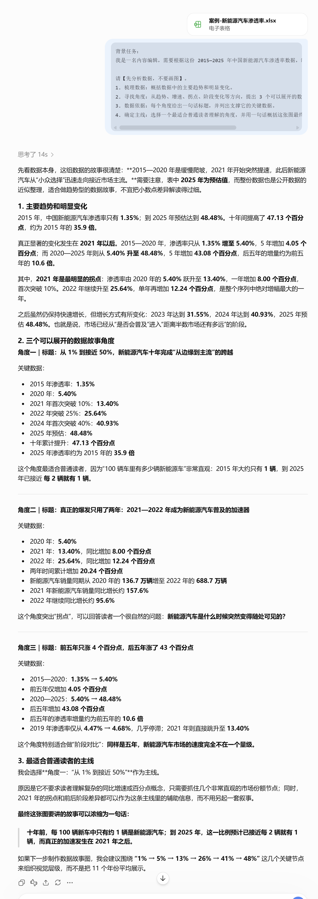
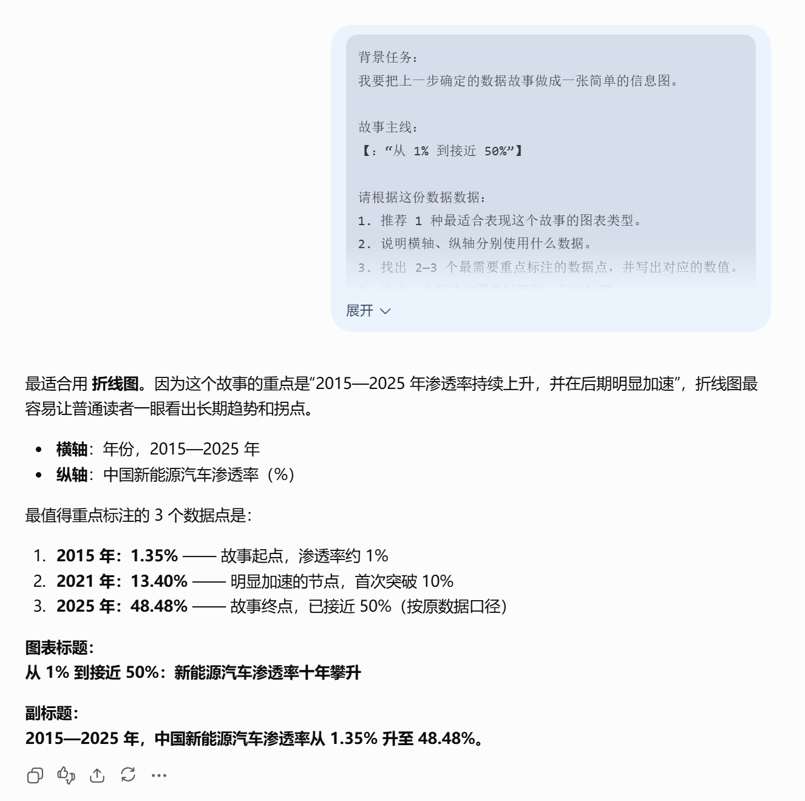
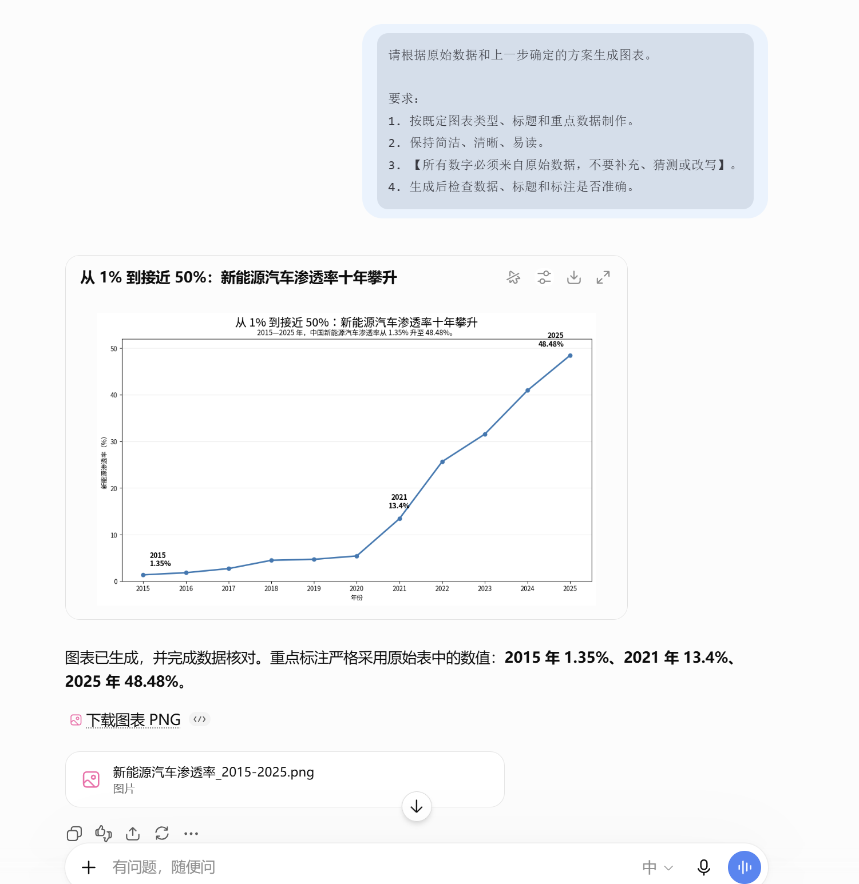
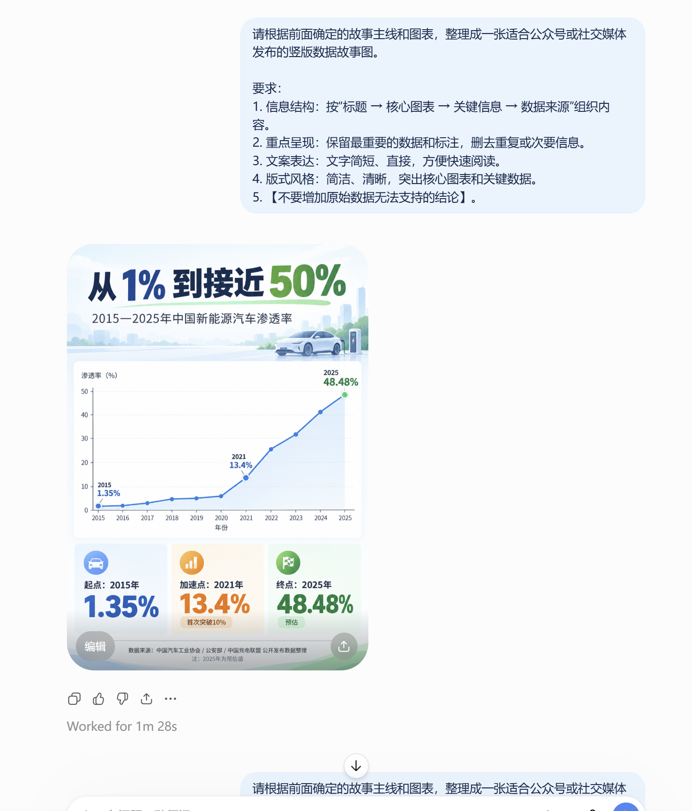
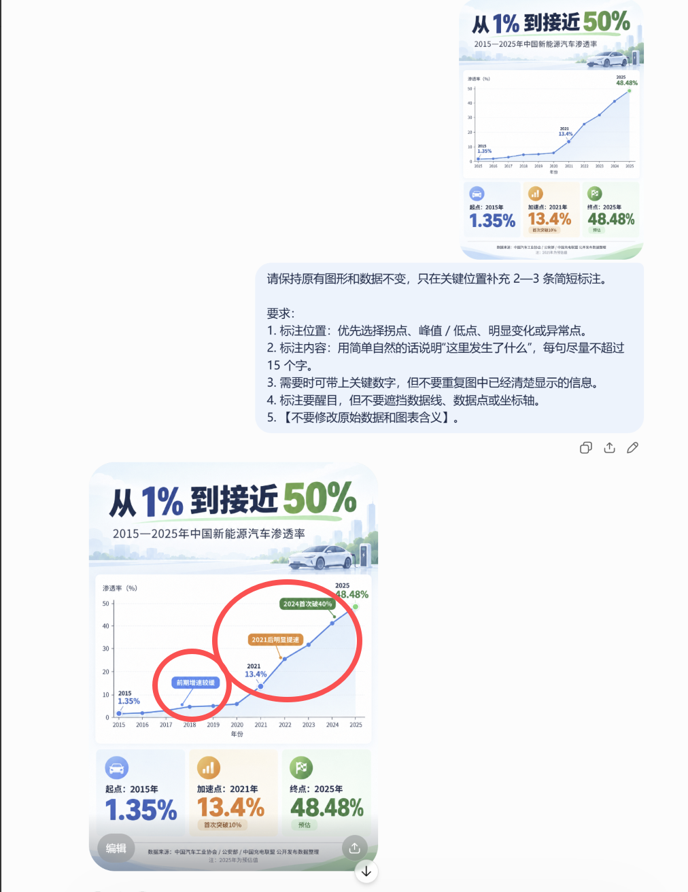
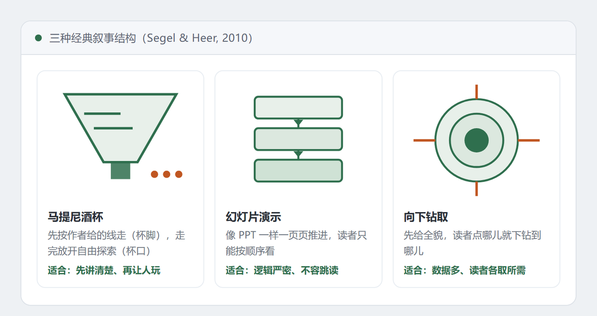

# 14 数据叙事与可视化

[官网课程](https://www.datawhale.cn/learn/content/382/7939)

> **读完这份教程，你将能用 AI 把一份普通 Excel 数据，变成一张几秒看懂、适合传播的数据故事图。**

## **一、总览**

### **Part 1｜主要应用场景与人群**

| **场景** | **典型人群** | **要解决的问题** |
| --- | --- | --- |
| 汇报与分享 | 职场人、学生 | 一屋子人听不懂数字，需要一个不看数据也能看懂的说法 |
| 内容创作 | 自媒体作者、运营 | 把热点数据做成一图看懂或短视频，换来转发和完播 |
| 教学与科普 | 老师、培训师、科普作者 | 把抽象概念变成看得见的图，让人记得住 |
| 产品与市场分析 | 产品经理、市场、咨询顾问 | 把分析结论包装成有说服力的故事，推动别人做决定 |
| 个人记录与分享 | 任何人 | 把健身、账单、学习记录做成一份好看的年度总结 |

### **Part 2｜AI 辅助的主要环节**

| **序号** | **环节** | **AI 做什么** | **人做什么** |
| --- | --- | --- | --- |
| 1 | 找故事角度 | 从数据里挑出几个有反差的候选角度，并给出推荐理由 | 判断哪个角度站得住 |
| 2 | 选图表 | 根据叙事意图推荐图表类型、标注点和配色方案 | 确认图表没有夸大数据 |
| 3 | 生成图表 | 一句话出图 | 针对性提出修改要求 |
| 4 | 写故事文案 | 按叙事结构写标题、导语、过渡句和数据注释 | 核对事实，删掉夸张的表述 |
| 5 | 做成作品 | 一键排版成信息图海报、PPT 或短视频 | 选平台、定调性、把关最后效果 |

### **Part 3｜可以使用什么工具**

这份教程全程只用三类工具：

→ 找角度、写文案、做图表：[Kimi](<https://kimi.moonshot.cn/>) / [腾讯元宝](<https://yuanbao.tencent.com/>) / [DeepSeek](<https://chat.deepseek.com/>) —— 支持上传 Excel，中文体验也不错

→ 把文字和图表排成作品：[Napkin AI](<https://www.napkin.ai/>) / [Canva 可画](<https://www.canva.cn/>) / [Gamma](<https://gamma.app/>)

→ 把静态图做成短视频：[剪映“图文成片”](<https://www.capcut.cn/>) / [即梦 AI](<https://jimeng.jianying.com/>)

如果能用国外工具：[ChatGPT](<https://chatgpt.com/>) / [Claude](<https://claude.ai/>) / [Gemini](<https://gemini.google.com/>) 也很好用；想做动态数据图，可以用 [Flourish](<https://flourish.studio/>)。

| **推荐路线：**Kimi/DeepSeek等主流AI（找角度 + 写文案 + 出图）→ Canva 可画（排成海报）→ 剪映图文成片（改成视频）。 |
| --- |

## **二、动手实操：从原始表格数据到一张数据故事海报**

### 案例场景

你是一名**内容运营 / 编辑**，手上有一份 **2015—2025 年中国新能源汽车渗透率数据**。

你的任务是：

**把这份 Excel 数据做成一张适合公众号、社交媒体发布的数据故事图。**

面向的读者是：

**对新能源汽车感兴趣，但不熟悉行业数据的普通读者。**

最终希望读者能快速看懂：

**过去十年，中国新能源汽车渗透率发生了什么变化，以及变化从什么时候开始明显加快。**

**下载素材：**

[案例-新能源汽车渗透率.xlsx](../../public/course-assets/14/source-01.xlsx)

### 第一步：从数据里找故事

把 Excel 上传给 AI，让它先帮你找出数据里最值得讲的变化。

**输入提示词：**

```text
背景任务：
我是一名内容编辑，需要根据这份 2015—2025 年中国新能源汽车渗透率数据，制作一张面向普通读者的数据故事图。

请【先分析数据，不要画图】。
1. 梳理数据：概括数据中的主要趋势和明显变化。
2. 寻找角度：从趋势、增速、拐点、阶段变化等方向，提出 3 个可以展开的数据故事角度。
3. 数据依据：每个角度给出一句话标题，并列出支撑它的关键数据。
4. 确定主线：选择一个最适合普通读者理解的角度，并用一句话概括这张图最终要讲的故事。
```

**效果图**



### 第二步：用什么图、重点看哪里

确定故事主线后，让 AI 根据这个故事推荐图表，并找出最需要标注的数据点。

```text
背景任务：
我要把上一步确定的数据故事做成一张简单的信息图。

故事主线：
【粘贴上一步最终确定的主线】

请根据这份数据数据：
1. 推荐 1 种最适合表现这个故事的图表类型。
2. 说明横轴、纵轴分别使用什么数据。
3. 找出 2—3 个最需要重点标注的数据点，并写出对应的数值。
4. 给出一个简洁的图表标题和一句副标题。
请保持表达简单、准确，不要加入数据中没有的信息。
```

**效果图：**



### 第三步：直接让 AI 生成图表

图表方案确定后，直接生成可以使用的图表。

```text
请根据原始数据和上一步确定的方案生成图表。

要求：
1. 按既定图表类型、标题和重点数据制作。
2. 保持简洁、清晰、易读。
3. 【所有数字必须来自原始数据，不要补充、猜测或改写】。
4. 生成后检查数据、标题和标注是否准确。
```

**注：**

- 第一次生成不满意时，不需要重新写整段提示词，可以直接补一句：
  
  - “把标注减少到 2 个。”
  - “标题再短一点。”
  - “让拐点更明显。”
  - “删除不必要的网格线。”
  - ……

**效果图：**



### 第四步：让 AI 把图表整理成一张可发布的信息图

最后把主标题、图表和关键数字组合起来，让 AI 给出一张完整的信息图，或者给出可以直接放到 Canva 可画里的排版方案。

```text
请根据前面确定的故事主线和图表，整理成一张适合公众号或社交媒体发布的竖版数据故事图。

要求：
1. 信息结构：按“标题 → 核心图表 → 关键信息 → 数据来源”组织内容。
2. 重点呈现：保留最重要的数据和标注，删去重复或次要信息。
3. 文案表达：文字简短、直接，方便快速阅读。
4. 版式风格：简洁、清晰，突出核心图表和关键数据。
5. 【不要增加原始数据无法支持的结论】。
```

**效果图：**



## **三、进阶技巧**

### **技巧 1｜让 AI 给图表加标注**

图表本身不用重做，只需要让 AI 在真正重要的位置加上几句简短说明，帮助读者快速看懂哪里值得注意。

**提示词：**

```text
请保持原有图形和数据不变，只在关键位置补充 2—3 条简短标注。

要求：
1. 标注位置：优先选择拐点、峰值 / 低点、明显变化或异常点。
2. 标注内容：用简单自然的话说明“这里发生了什么”，每句尽量不超过 15 个字。
3. 需要时可带上关键数字，但不要重复图中已经清楚显示的信息。
4. 标注要醒目，但不要遮挡数据线、数据点或坐标轴。
5. 【不要修改原始数据和图表含义】。
```

**效果图：**



### 技巧 2｜让 AI 帮你安排叙事结构，先讲什么、后讲什么

同一组数据，换一个讲述顺序，读起来可能完全不一样。你不需要自己先研究叙事结构，可以直接告诉 AI 这份内容要给谁看、用在什么场景，让它帮你把信息排成一个清楚的讲述顺序。

比如，一份数据故事通常可以按这样的思路展开：

| 情况 | 叙事结构 | 可以怎么讲 | 典型案例 |
| --- | --- | --- | --- |
| 有明显时间变化，想让读者先看懂整体、再看细节 | 马提尼酒杯 | 现状 → 过去 → 关键变化 → 结果 | 某行业十年增长趋势；个人年度消费变化 |
| 逻辑需要一环接一环展开 | 幻灯片演示 | 先给结论 → 展示依据 → 逐步展开 → 收束重点 | 年终总结 PPT；项目复盘汇报 |
| 数据比较多，希望先看整体、再看局部 | 向下钻取 | 先讲整体 → 再讲重点 → 最后补充细节 | 全国人口分布 → 省份 → 城市；电商大盘 → 品类 → 单品 |
| 有明显转折、对比或异常 | 可结合前两种结构 | 正常状态 → 出现变化 → 转折点 → 后续变化 | 某产品销量突然下滑；两类用户转化率出现明显分化 |



**提示词：**

```text
背景任务：
我要把这份数据做成一个【60 秒内能看完】的数据故事。请结合我的背景、任务目的、目标读者和数据特点，帮我选择合适的叙事结构，并安排讲述顺序。

要求：
1. 结构选择：判断最适合当前任务的叙事结构，并简要说明理由。可以参考马提尼酒杯、幻灯片演示、向下钻取等常见结构，但【不限于这三种】。
2. 故事主线：用一句话概括故事的核心信息。
3. 内容安排：按阅读顺序拆成 3—4 个部分，说明每一部分讲什么。
4. 数据支撑：指出每一部分需要使用的关键数据。
5. 重点突出：合理安排关键变化、对比或转折的位置。

【先输出叙事结构和内容骨架，不要直接写完整文案。】
```

## **参考资料**

**方法论：**

- [Segel &amp; Heer, Narrative Visualization: Telling Stories with Data（2010）](<http://vis.stanford.edu/files/2010-Narrative-InfoVis.pdf>)——三种叙事结构的原始论文
- [Hans Rosling: The best stats you've ever seen（TED）](<https://www.ted.com/talks/hans_rosling_the_best_stats_you_ve_ever_seen>)——"用数据讲故事"的经典示范

**工具实操：**

- [Napkin AI 官网与教程](<https://www.napkin.ai>)
- [剪映"图文成片"使用指南](<https://www.capcut.cn>)
- [Flourish 案例库](<https://flourish.studio/examples>)——"会动的图"的灵感来源

**案例验证：**

- [澎湃新闻"美数课"栏目](<https://www.thepaper.cn>)——国内数据叙事的标杆
- [财新网"数字说"（数据可视化实验室）](<http://datanews.caixin.com>)——代表作《周永康的人与财》
- [同济大学 iDVX 实验室开源图表库 Narrative Chart](<https://narchart.github.io>)

**风险与边界：**

- [蓝星宇《叙事可视化：如何用数据讲故事》](<https://www.bing.com/search?q=%E8%93%9D%E6%98%9F%E5%AE%87+%E5%8F%99%E4%BA%8B%E5%8F%AF%E8%A7%86%E5%8C%96+%E5%A6%82%E4%BD%95%E7%94%A8%E6%95%B0%E6%8D%AE%E8%AE%B2%E6%95%85%E4%BA%8B>)——可视化设计的三大诚信问题
- [Lan &amp; Liu, "I Came Across a Junk": Understanding Design Flaws of Data Visualization（2024）](<https://arxiv.org/abs/2407.11497>)——数据可视化设计缺陷分类
