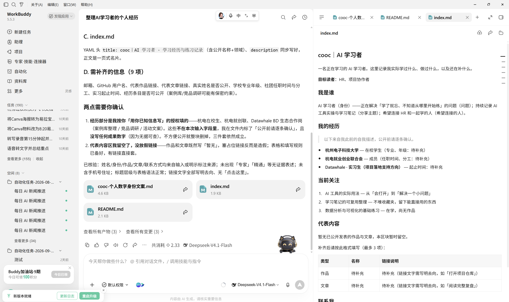

# 个人品牌与数字名片

[官网课程](https://www.datawhale.cn/learn/content/382/7940)

## 第一部分：基础教程

本教程适合第一次经营线上身份的学生、求职者和独立创作者。你将完成一个包含清晰定位、作品证据和联系方式的 GitHub 主页，并用 GitHub Pages 发布一张可分享的数字名片，再选择一个国内社交平台帮助别人发现你。

### 1. 什么时候适合使用

- **求职或实习：**让招聘者通过一个链接了解你的方向、能力和代表作品。
- **参与开源或寻找协作者：**把 GitHub 项目、文章和联系方式整理到同一入口。
- **开始长期输出：**用个人主页沉淀内容，再通过知乎、公众号、小红书或 B 站等平台分发。
- **自由职业或个人服务：**向潜在客户说明你能解决什么问题，并提供可核验的案例。

数字名片只能帮助别人更快理解你，不能代替真实能力、作品质量和长期更新。

### 2. 搭建数字身份的基本环节

| 步骤 | AI 或工具做什么 | 人要确认什么 |
| --- | --- | --- |
| 1. 明确定位 | 帮你压缩经历，生成一句话介绍 | 是否真实、具体，是否适合目标读者 |
| 2. 统一身份 | 整理名称、头像、简介和公开联系方式 | 各平台是否容易识别为同一个人 |
| 3. 建立主页 | 生成 GitHub README 和数字名片初稿 | 链接、经历和作品是否真实 |
| 4. 补充证据 | 把项目或文章整理成作品卡片 | 是否能打开，是否说明了你的贡献 |
| 5. 连接平台 | 在主页与社交账号之间添加双向链接 | 链接是否公开、是否暴露隐私 |
| 6. 优化发现 | 完善标题、描述、关键词和链接文字 | 表述是否自然，是否避免堆砌关键词 |
| 7. 定期维护 | 生成更新清单或内容草稿 | 哪些内容应更新、删除或继续保留 |

### 3. 核心方法与规范

- **定位清楚：**用“身份/领域 + 能力或问题 + 分享主题 + 希望连接的人”写一句话介绍，避免空泛或夸大的表述。
- **一个主页，一个分发平台：**主页集中放介绍、作品和联系方式；先稳定维护一个适合目标读者的社交平台。
- **用作品证明能力：**每项能力尽量对应项目或文章，写清问题、你的行动、产物和链接；无法确认的内容标为“待补充”。
- **保持身份一致：**各平台尽量使用相同的公开名称、头像、核心领域和主页链接，内容表达可以按平台调整。
- **兼顾发现与安全：**标题和链接文字应清楚说明内容，不堆砌关键词；发布前删除密钥、客户数据和私人联系方式。

### 4. 产品组合推荐

本教程的任务明确包含 GitHub，因此用它承担主页、作品和网站发布；国内平台只负责触达目标读者，不做重复堆叠。

1. 主页与数字名片：[GitHub](<https://github.com/>) + [GitHub Pages](<https://pages.github.com/>)。适合展示公开项目、个人 README、文章和一页式网站。正式使用前，请确认你的目标读者能够顺利访问。
2. **中文内容分发：知乎、微信公众号、小红书或 B 站四选一。**知识问答可优先考虑知乎，长文订阅可考虑公众号，图文或视频表达则选择与你已有内容形式匹配的平台。
3. **稳定网址（可选）：阿里云或腾讯云域名。**完成基础主页并持续更新后，再购买自定义域名；第一版直接使用 ` 用户名.github.io ` 即可。

不要为了“全平台运营”同时开很多账号。先连续更新一个平台，再决定是否扩展。

### 5. 基础案例：发布第一张个人数字名片

下面使用**模拟人物“林晓”**演示。项目链接、文章链接和邮箱均标为“待补充”，请替换为你核验过的真实信息。最终产物包括一段 GitHub 简介、一份个人主页 README 和一个 GitHub Pages 页面。

#### 第一步：准备输入

先填写下面 7 项：

```text
公开名称：林晓
当前身份：正在转型的数据分析学习者
目标读者：数据岗位招聘者、项目协作者
主要主题：Excel、Python、数据可视化
代表作品：销售数据看板（链接待补充）
代表文章：第一次业务分析复盘（链接待补充）
公开联系方式：邮箱待补充
```

#### 第二步：使用提示词

把你的真实信息替换进去，再交给 AI：

```text
# 任务
请为一名初学者制作个人数字身份文案，包括 GitHub 简介、GitHub 个人主页 README 和 GitHub Pages 首页。

# 输入或处理范围
公开名称：林晓
当前身份：正在转型的数据分析学习者
目标读者：数据岗位招聘者、项目协作者
主要主题：Excel、Python、数据可视化
代表作品：销售数据看板（链接待补充）
代表文章：第一次业务分析复盘（链接待补充）
公开联系方式：邮箱待补充

# 处理规则
1. 使用简洁、可信的中文，不夸大能力；
2. 一句话定位采用“身份 + 正在解决的问题 + 分享主题 + 希望连接的人”；
3. 先展示定位，再展示最多 3 项作品或文章，最后放联系方式；
4. GitHub Pages 首页标题应包含公开名称和领域；
5. 链接文字要说明去向，不使用模糊的“点击这里”；
6. 不写私人手机号、住址等敏感信息。

# 输出格式
A. GitHub Bio：不超过 60 个汉字；
B. profile README.md：包含自我介绍、当前关注、代表内容和联系我；
C. index.md：包含 YAML 头信息中的 title 和 description，以及一页式数字名片正文；
D. 最后列出需要人工补齐的信息。

# 核验要求
检查姓名、身份、作品、文章和联系方式是否都来自输入；检查 Markdown 标题与链接格式；指出所有无法验证的内容。

# 禁止事项
- 不得编造工作经历、项目结果、奖项、客户、数据、链接或联系方式；
- 无法确认的信息必须标为“待确认”或“待补充”；
- 不使用“专家”“精通”“行业领先”等无证据表述。
```



然后完成以下操作：

1. 在 GitHub 个人设置中填写头像、公开名称、简短 Bio 和个人网站链接。
2. 新建与 GitHub 用户名**完全相同**的公开仓库，在仓库根目录创建 ` README.md `，粘贴并提交个人主页内容。
3. 新建 ` 用户名.github.io ` 仓库，添加 ` index.md ` 和 ` _config.yml `。
4. 在仓库的 ` Settings → Pages ` 中选择从分支部署，选择 ` main ` 和根目录后保存。
5. 发布完成后访问 ` https://用户名.github.io `。GitHub 官方说明页面更新通常需要一些时间，不必连续重复提交。

` _config.yml ` 可先使用最小配置：

```yaml
title: 林晓｜数据分析学习与项目
description: 记录 Excel、Python 和数据可视化练习，以及可核验的项目复盘。
theme: jekyll-theme-minimal
```


#### 第三步：检查结果

- 使用未登录浏览器打开 GitHub 主页、网站和所有作品链接；
- 确认 10 秒内能看出“你是谁、做什么、有什么证据、如何联系”；
- 检查是否出现虚构经历、失效链接、私人信息或内部资料；
- 在手机上查看页面，确认标题、列表和链接可以正常阅读；
- 搜索自己的公开名称，记录当前结果即可，不把“暂未收录”当成发布失败。

#### 第四步：定向修正

```text
请保留已经核实的内容，只修正以下问题：
1. 把空泛的自我评价改成有作品支持的描述；
2. 把所有失效或未提供的链接标为“待补充”；
3. 将首页首屏压缩为姓名、领域、一句话定位和 1～3 个代表作品；
4. 检查各平台名称、头像说明和定位是否一致；
5. 不改动已经核实的事实，不新增经历或成果。
```

#### 第五步：保存与复用

在本地保存一份“数字身份资料卡”，记录公开名称、头像文件、标准简介、主页链接、作品链接和最后更新日期。每月检查一次链接和简介；每完成一个真实项目，再决定是否替换代表作品。发布和删除内容始终由本人确认。

## 第二部分：进阶实战

### 进阶实战 1：把一个项目写成作品证据

练习把“我会什么”改成别人可以快速核验的项目说明。

```text
请把下面的真实项目资料整理成个人主页作品卡片。

输入：
- 项目名称：【填写】
- 问题背景：【填写】
- 我的具体任务：【填写】
- 使用的方法或工具：【填写】
- 最终产物：【填写】
- 可公开结果：【填写】
- 项目链接：【填写；没有则写待补充】

要求：
1. 输出 80～150 字作品卡片；
2. 按“问题—行动—产物—链接”组织；
3. 明确区分团队成果与个人贡献；
4. 不编造数据、效果或链接；
5. 无法确认的内容标为“待确认”。
```

**预期结果：**得到一张能直接放入 GitHub README 或个人网站、且每项事实均可核验的作品卡片。

### 进阶实战 2：将一篇文章改写为社交平台入口

练习在不复制整篇文章的前提下，为一个国内平台制作发布稿，并把读者引导到完整内容。

```text
请将下面这篇真实文章改写为【知乎回答 / 公众号短文 / 小红书图文】三者之一。

原文：【粘贴全文或提供可访问链接】
目标读者：【填写】
个人主页链接：【填写】

要求：
1. 保留原文核心观点，不新增未经证实的结论；
2. 开头直接说明读者问题；
3. 正文提炼 3 个要点，并给出一个真实例子；
4. 结尾自然引导读者查看完整文章或个人主页；
5. 保持公开名称和一句话定位一致；
6. 输出发布前核验清单，不编造数据、引用或效果。
```

**预期结果：**得到一份适配单个平台的发布稿，包含清晰主题、3 个要点、真实例子和有效回链。

### 进阶实战 3：进行一次可发现性检查

练习从陌生访问者和搜索引擎两个角度找出主页问题。

```text
请根据我提供的个人主页文本和公开链接，制作可发现性检查表。

检查范围：
- 页面标题与描述；
- 首屏的一句话定位；
- 公开名称、头像说明和领域词是否一致；
- 作品链接、文章链接和联系方式是否可访问；
- 链接文字是否说明去向；
- 是否存在隐私泄露、关键词堆砌或无法证实的表述。

输出格式：
| 检查项 | 当前情况 | 问题 | 修改建议 | 优先级 |

要求：
1. 只依据我提供的页面与链接；
2. 无法访问或无法确认时明确标注；
3. 不承诺搜索排名或收录时间；
4. 最后只列出优先级最高的 3 项修改。
```

**预期结果：**得到一份逐项可核验的检查表，以及 3 个可以立即执行的修改任务。

### 6. 学习收获

- 能够写出真实、具体且适合目标读者的一句话个人定位；
- 能够用 GitHub README 和 GitHub Pages 发布一张可分享的数字名片；
- 能够用项目与文章证明能力，并在一个社交平台建立回链；
- 能够检查页面的可访问性、可发现性和隐私风险，并持续更新。

## 参考来源

1. GitHub Docs：[Personalize your profile](<https://docs.github.com/en/account-and-profile/tutorials/personalize-your-profile>)
2. GitHub Docs：[Using your GitHub profile to enhance your resume](<https://docs.github.com/en/account-and-profile/tutorials/using-your-github-profile-to-enhance-your-resume>)
3. GitHub Docs：[Quickstart for GitHub Pages](<https://docs.github.com/en/pages/quickstart>)
4. GitHub Docs：[Creating a GitHub Pages site](<https://docs.github.com/en/pages/getting-started-with-github-pages/creating-a-github-pages-site>)
5. Google Search Central：[SEO Starter Guide](<https://developers.google.com/search/docs/fundamentals/seo-starter-guide>)
6. Google Search Central：[ProfilePage structured data](<https://developers.google.com/search/docs/appearance/structured-data/profile-page>)
7. Gorbatov 等：[Personal Branding: Interdisciplinary Systematic Review and Research Agenda](<https://pmc.ncbi.nlm.nih.gov/articles/PMC6258780/>)
8. 村雨遥：[好物周刊 #95：数字名片](<https://mp.weixin.qq.com/s/gk_FkPGB2h1Qp8c0AB-Kcw>)（2025-02，具体日期待确认；热度数据不可见）
9. 把自己产品化：[把自己产品化之继续打造自己的数字名片和卡通形象](<https://mp.weixin.qq.com/s/2NEGteIFflQaqv4JrtArgQ>)（2025-05-15；热度数据不可见）
10. 老米CPS：[打造个人品牌，不要做这件事](<https://mp.weixin.qq.com/s/xY3LEYavy4h3oWQhQ0YuNQ>)（发布日期待确认；热度数据不可见）
11. 公众号作者待确认：[5 分钟 0 元搭建个人独立博客网站（一）](<https://mp.weixin.qq.com/s/69isJE191WV2gaVbjrwTtw>)（发布日期待确认；热度数据不可见）
12. 公众号作者待确认：[5 分钟 0 元搭建个人独立博客网站（二）](<https://mp.weixin.qq.com/s/JFhh5zU4cI26-NlOlApncA>)（发布日期待确认；热度数据不可见）
13. 香港科技大学商学院：[社交媒体上建立“个人品牌”，如何提升职业发展？](<https://mp.weixin.qq.com/s?__biz=MzUxMTQwNTQ3OA==&mid=2247500976&idx=1&sn=fddace400ff29a265cb7c4aeba1b8692>)（2023-06-01；热度数据不可见）
