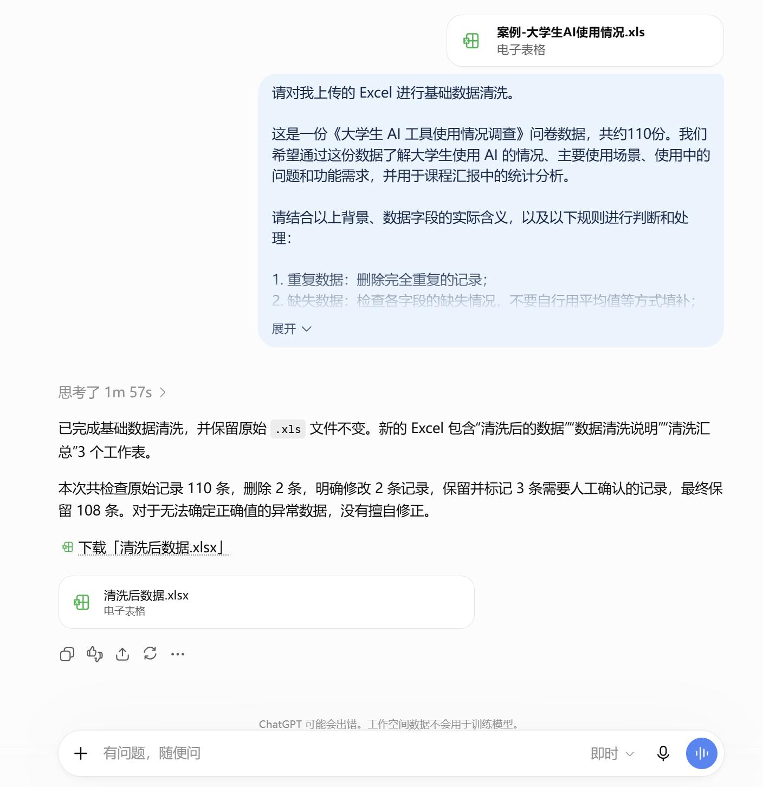
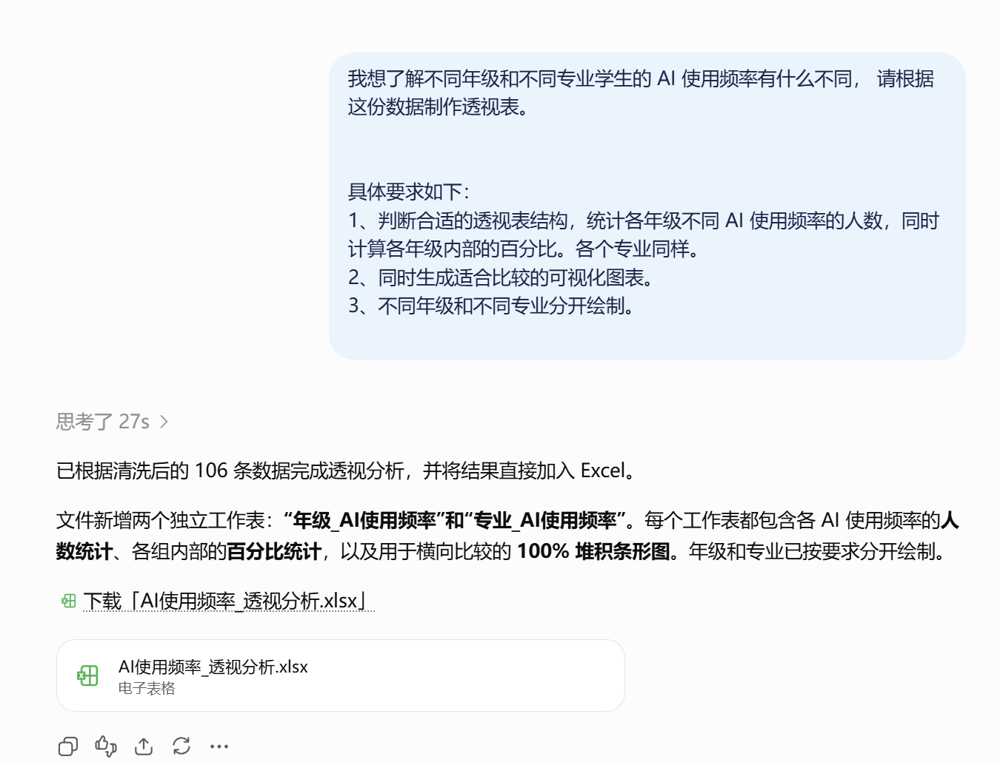
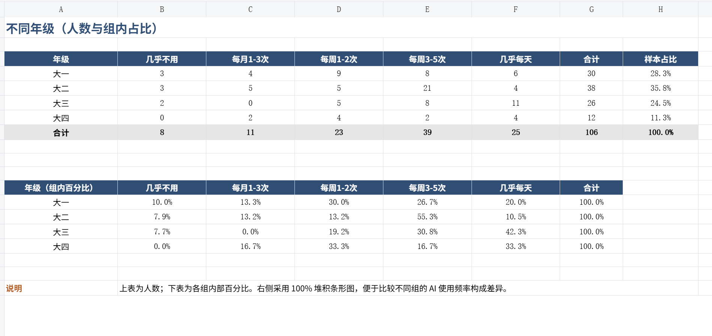
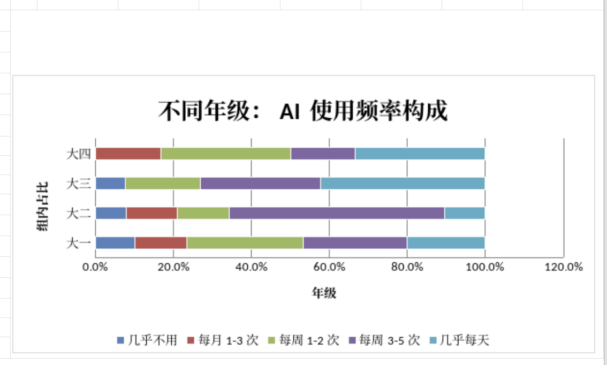
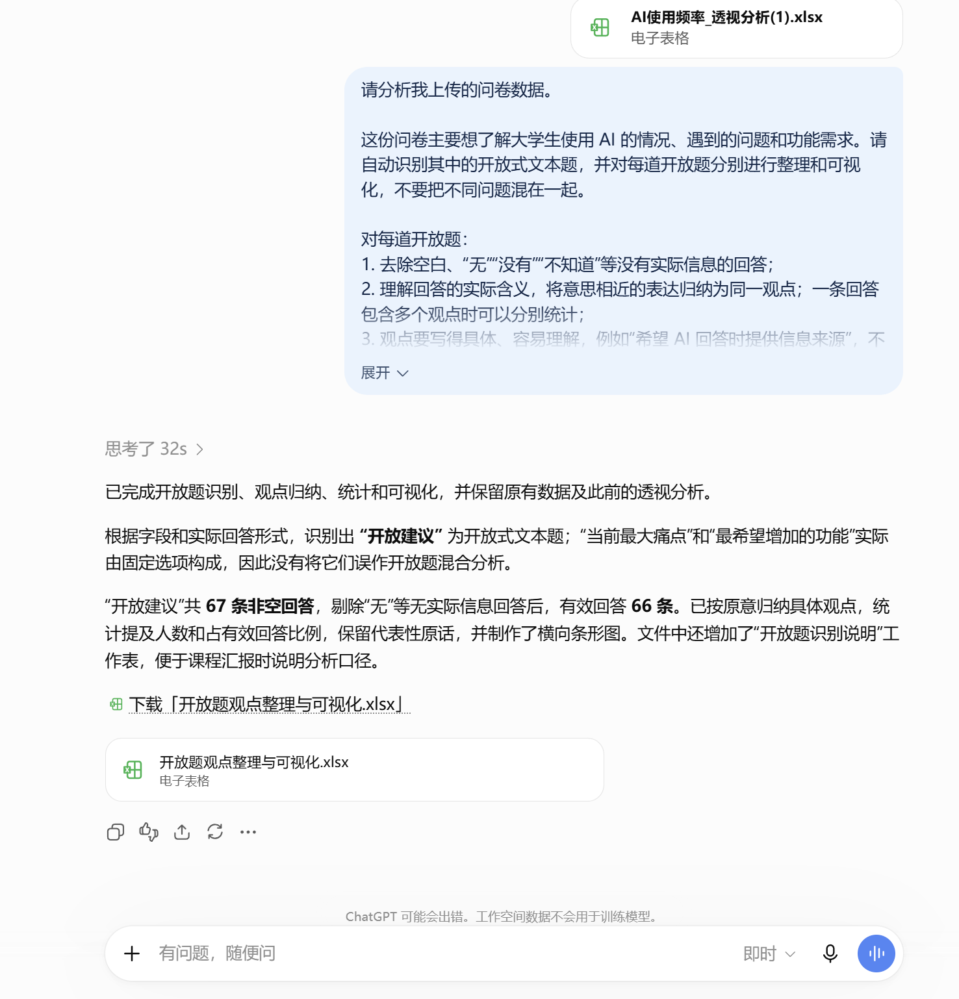
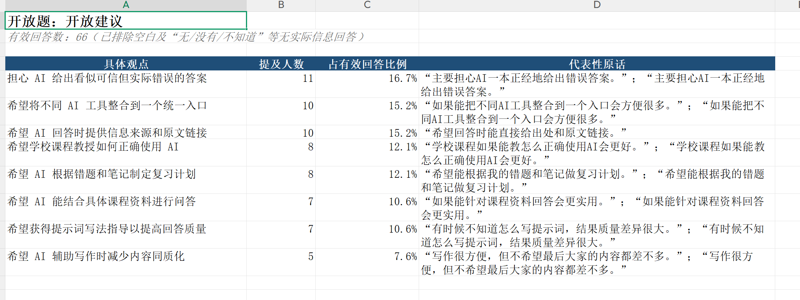
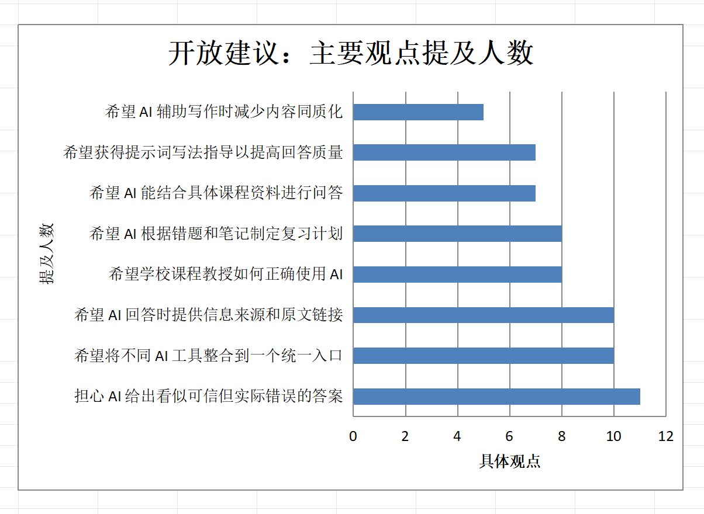
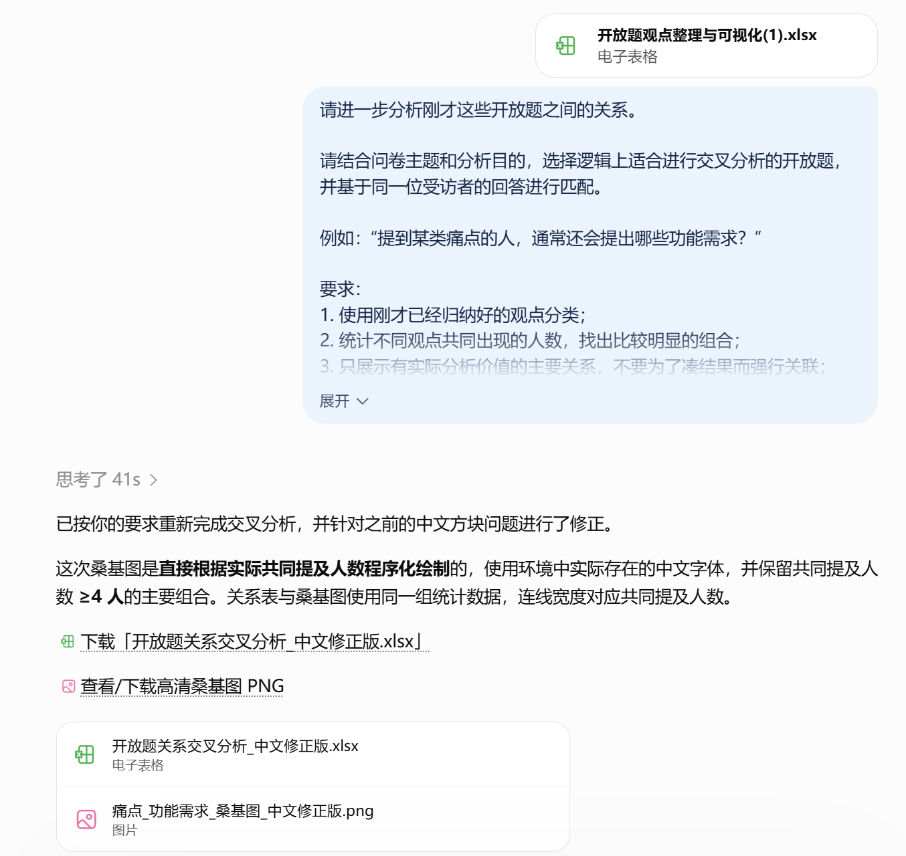
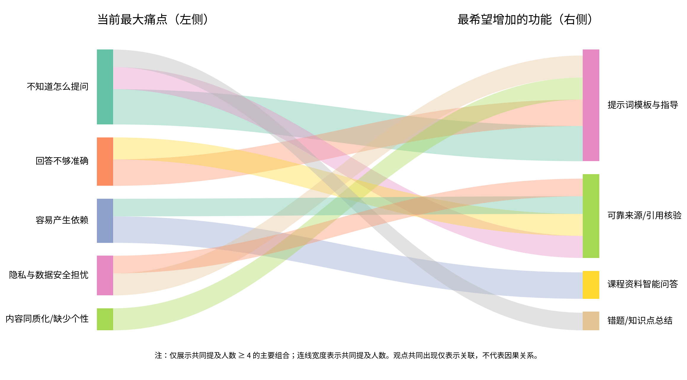

# 数据分析与洞察

[官网课程](https://www.datawhale.cn/learn/content/382/7943)

> 让 AI 帮你从繁琐的数据清洗中解脱出来，快速整理复杂的数据和文字，做出直观的图表，发现数据背后值得关注的问题。

## 一、总览

## Part 1｜主要应用场景与人群

| 主要场景 | 典型任务 | 主要人群 |
| --- | --- | --- |
| 课程作业与调研 | 分析调查问卷、实验或课程项目数据，完成报告与课堂汇报 | 大学生、研究生 |
| 论文与科研数据分析 | 整理研究数据，完成描述性统计、分组比较和结果呈现 | 本科生、研究生、科研人员 |
| 商赛与创新创业项目 | 分析用户调研、市场调查等数据，发现用户需求和业务机会 | 大学生、参赛团队、创业团队 |
| 日常业务数据分析 | 分析销售、用户、运营等 Excel 数据，发现变化、问题和机会 | 职场新人、运营、市场、产品人员 |

## Part 2｜AI 辅助的主要环节

| 序号 | 环节 | AI 做什么 | 人做什么 |
| --- | --- | --- | --- |
| 1 | 确定分析思路 | 梳理分析问题，推荐分析方法 | 明确分析目的，确定要回答什么 |
| 2 | 理解与清洗数据 | 识别数据问题，辅助整理数据 | 判断变量类型，确定清洗规则 |
| 3 | 描述性统计 | 计算统计指标，整理统计表 | 选择重点指标，判断哪些结果值得关注 |
| 4 | 文本数据整理 | 归纳相似回答，统计高频内容 | 检查归纳是否准确，确认原意 |
| 5 | 分组与交叉分析 | 比较不同人群，生成交叉结果 | 选择比较维度，判断差异是否有意义 |
| 6 | 数据可视化 | 推荐并生成合适的图表 | 确定图表要表达的重点 |
| 7 | 辅助提炼洞察 | 汇总结果，找出值得关注的现象 | 结合实际情况形成最终结论 |

## Part 3｜可以使用什么工具

可使用 [GPT](<https://chatgpt.com/>)，也可以选择国内的 [WPS AI](<https://ai.wps.cn/>)**、**[Kimi](<https://www.kimi.com/>) 等任何能够读取 Excel / 文件的 AI。

→ **普通数据分析**： [GPT](<https://chatgpt.com/>) / [WPS AI](<https://ai.wps.cn/>) / [腾讯元宝](<https://yuanbao.tencent.com/chat/naQivTmsDa>) / [Kimi](<https://www.kimi.com/>) ，上传数据后直接按照本教程操作

→ **需要查看、修改表格**：配合 [Excel](<https://www.microsoft.com/zh-cn/microsoft-365/excel>) / [WPS](<https://www.wps.cn/>)

→ **需要更专业的统计分析**：再使用 [SPSS](<https://www.ibm.com/cn-zh/products/spss>) / [R](<https://www.r-project.org/>)

**推荐路线：GPT / 国内 AI + Excel / WPS → 有专业统计需求时再用 SPSS / R**

如果需要把数据分析流程沉淀和复现，可以沉淀成skill，可以用[codex](<https://learn.chatgpt.com/docs/app>)、 [WorkBuddy](<https://www.workbuddy.cn>) 等

> AI工具组合：**AI 工具（ChatGPT / Claude / Gemini） + Excel / WPS。有进一步统计分析需求时，再配合 SPSS ****、R、**** Python**

## 二、基础案例：数据清洗及制作透视表

**下载素材：**

[案例-大学生AI使用情况.xls](../../public/course-assets/16/source-01.xls)

## 第一步：数据清洗：去重、去除异常数据、统一名称

正式分析数据之前，需要先检查数据有没有问题。传统做法需要在 Excel 中逐列筛选、查找重复值和异常值、检查缺失值、类别名称不统一，以及明显无效的数据。

**下面演示使用AI进行数据清洗：**

```text
请对我上传的 Excel 进行基础数据清洗。

这是一份《大学生 AI 工具使用情况调查》问卷数据，共约110份。我们希望通过这份数据了解大学生使用 AI 的情况、主要使用场景、使用中的问题和功能需求，并用于课程汇报中的统计分析。

请结合以上背景、数据字段的实际含义，以及以下规则进行判断和处理：

1. 重复数据：删除完全重复的记录；
2. 缺失数据：检查各字段的缺失情况，不要自行用平均值等方式填补；
3. 异常数据：检查明显超出合理范围、非法取值或前后逻辑矛盾的数据；
4. 格式和类别不统一：统一空格、大小写、同一类别的不同写法；
5. 无效或低质量数据：检查大量关键题缺失、明显乱填、明显无意义的回答等。

能够明确判断的问题可以直接处理；无法确定的数据不要自行修改或删除，请保留并标记“需要人工确认”。

请始终保留原始文件不变，在副本上完成清洗。

完成后请生成一个新的“清洗后数据.xlsx”，文件中包含：
① 清洗后的数据；
② 数据清洗说明：问题类型｜问题位置｜原始情况｜如何处理｜影响数量｜是否需要人工确认；
③ 清洗汇总：原始记录数｜删除数｜修改数｜待确认数｜最终记录数。
```

**演示及效果图：**



**输出的数据：**

[清洗后数据.xlsx](../../public/course-assets/16/source-02.xlsx)

**输出的数据需要人工确认，人工判断后进一步让AI处理**

**最终清洗完成输出的数据：**

[清洗后数据\_修改版.xlsx](../../public/course-assets/16/source-03.xlsx)

## 第二步：做透视表

我想要知道：**“不同年级学生使用 AI 的情况有什么区别？”，原始数据看不出来，就需要做透视表。**

上传/使用清洗完成的数据

**参考提示词：**

```text
我想了解不同年级和不同专业学生的 AI 使用频率有什么不同， 请根据这份数据制作透视表。  

具体要求如下：
1、判断合适的透视表结构，统计各年级不同 AI 使用频率的人数，同时计算各年级内部的百分比。各个专业同样。
2、同时生成适合比较的可视化图表。 
3、不同年级和不同专业分开绘制。
```

**演示和效果图：**







**输出文件：**

[AI使用频率\_透视分析.xlsx](../../public/course-assets/16/source-04.xlsx)

## 三、进阶案例

## 案例一、开放题进行交叉分析

对于问卷中“你遇到的最大问题是什么？”“你最希望增加什么功能？”“还有什么建议？”这样的开放题

如果有几百份问卷，传统做法通常需要人工逐条阅读，把意思相近的回答归到一起，再统计每类观点有多少人提到。

**第1步：****数据清洗、分析、可视化**

上传 Excel数据

```text
请分析我上传的问卷数据。

这份问卷主要想了解大学生使用 AI 的情况、遇到的问题和功能需求。请自动识别其中的开放式文本题，并对每道开放题分别进行整理和可视化，不要把不同问题混在一起。

对每道开放题：
1. 去除空白、“无”“没有”“不知道”等没有实际信息的回答；
2. 理解回答的实际含义，将意思相近的表达归纳为同一观点；一条回答包含多个观点时可以分别统计；
3. 观点要写得具体、容易理解，例如“希望 AI 回答时提供信息来源”，不要只写“准确性”“便利性”等抽象关键词；
4. 统计各观点的提及人数和占有效回答的比例，并保留1～2条代表性原话；
5. 按提及人数从高到低排列，并为每道开放题生成一张横向条形图，展示主要的5～8个观点。

请输出：
① 观点整理表：具体观点｜提及人数｜占比｜代表性原话；
② 对应的横向条形图。

归纳时不要改变受访者原意，也不要替我得出最终结论。
```

**演示示例及效果图：**







**输出的数据：**

[开放题观点整理与可视化.xlsx](../../public/course-assets/16/source-05.xlsx)

**第2步：****人工确认**

> 开始前，先自己快速浏览一下 Excel 中的开放题原始回答。不需要自己归类和统计，只需要大概知道大家在说什么。这样 AI 处理完成以后，可以快速判断归纳结果有没有明显问题。

AI 输出以后，重点看看**有没有把不同意思错误合并，以及归纳后的文字是否准确表达了原意**。发现问题直接让 AI 调整即可。

**第3步：****开放题的交叉分析**

如果问卷里有两道存在明显逻辑关系的开放题，还可以继续让 AI 把它们联系起来。

```markdown
请进一步分析刚才这些开放题之间的关系。

请结合问卷主题和分析目的，选择逻辑上适合进行交叉分析的开放题，并基于同一位受访者的回答进行匹配。

例如：“提到某类痛点的人，通常还会提出哪些功能需求？”

要求：
1. 使用刚才已经归纳好的观点分类；
2. 统计不同观点共同出现的人数，找出比较明显的组合；
3. 只展示有实际分析价值的主要关系，不要为了凑结果而强行关联；
4. 输出关系表：开放题A的观点｜开放题B的观点｜共同提及人数；
5. 根据主要关系生成一张桑基图，连线宽度代表共同提及人数；
6. 桑基图必须根据实际统计数据程序化绘制，不要使用生成式图片重绘；
7. 绘图时请使用当前环境中实际可用、支持中文的字体，确保标题、节点名称和注释正常显示中文，不出现“□□□”方块或乱码；生成后请检查中文是否显示正常，如有问题请更换字体后重新绘制。

这里只表示观点共同出现的关系，不要解释为因果关系。
```

**演示及效果图：**



**输出材料：**

[开放题关系交叉分析\_中文修正版.xlsx](../../public/course-assets/16/source-06.xlsx)


