# 17 用AI管理系统化学习笔记

[官网课程](https://www.datawhale.cn/learn/content/382/7944) · [飞书源稿](https://datawhaler.feishu.cn/docx/IJJXd8ssJoOGjjxOAdmcSNMSnmc)

> **整理课程知识、建立知识体系、辅助理解与复习**

## 第一部分 总览

## Part 1｜高频场景：什么时候需要个人知识管理？

| 场景 | 典型人群 | 具体需求 |
| --- | --- | --- |
| 学习与课程 | 学生、终身学习者、职场人 | 线下上课、看网课、参加培训；记录课程内容、课件和自己的理解，课后复习，需要时重新找到 |
| 阅读与信息获取 | 学生、知识工作者 | 阅读网页、公众号、PDF、书籍，观看视频；收藏有价值的信息，并留下真正重要的内容 |
| 灵感与随手记录 | 创作者、知识工作者 | 随时记录自己的想法，以及聊天、会议、生活中遇到的观点、案例、问题，避免稍纵即逝 |
| 知识找回与输出 | 学生、教师、创作者、知识工作者 | 写文章、备课、做 PPT、写方案时，快速找到过去学过、看过、记录过的内容并重新利用 |

## Part 2｜个人知识管理的三个核心环节

**① 汇集知识 → ② 管理知识 → ③ 调用知识**

| 环节 | 我想要什么 | 传统方式 | AI 辅助之后 |
| --- | --- | --- | --- |
| 汇集知识 | 不同来源的知识方便地进入一个地方 | 手动复制网页、摘录书籍、记课堂笔记、下载 PDF；信息散落在收藏夹、备忘录、文件夹等地方 | AI 帮助处理网页、PDF、视频、录音、文字等不同内容；转写、提取、总结后，更低成本地进入统一知识库 |
| 管理知识库 | 知识进去以后清晰、准确，而且不需要花很多时间维护 | 自己起标题、建文件夹、分类、打标签、整理笔记、建立关联 | AI 自动总结、提取重点、分类、打标签、建立关联；人负责判断什么重要，AI 负责大量机械整理 |
| 调用知识 | 需要的时候能快速找到，并直接拿来使用 | 要记得“我存过什么、放在哪里、叫什么”，再通过目录或关键词搜索 | 能够检索到文本本身，也能够直接用自然语言提问：“我之前关于 XX 学过什么？”AI 找到相关内容、综合回答；还可以进一步用于复习、写作、备课、做 PPT 等 |

## Part 3｜工具组合推荐：用什么来实现？

- **日常 AI 助手**：[DeepSeek](<https://www.deepseek.com/>) / [Kimi](<https://www.kimi.com/>) / [腾讯混元](<https://hunyuan.tencent.com/>)，有条件可用 [ChatGPT](<https://chatgpt.com/>) / [Claude](<https://claude.ai/>) —— 整理资料、总结重点、日常问答。
- **读课程 / PDF / 论文**：[NotebookLM](<https://notebooklm.google.com/>)（原 Gemini Notebook）—— 资料集中导入，总结、提问、复习一站搞定。
- **建个人知识库**：[Notion](<https://www.notion.so/>) / [Obsidian](<https://obsidian.md/>) —— 长期沉淀笔记与知识框架；Obsidian 可用 Web Clipper 保存和高亮网页。
- **论文与文献管理**：[Zotero](<https://www.zotero.org/>) —— 资料收集、PDF 标注、分类笔记、引用管理。

## 第二部分 动手实操：学一堂网课**，进行笔记管理**

**工具准备：下载WPS、**[**WorkBuddy**](<https://copilot.tencent.com/work/>)**（官网或者应用商店都可下载）**

（也可以选择使用 [WPS](<https://www.wps.cn/>) + [Codex](<https://openai.com/codex/>) / [千问](<https://www.qianwen.com/>) / [Trae](<https://www.trae.ai/>)等）

**素材下载：**

[课堂演示材料\_AI个人知识管理入门.pdf](../../public/course-assets/17/source-01.pdf)

**适用场景：**老师已经提供 PPT、PDF 或课程讲义，希望在上课时直接把自己的重点、疑问和想法留在原材料旁边。

## 第 1 步｜把课程 PPT/PDF 当作笔记底稿

拿到老师的 PPT 后，使用WPS PDF 等任意PDF编辑工具，对于重点内容、疑问、想法，一边听课，一边进行批注和记录。

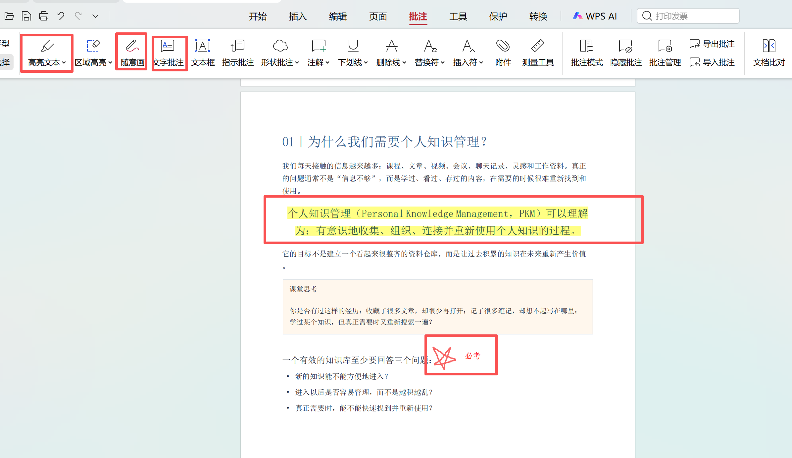

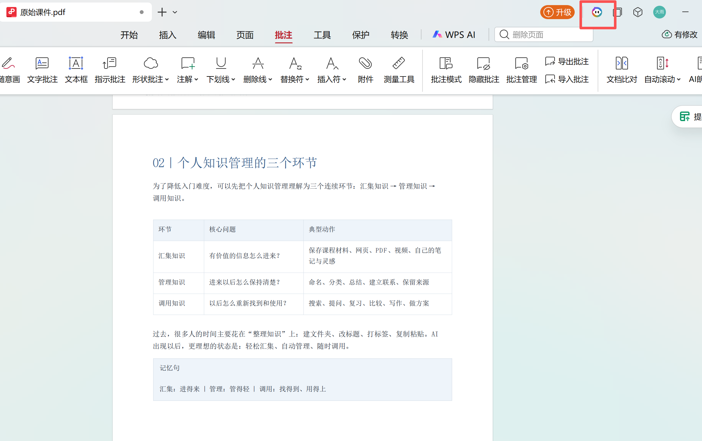

## 第 2 步｜AI作为课堂助教，解决听课过程中遇到的疑问

遇到陌生概念、复杂段落或逻辑关系没有听明白时，使用 WPS 的 AI PDF / Ask AI 类功能进行提问。

**演示图：**

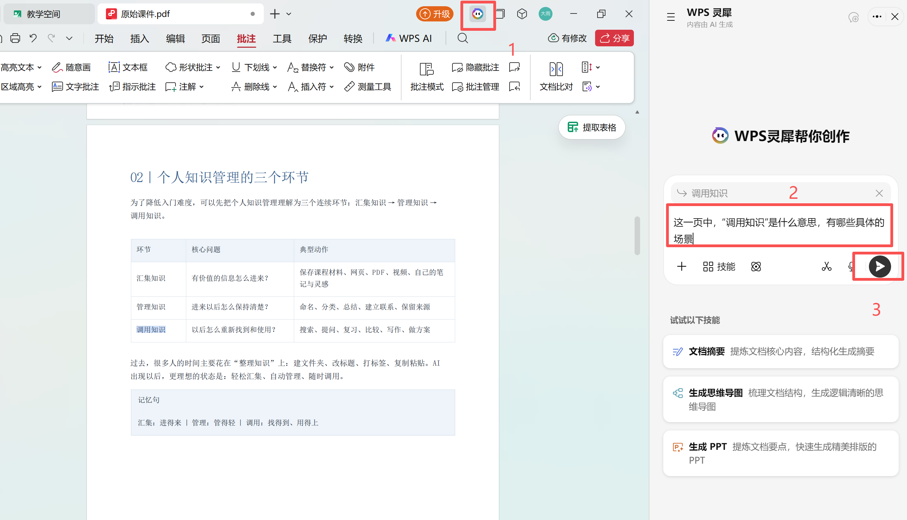

## 第 3 步｜课后让 AI 整理成完整复习材料并存储

**第一轮**

**输入提示词：**

```text
请根据我提供的课堂标注课件，整理本节课的复习资料，并自动完成文件创建、命名和归档。

请生成 3 个文件：
1.《复习笔记.docx》：按知识逻辑整理核心知识、老师的重要解释和案例，并保留我的疑问、理解和灵感；
2.《知识思维导图.md》：梳理知识之间的关系，形成层级清晰的知识框架；
3.《背诵材料.docx》：整理需要记忆的定义、原理、公式、分类、条件、步骤等。需要准确记忆的内容尽量保留课程原文，可增加关键词、口诀、对比等辅助记忆。

请根据课件内容识别课程名称和课次，并在当前工作目录中自动建立和整理文件夹，例如：

《课程名称》
└─ 01 第一课
   ├─ 原始课件.pdf
   ├─ 复习笔记.docx
   ├─ 知识思维导图.md
   └─ 背诵材料.docx

请将原始课件和生成的 3 份资料统一保存到对应课次文件夹中，不需要我手动创建或整理文件夹。

要求：课程内容与我的个人思考明确区分；不遗漏重要知识，不确定的内容请标注，不自行补充。Word 使用宋体，排版简洁清晰，以方便直接复习为准。
```

**实操演示：**

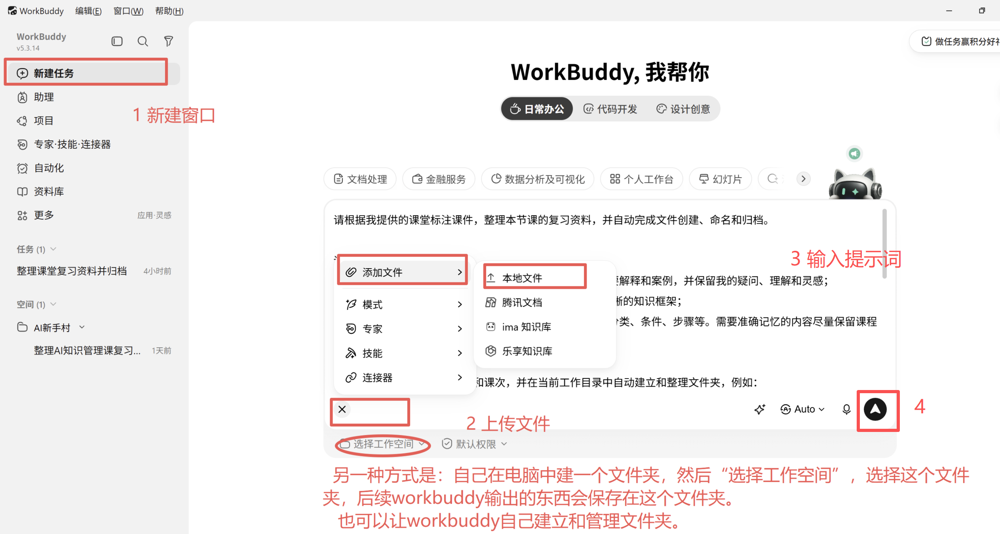

**效果：**

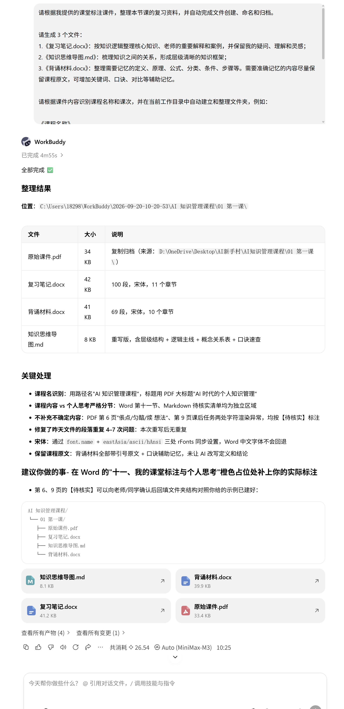

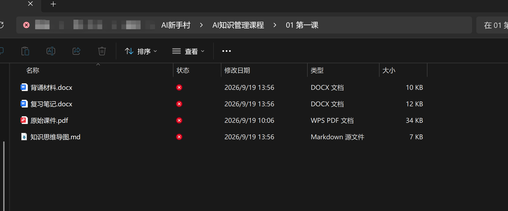

**第二轮：人工确认+绘制思维导图**

**人工确认复习材料、思维导图文件，可让AI修改，也可人工修改。修改完成后，让AI绘制成思维导图**

```text
思维导图没问题，为我绘制成图片，提供可打印的PDF及PNG版本
```

**演示及效果图：**

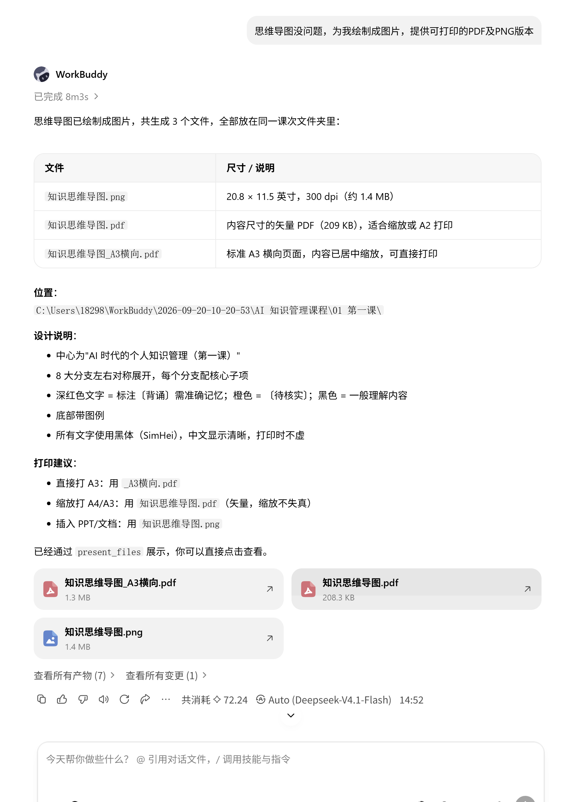

**输出材料之一：**

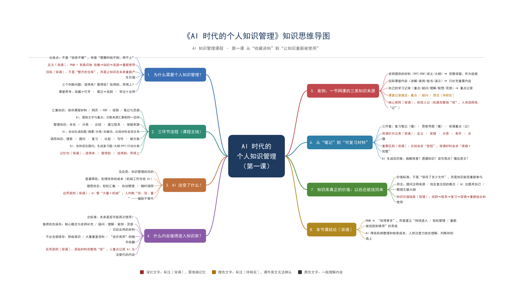

随着课程不断推进，每一节课都会形成同样的结构。到了期末，可以把各节课的知识进一步合并，让 AI 整理出一份**全课程知识框架和期末总复习材料（详见进阶）**，用于集中复习和背诵。

> **路径：课程 PPT/PDF → 课上在原材料旁高亮和批注 → AI 随堂解释难点 → 课后整理成完整复习材料（笔记 + 思维导图 + 背诵重点）→ 保存为课程资料库 → 复习和调用。**

## 第三部分｜进阶技巧：资料多了以后，怎么让 AI 帮你复习？

**素材下载（素材比较简单，分为三课，每课4个文件，文件内容很简单，只作为演示）：**

[AI个人知识管理\_三节课演示资料.zip](../../public/course-assets/17/source-02.zip)

## 技巧 1｜多节课一起问，让 AI 帮你找跨章节的知识联系

**一句话描述：**
当一个知识点分散在不同课次时，不用自己逐份翻找，可以把多节课资料一起交给 AI，让它跨文件检索、比较并梳理知识之间的联系。

### **怎么操作**

把多节课的课件、笔记等资料上传到支持多文件分析的 AI 工具（或让 AI 读取该课程文件夹，如图），例如 [Gemini Notebook](<https://notebooklm.google.com/>)、[Codex](<https://openai.com/codex/>)、[WorkBuddy](<https://www.workbuddy.com/>)、[千问](<https://www.qianwen.com/>) 等，再针对某个主题提问。

**操作演示：**

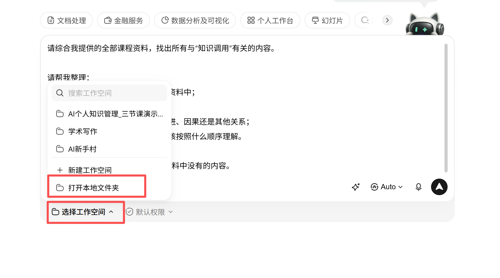

**输入提示词提问：**

```text
这些文件是我这门课程各节课已经整理好的学习资料。

【目标主题】：填写要整理的主题，例如“知识调用”。

请综合全部资料，围绕【目标主题】进行整理。

第一部分｜相关内容
按课次顺序，找出所有与【目标主题】直接相关的内容。

要求：
1、来源清楚：注明课次、文件类型，以及页码/位置（如可确认）。
2、原文优先：优先保留原始课件和笔记中的原文或接近原文的表述。
3、避免扩展：只保留直接相关内容，不加入资料中没有的信息，也不要为了“有关联”而强行扩展。
4、减少重复：完全重复的内容可以合并，并注明多个来源。

第二部分｜AI 总结
基于第一部分的内容，对【目标主题】进行简洁、清晰、易读的总结和梳理。

要求：
1、按知识逻辑组织，不要机械按文件顺序重复。
2、用小标题和分点表达，突出核心概念、重要结论、方法和不同课次之间的联系。
3、不要重复粘贴第一部分的大段原文。
4、不要补充课程资料中没有的信息。

【重要】
只输出以上两个部分，不要额外加入资料清单、覆盖率、复习计划、Checklist、附录或其它分析。
```

### 演示及效果图

**操作演示图：**

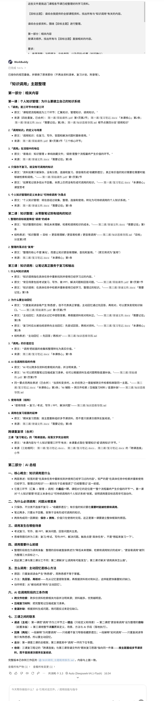

**输出文件：**

[知识调用\_主题梳理报告.md](../../public/course-assets/17/source-03.md)

## 技巧 2｜期末把所有课次资料一次整理成总复习文件

**背景及任务描述：**
到了期末，不需要再手动把每一课的笔记重新复制整理，可以把整门课积累下来的资料一次交给 AI，让它按照知识主题重新汇总，生成一份期末复习材料。

### 怎么操作

把整门课程的资料文件夹交给能够读取文件的 AI 工具。

**然后输入提示词：**

```text
这些文件是我这门课程各节课已经整理好的学习资料，包括原始课件、复习笔记、背诵材料和思维导图。

现在请综合全部资料，整理一份【期末总复习文件】。

要求如下：
1、内容重组：不要简单按照课程顺序依次拼接，而要按照知识主题和逻辑关系重新组织整门课程。
2、重点保留：优先整理核心概念、定义、原理、分类、条件、步骤、方法、公式、易混淆知识和重要结论。
3、去重合并：同一知识点如果出现在不同课次中，重复内容合并；如果属于补充、深化或不同角度说明，则整合到同一主题下。
4、原文优先：需要准确记忆的定义、公式、条件、步骤和标准表述，尽量以原始课件和背诵材料中的原文为依据。
5、来源清楚：重要内容注明来自哪一课或哪个文件，方便我回到原始资料查看。
6、真实准确：只使用我提供的课程资料，不补充资料中没有的信息；无法确认的内容请明确标注。

【输出要求】
请直接生成一份完整、可用于期末复习的材料，结构清晰、层级明确、便于阅读和背诵。

建议包括：
1、全课程知识框架；
2、各知识主题的核心内容；
3、易混淆和容易遗漏的重点；
4、需要重点背诵的内容；
5、考前快速复习清单。

不要额外输出分析过程、资料清单、覆盖率或无关说明。
```

### **演示及效果图：**

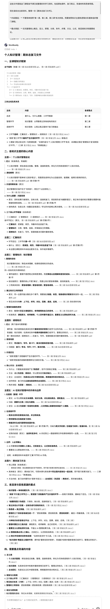

**输出文件：**

[期末总复习\_个人知识管理.md](../../public/course-assets/17/source-04.md)

**如图是输出的文件结构：**

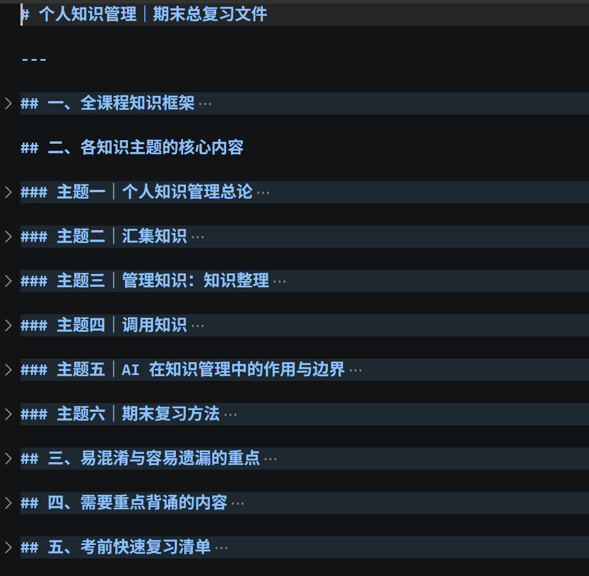

## 参考材料

\[1\] [WPS Office Academy. How to highlight the content of a PDF file.](<https://www.wps.com/academy/how-to-highlight-the-content-of-a-pdf-file/1861687/>)

\[2\] [WPS Office Academy. How to Edit a PDF \[For Students\].](<https://www.wps.com/academy/how-to-edit-a-pdf-for-students-quick-tutorials-1881194/>)

\[3\] [WPS Office Academy. How to Use WPS PDF Editor Online?（含 AI PDF 功能说明）.](<https://www.wps.com/academy/how-to-use-wps-pdf-editor-online/about-wps/1885542/>)

\[4\] [Google NotebookLM 帮助中心. 为笔记本添加或探索新来源.](<https://support.google.com/notebooklm/answer/16215270?hl=zh-Hans>)

\[5\] [Notion 官方帮助中心（中文）：Notion 基础知识.](<https://www.notion.com/zh-cn/help/category/new-to-notion>)

\[6\] [Notion 中文网：2026 最新 Notion 中文教程目录大纲（从入门到精通）.](<https://www.notionapp.cn/docs/%E6%95%99%E7%A8%8B%E7%9B%AE%E5%BD%95/>)

\[7\] [Obsidian 中文帮助（由此开始）.](<https://obsidian.md/zh/help/>)

\[8\] [少数派：Obsidian 入门：从第一个文档开始. 2021-06-29.](<https://sspai.com/post/67476>)
