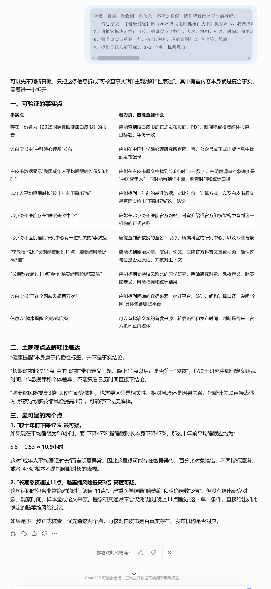
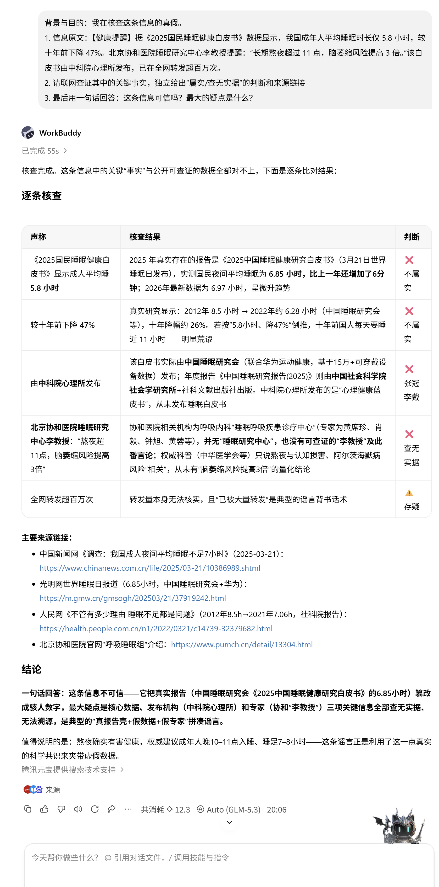
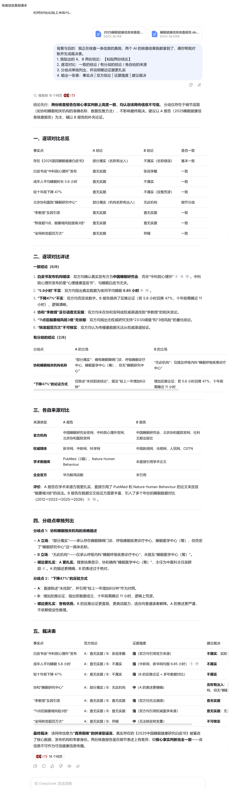

# 18 AI 时代的信息辨别与独立判断

[官网课程](https://www.datawhale.cn/learn/content/382/7908) · [飞书源稿](https://datawhaler.feishu.cn/docx/Pxobd4n0hoGicTxkB5DcAzR1nZc)

> **AI 写出来的内容越来越像真的：数字、专家、出处一应俱全，但很可能是查无此数、查无此人、查无此文。这篇教程中，让我们把一条可疑信息交给 AI 做拆解、查证、交叉对比和对账，帮助你高效验证真伪。**

## **一、总览**

### **Part 1｜主要应用场景与人群**

**只要涉及“信息能不能转发、能不能用、是不是真的”，都可以直接用**

| **场景** | **典型人群** | **要解决的问题** |
| --- | --- | --- |
| 刷到“震惊体”信息 | 所有人 | AI 生成的假新闻、假图片越来越像真的，随手转发可能成了谣言二传手 |
| 用 AI 写报告/作业 | 学生、职场人 | AI 编的数字、引用、案例混进作品 |
| 专业工作辅助 | 律师、审计、运营、HR | AI 给的法条、数据、案例可能查无实据，用了要自己担责 |
| 消费与生活决策 | 中老年、网购用户 | AI 生成的种草文、假评测、AI 合成语音诈骗防不胜防 |
| 转发与创作 | 自媒体、群管理员 | 引用了 AI 编的“名言”“数据”发布，损害自己和平台公信力 |

### **Part 2｜AI 辅助的主要环节**

| **序号** | **环节** | **AI 做什么** | **人做什么** |
| --- | --- | --- | --- |
| 1 | 拆解信息 | 把一段话拆成“事实点 vs 观点”，逐条标出验证思路 | 判断哪些事实点对自己重要，优先查 |
| 2 | 联网查证 | 逐条搜索、给来源链接、标注来源权威性 | 点开链接核对原文 |
| 3 | 交叉验证 | 换一个 AI 独立再查一遍 | 聚焦两个 AI 的分歧点，重点核查 |
| 4 | 对账裁决 | 把两份结论对账，生成裁决表 | 做最终裁决：信、不信、存疑 |
| 5 | 识别 AI 痕迹 | 按特征清单检查图片/文字疑点 | 用常识做最后检验 |

### **Part 3｜可以使用什么工具**

国内工具：

→ 联网拆解、查证事实：[DeepSeek](<https://chat.deepseek.com>) / [Kimi](<https://kimi.moonshot.cn>) / [腾讯元宝](<https://yuanbao.tencent.com>) 等—— 都能联网搜索、中文友好

→ 第二个模型交叉对比：[豆包](<https://www.doubao.com>) 等—— 换一家公司再问一遍，答案一致更可信，出现分歧就重点核查

→ 官方终审：[中国互联网联合辟谣平台](<https://www.piyao.org.cn>) / [国家反诈中心 APP](<https://www.bjdx.gov.cn/bjsdxqrmzf/zwfw/ztlm/2190537/bsfw21/2190814/index.html>) —— 谣言库里一搜便知，反诈中心还能鉴定 AI 内容

→ 图片视频找疑点：对照[加拿大网络安全局《识别 AI 内容 9 招》信息图](<https://www.getcybersafe.gc.ca/sites/default/files/gcs-spottingai-web2024.pdf>) —— 官方 PDF，逐条自查

有条件也可用国外工具：[ChatGPT](<https://chat.openai.com>) / [Gemini](<https://gemini.google.com>)等。

## **二、动手实操：一条可疑信息的四步核查**

案例素材是一条看起来很专业的健康提醒，里面包含白皮书、数字、专家引语。跟着四步走一遍，你就能判断它能不能信、敢不敢转发。

**素材：**

**【健康提醒】据《2025国民睡眠健康白皮书》数据显示，我国成年人平均睡眠时长仅 5.8 小时，较十年前下降 47%。北京协和医院睡眠研究中心李教授提醒：“长期熬夜超过 11 点，脑萎缩风险提高 3 倍。”该白皮书由中科院心理所发布，已在全网转发超百万次。**

### **第一步：让 AI 把信息拆成“事实点 + 观点”**

```text
背景与目的：我收到一条信息，不确定真假，请你帮我做核查前的拆解。
1. 信息原文：【粘贴信息原文】
2. 请把它拆成两类：可验证的事实点（数字、人名、机构、引语、时间）和主观观点
3. 每个事实点单独一行，按“若为真，应能查到什么”写出验证思路
4. 标出你认为最可疑的 1-2 个点，说明理由
```

**演示及效果图：**



### **第二步：让 AI 联网逐条查证，给出处**

```text
背景与目的：请联网核查上面拆出的每个事实点，我要判断这条信息真假。
1. 逐条搜索，给出每条的结论：属实 / 查无实据 / 部分属实
2. 每条附上你实际打开的来源链接，标注来源权威性（官方/媒体/自媒体）
3. 引语类事实：找到原始出处和原话，没有就明确说“找不到原话”
4. 查不到的一律写“查无实据”，不要推测

以word形式给我（可选）
```

**演示及效果图：**

![图片展示了“一条可疑信息的四步核查”中第二步的核查结果。上方是“2025年中国睡眠白皮书”和“2025年中国睡眠白皮书（修订版）”的封面。下方是核查内容，包括“白皮书”核心内容“睡眠不足”“睡眠质量差”“睡眠时间少”“睡眠障碍”“睡眠质量差”“睡眠时间少”“睡眠障碍”等，以及“睡眠时间少”“睡眠障碍”“睡眠质量差”“睡眠不足”“睡眠障碍”“睡眠时间少”“睡眠质量差”“睡眠不足”“睡眠障碍”“睡眠时间少”“睡眠质量差”“睡眠不足”“睡眠障碍”“睡眠时间少”“睡眠质量差”“睡眠不足”“睡眠障碍”“睡眠时间少”“睡眠质量差”“睡眠不足”“睡眠障碍”“睡眠时间少”“睡眠质量差”“睡眠不足”“睡眠障碍”“睡眠时间少”“睡眠质量差”“睡眠不足”“睡眠障碍”“睡眠时间少”“睡眠质量差”“睡眠不足”“睡眠障碍”“睡眠时间少”“睡眠质量差”“睡眠不足”“睡眠障碍”“睡眠时间少”“睡眠质量差”“睡眠不足”“睡眠障碍”“睡眠时间少”“睡眠质量差”“睡眠不足”“睡眠障碍”“睡眠时间少”“睡眠质量差”“睡眠不足”“睡眠障碍”“睡眠时间少”“睡眠质量差”“睡眠不足”“睡眠障碍”“睡眠时间少”“睡眠质量差”“睡眠不足”“睡眠障碍”“睡眠时间少”“睡眠质量差”“睡眠不足”“睡眠障碍”“睡眠时间少”“睡眠质量差”“睡眠不足”“睡眠障碍”“睡眠时间少”“睡眠质量差”“睡眠不足”“睡眠障碍”“睡眠时间少”“睡眠质量差”“睡眠不足”“睡眠障碍”“睡眠时间少”“睡眠质量差”“睡眠不足”“睡眠障碍”“睡眠时间少”“睡眠质量差”“睡眠不足”“睡眠障碍”“睡眠时间少”“睡眠质量差”“睡眠不足”“睡眠障碍”“睡眠时间少”“睡眠质量差”“睡眠不足”“睡眠障碍”“睡眠时间少”“睡眠质量差”“睡眠不足”](../../public/course-assets/18/img-02.png)

**输出文件：**

[2025睡眠健康信息核查报告.docx](../../public/course-assets/18/source-01.docx)

### **第三步：换一家 AI，独立再查一遍**

同一个模型会重复自己的错误，所以要用不同公司的 AI 再问一次。两个 AI 结论一致的地方更可信，出现分歧，立刻重点核查。

```text
背景与目的：我在核查这条信息的真假。
1. 信息原文：【粘贴信息原文】
2. 请联网查证其中的关键事实，独立给出“属实/查无实据”的判断和来源链接
3. 最后用一句话回答：这条信息可信吗？最大的疑点是什么？

以word形式给我（可选）
```

**演示及效果图：**

**第二家AI的结果：**



**输出文件：**

[睡眠健康信息核查报告.docx](../../public/course-assets/18/source-02.docx)

### **第四步：对比两份结论，生成裁决表**

两个 AI 的结论可能零散，把它们交给第三个 AI 对账，生成一张裁决表。

```text
背景与目的：我正在核查一条信息的真假，两个 AI 的核查结果我都拿到了，请你帮我对账并生成裁决表。
1. 我贴出的 A、B 两份结论：【粘贴两份结论】
2. 逐项对比：一致的结论 / 有分歧的结论 / 各自给的来源
3. 分歧点单独列出，并说明哪边证据更扎实
4. 输出一张表：事实点 | 双方结论 | 证据强度 | 建议裁决
```

**演示及效果图：**



## **三、进阶：3 个提效小技巧**

### **技巧 1｜反向质询：让 AI 交代自己的假设**

让 AI 说明“我是怎么得出这个结论的、做了哪些假设”。假设越多的地方，幻觉风险越高。

```text
背景与目的：请把你刚才的推理过程完整交代一遍，列出你做出判断所依赖的所有假设。
1. 每个假设单独一行
2. 标明每个假设是否有来源支持
3. 如果某个点是你“推测”或“补全”的，请明确说“这是我假设的，未经验证”
```

### **技巧 2｜名言溯源：这话真的是他说的吗？**

```text
背景与目的：我想引用下面这句话，请你帮我确认它是否真的是这个人说的。
1. 待核查语录：【粘贴引语】——【标注人名】
2. 请联网查找该语录在原著、访谈、演讲或官方报道中的原始出处
3. 找到则给出原始来源；找不到则明确说“查无实据，疑似网络误传”
4. 如果存在误传，请给出传播线索（最早出现平台、常见变体）
```

### **技巧 3｜通过提示词工程降低幻觉率**

把这句防幻觉提示词固定放在平时使用的提示词开头/末尾。

```text
背景与目的：请你回答以下问题。如果某些信息无法验证，请明确标注“查无实据”或“无法确认”，禁止编造数据、案例、论文或专家引语。
问题：【你的具体问题】
```

## **参考资料**

**真实案例：**

• [《刚上手 AI，职场人就踩了幻觉的坑》](<https://mp.weixin.qq.com/s/rWqbtST_epBU6XI-GaQUNw>)（钛媒体/坤舆商业观察）—— 4 个真实职场翻车故事：编辑、客服、讲师、产品经理

• [《全国首例 AI“幻觉”案判了！四招可防忽悠》](<https://mp.weixin.qq.com/s/ds-TcvZcdaKQDT8AQSRsMA>)（光明日报）—— 律师因引用 AI 编造案例被判担责的司法案例

**方法论：**

• [《大模型最隐蔽的 4 种“坑”》](<https://mp.weixin.qq.com/s/wm53-I_qqHxMBIHCXsilHw>)—— AI 幻觉的 4 种分类，适合当判断框架

• [《你被 AI 骗了多少次？6 招击破 AI“幻觉”魔咒》](<https://mp.weixin.qq.com/s/b0a8L3vwKSSy2YpZ9KlAIg>)（HRflag）—— 6 个应对思路与跨领域案例

• [《幻觉猛于虎？AI 时代律师避坑指南》](<https://mp.weixin.qq.com/s/FwUKh78JtzXZ0ceu2zOJ3A>)（万象天元）—— 使用前/中/后完整流程 + 5 个幻觉信号

• [《审计人必学的 AI 交叉验证指南》](<https://mp.weixin.qq.com/s/Q5NCJ4IULf3JI6O2qODQHg>)—— 双模型对抗、反向质询、总量守恒验证

**官方工具与平台：**

• [央视新闻《四招教你辨别 AI 生成内容真伪》](<https://news.cctv.cn/2025/03/15/ARTIsZWgXb0YZRktanalsWXY250315.shtml>)—— 官方媒体识别教程

• [中国互联网联合辟谣平台](<https://www.piyao.org.cn>)—— 官方谣言核实数据库

• [加拿大网络安全局《识别 AI 内容 9 招》](<https://www.getcybersafe.gc.ca/sites/default/files/gcs-spottingai-web2024.pdf>)（PDF 信息图）—— 图片/视频/文字识别自查清单
