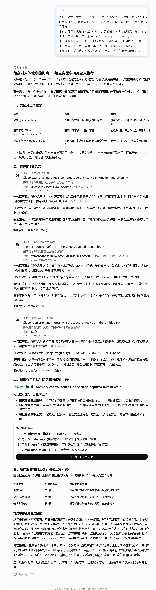
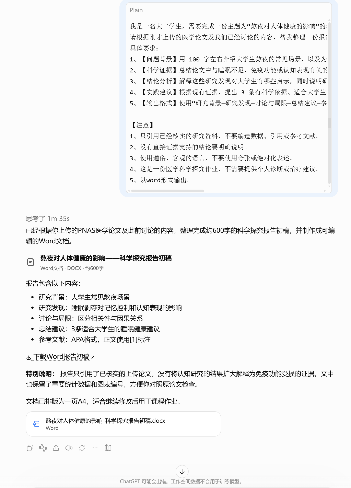

# AI for Science入门

[官网课程](https://www.datawhale.cn/learn/content/382/7941)

> AI for Science，帮助我们寻找科学证据、理解研究方法、识别结论的适用范围。

## **一、总览**

## **Part 1｜这份教程针对什么场景和人群**

AI for Science 是一个覆盖面很广的方向，本教程聚焦在「用 AI 辅助你做科研和学习的日常」，而不是教你做 AI 算法本身的研发。

| **场景** | **适用人群** |
| --- | --- |
| 读不懂科学论文摘要 / 想跨学科入门 | 想入门 AI for Science 的同学、研究生、本科生 |
| 找研究方向、写综述、做开题 | 研究生、青年学者 |
| 备课 / 写科普稿 / 做培训 | 高校教师、科技馆讲解员 |
| 跨学科决策 / 选课题 / 评审项目 | 科研管理者、基金申请人 |

## **Part 2｜AI 辅助的主要环节**

| **序号** | **环节** | **AI 做什么** | **人做什么** |
| --- | --- | --- | --- |
| 1 | 文献检索与综述 | 搜集全网资料、生成结构化摘要 | 判断来源可信度、补充领域专家意见 |
| 2 | 论文 / 概念解读 | 把英文论文、复杂公式翻译成大白话 | 提问、验收理解是否准确 |
| 3 | 研究思路设计 | 生成多个候选方向、列优劣 | 选择方向、把控科学问题的重要性 |
| 4 | 实验设计 / 数据处理 | 输出步骤清单、代码框架、注意事项 | 决策、动手实验、解读结果 |
| 5 | 论文 / 报告写作 | 翻译润色、结构化表达、参考文献整理 | 严守学术规范、保证贡献真实 |

## **Part 3｜可以使用什么工具**

**国内AI工具：**

**→ 找文献 / 联网搜索：**[秘塔 AI 搜索](<https://metaso.cn>) ｜ [腾讯元宝](<https://yuanbao.tencent.com>)

**→ 读论文 / 解析 PDF：**[Kimi](<https://kimi.moonshot.cn>) ｜ [通义千问](<https://tongyi.aliyun.com>) ｜ [智谱清言](<https://chatglm.cn>)

**→ 对话 / 推理 / 写作：**[DeepSeek](<https://www.deepseek.com>) ｜ [文心一言](<https://yiyan.baidu.com>)

**国外 AI 工具：** [ChatGPT](<https://chatgpt.com/>)｜[Claude](<https://claude.ai/>)｜[Gemini](<https://gemini.google.com/>)｜[Perplexity](<https://www.perplexity.ai/>)

**→ 动手玩 AI for Science（真跑一遍）：**[ColabFold](<https://colabfold.com>) ｜ [AlphaFold 蛋白质结构数据库](<https://alphafold.ebi.ac.uk>)

## 二、基础案例：用 AI 探索“为什么熬夜会影响健康？”

## 案例背景

你是一名大二学生，最近正值期末考试周。宿舍里的同学经常熬夜复习，有人认为熬夜只是第二天困一点，有人却说长期熬夜可能影响免疫力，甚至增加疾病风险。

你开始好奇：

熬夜究竟会给身体带来哪些影响？这些说法有没有科学依据？

恰好老师布置了一份课程小作业：围绕一个自己感兴趣的健康问题，查找科学文献、理解研究发现，并完成一份简短的研究报告。

## 第一步｜用 AI 快速查找医学研究

通过 AI 联网搜索，快速找到与熬夜和健康相关的真实医学论文，省去反复输入关键词、筛选资料的时间。

**输入提示词：**

```text
我是一名大二学生，正在完成一份关于“熬夜对人体健康的影响”的课程作业。
请帮我查找 3 篇相关的真实医学研究论文，重点关注睡眠不足与免疫功能、记忆力或身体健康之间的关系。
具体要求：
【真实可靠】优先选择近 5 年发表于权威学术期刊的研究，提供论文标题、发表年份、期刊名称和原文链接。
【通俗易懂】用一句话解释每篇论文研究了什么、发现了什么。
【区分概念】说明研究针对的是熬夜、睡眠不足还是睡眠时间不规律，不要混为一谈。
【推荐阅读】推荐一篇适合本科低年级学生阅读、能获取全文的论文，并说明理由。
【注意】不要编造论文或研究结论，无法核实的信息请明确说明。
```

**效果图：**



**素材下载：**

[pnas.202400743.pdf](../../public/course-assets/19/source-01.pdf)

## 第二步｜用 AI 读懂英文医学论文

上传论文 PDF，让 AI 用通俗语言解释研究目的、实验方法和主要发现，降低阅读英文医学论文的门槛。

步骤：

上传第一步下载的论文PDF——输入提示词——阅读输出结果，对不理解的医学概念继续追问。

**提示词：**

```text
我是一名大二学生，正在研究“熬夜对人体健康的影响”，已经上传了一篇相关医学论文。
请你扮演一位医学课程助教，帮我读懂这篇论文。
具体要求：
【核心结论】用一句通俗的话总结论文最重要的发现。
【研究方法】说明研究对象是谁、研究人员做了什么、收集了哪些数据。
【重要发现】总结 3 个关键发现，并保留原文中的重要数据（如有）。
【术语解释】挑出 3 个重要医学术语，用生活中的例子解释。
【研究局限】说明这篇论文能证明什么、不能证明什么，特别注意区分相关性和因果关系。
【注意】严格依据上传的论文回答，不要编造研究结果。重要结论请标注论文中的对应章节或图表位置，方便我核对。
请使用本科低年级学生能理解的语言，分点回答。
```

**遇到看不懂的术语/不懂的地方，可以直接追问：**

```text
什么是昼夜节律？请用小白能理解的语言举一个例子。
```

**效果图：**


## 第三步｜用 AI 整理证据，完成科学探究报告

基于刚刚阅读的论文，让 AI 帮助整理研究证据，形成一份有依据、结构清晰的医学科普小报告。

**输入提示词：**

```text
我是一名大二学生，需要完成一份主题为“熬夜对人体健康的影响”的科学探究报告。
请根据刚才上传的医学论文及我们已经讨论的内容，帮我整理一份报告初稿。
具体要求：
1、【问题背景】用 100 字左右介绍大学生熬夜的常见场景，以及为什么值得研究。
2、【科学证据】总结论文中与睡眠不足、免疫功能或认知表现有关的研究发现，注明对应的论文来源——在正文中用[1]进行标注，并将所有的参考文献在最后用APA格式按顺序列出。
3、【结论分析】解释这些研究发现对大学生有哪些启示，同时说明研究局限，避免夸大结论。
4、【实践建议】根据现有证据，提出 3 条有科学依据、适合大学生的睡眠健康建议。
5、【输出格式】使用“研究背景—研究发现—讨论与局限—总结建议—参考文献”的结构，全文约 600 字。

【注意】
1、只引用已经核实的研究资料，不要编造数据、引用或参考文献。
2、没有直接证据支持的结论要明确说明。
3、使用通俗、客观的语言，不要使用夸张或绝对化表述。
4、这是一份医学科学探究作业，不需要提供个人诊断或治疗建议。
5、以word形式输出。
```

**效果图：**



**输出文件：**

[熬夜对人体健康的影响\_科学探究报告初稿.docx](../../public/course-assets/19/source-02.docx)

## **三、进阶技巧**

## 技巧1：让 AI 展示分析过程，而不只是给出答案

在提问时，不要只让 AI 给结论，还可以要求它列出关键分析步骤、支持证据和需要验证的假设，帮助你理解结论是如何得出的。

适用场景： 科研选题、技术可行性分析、论文理解、实验方案设计等。

**提示词：**

```text
问题：帮我判断用机器学习预测蛋白质结合能是否可行。
请从以下几个方面展开分析：
问题定义：明确预测目标是什么，以及需要哪些输入数据。
技术可行性：目前有哪些可能采用的机器学习方法？各自有什么限制？
关键困难：分析数据质量、模型泛化能力和实验验证等方面的挑战。
判断依据：说明支持结论的科学依据，并区分已有证据与合理推测。
最终结论：给出可行性判断，并说明哪些问题还需要进一步验证。
请用小白能理解的语言解释，不要省略影响结论的关键条件。
```

## 技巧2：让 AI 当评审专家，帮助你审核和改进想法

在确定研究方向前，让 AI 从同行评审的视角提出质疑，帮助你提前发现研究方案中的薄弱环节。

适用场景： 科研开题、课题选择、研究方案设计、文献综述。

怎么操作：先告诉 AI 你的研究想法，再要求它从不同维度进行批判性评估。不仅要指出问题，还要给出可能的改进方向。

**提示词：**

```text
我目前的研究想法是：利用 AI 预测中药复方的疗效。

请你扮演一位严格但客观的科研同行评审专家，从以下4个维度评估我的研究想法：
1、科学价值：这个研究问题是否具有明确的科学意义？
2、技术可行性：现有的数据和技术是否足以支持研究？
3、创新性：与已有研究相比，可能有哪些创新点或重复之处？
4、潜在风险：可能存在哪些数据偏差、验证困难或研究设计问题？

请提出3条最值得关注的质疑意见。
对于每条意见，请说明：
1、为什么这是一个问题？
2、它可能怎样影响研究结果？
3、有没有可行的改进方法？

最后，请指出当前方案中最需要优先解决的一个问题，并给出建议。
请保持客观，不要为了反驳而反驳；对于无法确认的信息，请明确指出需要查阅文献或进一步验证。
```

**注意：** AI 提出的质疑不一定全部成立。可以继续要求它提供文献依据，并自行核查，避免把AI的推测当成已被证实的研究缺陷。

## 技巧3：用反向提问让 AI 帮你澄清需求

当你还没有想清楚自己的目标时，先让 AI 向你提出关键问题，再根据你的回答制定方案。

适用场景： 初次使用 AI、制定学习计划、选择科研方向、规划个人项目。

怎么操作：不要一开始就要求 AI 输出完整方案。可以先让它扮演顾问，通过提问了解你的背景、目标和实际限制，再提供更符合需求的建议。

**提示词：**

```text
我想利用 AI 帮我制定一份“AI for Science”方向的学习规划，但目前还不清楚应该从哪里开始。
请你扮演一位科研学习规划师。
在制定计划之前，请先向我提出最多5个关键问题，重点了解：
1、知识背景：我目前掌握了哪些数学、编程和专业知识？
2、学习目标：我是想了解基础知识、参与科研，还是完成具体项目？
3、时间安排：每周可以投入多少时间？计划学习多久？
4、可用资源：我有哪些课程、设备、导师指导或其他学习资源？
5、最终产出：我希望获得什么成果，例如完成入门项目、复现论文或撰写研究报告？

请先提问，不要立即生成完整学习计划。

我回答后，请根据我的实际情况，制定一份分阶段、可执行的学习规划。
如果我的回答中仍有影响规划的关键信息缺失，请优先补充询问，不要自行假设。
```

## **参考资料**

1. [AI4Science101 新手营地](<https://ai4science101.deepmodeling.com>)

2. [AI4Science101 GitHub](<https://github.com/deepmodeling/AI4Science101>)

3. [AlphaFold 数据库](<https://alphafold.ebi.ac.uk>)

4. [ColabFold 协议（Nature Protocols 2024）](<https://protocol.colabfold.com>)

5. [盘古气象大模型（Nature 2023）](<https://www.nature.com/articles/s41586-023-06525-z>)

6. [DeePMD-kit GitHub](<https://github.com/deepmodeling/deepmd-kit>)

7. [2024 诺贝尔化学奖科普（诺贝尔奖官方图解）](<https://www.nobelprize.org/uploads/2024/11/fig2_ke_en_24-5.pdf>)

8. [GNoME 新材料发现（Nature 2023）](<https://www.nature.com/articles/s41586-023-06719-5>)

9. [科普中国《AI for Science：当人工智能成为科研新工具》](<https://cloud.kepuchina.cn/newSearch/imgText?id=7467058957834956800>)

10. [2024 诺贝尔物理学奖](<https://www.nobelprize.org/prizes/physics/2024/summary/>)

11. [2024 诺贝尔化学奖](<https://www.nobelprize.org/prizes/chemistry/2024/summary/>)

12. [Kimi 官方](<https://kimi.moonshot.cn>)

13. [秘塔 AI 搜索](<https://metaso.cn>)

14. [DeepSeek 官方](<https://www.deepseek.com>)

15. [通义千问官方](<https://tongyi.aliyun.com>)

16. [腾讯元宝官方](<https://yuanbao.tencent.com>)

17. [智谱清言官方](<https://chatglm.cn>)

18. [豆包官方](<https://www.doubao.com>)

19. [文心一言官方](<https://yiyan.baidu.com>)
