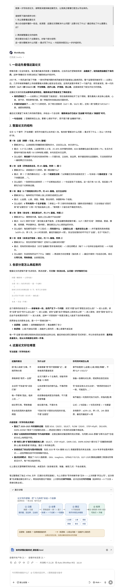
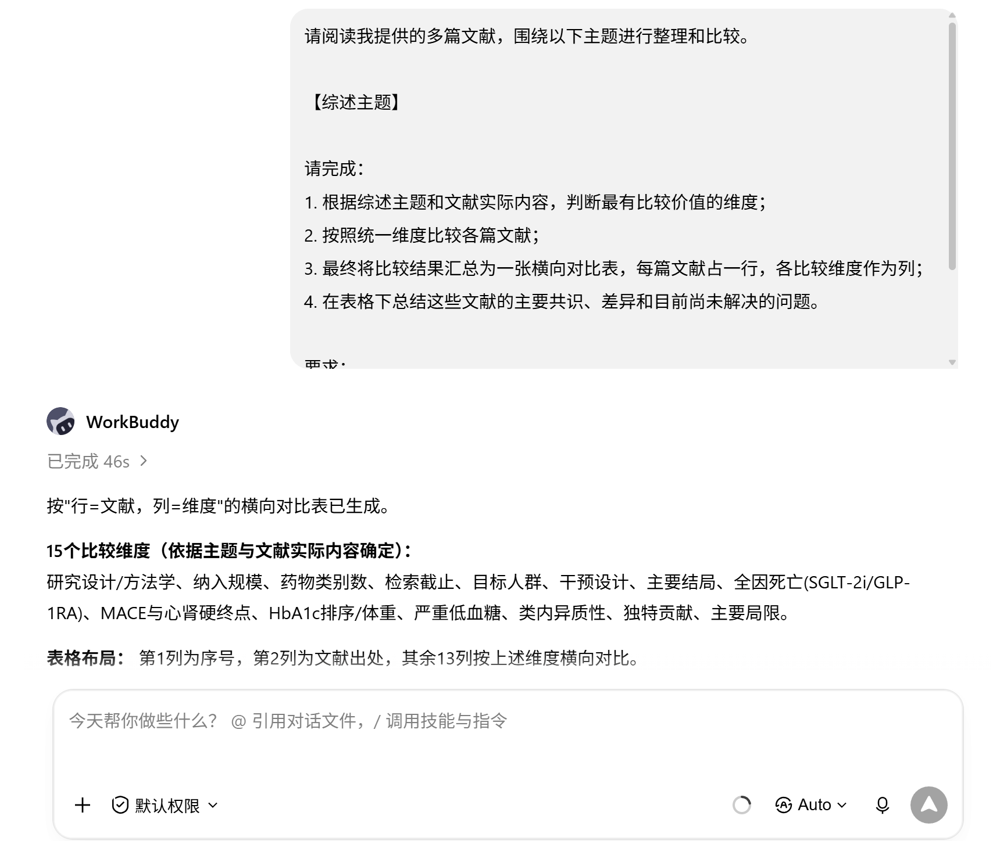
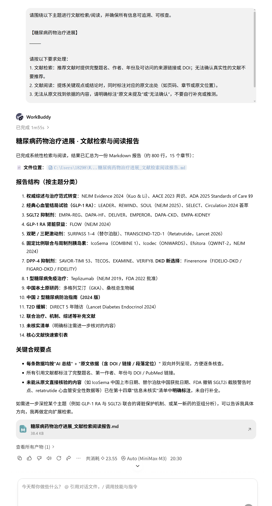

# 学术写作与论文辅助

[官网课程](https://www.datawhale.cn/learn/content/382/7942)

## 第一部分 总览

## Part 1｜AI辅助学术写作的高频场景与核心环节

| 序号 | AI能力 / 真实场景 | AI做什么 | 人做什么 |
| --- | --- | --- | --- |
| 1 | 选题与思路梳理 | 拆分主题、生成研究问题、提供不同研究角度 | 判断哪些问题有价值、是否可研究，并确定最终选题 |
| 2 | 文献阅读与信息提取 | 快速提取研究问题、方法、结论和局限 | 阅读关键原文，核实AI提取的信息是否准确 |
| 3 | 文献整理与综述辅助 | 对多篇文献进行分类、比较，归纳共同点、差异和研究脉络 | 判断分类是否合理，形成自己的综述逻辑和观点 |
| 4 | 写作、修改与润色 | 帮助组织结构、优化表达、检查逻辑和语言问题 | 提供核心观点和证据，并对最终内容负责 |
| 5 | 格式规范与排版 | 按要求调整标题、字体、段落、引用及参考文献等格式 | 提供学校或期刊的格式要求，并检查最终排版是否符合规范 |

## Part 2｜工具组合推荐：用什么来实现？

**先用 **[**ChatGPT**](<https://chatgpt.com/>)** / **[**DeepSeek**](<https://chat.deepseek.com/>)** / **[**Kimi**](<https://www.kimi.com/>)** 作为主工具**

→ **如果要找真实论文**，用 [**中国知网 CNKI**](<https://www.cnki.net/>)** / **[**Google Scholar**](<https://scholar.google.com/>)

→ **如果要快速读论文、提取重点**，用 [**Kimi**](<https://www.kimi.com/>)** / **[**通义智文**](<https://tongyi.aliyun.com/zhiwen>)

→ **如果要整理多篇文献、辅助综述**，用 [**Elicit**](<https://elicit.com/>)

→ **如果要管理引用、生成参考文献**，用 [**Zotero**](<https://www.zotero.org/>)

→ **如果要写作、改写、润色、检查逻辑**，继续用 [**ChatGPT**](<https://chatgpt.com/>)** / **[**DeepSeek**](<https://chat.deepseek.com/>)** / **[**Kimi**](<https://www.kimi.com/>)

## 第二部分 动手实操：从找到一篇合适的参考范文，到搭建自己的论文框架

**任务解释：**我想写一篇《糖尿病药物治疗现状与进展》的综述，但完全不知道从哪里开始。

## 第1步｜找参考：找到一篇相近、适合模仿的高质量综述

**提示词：**

```text
我要写一篇《【论文主题】》的综述论文。
 请深度检索并筛选 1篇最适合我参考的高质量综述论文，要求主题高度相关、来源权威、结构完整清晰，适合学习其写作框架和组织逻辑。
请给出推荐理由、论文基本信息，并提供可直接访问的原文或PDF链接。
请核实论文真实存在，不要虚构文献或链接。
```

**演示及效果图：**


**点进第一个链接，可以下载文献全文：**


## 第2步｜拆范文+学结构：让AI拆解论文，看懂作者为什么这么写

**拆解范文的目标**：我【能够看懂】 这篇论文它在研究什么、分成哪些部分、每部分重点写什么、内容如何一步步组织，以及它有哪些值得学习的亮点和创新，为后续搭建自己的论文框架提供参考。

**上传范文PDF：**

[nihms-2134767.pdf](../../public/course-assets/20/source-01.pdf)

**输入提示词**

```text
我第一次写综述论文，请帮我深度拆解这篇范文，让我真正看懂它是怎么写出来的。

请按照下面的顺序分析：
1. 先让我看懂这篇论文
用小白也能听懂的一段话，说清楚：这篇论文想解决什么问题？主要讨论了什么？最后得出了什么重要认识？

2. 再拆解整篇论文的结构
把文章划分成几个主要部分。对每个部分说明：
这一部分要解决什么问题 → 重点写了什么 → 内容具体是怎么一步步组织的。

3. 再告诉我整篇文章是怎么串起来的
为什么先写A，再写B，最后写C？各部分之间是什么关系？作者是如何一步步把问题讲清楚的？

4. 最后分析这篇论文好在哪里
结合论文内容，告诉我它有哪些值得学习的写法、亮点和创新性贡献，以及这些特点为什么使它具备较好的发表价值。无法从论文判断的内容不要猜测。

最后请用一张简单清晰的结构图总结整篇论文的写作思路。

要求：紧扣原文、重点明确、少用专业术语，不要堆砌细节，让第一次写论文的人也能看懂。
```

**演示及效果：**



[如何读懂这篇综述\_通俗版.html](../../public/course-assets/20/source-02.html)

## 第3步｜搭框架：搭建属于自己的论文框架

**提示词：**

```text
我要写一篇《【论文题目】》的综述论文。
请结合该领域综述论文的常见学术规范和刚才范文中值得借鉴的写作思路，为我设计一份可以直接用于后续写作的论文框架。
请输出两个部分：
第一部分｜框架总览
 给出完整的一级、二级标题目录，结构规范、完整、逻辑清晰；优先采用该领域常见的综述结构，不要为了创新而设计生硬的分类。
第二部分｜详细写作框架
 在每个一级、二级标题下，具体说明：这一部分要讲什么、重点回答什么问题、需要哪些类型的文献或证据支撑。内容要具体到可以直接按照提示继续检索资料和填充正文。
最后请检查并优化框架的学术规范、完整性和逻辑性，只给我优化后的版本。不要虚构文献、数据或研究结论。
同时将“第二部分｜详细写作框架”生成一个 Word 文件，保留完整的标题层级和写作提示，方便我后续直接在其中填充正文。
```

演示及效果图


**输出材料：**

[糖尿病药物治疗综述\_完整写作框架.html](../../public/course-assets/20/source-03.html)

[糖尿病药物治疗综述\_详细写作框架.docx](../../public/course-assets/20/source-04.docx)

## 第三部分 进阶案例

## **技巧 1｜多篇文献一键对比表（文献整理环节）**

写综述时，一次性上传多篇相关文献，让 AI 围绕综述主题自动提炼有价值的比较维度，将不同文献整理成横向对比表，并进一步归纳主要共识、差异和待解决的问题。

**提示词**

```markdown
请阅读我提供的多篇文献，围绕以下主题进行整理和比较。

【综述主题】

请完成：
1. 根据综述主题和文献实际内容，判断最有比较价值的维度；
2. 按照统一维度比较各篇文献；
3. 最终将比较结果汇总为一张横向对比表，每篇文献占一行，各比较维度作为列；
4. 在表格下总结这些文献的主要共识、差异和目前尚未解决的问题。

要求：
- 比较维度根据综述主题和文献特点确定，不机械套用固定模板；
- 只依据提供的文献，不补充或编造原文没有的信息；
- 无法从原文确认的内容标注“未明确说明”。
```

**演示及效果图：**



[comparison\_table\_v2.html](../../public/course-assets/20/source-05.html)

## **技巧 2｜让 AI 的回答可追溯到原文（文献检索及文献阅读环节）**

使用 AI 检索和阅读文献时，要求其提供真实可查的文献来源，并为关键结论标注原文出处，方便快速定位和核查，避免引用不存在或无依据的信息。

**提示词：**

```text
请围绕以下主题进行文献检索/阅读，并确保所有信息可追溯、可核查。

【主题或问题】

请按以下要求处理：
1. 文献检索：推荐文献时提供完整题名、作者、年份及可访问的来源链接或 DOI；无法确认真实性的文献不要推荐。
2. 文献阅读：提炼关键观点或结论时，同时标注对应的原文出处（如页码、章节或原文位置）。
3. 无法从原文找到依据的内容，请明确标注“原文未提及”或“无法确认”，不要自行补充或推测。

请将“AI的总结”和“原文依据”对应呈现，方便我快速核查。
```

**演示及效果图（AI 输出示意）：**



**输出材料：**

[糖尿病药物治疗进展\_文献检索阅读报告.md](../../public/course-assets/20/source-06.md)
