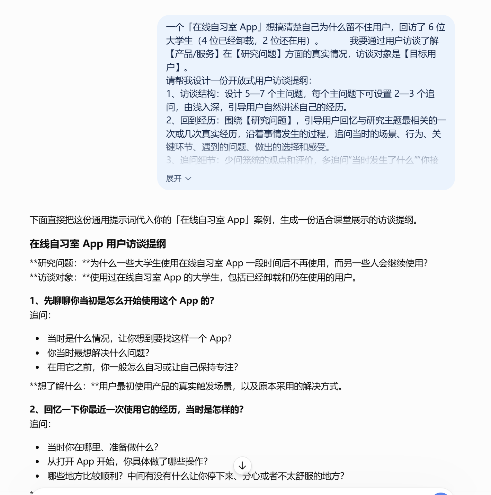
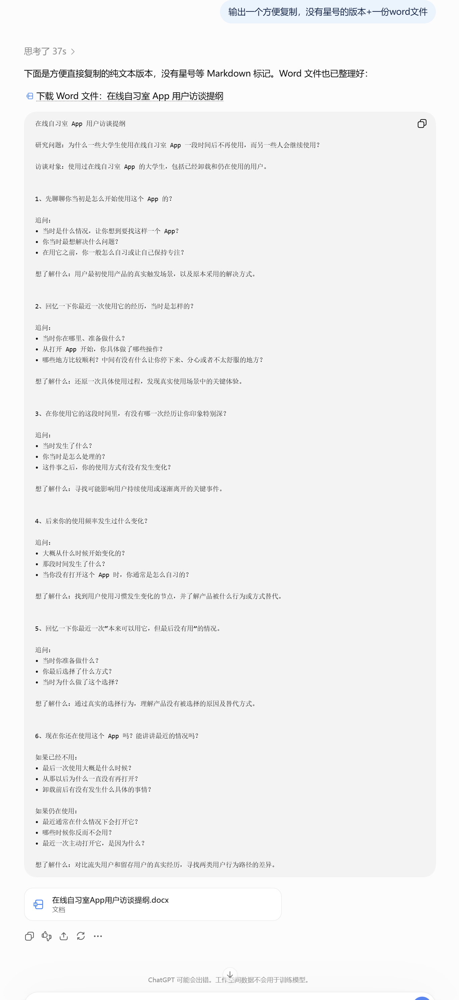
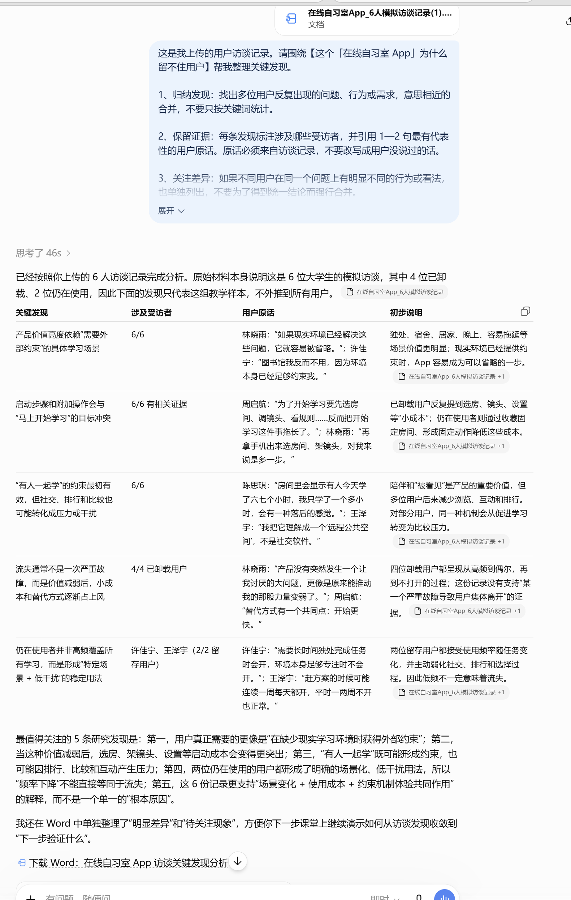
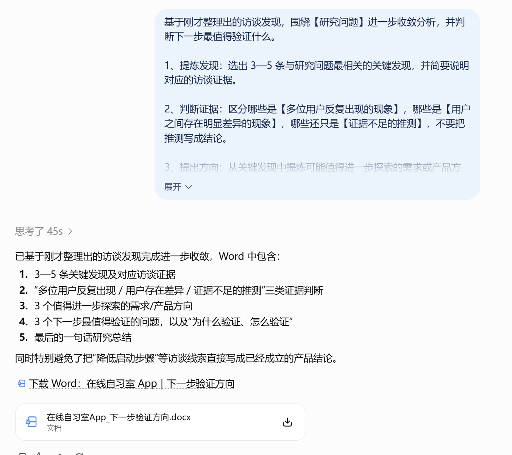
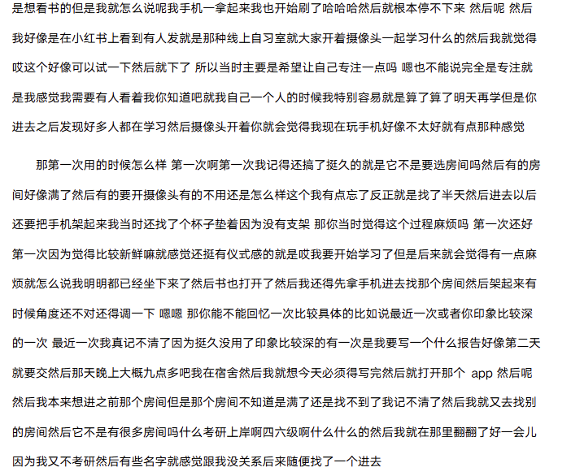
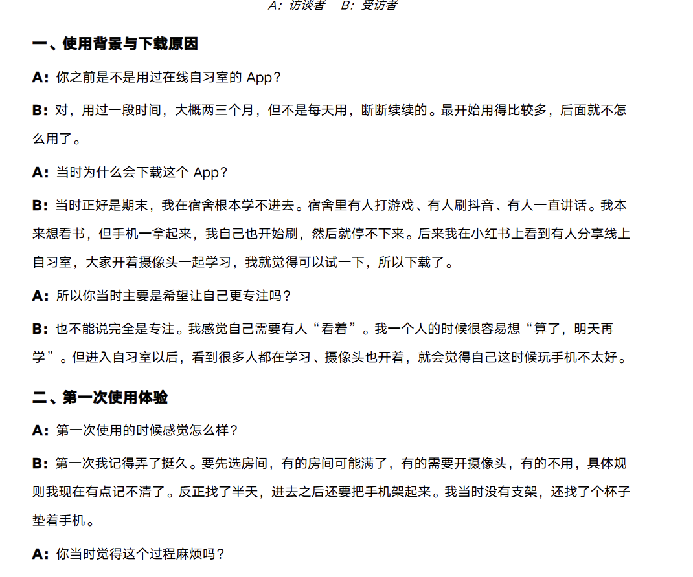

# 21 用户研究与需求验证

[官网课程](https://www.datawhale.cn/learn/content/382/7911)

> **让 AI 帮你把访谈材料、问卷开放题、用户评论等里的零散声音，整理成能直接支撑决策的发现与洞察，并用最低成本判断一个需求到底是真需求还是伪需求。**

## **一、总览**

### **Part 1｜主要应用场景与人群**

| **场景** | **谁在用** | **具体要解决的问题** |
| --- | --- | --- |
| 访谈 / 调研方案设计 | 产品经理、创业者、学生作业 | 不知道问什么，不知道怎么调研 |
| 访谈录音与逐字稿整理 | 用研、产品、咨询顾问、记者 | 录音要听好几遍，手工分类、手工编码，工作量太大 |
| 问卷设计与质检 | 运营、市场、学生 | 题目带专业术语、有歧义、逻辑跳转写错 |
| 评论 / 反馈痛点挖掘 | 电商运营、独立开发者 | 上千条评论只能凭感觉翻几十条 |
| 用户画像与需求优先级 | 产品、设计、创业团队 | 需求攒了一堆，不知道先做哪个 |

### **Part 2｜AI 辅助的主要环节**

| **序号** | **环节** | **AI 做什么** | **人做什么** |
| --- | --- | --- | --- |
| 1 | 定调研方案与访谈提纲 | 按研究目标和用户画像，一次生成结构化提纲 | 说清研究目标；判断问题贴不贴合自己的业务 |
| 2 | 访谈录音转录与整理 | 录音转文字，自动区分发言人、标时间戳，按模板输出结构化摘要 | 核对关键原话；补上 AI 听不出来的语气和情绪 |
| 3 | 访谈内容的编码与聚类 | 把几万字逐字稿归成几条痛点，每条附受访者原话，并按提到人数排序 | 回原文抽查，确认 AI 没把不同意思合并 |
| 4 | 评论 / 反馈痛点挖掘 | 上千条评论一次聚类，输出「问题类型＋频次＋占比＋典型原文」 | 判断哪些算真问题，哪些可以不管 |
| 5 | 画像生成与需求优先级排序 | 生成用户画像，按 Kano 模型和用户价值公式给需求打分排序 | 用真实业务经验校准，最后拍板做什么 |

### **Part 3｜可以使用什么工具**

优先用国内能直接打开的 AI，它们都支持上传文件：[豆包](<https://www.doubao.com/>)、[Kimi](<https://kimi.moonshot.cn/>)、[腾讯元宝](<https://yuanbao.tencent.com/>)、[DeepSeek](<https://chat.deepseek.com/>)等。

→ 生成提纲、分析访谈记录、聚类评论：[豆包](<https://www.doubao.com/>) / [Kimi](<https://kimi.moonshot.cn/>) / [腾讯元宝](<https://yuanbao.tencent.com/>) / [DeepSeek](<https://chat.deepseek.com/>) 等任选一个即可。
 → 访谈录音转文字：[豆包](<https://www.doubao.com/>)「录音纪要」、[讯飞听见](<https://www.iflyrec.com/>)、[网易见外](<https://jianwai.youdao.com/>)
 → 制作问卷：[问卷星](<https://www.wjx.cn/>)、[飞书问卷](<https://wenjuan.feishu.cn/?utm_source=chatgpt.com>) 或 [腾讯问卷](<https://wj.qq.com/>)
 → 判断需求有没有真实热度：[百度指数](<https://index.baidu.com/>)、微信指数（微信内搜「微信指数」）
 → 手里还没有用户、想先试水：去[小红书](<https://www.xiaohongshu.com/>) / [知乎](<https://www.zhihu.com/>) / [B 站](<https://www.bilibili.com/>) 搜抱怨，再做一个落地页

推荐路线：一个国内能用的通用AI（[豆包](<https://www.doubao.com/>) / [Kimi](<https://kimi.moonshot.cn/>) / [腾讯元宝](<https://yuanbao.tencent.com/>) / [DeepSeek](<https://chat.deepseek.com/>)）+ [问卷星](<https://www.wjx.cn/>) + 豆包录音纪要。

## **二、动手实操：用 AI 走完一次用户访谈调研的小闭环**

**案例背景：**一个「在线自习室 App」想搞清楚自己为什么留不住用户，回访了 6 位大学生（4 位已经卸载，2 位还在用）。

### **第一步：让 AI 出一份访谈提纲**

**提示词：**

```text
我要通过用户访谈了解【产品/服务】在【研究问题】方面的真实情况，访谈对象是【目标用户】。
请帮我设计一份开放式用户访谈提纲：
1、访谈结构：设计 5—7 个主问题，每个主问题下可设置 2—3 个追问，由浅入深，引导用户自然讲述自己的经历。
2、回到经历：围绕【研究问题】，引导用户回忆与研究主题最相关的一次或几次真实经历，沿着事情发生的过程，追问当时的场景、行为、关键环节、遇到的问题、做出的选择和感受。
3、追问细节：少问笼统的观点和评价，多追问“当时发生了什么”“你接下来做了什么”“为什么这样做”等具体细节。
4、避免假设：不要问“如果有某个功能你会不会用”“以后愿不愿意购买”等假设性、诱导性问题，优先了解用户过去真实做过什么。
5、保持开放：不要预设用户的问题和答案，让用户先讲，再根据回答继续追问。

每个主问题后，用一句话注明“想了解什么”，帮助访谈者理解提问目的。

输出一个方便复制，没有星号的版本+一份word文件
```

**演示及效果图：**





**输出材料：访谈提纲**

[在线自习室App用户访谈提纲.docx](../../public/course-assets/21/source-01.docx)

### **第二步：从访谈原话中提炼关键发现**

**完成访谈并将录音整理为访谈记录后**

**下载素材：**

[在线自习室App\_6人模拟访谈记录.docx](../../public/course-assets/21/source-02.docx)

**上传访谈记录**

**输入提示词**

```text
这是我调研得到的用户访谈记录。请围绕【研究问题】帮我整理关键发现。
1、归纳发现：找出多位用户反复出现的问题、行为或需求，意思相近的合并，不要只按关键词统计。
2、保留证据：每条发现标注涉及哪些受访者，并引用 1—2 句最有代表性的用户原话。原话必须来自访谈记录，不要改写成用户没说过的话。
3、关注差异：如果不同用户在同一个问题上有明显不同的行为或看法，也单独列出，不要为了得到统一结论而强行合并。
4、保留孤例：对于只有 1 人提到、但可能值得继续了解的现象，单独放在“待关注现象”中，不直接当成普遍结论。
5、控制推断：【只根据访谈记录总结，不补充记录中没有的信息，不把相关性解释成因果关系。】
请输出为表格+word文档：
关键发现｜涉及受访者｜用户原话｜初步说明
最后总结 3—5 条最值得关注的研究发现。
```

**演示：**



**输出：**

[在线自习室App\_访谈关键发现分析.docx](../../public/course-assets/21/source-03.docx)

### 第三步：从研究发现收敛到“下一步验证什么”

访谈初步分析结束后：我们现在知道了什么？哪些还只是猜测？下一步最值得验证什么？

**提示词：**

```text
基于刚才整理出的访谈发现，围绕【研究问题】进一步收敛分析，并判断下一步最值得验证什么。
1、提炼发现：选出 3—5 条与研究问题最相关的关键发现，并简要说明对应的访谈证据。
2、判断证据：区分哪些是【多位用户反复出现的现象】，哪些是【用户之间存在明显差异的现象】，哪些还只是【证据不足的推测】，不要把推测写成结论。
3、提出方向：从关键发现中提炼可能值得进一步探索的需求或产品方向，但不要直接把用户提出的解决办法当成真实需求，也不要直接给出产品结论。
4、确定验证：提出 2—3 个下一步最值得验证的问题，并分别说明【为什么要验证】和【可以怎么验证】。
最后用一句话总结：这次访谈让我们对原来的研究问题多知道了什么？
注意：【只基于现有访谈证据进行判断】，不要用少量受访者代表全部用户，也不要替我做最终产品决策。
输出要求：将完整分析结果整理并以【Word 文档】形式输出。
```

**演示：**



**输出：**

[在线自习室App\_下一步验证方向.docx](../../public/course-assets/21/source-04.docx)

**当问题逐轮收敛，并得到调研验证的时候，说明用户需求已经找到**

## 三、进阶：3 个常用的提效技巧

### 技巧一：访谈前，用 AI 模拟预访谈，审核与优化提纲

正式访谈前，可以先让 AI 模拟访谈。重点不是获得用户答案，而是提前发现哪些问题太抽象、有诱导性，或者很难继续追问。

**提示词：**

```text
请模拟【目标用户】，试着回答下面这份访谈提纲，并帮我检查提问质量。
1、模拟回答：按照这个角色可能的真实经历逐题回答，遇到信息不足的地方直接说明，不要为了回答而编造完整经历。
2、发现问题：指出哪些问题过于宽泛、有诱导性、容易得到客套话，或者很难继续追问，并说明原因。
3、优化提问：针对有问题的题目给出更具体、更容易引出【真实经历和行为细节】的问法。
4、补充追问：指出提纲中还缺少哪些值得进一步了解的方向，并给出必要的追问。
注意：【模拟用户的回答只能用于检查提纲，不能作为真实用户研究结论。】
目标用户：【填写】
研究问题：【填写】
访谈提纲：【粘贴】
```

注.模拟访谈不能代替真实预访谈

### 技巧二：用 AI 把访谈录音整理成规范化、可读性高的访谈记录

**工具： 豆包纪要等**

**素材：**

[在线自习室App\_原始语音转写逐字稿.docx](../../public/course-assets/21/source-05.docx)

**上传录音文件**

**提示词：**

```text
请将这份用户访谈录音处理为两份文件：一份【完整逐字稿】，一份【访谈记录整理稿】。

1、完整转录：将录音完整转成逐字稿，尽可能保留提问、回答、具体经历、行为细节、原因、感受及有价值的口语表达。不要随意删减、概括或补充；听不清或无法确认的内容标记为【待确认】。
2、区分角色：明确标注说话人，A表示访谈者，B表示受访者；如有多人，依次使用C、D等。
3、忠于原意：逐字稿以还原原始表达为主，只做必要的标点和断句，不擅自润色成书面表达，不把推测写成用户说过的话。
4、整理记录：在逐字稿和原录音基础上，再整理一份可读性更高的访谈记录。可删除无意义语气词、明显重复和口误，调整断句和表达，但【尽可能保留原始信息，不要为了简洁而大量删减或概括】。
5、保留细节：整理稿中重点保留与研究相关的真实经历、行为过程、具体案例、原因、感受、态度和有价值的用户原话，不改变受访者原意。
6、规范输出：按访谈过程合理分段，保持原有话题和时间顺序，持续使用A、B、C等角色标记，便于直接用于后续研究分析。

文件输出：分别输出为
XXX_完整逐字稿.docx
XXX_访谈记录_整理稿.docx
除上述两份文件外，不额外输出研究结论、用户画像或洞察分析，除非另有要求。
```

**输出文件：**

[在线自习室App\_访谈记录\_整理稿.docx](../../public/course-assets/21/source-06.docx)

**逐字稿与访谈记录（整理稿）效果对比：**



**逐字稿**



**整理稿**

### 技巧三：用 AI 快速整理大量用户反馈

**当文本量从 6 份访谈变成几百、几千条评论时，AI 可以先帮助分类和发现高频模式。**

**提示词：**

```text
这是我收集的一批【用户评论/客服反馈/问卷开放题】。请帮我整理其中反复出现的问题和需求。
1、归类主题：按照用户实际表达的问题、需求和使用场景进行归类，意思相近的合并，不要只做关键词统计。
2、统计频次：统计每类反馈涉及的数量和占比，并区分正面、负面和中性反馈。
3、保留证据：每类选取 1—2 条有代表性的用户原话，方便回到原始反馈核对。
4、发现异常：单独列出数量不多、但问题明显或值得进一步关注的反馈，不要因为频次低就直接忽略。
5、形成方向：根据反馈整理值得进一步研究或优化的方向，但【不要只根据出现次数直接判断优先级】。
请用表格+word文档格式输出：反馈主题｜数量/占比｜典型场景｜用户原话｜值得关注的问题
```

## **参考资料**

**方法论**

1. Mom Test 妈妈测试实践指南：怎么问出真话：[https://bridgingproducts.com/asking-better-questions-the-mom-test-for-product-managers/](<https://bridgingproducts.com/asking-better-questions-the-mom-test-for-product-managers/>)
2. 客户发现访谈问题对照表（该问什么 / 不该问什么）：[https://www.stackmatix.com/blog/customer-discovery-interviews-startups](<https://www.stackmatix.com/blog/customer-discovery-interviews-startups>)
3. JTBD「焦糖布丁」框架完整指南（含机会分数公式）：[https://www.usehubble.io/blog/jobs-to-be-done-framework](<https://www.usehubble.io/blog/jobs-to-be-done-framework>)
4. 俞军用户价值 / 商业价值公式拆解：[https://shangwuwang.com.cn/baike/435.html](<https://shangwuwang.com.cn/baike/435.html>)

**AI 工具与实操**

1. 问卷星官网（含 AI 检查问卷入口）：[https://www.wjx.cn/](<https://www.wjx.cn/>)
2. 问卷星 AI 助手功能说明：[https://www.wjx.cn/mobile/themehtml/wjxai.aspx](<https://www.wjx.cn/mobile/themehtml/wjxai.aspx>)
3. 用豆包设计访谈提纲并分析录音：[https://www.ufcn.cn/article/2191981.html](<https://www.ufcn.cn/article/2191981.html>)
4. 豆包录音 / 访谈转录实战指南：[https://www.cn486.com/news/4090967/](<https://www.cn486.com/news/4090967/>)
5. 问卷星 AI 功能升级报道（新京报）：[https://www.bjnews.com.cn/detail/1784644375129966.html](<https://www.bjnews.com.cn/detail/1784644375129966.html>)

**评论挖掘与需求验证**

1. 商品评价 AI 分析：从 10 万条差评里挖真问题（含提示词模板）：[https://www.clawbrain.dev/blog/ai-customer-review-analyzer](<https://www.clawbrain.dev/blog/ai-customer-review-analyzer>)
2. 8 种 MVP 验证法对照表（成本 / 周期 / 信号）：[https://speedmvps.com/blog/how-to-test-your-mvp-idea](<https://speedmvps.com/blog/how-to-test-your-mvp-idea>)
3. Buffer 两页网站验证需求的经典案例：[https://pollume.com/blog/test-your-startup-idea](<https://pollume.com/blog/test-your-startup-idea>)

**合成用户与风险边界**

1. 合成用户与真实参与者对照研究综述（2026）：[https://userevaluation.com/post/synthetic-users-vs-real-participants](<https://userevaluation.com/post/synthetic-users-vs-real-participants>)
2. 三分之一的情况下合成研究会指向错误方向：[https://www.xcentium.com/blogs/one-third-of-the-time-synthetic-research-points-the-wrong-direction](<https://www.xcentium.com/blogs/one-third-of-the-time-synthetic-research-points-the-wrong-direction>)
3. ACM Interactions：UX 研究中合成用户的挑战（2026 年 1 月刊）：[https://interactions.acm.org/archive/view/january-february-2026/the-challenges-of-synthetic-users-in-ux-research](<https://interactions.acm.org/archive/view/january-february-2026/the-challenges-of-synthetic-users-in-ux-research>)
