# 22 用AI管理碎片化知识

[官网课程](https://www.datawhale.cn/learn/content/382/7945) · [飞书源稿](https://datawhaler.feishu.cn/wiki/GYKnw6nUfi7oB3kUJ1acYEoLnQa?from=from_copylink)

> **随手捕捉灵感、收藏内容、重新发现价值**

## **一、总览**

## **Part 1｜主要应用场景与人群**

| **高频场景** | **对应人群** | **具体需求** |
| --- | --- | --- |
| 刷到好文章、好视频，想留存下来 | 所有上网的人 | 原文可能被删除，需要一个永久、统一的存放处 |
| 灵光一现的想法，转头就忘 | 产品、运营、教师、写作者 | 3 秒内记下来，之后还能找得到 |
| 开完会、上完课，记不全 | 职场人、学生 | 录音转文字，自动出要点和待办 |
| 收藏了几百篇，从来没看过 | 收藏爱好者 | 自动摘要，先看重点再决定要不要精读 |
| 写东西时，明明存过的素材却找不到 | 内容创作者、研究者 | 用大白话就能搜到，不用记关键词 |

## **Part 2｜AI 辅助的主要环节**

| **序号** | **环节** | **AI 做什么** | **人做什么** |
| --- | --- | --- | --- |
| 1 | 收集 | 一键剪藏网页、语音转文字、自动解析 PDF 和图片 | 决定什么值得收，随手丢进去 |
| 2 | 整理 | 自动生成摘要、自动打标签、按主题归类 | 扫一眼结果，不对就改 |
| 3 | 检索 | 理解大白话提问，跨文档综合回答并给出出处 | 提出真问题，核对出处 |
| 4 | 关联 | 把语义相关的旧笔记自动推到你面前 | 判断哪些关联真的有价值 |
| 5 | 输出 | 基于你的资料起草笔记、大纲、汇报初稿 | 补上自己的观点和判断 |

## **Part 3｜可以使用什么工具**

主体可使用 [腾讯ima](<https://ima.qq.com>)、[flomo](<https://flomoapp.com>)、[Get笔记](<https://www.biji.com>) 等搭配使用。

→ 碎片灵感随手记：[flomo](<https://flomoapp.com>)　，微信里直接发消息就能存一条

→ 长文、报告、PDF 收纳与问答：[腾讯ima](<https://ima.qq.com>)

→ 会议、课程录音转文字：[飞书妙记](<https://www.feishu.cn/product/minutes>)　 / [通义听悟](<https://tingwu.aliyun.com>)

→ 需要资料完全保存在本地：再进阶使用 [Obsidian](<https://obsidian.md>)　（需自行配置 AI 插件）

**推荐路线：flomo 记灵感 + ima 存资料、答问题。**

## 二、动手实操：三步搭一个随问随答的个人知识库

**案例背景： **你是一名大学生，某天，突然想到可以在宿舍组织一个“每周阅读分享”，让大家交流最近读到的有价值的内容。随后，你在微信公众号看到了人民日报的一篇文章，决定收藏起来，并尝试借助AI，从文章中寻找能够启发这项活动的内容。

本教程演示使用**腾讯ima手机App，**需要在手机应用商店进行下载

## 第一步：随手记录idea，让灵感不再丢失

目标：用简单的方式保存突然产生的想法。

很多灵感并不是坐在书桌前认真思考时产生的，而是在吃饭、散步、刷手机，甚至与朋友聊天时突然冒出来的。

这时，最重要的不是立刻把想法整理得多么完整，而是先记下来，避免遗忘。

### 怎么操作

1. 打开手机上的腾讯ima App。
2. 在首页找到「笔记」，点击进入。

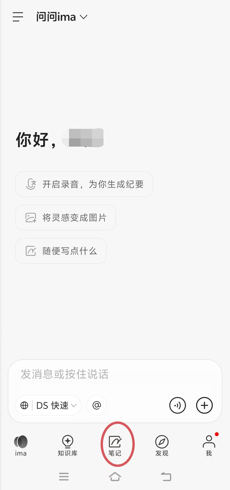

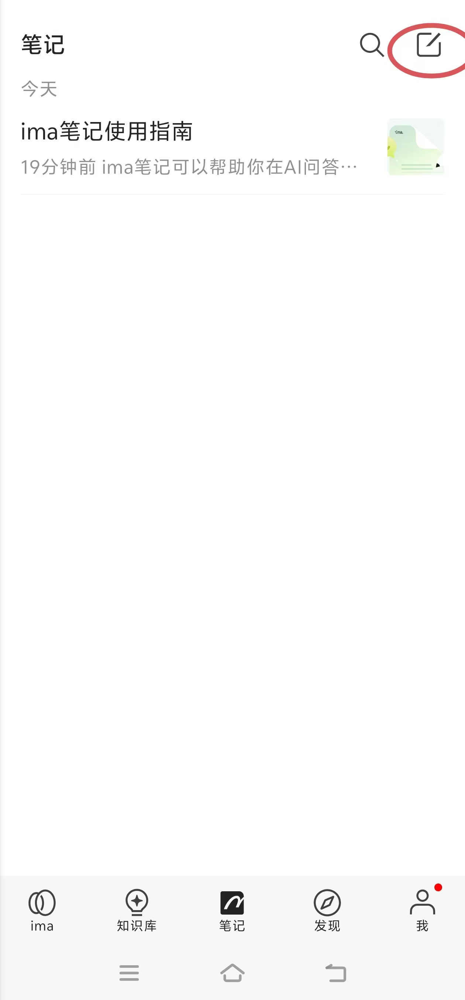

1. 输入下面这段灵感。

```text
灵感：每周阅读分享
我想在宿舍尝试组织一个小型阅读分享活动。每周大家各自推荐一篇最近读到的好文章，说说哪句话最有启发，以及它和自己的学习、生活有什么联系。
不需要正式的演讲，每人分享3分钟就好。
以后可以先收集一些适合讨论的文章，再考虑怎么组织。
```

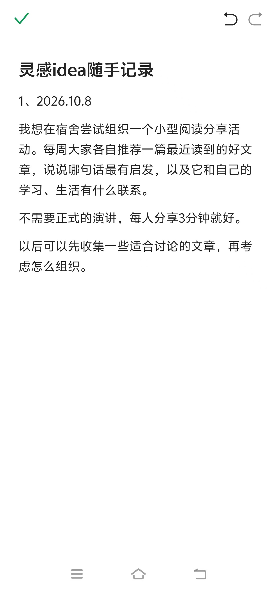

1. 保存（左上角绿色✔，或者返回列表界面，页面会自动保存），再进入底部「笔记」，确认内容是否保存成功。

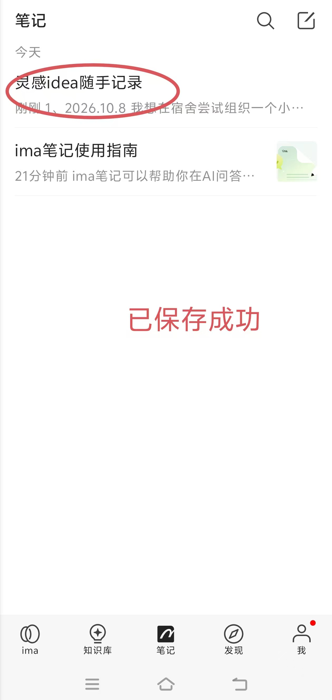

## 第二步：收藏的微信公众号文章，让AI帮你提炼重点

目标：将偶然看到的好文章保存到个人知识库，方便以后查找和利用。

记录了自己的想法后，我们再尝试收藏一篇来自外部的信息。

这次以微信公众号“人民日报”的一篇文章为例。假设你在刷微信时看到它，觉得有启发，但暂时没有时间仔细阅读。

可以尝试将它保存到ima知识库，让AI帮助提炼重点，方便以后用于阅读分享或写作。

**素材链接：**https://mp.weixin.qq.com/s/hWCqLabJA31LiOfBXHzWfA

### 怎么操作

1. 在微信中打开上面的人民日报文章。
2. 点击文章右上角的「…」菜单。

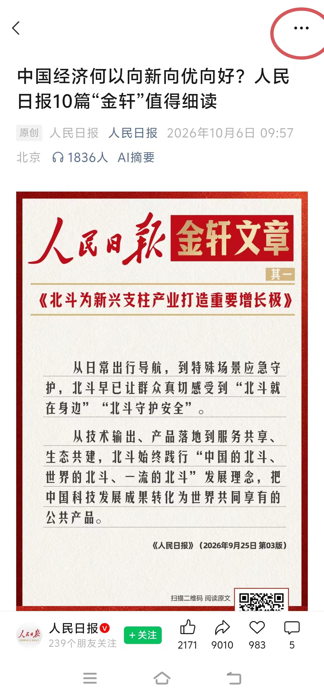

1. 寻找 \[更多打开方式\]，查看是否出现 \[ima知识库\]。

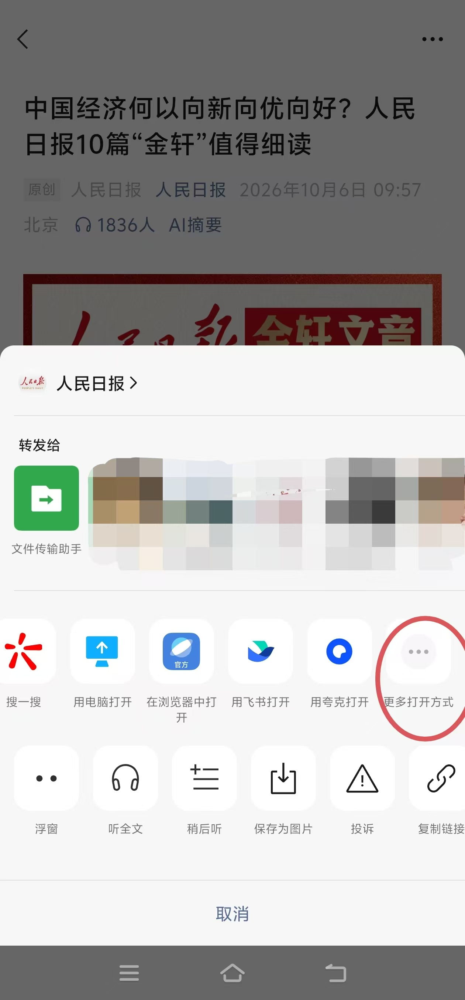

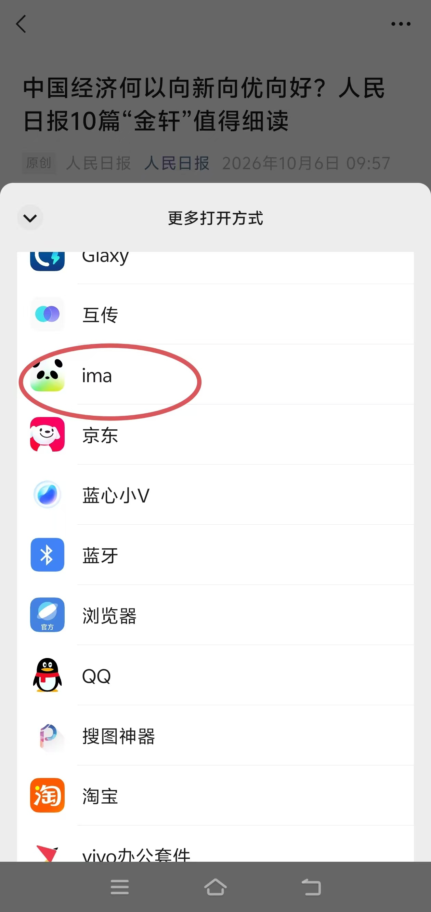

1. 如果出现，点击该入口，按照页面提示完成导入。

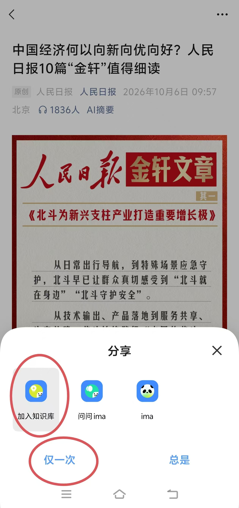

1. 返回ima App，点击底部「知识库」，检查文章是否保存成功。

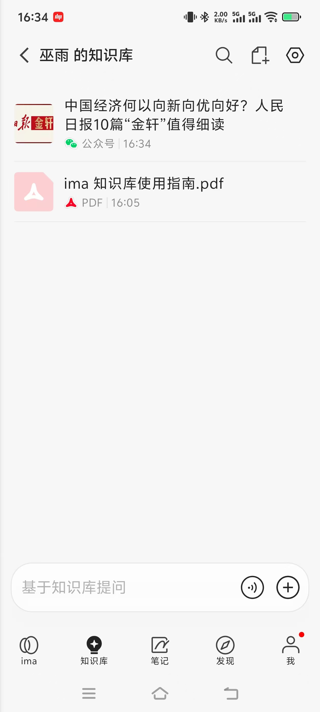

**注.**

如果没有找到「ima知识库」： 可以尝试在微信中将文章转发给「ima知识库」联系人；如果该入口也没有出现，可复制文章链接，尝试在ima的知识库添加界面通过网页链接导入。

无论使用哪种方法，都要确认文章确实出现在知识库中，而不是仅仅把链接发送到普通AI对话框。

1. 让AI帮你整理文章

文章成功导入后，在ima中选中这篇资料，或者在问答输入框通过「@」选择相应的知识库，再使用以下提示词：

```text
我刚刚收藏了一篇来自微信公众号“人民日报”的文章，希望以后用于阅读分享和日常写作。
请仅根据这篇文章的原文，帮我整理：
1、文章主题： 用一句话说明这篇文章主要讲什么。
2、核心观点： 提炼3—5个重要观点，每条不超过30字。
3、值得记录的内容： 找出文章中最值得进一步思考的一处内容，说明理由。
4、适用场景： 这篇文章适合用于哪些学习、生活或讨论场景？
5、检索关键词： 推荐3个方便以后查找的关键词。
请注明重要观点在原文中的对应位置。
不要编造文章中没有的内容。如果无法读取正文，请明确告诉我。
```

**演示及效果图：**

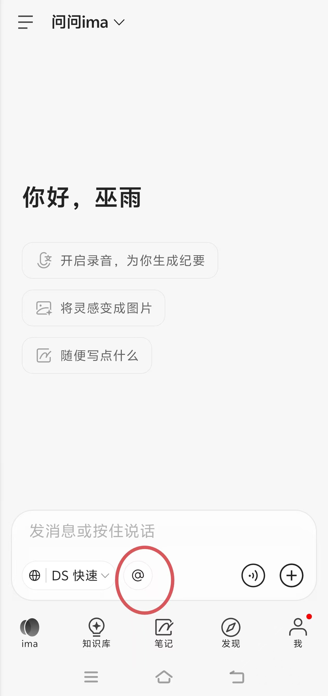

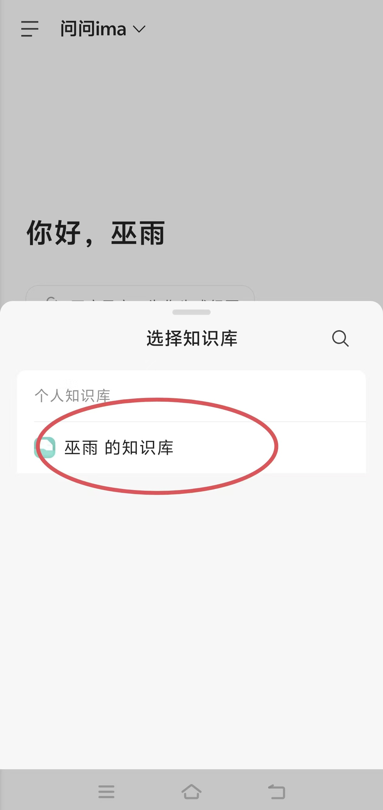

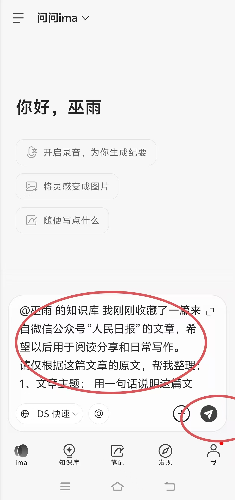

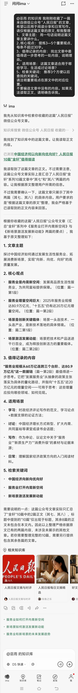

## 第三步：把灵感和收藏资料联系起来，产生新的想法

目标：让AI帮助重新发现旧内容，并尝试将不同来源的信息联系起来。

前两步，我们保存了两种不同的内容：

- 自己产生的灵感： 在宿舍组织“每周阅读分享”。
- 外部收藏的资料： 一篇人民日报微信公众号文章。

接下来，我们尝试让AI帮助寻找两者之间的联系，看看收藏的文章能否为之前的想法提供新的启发。

### 怎么操作

1. 打开腾讯ima App，进入底部「ima」问答页面。
2. 点击输入框附近的「@」，尝试选择刚才保存文章的知识库。
3. 确认之前记录的“每周阅读分享”笔记也被当前问答检索。

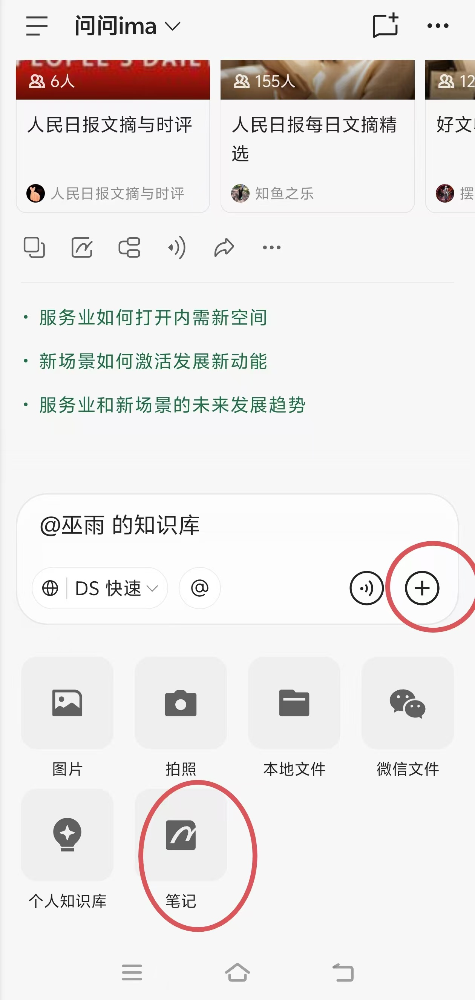

1. 使用下面的提示词。

```text
我之前有一个想法：在宿舍组织“每周阅读分享”，让大家每周推荐一篇好文章，并交流自己最有感触的观点。
现在，我又收藏了一篇来自微信公众号“人民日报”的文章。
请结合我的想法和这篇文章的实际内容，帮我分析：
1、寻找联系： 这篇文章与“每周阅读分享”的想法有哪些可以结合的地方？如果联系不明显，请直接说明。
2、提取素材： 文章中有哪些观点适合作为交流话题？请注明原文依据。
3、设计讨论问题： 根据文章内容，提出3个适合大学生讨论的开放性问题。
4、完善灵感： 给出2条改进“每周阅读分享”活动的建议。
5、形成行动： 如果下周就开始第一次分享，我可以怎样利用这篇文章做准备？
请区分文章中的真实观点和你提出的建议，不要为了建立联系而编造文章内容。
```

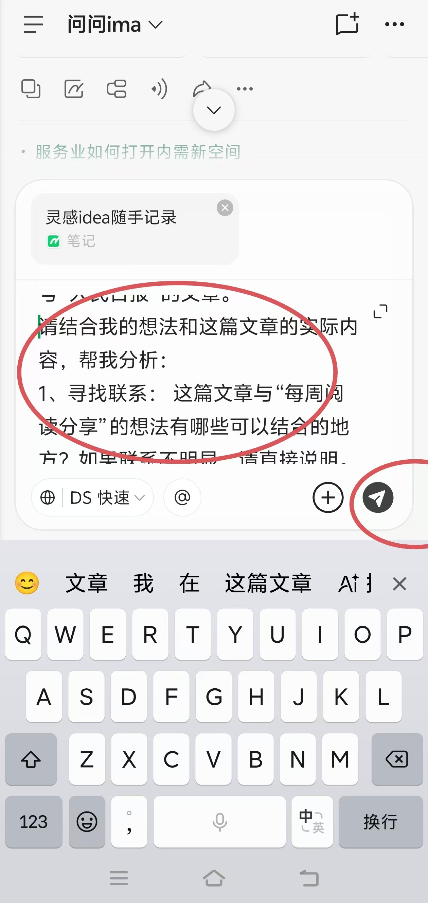

1. 查看AI生成的建议，判断哪些值得保留。

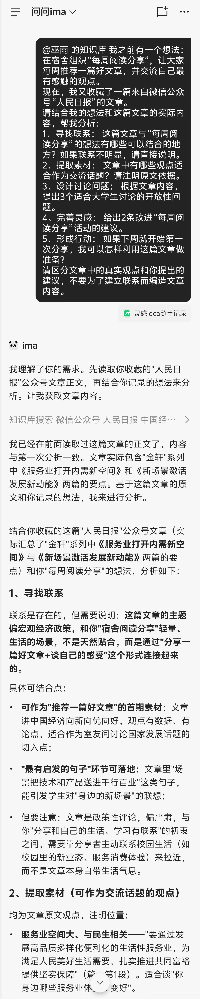

最后，可以将经过自己筛选、修改的结果保存为新笔记，标题例如：《第一次宿舍阅读分享：讨论话题与活动准备》

## **三、进阶技巧**

## 技巧一：给碎片知识设置标签

一句话描述： 给收藏的文章和灵感贴上几个简单的关键词标签，以后即使忘记标题，也能按主题快速找到相关内容。

适用场景： 收藏文章、积累灵感、整理写作素材、管理不同主题的资料。

### 为什么要设置标签？

假设你平时收藏了很多内容，有的是关于阅读的，有的是关于大学生活的，还有的是突然想到的创意。

如果所有资料都堆在一起，时间久了就容易找不到。

这时可以通过标签进行分类。例如：

| 收藏内容 | 推荐标签 |
| --- | --- |
| 宿舍每周阅读分享的灵感 | 阅读、灵感、校园生活 |
| 收藏的人民日报文章 | 根据文章实际主题设置 |
| 关于学习方法的文章 | 学习方法、效率 |
| 想尝试的校园活动 | 校园活动、待实践 |

一条资料可以同时属于多个主题，不必为了分类而建立很多文件夹。

### 怎么操作？（以腾讯ima手机端为例）

继续使用基础案例中收藏的资料。

1. 打开腾讯ima手机App，点击底部「知识库」。
2. 找到之前收藏的文章或其他资料。长按目标文章/资料。

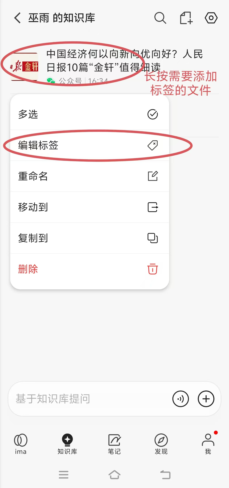

1. 如果出现标签编辑功能，输入适合这份资料的主题关键词。

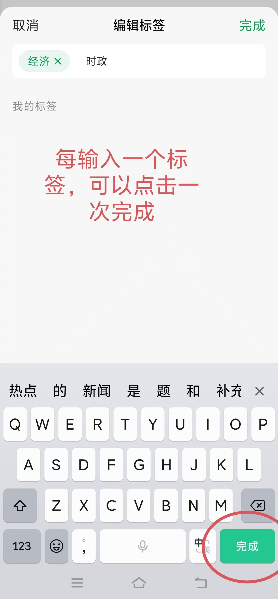

1. 保存后，回到知识库页面，可以看到标签已经设置完成。
   
   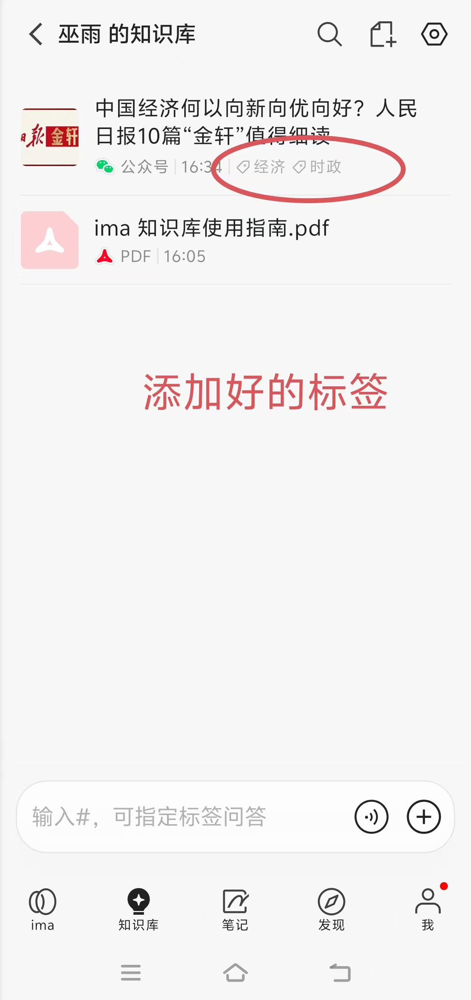
2. 进入知识库的标签视图，点击对应标签查看同类资料。

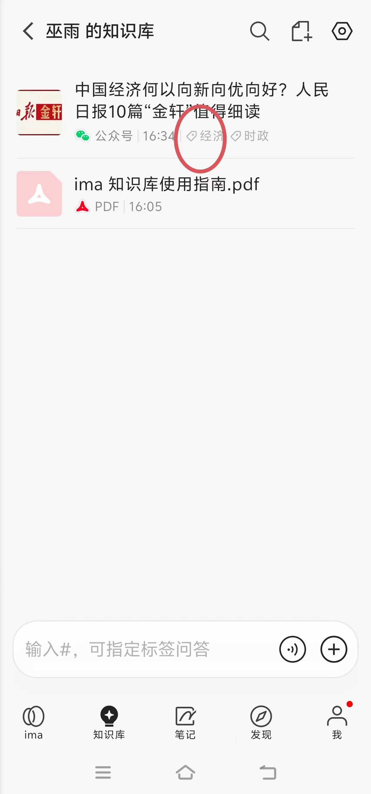

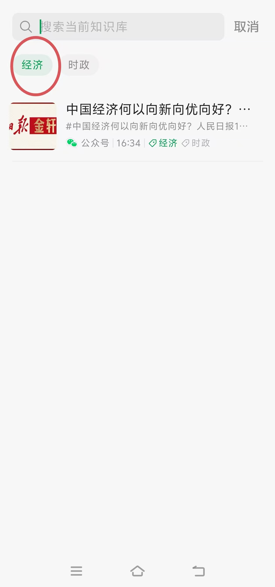

### Tip：不知道应该设置什么标签？让AI帮你推荐

```text
请根据我收藏的这篇文章，推荐3个适合长期知识管理的标签。
要求：
1、每个标签尽量控制在2—6个字。
2、优先选择主题明确、以后能够重复使用的标签。
3、避免使用“好文章”“有用”“收藏”等过于宽泛的标签。
4、简单解释为什么推荐这些标签。
5、请只根据文章的实际内容推荐，不要编造文章中没有的主题。
```

## 技巧二：追溯AI回答的来源，避免把错误信息当成事实

### 怎么操作

继续使用基础案例中收藏的人民日报文章。

1. 打开腾讯ima手机App，进入底部「ima」问答界面。
2. 选择已收藏文章所在的知识库。
3. 让AI总结文章中的主要观点。

前面步骤与基础案例中第二步相同

1. 查看回答中是否出现引用编号或资料来源入口。
2. 点击来源，打开对应原文，检查AI的概括是否准确。

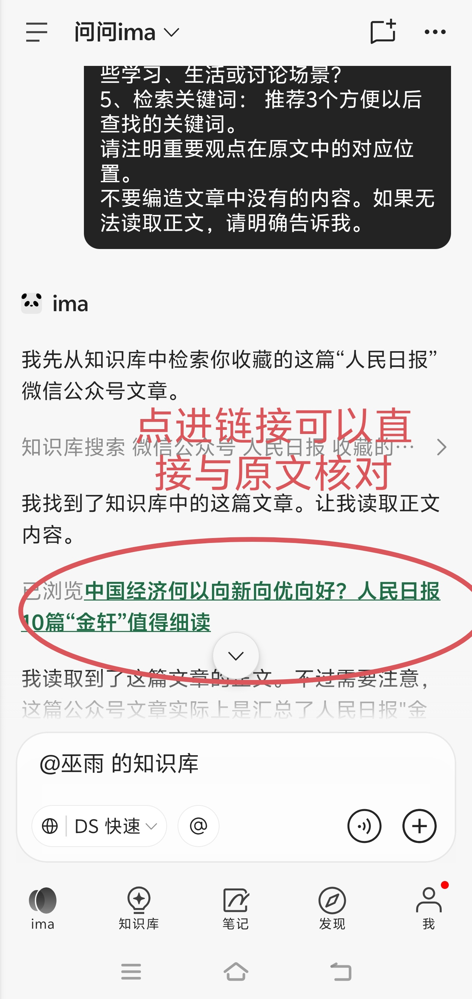

## 技巧三：让AI连接不同主题的资料，发现新的想法

假设你陆续收藏了两类文章：一类与大学生学习有关，另一类与社会观察有关。

它们看起来没有直接关系，但可能共同涉及时间管理、个人成长或社会参与等话题。

这时候，不必依赖已经设置好的标签，可以直接让AI进行跨资料比较。

### 怎么操作

1. 在ima知识库中准备至少两份不同主题的资料。
2. 在问答界面通过「@」选择包含它们的知识库。
3. 输入下面的提示词。
4. 检查AI提出的联系是否有资料依据。

```text
我想从知识库中不同主题的资料里寻找新的灵感。
请根据我收藏的资料，完成以下任务：
1、找出与【大学生学习】和【社会观察】有关的内容。
2、分别总结两类资料最重要的观点，并注明来源。
3、分析它们之间是否存在共同话题、互补观点或不同看法。
4、提出3个值得进一步探索的讨论问题或创意方向。
5、对每个新想法，说明它受到哪些资料的启发。
请区分原始资料中的观点与你提出的新联想。如果资料之间没有明显联系，不要强行建立联系。
```

## **参考资料**

**方法与认知**

- [你利用了99%的碎片时间来学习，却输在1%的「知识管理」上（岳蒙）](<https://mp.weixin.qq.com/s/mCMNTjbhyztwnOnd38xFcA>)
- [信息过载时代，如何有效管理知识？（印象笔记 CEO 唐毅，极客公园）](<https://mp.weixin.qq.com/s/Hfz-Q4orYaoIPhdf7aCKeQ>)
- [碎片化时代—从体系思维到系统化知识体系构建之路（人月聊IT）](<https://mp.weixin.qq.com/s/CydlUv4bL_elso1I73ijDQ>)
- [AI大模型与碎片化知识的管理](<https://mp.weixin.qq.com/s/F_I9wYyEt8GeTFaHb3Pc5A>)

**工具与实操**

- [搜不到、答不对？3个技巧，让ima的每次回答都有据可查（腾讯新闻）](<https://news.qq.com/rain/a/20260420A085XD00>)
- [用 AI 搭一个「第二大脑」：个人知识库从散落笔记到随问随答（ima 官方教程）](<https://ima.qq.com>)
- [别让Obsidian成为信息孤岛：Flomo + Get笔记 + AI自动化 + Obsidian 知识流水线（什么值得买）](<https://post.m.smzdm.com/p/awwggrvg>)

**传统工具与方法**

- [【黄金四步】教会你高效管理和吸收碎片化知识（有道云笔记）](<https://mp.weixin.qq.com/s/A1zv9zvd1FI--WGhCfKxoA>)
- [拯救大脑！碎片化知识管理神器，打造个人知识库（Trilium Notes）](<https://mp.weixin.qq.com/s/tOiFIOkyhfI4rUMts_vg-A>)
- [碎片化时代，该如何做好知识管理？（小北小姐）](<https://mp.weixin.qq.com/s/-mnD0UH1uRaxOL6iB7Fj-Q>)
- [学习工具｜超好用的碎片化知识管理神器——收藏家（印象笔记）](<https://mp.weixin.qq.com/s/AxRs04zo-BqVnGfFggUymQ>)
