# 23 使用AI辅助制作简历

[官网课程](https://www.datawhale.cn/learn/content/382/7912)

> 让 AI 帮你先读懂岗位需要什么，再从自己的真实经历中筛选和整理最相关的内容，最后配合 LaTeX 和 Overleaf，快速制作一份结构清晰、排版稳定、可以直接导出 PDF 的简历。

## 一、总览

## Part 1｜主要应用场景与人群

这份教程主要面向第一次写简历、正在准备实习或校招，以及已经有一些经历但不知道应该怎么针对岗位整理的人。

| 主要场景/任务 | 典型需求 |
| --- | --- |
| 第一次制作简历 | 不知道该写什么，也不知道简历应该怎么排版 |
| 根据岗位准备简历 | 看得懂 JD，但不知道招聘方真正看重什么，也不知道自己的哪些经历最相关 |
| 优化经历描述 | 有真实经历，但只会写“负责、参与、协助”，内容比较像流水账 |
| 针对不同岗位修改 | 同一份简历投多个岗位，不知道应该怎么调整重点 |
| 快速制作美观简历 | 不想花大量时间在 Word 中反复调格式，希望内容变化后版式仍然稳定 |

## Part 2｜AI 辅助的主要环节

| 序号 | 环节 | AI 做什么 | 人做什么 |
| --- | --- | --- | --- |
| 1 | 分析岗位 JD | 提取核心职责、能力要求和关键词 | 确认目标岗位，判断要求是否与自己匹配 |
| 2 | 筛选和优化经历 | 从已有经历中挑选更相关的内容，并整理成简历表达 | 提供真实经历、事实和数据，并核对结果 |
| 3 | 生成 LaTeX 简历代码 | 根据选定模板和简历内容生成可编译代码 | 选择喜欢的模板，确认版式和内容 |
| 4 | 检查和修改 | 检查内容缺口、排版问题和 LaTeX 报错 | 做最终确认，并决定是否投递 |

## Part 3｜可以使用什么工具

→ AI：优先使用能够处理长文本和代码的 AI，例如[豆包](<https://www.doubao.com/>)、[Kimi](<https://www.kimi.com/>)、[腾讯元宝](<https://yuanbao.tencent.com/>)、[通义](<https://tongyi.aliyun.com/>)，也可以使用 [ChatGPT](<https://chatgpt.com/>)、[Claude](<https://claude.ai/>)、[Gemini](<https://gemini.google.com/>)。

→ LaTeX 模板：优先从 [Overleaf](<https://www.overleaf.com/>) 的 CV / Résumé 模板库中选择现成模板。

→ 排版与输出：使用 [Overleaf](<https://www.overleaf.com/>) 在线编辑和编译 LaTeX，最后直接导出 PDF。

[` Overleaf `](<https://www.overleaf.com/>) 官方有专门的 CVs and résumés 模板分类，可以浏览模板、查看源码，并直接作为模板创建项目。

**推荐路线：**

> [**Overleaf**](<https://www.overleaf.com/>)** 找模板 → AI 分析 JD 和优化内容 → AI 根据模板生成 LaTeX 代码 → **[**Overleaf**](<https://www.overleaf.com/>)** 编译并导出 PDF**

## 二、动手操作基础案例：用 AI + Overleaf 制作一份针对岗位的简历

下面通过一个完整案例完成一份简历。

假设现在要应聘的是**新媒体运营实习生**。手上有一些校园、课程和兼职经历，但还没有整理成正式简历。

**素材下载：**

[个人经历模拟材料\_张三.docx](../../public/course-assets/23/source-01.docx)

## 第一步：找到一份合适的 LaTeX 简历模板

使用 LaTeX 时，更简单的方式是直接使用已经设计好的模板。Overleaf 本身就是一个在线 LaTeX 编辑器，同时提供大量可以直接使用的简历模板。官方模板库里既有简单的单栏模板，也有双栏和视觉风格更明显的模板。(Overleaf)

### 怎么找-步骤说明

进入 **Overleaf **的 **Templates **页面，在模板中搜索：Resume 或 CV 或 Simple Resume 或 Minimal CV （一次只输入一个关键词）

找到喜欢的模板后，可以点击 **Open as Template** 打开。在左侧文件区找到主要的 ` .tex ` 文件，通常是 ` main.tex ` 或类似名称。

**演示与效果图：**

1、首页右上角找到模板

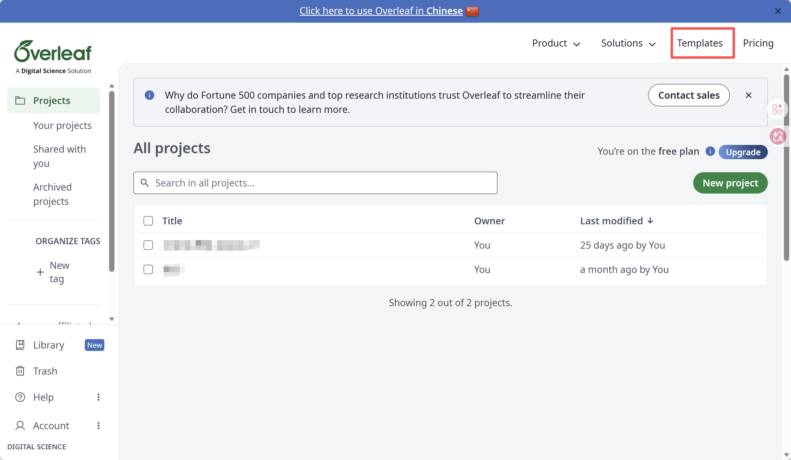

2、模板空间搜索、选择合适的简历模板


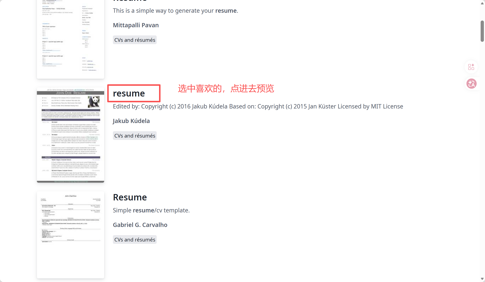

3、打开选中的模板

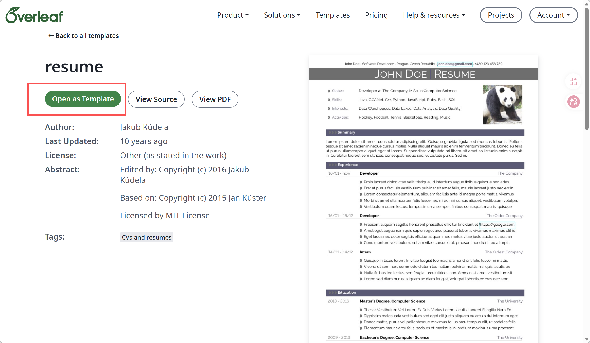

4、下载模板文件

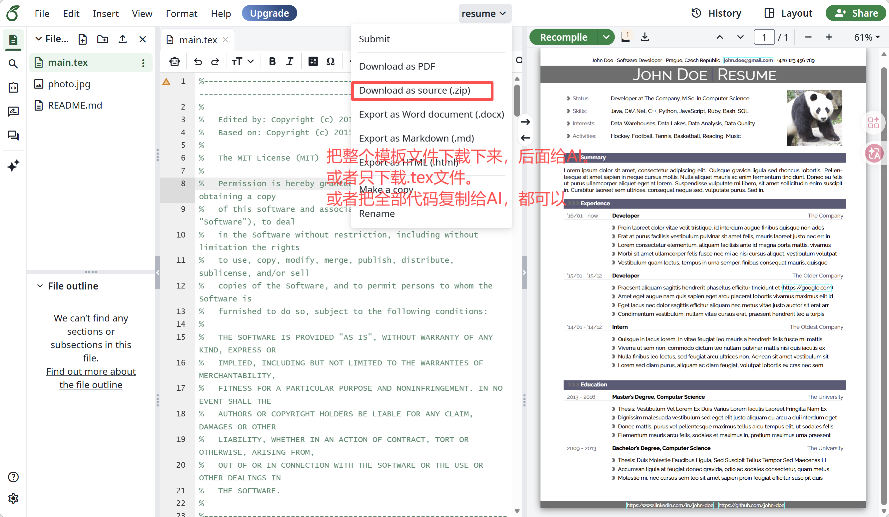

[resume.zip](../../public/course-assets/23/source-02.zip)

也可以直接进入 Overleaf 的 **CVs and résumés** 分类进行浏览。

对于普通实习、校招和职能岗位，建议优先选择**结构简单、文字为主、层级清楚、没有大量图标和装饰元素**的模板。

## 第二步：把个人经历和岗位 JD 交给 AI，筛选并优化简历内容

把目标岗位 JD 和自己的原始经历一起交给 AI，拆解JD，让 AI 先判断招聘方最看重什么，再从已有经历中筛选最有证明力的内容。

**例如目标岗位是：**

```text
活动运营实习生｜ JD

公司/团队简介
某 AI 开源学习社区，致力于建设人工智能学习生态，与高校、产业及相关机构合作开展 AI 学习与实践活动。

岗位职责
协助各类 AI 学习与实践活动的策划、组织和执行，包括实训营、组队学习、主题训练营等，并逐步独立负责其中的具体模块；
跟进活动全流程，包括用户沟通、社群运营、物料准备、现场支持及活动复盘等；
参与活动数据整理与分析，根据数据和用户反馈提出流程优化及用户体验改进建议；
协助与高校合作伙伴、校园组织者、助教、分享嘉宾等外部角色进行沟通协作，维护活动参与者关系。

任职要求
在校大学生或研究生，专业不限，特定毕业年份优先；
有活动运营、社群运营、校园活动组织、线上社群管理或助教等相关经验者优先，能够独立推进任务并对结果负责；
做事有条理，能够使用在线协作工具、电子表格等进行任务管理和数据整理；
具有较强的执行力、沟通能力和学习意愿，能够适应多样化的工作任务；
加分项：熟练使用 AI 工具，能够利用大语言模型、AI Coding 等工具提升内容生产、信息整理和数据处理效率。

工作形式
线下/混合办公；
每周需保证较稳定的实习时间；
建议连续实习 3–6个月及以上。

薪酬
按个人能力、实际工作时间及相关考核机制确定。
```

自己的原始经历不需要提前写得很正式，先把真实信息提供完整即可，可以以文字形式提供，也可以上传整理好的个人经历文件。

### **参考提示词**

**个人经历素材下载：**

[个人经历模拟材料\_张三.docx](../../public/course-assets/23/source-03.docx)

**上传 个人经历+岗位JD**

**输入提示词：**

```markdown
你是一名资深招聘经理和职业顾问。

我会给你：
1. 一份目标岗位JD；
2. 我的现有简历；
3. 我的个人经历补充。

请不要泛泛润色，而是从“提高进入面试的概率”出发，对我的简历进行岗位定向优化。

请按以下步骤进行：

第一步：拆解JD
- 提炼岗位最核心的5-8项能力；
- 区分硬性要求、核心能力、加分项；
- 判断招聘方真正想找什么样的人；
- 判断这个岗位最可能筛掉候选人的点。

第二步：匹配我的经历
- 将我的每段经历对应到JD中的具体能力；
- 区分强匹配、弱匹配、无关经历；
- 找出最应该保留、强化、精简或删除的内容；
- 不要为了匹配而虚构经历。

第三步：改写简历
- 用结果导向、动作导向、运营/业务语言改写；
- 尽量使用“做了什么 + 怎么做 + 产生什么结果”的表达；
- 删除空泛形容词，如“认真负责、沟通能力强”；
- 优先用项目行为证明能力；
- 尽可能量化，但没有真实数字时不要编造。

第四步：给出最终建议
请输出：
1. 岗位能力画像；
2. 我的匹配优势；
3. 我的短板；
4. 建议保留的经历；
5. 建议删减的经历；
6. 修改后的简历内容；
7. 面试中最可能被追问的5个点。

目标岗位JD：
【粘贴JD】

个人经历：
【粘贴简历】

补充经历（可选）：
【粘贴】
```

**演示及效果图：**


## 第三步：让 AI 根据模板生成 LaTeX 代码，并在 Overleaf 中生成简历

**【AI 输出 LaTeX 代码 → 粘贴到 Overleaf → 点击 Recompile → 右侧出现完整 PDF 简历】**

把第一步选好的**LaTeX 模板zip文件**和第二步已经确定的**简历内容**一起交给 AI，让 AI 在保留模板样式的情况下完成内容替换。

### 参考提示词

```text
我需要你根据我提供的、或我们之前已经讨论确认过的【LaTeX 简历模板代码】【个人经历信息】【目标岗位 JD】，为该岗位定制化撰写我的简历，并输出完整可用的 LaTeX 简历代码。

【输入内容】
LaTeX 简历模板: 粘贴完整 .tex 代码，或上传模板压缩包。
我的个人经历: 粘贴已确认的教育、实习/工作、项目、科研、技能等奖历内容，或使用我们之前已经确认过的版本。
目标岗位 JD: 粘贴目标岗位的职位描述、职责和任职要求。

【撰写要求】：
1、岗位匹配：结合 JD 调整内容重点、模块顺序和表述方式，突出与岗位最相关的经历、成果和技能。
2、真实准确：只使用我提供或之前已确认的信息，不新增、虚构或推测经历、数据、成果、技能和技术栈。
3、保留模板：尽量保留原模板的版式、字体、配色、间距和整体视觉风格，仅做必要调整。
4、内容优化：不是简单把原内容填入模板；应在不改变事实的前提下，对经历描述进行精炼、重组和岗位定制，使表达更专业、清晰、有重点。
5、优先一页：优先控制在 1 页。内容过多时，先压缩低相关、重复或次要信息，并优化布局和间距，不要单纯依靠大幅缩小字号。
6、中文兼容：使用 XeLaTeX，并保证中文排版正常；如模板存在不适合中文的样式或布局，可进行必要调整。
7、稳定编译：优先保证在 Overleaf 中稳定编译；如存在复杂或高开销实现，可在尽量保持视觉效果的前提下简化，并删除未使用的宏包或依赖。
8、完整检查：检查 LaTeX 语法、环境、括号、自定义命令和依赖文件是否完整；如依赖 .cls、.sty、字体、图片等额外文件，请明确说明。

【输出要求】
输出【完整、可直接使用的 LaTeX 简历代码】。
从 \documentclass 开始，到 \end{document} 结束。
不要省略任何中间代码，不要使用“同上”“保持不变”“此处省略”等表达。
不要只输出修改建议或局部代码片段。
如存在额外依赖文件，请在代码后单独列出文件名及用途。
```

**操作演示：**

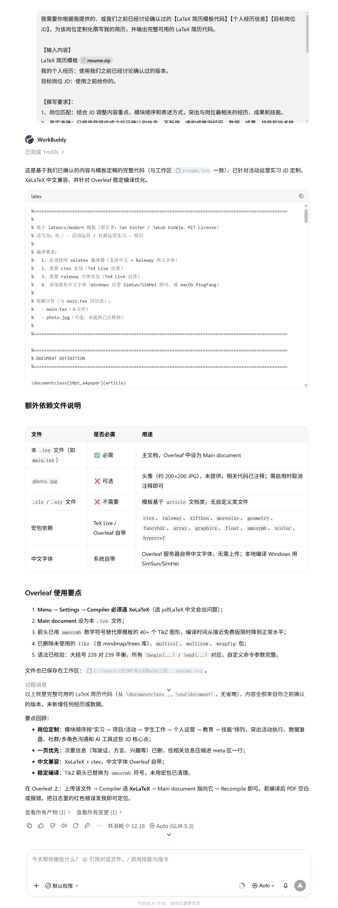

**输出的代码：**

```bash
%===================================================================================================
%
%        基于 latexcv/modern 模板（原作者：Jan Küster / Jakub Kúdela，MIT License）
%        改写为：张三 · 活动运营 / 社群运营实习 · 简历
%
%        编译要求：
%          1. 必须使用 xelatex 编译器（支持中文 + Raleway 西文字体）
%          2. 需要 ctex 宏包（TeX Live 自带）
%          3. 需要 raleway 字体宏包（TeX Live 自带）
%          4. 系统需有中文字体（Windows 自带 SimSun/SimHei 即可，或 macOS PingFang）
%
%        依赖文件（与 main.tex 同目录）：
%          - main.tex（本文件）
%          - photo.jpg（可选，未提供已注释掉）
%
%===================================================================================================

%===================================================================================================
%        DOCUMENT DEFINITION
%===================================================================================================

\documentclass[10pt,a4paper]{article}

%---------------------------------------------------------------------------------------------------
%        中文支持：用 ctex 替代原模板的 inputenc[utf8] + fontenc[T1]
%---------------------------------------------------------------------------------------------------

\usepackage{ctex}
% 如需指定中文字体可解开下行注释；Windows 默认字体已可正常工作
% \setCJKmainfont{SimSun}
% \setCJKsansfont{SimHei}

%---------------------------------------------------------------------------------------------------
%        LOGIC
%---------------------------------------------------------------------------------------------------

\usepackage{xifthen}

%---------------------------------------------------------------------------------------------------
%        FONT
%---------------------------------------------------------------------------------------------------

\usepackage[default]{raleway}
\renewcommand*\familydefault{\sfdefault}

\usepackage{moresize}

%---------------------------------------------------------------------------------------------------
%        PAGE LAYOUT
%---------------------------------------------------------------------------------------------------

\usepackage[a4paper]{geometry}
\geometry{top=1.75cm, bottom=-.6cm, left=1.5cm, right=1.5cm}

\usepackage{fancyhdr}
\pagestyle{fancy}
\setlength{\headheight}{-5pt}

% 顶部条幅（姓名 + 求职方向 + 城市 + 邮箱 + 电话）
\lhead{}
\chead{\small{
  张三 $\cdot$
  活动运营 / 社群运营实习生 $\cdot$
  上海 $\cdot$
  \textcolor{sectcol}{\textbf{\href{mailto:zhangsan.demo@example.com}{zhangsan.demo@example.com}}} $\cdot$
  138-0000-2468
}}
\rhead{}

\setlength{\parindent}{0mm}

%---------------------------------------------------------------------------------------------------
%        TABLES / ARRAYS
%---------------------------------------------------------------------------------------------------

\usepackage{array}
\newcolumntype{x}[1]{>{\raggedleft\hspace{0pt}}p{#1}}

%---------------------------------------------------------------------------------------------------
%        GRAPHICS
%---------------------------------------------------------------------------------------------------

\usepackage{graphicx}
\usepackage{float}

%---------------------------------------------------------------------------------------------------
%        ARROWS：用数学符号替代原模板的 TikZ 箭头（Overleaf 免费版编译更快）
%---------------------------------------------------------------------------------------------------

\usepackage{amssymb}
\newcommand{\larrow}[1]{{\color{#1}$\blacktriangleleft$}}

%---------------------------------------------------------------------------------------------------
%        COLORS
%---------------------------------------------------------------------------------------------------

\usepackage{xcolor}

\definecolor{sectcol}{RGB}{90,90,120}
\definecolor{bgcol}{RGB}{110,110,110}
\definecolor{softcol}{RGB}{225,225,225}

%---------------------------------------------------------------------------------------------------
%        HYPERREF (last)
%---------------------------------------------------------------------------------------------------

\usepackage{hyperref}

%===================================================================================================
%        DEFINITIONS
%===================================================================================================

\renewcommand{\headrulewidth}{0pt}
\renewcommand{\footrulewidth}{0pt}
\renewcommand{\thepage}{}
\renewcommand{\thesection}{}

%--- Custom sections ------------------------------------------------------

\newcommand{\cvsection}[1]{
  \vspace{10pt}
  \colorbox{sectcol}{\mystrut \makebox[1\linewidth][l]{
    \larrow{bgcol} \hspace{-8pt} \larrow{bgcol} \hspace{-8pt}
    \larrow{bgcol}\textcolor{white}{\textbf{#1}}\hspace{4pt}
  }}\\
}

% 加宽第二列以容纳中文 meta 文本（原模板 p{11cm} 对中文偏窄）
\newcommand{\metasection}[2]{
  \begin{tabular*}{1\textwidth}{@{\extracolsep{\fill}} p{2.8cm} p{14.6cm}}
    \larrow{bgcol} \normalsize{\textcolor{sectcol}{#1}}&\normalsize{#2}\\[10pt]
  \end{tabular*}
}

%--- CV event -------------------------------------------------------------

\newcommand{\cvevent}[3]{
  \begin{tabular*}{1\textwidth}{@{\extracolsep{\fill}} p{2.5cm} p{10.5cm} x{4.0cm}}
    \textcolor{bgcol}{#1} & \textbf{#2} & \vspace{2.5pt}\textcolor{sectcol}{#3}
  \end{tabular*}
  \vspace{-10pt}
  \textcolor{softcol}{\hrule}
  \vspace{10pt}
}

\newcommand{\cvdetail}[1]{
  \begin{tabular*}{1\textwidth}{@{\extracolsep{\fill}} p{2.5cm} p{14.5cm}}
    & \larrow{bgcol}  #1\\ [3pt]
  \end{tabular*}
}

%--- Strut ----------------------------------------------------------------

\newcommand{\mystrut}{\rule[-.3\baselineskip]{0pt}{\baselineskip}}

%===================================================================================================
%        DOCUMENT CONTENT
%===================================================================================================

\begin{document}

\pagestyle{fancy}

%---------------------------------------------------------------------------------------------------
%        TITLE BLOCK
%---------------------------------------------------------------------------------------------------

\vspace{-20pt}

\hspace{-0.25\linewidth}\colorbox{bgcol}{
  \makebox[1.5\linewidth][c]{
    \HUGE{\textcolor{white}{\textbf{张三}}}
    \textcolor{sectcol}{\rule[-1mm]{1mm}{0.9cm}}
    \HUGE{\textcolor{white}{\textsc{Resume}}}
  }
}

% 如需启用头像，取消下方注释并把 photo.jpg 放在同目录
% \begin{figure}[H]
% \begin{flushright}
%   \includegraphics[width=0.2\linewidth]{photo.jpg}
% \end{flushright}
% \end{figure}

\vspace{-10pt}

%---------------------------------------------------------------------------------------------------
%        META SECTION
%---------------------------------------------------------------------------------------------------

\metasection{求职意向:}{活动运营 / 社群运营实习 $\cdot$ 2026 届本科 $\cdot$ 广告学}
\metasection{核心技能:}{AI 工具 $\cdot$ Excel $\cdot$ SPSS $\cdot$ 公众号 / 小红书 $\cdot$ 短视频脚本}
\metasection{语言能力:}{CET-6 524 $\cdot$ 普通话二级甲等 $\cdot$ 英语办公阅读}
\metasection{荣誉奖项:}{校一等奖学金（前 5\%）$\cdot$ 优秀学生干部 $\cdot$ 大广赛省二 $\cdot$ 互联网+ 校赛铜奖}

%---------------------------------------------------------------------------------------------------
%        SUMMARY
%---------------------------------------------------------------------------------------------------

\cvsection{个人概述}

新闻传播学院广告学应届生，具备内容运营 + 线下活动执行 + 学生组织 + 用户调研方法论的复合背景；2 段市场 / 内容方向实习，独立 owner 过从选题、数据到复盘优化的内容闭环；熟练使用 ChatGPT / Kimi / 豆包等 AI 工具提效；可 2026.02 起每周 $\geq$4 天到岗，连续实习 6 个月以上。

%---------------------------------------------------------------------------------------------------
%        EXPERIENCE
%---------------------------------------------------------------------------------------------------

\cvsection{实习经历}

\cvevent{2025.07 - 2025.10}{内容运营实习生}{星河消费科技 $\cdot$ 品牌内容部}
\cvdetail{参与公司生活方式账号小红书运营，独立完成 \textbf{18 篇}笔记初稿、\textbf{13 篇}正式上线，单篇最高 4.8 万浏览、2,300+ 收藏}
\cvdetail{每周整理 40--60 条同赛道高互动内容，按选题 / 标题 / 封面 / 评论反馈 4 维度归类，形成周度竞品简报}
\cvdetail{协助"双 11"预热专题，输出 3 个选题方向、12 条备选内容；"宿舍低成本幸福感"系列被采纳 4 条}
\cvdetail{用 Excel 维护周度数据表，跟踪曝光 / 互动 / 收藏 / 涨粉；从历史数据中发现"清单型内容评论弱"，建议加提问式结尾，后续 3 篇同类内容平均评论数 \textbf{+35\%}（小样本观察）}

\cvevent{2024.07 - 2024.08}{市场助理实习生}{云帆文化传媒 $\cdot$ 客户执行组}
\cvdetail{协助某商场暑期活动项目，独立负责 2 场周末亲子活动报名整理与现场签到，覆盖约 \textbf{160 组}家庭}
\cvdetail{活动后汇总 \textbf{118 份}问卷反馈，输出复盘材料；同步负责商户资料、物料清单与活动摄影归档}

%---------------------------------------------------------------------------------------------------
%        PROJECTS / ACTIVITIES
%---------------------------------------------------------------------------------------------------

\cvsection{项目 / 活动经历}

\cvevent{2024.04 - 2024.12}{内容策划 $\cdot$ 文案负责人}{大广赛 $\cdot$ 某茶饮品牌整合营销方案（省二）}
\cvdetail{4 人团队，主导用户洞察与核心传播语；输出 \textbf{23 页}策划案、6 条样例社交文案、1 支 45 秒视频脚本}
\cvdetail{通过公开资料 + 小范围访谈 + \textbf{186 份}问卷验证毕业生"仪式感 / 陪伴 / 性价比"三大诉求}

\cvevent{2024.03 - 2025.03}{项目负责人之一}{校级大创 $\cdot$ Z 世代城市咖啡消费与社媒内容偏好研究}
\cvdetail{5 人团队，主导研究框架 / 问卷 / 访谈 / 汇报；完成 \textbf{412 份}有效问卷 + \textbf{18 名}大学生半结构化访谈}
\cvdetail{用 Excel 完成数据清洗、统计与交叉表，输出 28 页结项报告；项目获校级"优秀结项"}

\cvevent{2024.10 - 2024.12}{用户调研 $\cdot$ 汇报负责人}{课程项目 $\cdot$ 某功能饮料年轻化传播方案}
\cvdetail{线上回收 \textbf{236 份}有效问卷 + 访谈 8 名大学生消费者，识别"熬夜 / 运动 / 考试周"等场景动机}
\cvdetail{提出"状态切换"内容主题，主导汇报叙事；课程成绩 94（老师反馈：洞察具体，但预算 / 投放测算不够成熟）}

\cvevent{2023.07}{短视频脚本 $\cdot$ 推文}{暑期实践 $\cdot$ 老字号品牌年轻化传播调研（苏州）}
\cvdetail{随学院实践队赴苏州调研 \textbf{6 家}老字号门店，采访店员 / 消费者 / 品牌负责人共 \textbf{21 人}}
\cvdetail{独立产出 \textbf{4 条}短视频 + 2 篇长图文；团队获学院"优秀实践项目"}

%---------------------------------------------------------------------------------------------------
%        STUDENT WORK
%---------------------------------------------------------------------------------------------------

\cvsection{学生工作}

\cvevent{2024.06 - 2025.06}{副部长}{校学生会新媒体中心}
\cvdetail{负责校学生会公众号选题与内容审核，带 \textbf{6 名}干事完成日常推送；一学年发布 \textbf{42 篇}推文，本人主笔 / 深度修改 15 篇}
\cvdetail{建立"选题登记表 + 发布复盘表"减少撞车；每月组织 1 次内容复盘会}
\cvdetail{主导招新：面试约 \textbf{70 名}同学、最终录取 12 人；其中 6 人基础排版与文案培训由我负责}

\cvevent{2022.10 - 2024.06}{干事}{新闻传播学院学生会宣传部}
\cvdetail{负责学院公众号排版、活动摄影、海报文案与新闻稿；参与迎新晚会 / 运动会 / 毕业季等活动宣传}

%---------------------------------------------------------------------------------------------------
%        PERSONAL CHANNEL
%---------------------------------------------------------------------------------------------------

\cvsection{个人运营}

\cvevent{2024.09 - 至今}{独立运营者}{个人小红书账号 $\cdot$ 生活方式 / 校园效率}
\cvdetail{独立完成 \textbf{37 篇}笔记的选题、拍摄、修图、文案、发布与数据记录；累计 \textbf{3,600 粉、2.7 万赞藏}，5 篇破万}
\cvdetail{尝试"标题 A/B 方向"复盘（未严格控制变量），初步形成"标题决定点击率"的内容迭代意识}

%---------------------------------------------------------------------------------------------------
%        EDUCATION
%---------------------------------------------------------------------------------------------------

\cvsection{教育经历}

\cvevent{2022.09 - 2026.06}{广告学 $\cdot$ GPA 3.63 / 4.0（前 14\%）}{东海财经大学 $\cdot$ 新闻传播学院}
\cvdetail{主修：广告策划与创意 / 消费者行为学 / 品牌传播 / 新媒体运营 / 市场调研 / 数据新闻 / 视觉传播}
\cvdetail{辅修：Excel 数据处理 / Python 数据分析入门；NCRE 二级 MS Office 合格；CET-6 524；普通话二级甲等}

%---------------------------------------------------------------------------------------------------
%        SKILLS
%---------------------------------------------------------------------------------------------------

\cvsection{技能与工具}

\cvdetail{\textbf{AI 工具}：ChatGPT $\cdot$ Kimi $\cdot$ 豆包 $\cdot$ 提示词迭代 $\cdot$ AI 资料梳理与表格分析 $\cdot$ 了解 AI 幻觉与事实核查}
\cvdetail{\textbf{数据 / 内容 / 设计}：Excel（XLOOKUP / VLOOKUP / SUMIFS / 透视表 / 图表）$\cdot$ SPSS 描述统计与交叉表 $\cdot$ pandas 基础 $\cdot$ 剪映 $\cdot$ Premiere $\cdot$ Canva $\cdot$ Photoshop 基础}

\end{document}
```

**AI 输出代码后，回到 Overleaf，粘贴代码，生成简历。**

**演示及效果图：**

**1、新建项目**

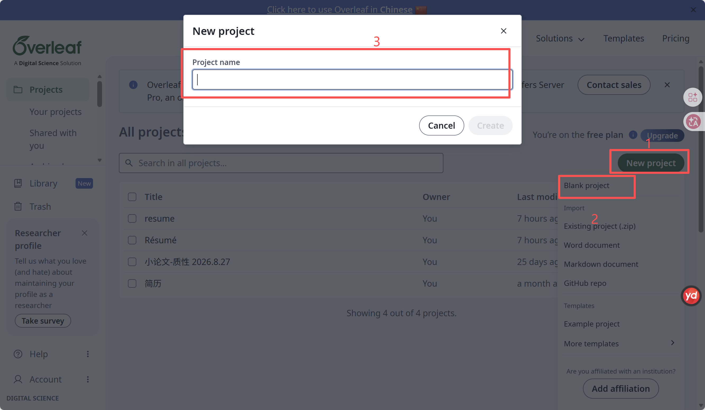

**2、设置编译器**

- **如果简历内容要求是中文，需要修改成中文模式           **

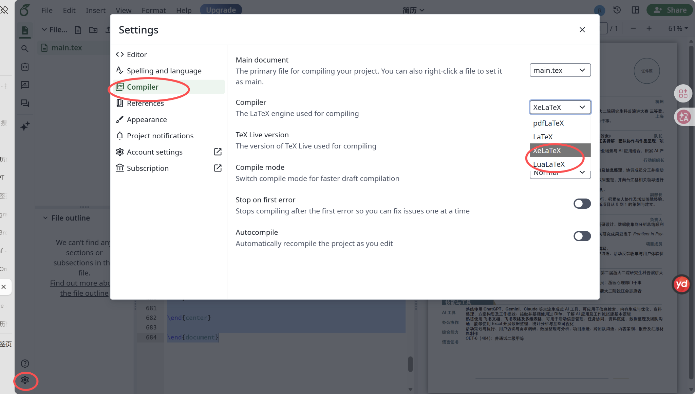

**3、粘贴代码、选中代码、生成：**

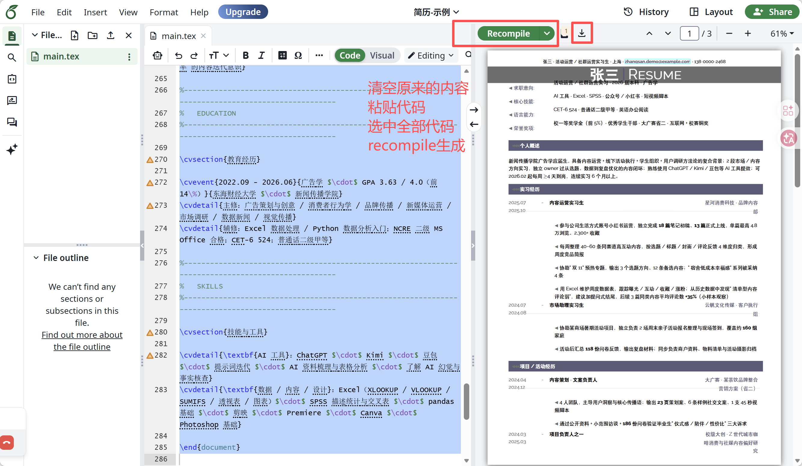

## 三、进阶技巧

## 技巧1：生成的简历排版不满意，怎么调整？

**如图，简历预览效果，信息存在错位，需要调整布局**

**把生成的简历预览截图上传给AI，要求AI修改代码**

**提示词：**

```text
如图，生成的简历存在错位，请帮我调整布局，修改代码，把修改后的完整代码给我
```

**演示：**

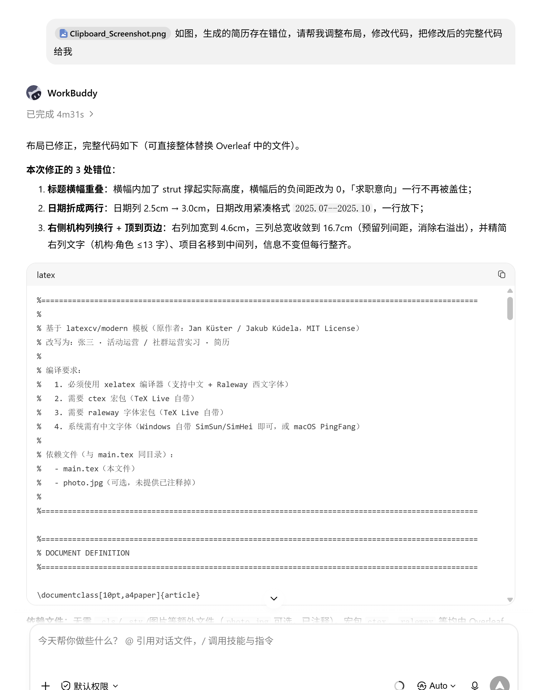

**修改后的代码：**

```bash
%===================================================================================================
%
%        基于 latexcv/modern 模板（原作者：Jan Küster / Jakub Kúdela，MIT License）
%        改写为：张三 · 活动运营 / 社群运营实习 · 简历
%
%        编译要求：
%          1. 必须使用 xelatex 编译器（支持中文 + Raleway 西文字体）
%          2. 需要 ctex 宏包（TeX Live 自带）
%          3. 需要 raleway 字体宏包（TeX Live 自带）
%          4. 系统需有中文字体（Windows 自带 SimSun/SimHei 即可，或 macOS PingFang）
%
%        依赖文件（与 main.tex 同目录）：
%          - main.tex（本文件）
%          - photo.jpg（可选，未提供已注释掉）
%
%===================================================================================================

%===================================================================================================
%        DOCUMENT DEFINITION
%===================================================================================================

\documentclass[10pt,a4paper]{article}

%---------------------------------------------------------------------------------------------------
%        中文支持：用 ctex 替代原模板的 inputenc[utf8] + fontenc[T1]
%---------------------------------------------------------------------------------------------------

\usepackage{ctex}
% 如需指定中文字体可解开下行注释；Windows 默认字体已可正常工作
% \setCJKmainfont{SimSun}
% \setCJKsansfont{SimHei}

%---------------------------------------------------------------------------------------------------
%        LOGIC
%---------------------------------------------------------------------------------------------------

\usepackage{xifthen}

%---------------------------------------------------------------------------------------------------
%        FONT
%---------------------------------------------------------------------------------------------------

\usepackage[default]{raleway}
\renewcommand*\familydefault{\sfdefault}

\usepackage{moresize}

%---------------------------------------------------------------------------------------------------
%        PAGE LAYOUT
%---------------------------------------------------------------------------------------------------

\usepackage[a4paper]{geometry}
\geometry{top=1.75cm, bottom=-.6cm, left=1.5cm, right=1.5cm}

\usepackage{fancyhdr}
\pagestyle{fancy}
\setlength{\headheight}{-5pt}

% 顶部条幅（姓名 + 求职方向 + 城市 + 邮箱 + 电话）
\lhead{}
\chead{\small{
  张三 $\cdot$
  活动运营 / 社群运营实习生 $\cdot$
  上海 $\cdot$
  \textcolor{sectcol}{\textbf{\href{mailto:zhangsan.demo@example.com}{zhangsan.demo@example.com}}} $\cdot$
  138-0000-2468
}}
\rhead{}

\setlength{\parindent}{0mm}

%---------------------------------------------------------------------------------------------------
%        TABLES / ARRAYS
%---------------------------------------------------------------------------------------------------

\usepackage{array}
\newcolumntype{x}[1]{>{\raggedleft\hspace{0pt}}p{#1}}

%---------------------------------------------------------------------------------------------------
%        GRAPHICS
%---------------------------------------------------------------------------------------------------

\usepackage{graphicx}
\usepackage{float}

%---------------------------------------------------------------------------------------------------
%        ARROWS：用数学符号替代原模板的 TikZ 箭头（Overleaf 免费版编译更快）
%---------------------------------------------------------------------------------------------------

\usepackage{amssymb}
\newcommand{\larrow}[1]{{\color{#1}$\blacktriangleleft$}}

%---------------------------------------------------------------------------------------------------
%        COLORS
%---------------------------------------------------------------------------------------------------

\usepackage{xcolor}

\definecolor{sectcol}{RGB}{90,90,120}
\definecolor{bgcol}{RGB}{110,110,110}
\definecolor{softcol}{RGB}{225,225,225}

%---------------------------------------------------------------------------------------------------
%        HYPERREF (last)
%---------------------------------------------------------------------------------------------------

\usepackage{hyperref}

%===================================================================================================
%        DEFINITIONS
%===================================================================================================

\renewcommand{\headrulewidth}{0pt}
\renewcommand{\footrulewidth}{0pt}
\renewcommand{\thepage}{}
\renewcommand{\thesection}{}

%--- Custom sections ------------------------------------------------------

\newcommand{\cvsection}[1]{
  \vspace{10pt}
  \colorbox{sectcol}{\mystrut \makebox[1\linewidth][l]{
    \larrow{bgcol} \hspace{-8pt} \larrow{bgcol} \hspace{-8pt}
    \larrow{bgcol}\textcolor{white}{\textbf{#1}}\hspace{4pt}
  }}\\
}

% 加宽第二列以容纳中文 meta 文本（原模板 p{11cm} 对中文偏窄）
\newcommand{\metasection}[2]{
  \begin{tabular*}{1\textwidth}{@{\extracolsep{\fill}} p{2.8cm} p{13.9cm}}
    \larrow{bgcol} \normalsize{\textcolor{sectcol}{#1}}&\normalsize{#2}\\[10pt]
  \end{tabular*}
}

%--- CV event -------------------------------------------------------------
% 布局修正（v2）：
%   - 日期列 2.5cm -> 3.0cm，日期不再折成两行（日期写成 2025.07--2025.10 紧凑格式）
%   - 右侧机构列 4.0cm -> 4.6cm，中文机构名一行放下
%   - 三列总宽收敛到 16.7cm（预留列间距），消除向右页边的溢出
\newcommand{\cvevent}[3]{
  \begin{tabular*}{1\textwidth}{@{\extracolsep{\fill}} p{3.0cm} p{9.1cm} x{4.6cm}}
    \textcolor{bgcol}{#1} & \textbf{#2} & \vspace{2.5pt}\textcolor{sectcol}{#3}
  \end{tabular*}
  \vspace{-10pt}
  \textcolor{softcol}{\hrule}
  \vspace{10pt}
}

\newcommand{\cvdetail}[1]{
  \begin{tabular*}{1\textwidth}{@{\extracolsep{\fill}} p{3.0cm} p{13.7cm}}
    & \larrow{bgcol}  #1\\ [3pt]
  \end{tabular*}
}

%--- Strut ----------------------------------------------------------------

\newcommand{\mystrut}{\rule[-.3\baselineskip]{0pt}{\baselineskip}}

%===================================================================================================
%        DOCUMENT CONTENT
%===================================================================================================

\begin{document}

\pagestyle{fancy}

%---------------------------------------------------------------------------------------------------
%        TITLE BLOCK
%---------------------------------------------------------------------------------------------------

\vspace{-20pt}

% 布局修正（v2）：加入 strut 撑起横幅高度，避免横幅与下方"求职意向"行重叠
\hspace{-0.25\linewidth}\colorbox{bgcol}{
  \makebox[1.5\linewidth][c]{
    \rule[-0.45cm]{0pt}{1.25cm}%
    \HUGE{\textcolor{white}{\textbf{张三}}}
    \textcolor{sectcol}{\rule[-1mm]{1mm}{0.9cm}}
    \HUGE{\textcolor{white}{\textsc{Resume}}}
  }
}

% 如需启用头像，取消下方注释并把 photo.jpg 放在同目录
% \begin{figure}[H]
% \begin{flushright}
%   \includegraphics[width=0.2\linewidth]{photo.jpg}
% \end{flushright}
% \end{figure}

\vspace{0pt}

%---------------------------------------------------------------------------------------------------
%        META SECTION
%---------------------------------------------------------------------------------------------------

\metasection{求职意向:}{活动运营 / 社群运营实习 $\cdot$ 2026 届本科 $\cdot$ 广告学}
\metasection{核心技能:}{AI 工具 $\cdot$ Excel $\cdot$ SPSS $\cdot$ 公众号 / 小红书 $\cdot$ 短视频脚本}
\metasection{语言能力:}{CET-6 524 $\cdot$ 普通话二级甲等 $\cdot$ 英语办公阅读}
\metasection{荣誉奖项:}{校一等奖学金（前 5\%）$\cdot$ 优秀学生干部 $\cdot$ 大广赛省二 $\cdot$ 互联网+ 校赛铜奖}

%---------------------------------------------------------------------------------------------------
%        SUMMARY
%---------------------------------------------------------------------------------------------------

\cvsection{个人概述}

新闻传播学院广告学应届生，具备内容运营 + 线下活动执行 + 学生组织 + 用户调研方法论的复合背景；2 段市场 / 内容方向实习，独立 owner 过从选题、数据到复盘优化的内容闭环；熟练使用 ChatGPT / Kimi / 豆包等 AI 工具提效；可 2026.02 起每周 $\geq$4 天到岗，连续实习 6 个月以上。

%---------------------------------------------------------------------------------------------------
%        EXPERIENCE
%---------------------------------------------------------------------------------------------------

\cvsection{实习经历}

\cvevent{2025.07--2025.10}{内容运营实习生}{星河消费科技·品牌内容部}
\cvdetail{参与公司生活方式账号小红书运营，独立完成 \textbf{18 篇}笔记初稿、\textbf{13 篇}正式上线，单篇最高 4.8 万浏览、2,300+ 收藏}
\cvdetail{每周整理 40--60 条同赛道高互动内容，按选题 / 标题 / 封面 / 评论反馈 4 维度归类，形成周度竞品简报}
\cvdetail{协助"双 11"预热专题，输出 3 个选题方向、12 条备选内容；"宿舍低成本幸福感"系列被采纳 4 条}
\cvdetail{用 Excel 维护周度数据表，跟踪曝光 / 互动 / 收藏 / 涨粉；从历史数据中发现"清单型内容评论弱"，建议加提问式结尾，后续 3 篇同类内容平均评论数 \textbf{+35\%}（小样本观察）}

\cvevent{2024.07--2024.08}{市场助理实习生}{云帆文化传媒·客户执行组}
\cvdetail{协助某商场暑期活动项目，独立负责 2 场周末亲子活动报名整理与现场签到，覆盖约 \textbf{160 组}家庭}
\cvdetail{活动后汇总 \textbf{118 份}问卷反馈，输出复盘材料；同步负责商户资料、物料清单与活动摄影归档}

%---------------------------------------------------------------------------------------------------
%        PROJECTS / ACTIVITIES
%---------------------------------------------------------------------------------------------------

\cvsection{项目 / 活动经历}

\cvevent{2024.04--2024.12}{某茶饮品牌整合营销方案（省级二等奖）}{大广赛·内容策划负责人}
\cvdetail{4 人团队，主导用户洞察与核心传播语；输出 \textbf{23 页}策划案、6 条样例社交文案、1 支 45 秒视频脚本}
\cvdetail{通过公开资料 + 小范围访谈 + \textbf{186 份}问卷验证毕业生"仪式感 / 陪伴 / 性价比"三大诉求}

\cvevent{2024.03--2025.03}{Z 世代城市咖啡消费与社媒内容偏好研究}{校级大创·项目负责人之一}
\cvdetail{5 人团队，主导研究框架 / 问卷 / 访谈 / 汇报；完成 \textbf{412 份}有效问卷 + \textbf{18 名}大学生半结构化访谈}
\cvdetail{用 Excel 完成数据清洗、统计与交叉表，输出 28 页结项报告；项目获校级"优秀结项"}

\cvevent{2024.10--2024.12}{某功能饮料年轻化传播方案}{课程项目·调研与汇报负责人}
\cvdetail{线上回收 \textbf{236 份}有效问卷 + 访谈 8 名大学生消费者，识别"熬夜 / 运动 / 考试周"等场景动机}
\cvdetail{提出"状态切换"内容主题，主导汇报叙事；课程成绩 94（老师反馈：洞察具体，但预算 / 投放测算不够成熟）}

\cvevent{2023.07}{老字号品牌年轻化传播调研（苏州）}{暑期实践·短视频与推文}
\cvdetail{随学院实践队赴苏州调研 \textbf{6 家}老字号门店，采访店员 / 消费者 / 品牌负责人共 \textbf{21 人}}
\cvdetail{独立产出 \textbf{4 条}短视频 + 2 篇长图文；团队获学院"优秀实践项目"}

%---------------------------------------------------------------------------------------------------
%        STUDENT WORK
%---------------------------------------------------------------------------------------------------

\cvsection{学生工作}

\cvevent{2024.06--2025.06}{副部长}{校学生会新媒体中心}
\cvdetail{负责校学生会公众号选题与内容审核，带 \textbf{6 名}干事完成日常推送；一学年发布 \textbf{42 篇}推文，本人主笔 / 深度修改 15 篇}
\cvdetail{建立"选题登记表 + 发布复盘表"减少撞车；每月组织 1 次内容复盘会}
\cvdetail{主导招新：面试约 \textbf{70 名}同学、最终录取 12 人；其中 6 人基础排版与文案培训由我负责}

\cvevent{2022.10--2024.06}{干事}{新闻传播学院学生会宣传部}
\cvdetail{负责学院公众号排版、活动摄影、海报文案与新闻稿；参与迎新晚会 / 运动会 / 毕业季等活动宣传}

%---------------------------------------------------------------------------------------------------
%        PERSONAL CHANNEL
%---------------------------------------------------------------------------------------------------

\cvsection{个人运营}

\cvevent{2024.09--至今}{个人小红书账号 · 生活方式 / 校园效率}{独立运营者}
\cvdetail{独立完成 \textbf{37 篇}笔记的选题、拍摄、修图、文案、发布与数据记录；累计 \textbf{3,600 粉、2.7 万赞藏}，5 篇破万}
\cvdetail{尝试"标题 A/B 方向"复盘（未严格控制变量），初步形成"标题决定点击率"的内容迭代意识}

%---------------------------------------------------------------------------------------------------
%        EDUCATION
%---------------------------------------------------------------------------------------------------

\cvsection{教育经历}

\cvevent{2022.09--2026.06}{广告学 · GPA 3.63 / 4.0（前 14\%）}{东海财经大学·新闻传播学院}
\cvdetail{主修：广告策划与创意 / 消费者行为学 / 品牌传播 / 新媒体运营 / 市场调研 / 数据新闻 / 视觉传播}
\cvdetail{辅修：Excel 数据处理 / Python 数据分析入门；NCRE 二级 MS Office 合格；CET-6 524；普通话二级甲等}

%---------------------------------------------------------------------------------------------------
%        SKILLS
%---------------------------------------------------------------------------------------------------

\cvsection{技能与工具}

\cvdetail{\textbf{AI 工具}：ChatGPT $\cdot$ Kimi $\cdot$ 豆包 $\cdot$ 提示词迭代 $\cdot$ AI 资料梳理与表格分析 $\cdot$ 了解 AI 幻觉与事实核查}
\cvdetail{\textbf{数据 / 内容 / 设计}：Excel（XLOOKUP / VLOOKUP / SUMIFS / 透视表 / 图表）$\cdot$ SPSS 描述统计与交叉表 $\cdot$ pandas 基础 $\cdot$ 剪映 $\cdot$ Premiere $\cdot$ Canva $\cdot$ Photoshop 基础}

\end{document}
```

**回到overleaf，重新粘贴代码，生成简历**

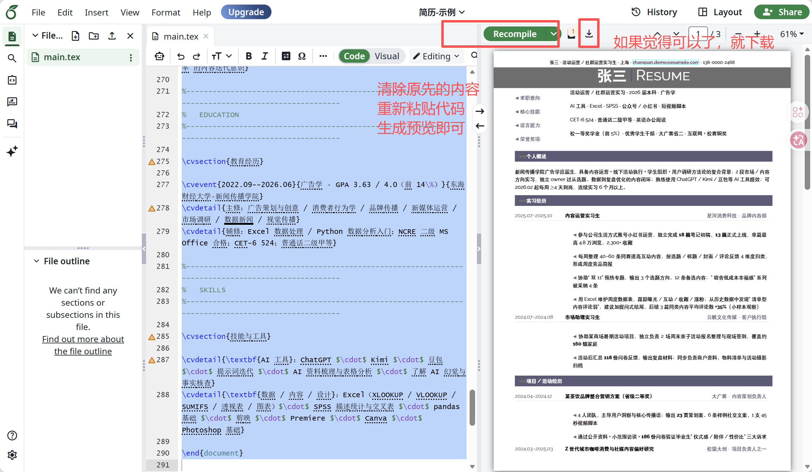

## 技巧2：基于现有简历，快速生成新岗位版本

**背景：**现在我要投一个新的岗位，需要快速完成一份针对新的JD的新简历。

**新JD：**

```text
目标岗位：产品运营经理（点评打卡方向）
公司：美团
地点：上海
经验要求：1–3 年
学历要求：本科
岗位方向：
负责点评/打卡相关产品的运营工作，围绕用户使用场景和产品目标制定运营策略，推动产品功能和运营方案落地；通过用户反馈、行为数据及业务数据分析发现问题和机会，并持续优化产品体验及运营效果；结合业务需求进行用户运营、内容运营及活动运营，与产品、研发、设计等团队协作推进项目。
```

**上传/粘贴 个人经历材料、上一版LaTeX 简历代码、新岗位JD**

[个人经历模拟材料\_张三.docx](../../public/course-assets/23/source-04.docx)

```bash
%===================================================================================================
%
%        基于 latexcv/modern 模板（原作者：Jan Küster / Jakub Kúdela，MIT License）
%        改写为：张三 · 活动运营 / 社群运营实习 · 简历
%
%        编译要求：
%          1. 必须使用 xelatex 编译器（支持中文 + Raleway 西文字体）
%          2. 需要 ctex 宏包（TeX Live 自带）
%          3. 需要 raleway 字体宏包（TeX Live 自带）
%          4. 系统需有中文字体（Windows 自带 SimSun/SimHei 即可，或 macOS PingFang）
%
%        依赖文件（与 main.tex 同目录）：
%          - main.tex（本文件）
%          - photo.jpg（可选，未提供已注释掉）
%
%===================================================================================================

%===================================================================================================
%        DOCUMENT DEFINITION
%===================================================================================================

\documentclass[10pt,a4paper]{article}

%---------------------------------------------------------------------------------------------------
%        中文支持：用 ctex 替代原模板的 inputenc[utf8] + fontenc[T1]
%---------------------------------------------------------------------------------------------------

\usepackage{ctex}
% 如需指定中文字体可解开下行注释；Windows 默认字体已可正常工作
% \setCJKmainfont{SimSun}
% \setCJKsansfont{SimHei}

%---------------------------------------------------------------------------------------------------
%        LOGIC
%---------------------------------------------------------------------------------------------------

\usepackage{xifthen}

%---------------------------------------------------------------------------------------------------
%        FONT
%---------------------------------------------------------------------------------------------------

\usepackage[default]{raleway}
\renewcommand*\familydefault{\sfdefault}

\usepackage{moresize}

%---------------------------------------------------------------------------------------------------
%        PAGE LAYOUT
%---------------------------------------------------------------------------------------------------

\usepackage[a4paper]{geometry}
\geometry{top=1.75cm, bottom=-.6cm, left=1.5cm, right=1.5cm}

\usepackage{fancyhdr}
\pagestyle{fancy}
\setlength{\headheight}{-5pt}

% 顶部条幅（姓名 + 求职方向 + 城市 + 邮箱 + 电话）
\lhead{}
\chead{\small{
  张三 $\cdot$
  活动运营 / 社群运营实习生 $\cdot$
  上海 $\cdot$
  \textcolor{sectcol}{\textbf{\href{mailto:zhangsan.demo@example.com}{zhangsan.demo@example.com}}} $\cdot$
  138-0000-2468
}}
\rhead{}

\setlength{\parindent}{0mm}

%---------------------------------------------------------------------------------------------------
%        TABLES / ARRAYS
%---------------------------------------------------------------------------------------------------

\usepackage{array}
\newcolumntype{x}[1]{>{\raggedleft\hspace{0pt}}p{#1}}

%---------------------------------------------------------------------------------------------------
%        GRAPHICS
%---------------------------------------------------------------------------------------------------

\usepackage{graphicx}
\usepackage{float}

%---------------------------------------------------------------------------------------------------
%        ARROWS：用数学符号替代原模板的 TikZ 箭头（Overleaf 免费版编译更快）
%---------------------------------------------------------------------------------------------------

\usepackage{amssymb}
\newcommand{\larrow}[1]{{\color{#1}$\blacktriangleleft$}}

%---------------------------------------------------------------------------------------------------
%        COLORS
%---------------------------------------------------------------------------------------------------

\usepackage{xcolor}

\definecolor{sectcol}{RGB}{90,90,120}
\definecolor{bgcol}{RGB}{110,110,110}
\definecolor{softcol}{RGB}{225,225,225}

%---------------------------------------------------------------------------------------------------
%        HYPERREF (last)
%---------------------------------------------------------------------------------------------------

\usepackage{hyperref}

%===================================================================================================
%        DEFINITIONS
%===================================================================================================

\renewcommand{\headrulewidth}{0pt}
\renewcommand{\footrulewidth}{0pt}
\renewcommand{\thepage}{}
\renewcommand{\thesection}{}

%--- Custom sections ------------------------------------------------------

\newcommand{\cvsection}[1]{
  \vspace{10pt}
  \colorbox{sectcol}{\mystrut \makebox[1\linewidth][l]{
    \larrow{bgcol} \hspace{-8pt} \larrow{bgcol} \hspace{-8pt}
    \larrow{bgcol}\textcolor{white}{\textbf{#1}}\hspace{4pt}
  }}\\
}

% 加宽第二列以容纳中文 meta 文本（原模板 p{11cm} 对中文偏窄）
\newcommand{\metasection}[2]{
  \begin{tabular*}{1\textwidth}{@{\extracolsep{\fill}} p{2.8cm} p{14.6cm}}
    \larrow{bgcol} \normalsize{\textcolor{sectcol}{#1}}&\normalsize{#2}\\[10pt]
  \end{tabular*}
}

%--- CV event -------------------------------------------------------------

\newcommand{\cvevent}[3]{
  \begin{tabular*}{1\textwidth}{@{\extracolsep{\fill}} p{2.5cm} p{10.5cm} x{4.0cm}}
    \textcolor{bgcol}{#1} & \textbf{#2} & \vspace{2.5pt}\textcolor{sectcol}{#3}
  \end{tabular*}
  \vspace{-10pt}
  \textcolor{softcol}{\hrule}
  \vspace{10pt}
}

\newcommand{\cvdetail}[1]{
  \begin{tabular*}{1\textwidth}{@{\extracolsep{\fill}} p{2.5cm} p{14.5cm}}
    & \larrow{bgcol}  #1\\ [3pt]
  \end{tabular*}
}

%--- Strut ----------------------------------------------------------------

\newcommand{\mystrut}{\rule[-.3\baselineskip]{0pt}{\baselineskip}}

%===================================================================================================
%        DOCUMENT CONTENT
%===================================================================================================

\begin{document}

\pagestyle{fancy}

%---------------------------------------------------------------------------------------------------
%        TITLE BLOCK
%---------------------------------------------------------------------------------------------------

\vspace{-20pt}

\hspace{-0.25\linewidth}\colorbox{bgcol}{
  \makebox[1.5\linewidth][c]{
    \HUGE{\textcolor{white}{\textbf{张三}}}
    \textcolor{sectcol}{\rule[-1mm]{1mm}{0.9cm}}
    \HUGE{\textcolor{white}{\textsc{Resume}}}
  }
}

% 如需启用头像，取消下方注释并把 photo.jpg 放在同目录
% \begin{figure}[H]
% \begin{flushright}
%   \includegraphics[width=0.2\linewidth]{photo.jpg}
% \end{flushright}
% \end{figure}

\vspace{-10pt}

%---------------------------------------------------------------------------------------------------
%        META SECTION
%---------------------------------------------------------------------------------------------------

\metasection{求职意向:}{活动运营 / 社群运营实习 $\cdot$ 2026 届本科 $\cdot$ 广告学}
\metasection{核心技能:}{AI 工具 $\cdot$ Excel $\cdot$ SPSS $\cdot$ 公众号 / 小红书 $\cdot$ 短视频脚本}
\metasection{语言能力:}{CET-6 524 $\cdot$ 普通话二级甲等 $\cdot$ 英语办公阅读}
\metasection{荣誉奖项:}{校一等奖学金（前 5\%）$\cdot$ 优秀学生干部 $\cdot$ 大广赛省二 $\cdot$ 互联网+ 校赛铜奖}

%---------------------------------------------------------------------------------------------------
%        SUMMARY
%---------------------------------------------------------------------------------------------------

\cvsection{个人概述}

新闻传播学院广告学应届生，具备内容运营 + 线下活动执行 + 学生组织 + 用户调研方法论的复合背景；2 段市场 / 内容方向实习，独立 owner 过从选题、数据到复盘优化的内容闭环；熟练使用 ChatGPT / Kimi / 豆包等 AI 工具提效；可 2026.02 起每周 $\geq$4 天到岗，连续实习 6 个月以上。

%---------------------------------------------------------------------------------------------------
%        EXPERIENCE
%---------------------------------------------------------------------------------------------------

\cvsection{实习经历}

\cvevent{2025.07 - 2025.10}{内容运营实习生}{星河消费科技 $\cdot$ 品牌内容部}
\cvdetail{参与公司生活方式账号小红书运营，独立完成 \textbf{18 篇}笔记初稿、\textbf{13 篇}正式上线，单篇最高 4.8 万浏览、2,300+ 收藏}
\cvdetail{每周整理 40--60 条同赛道高互动内容，按选题 / 标题 / 封面 / 评论反馈 4 维度归类，形成周度竞品简报}
\cvdetail{协助"双 11"预热专题，输出 3 个选题方向、12 条备选内容；"宿舍低成本幸福感"系列被采纳 4 条}
\cvdetail{用 Excel 维护周度数据表，跟踪曝光 / 互动 / 收藏 / 涨粉；从历史数据中发现"清单型内容评论弱"，建议加提问式结尾，后续 3 篇同类内容平均评论数 \textbf{+35\%}（小样本观察）}

\cvevent{2024.07 - 2024.08}{市场助理实习生}{云帆文化传媒 $\cdot$ 客户执行组}
\cvdetail{协助某商场暑期活动项目，独立负责 2 场周末亲子活动报名整理与现场签到，覆盖约 \textbf{160 组}家庭}
\cvdetail{活动后汇总 \textbf{118 份}问卷反馈，输出复盘材料；同步负责商户资料、物料清单与活动摄影归档}

%---------------------------------------------------------------------------------------------------
%        PROJECTS / ACTIVITIES
%---------------------------------------------------------------------------------------------------

\cvsection{项目 / 活动经历}

\cvevent{2024.04 - 2024.12}{内容策划 $\cdot$ 文案负责人}{大广赛 $\cdot$ 某茶饮品牌整合营销方案（省二）}
\cvdetail{4 人团队，主导用户洞察与核心传播语；输出 \textbf{23 页}策划案、6 条样例社交文案、1 支 45 秒视频脚本}
\cvdetail{通过公开资料 + 小范围访谈 + \textbf{186 份}问卷验证毕业生"仪式感 / 陪伴 / 性价比"三大诉求}

\cvevent{2024.03 - 2025.03}{项目负责人之一}{校级大创 $\cdot$ Z 世代城市咖啡消费与社媒内容偏好研究}
\cvdetail{5 人团队，主导研究框架 / 问卷 / 访谈 / 汇报；完成 \textbf{412 份}有效问卷 + \textbf{18 名}大学生半结构化访谈}
\cvdetail{用 Excel 完成数据清洗、统计与交叉表，输出 28 页结项报告；项目获校级"优秀结项"}

\cvevent{2024.10 - 2024.12}{用户调研 $\cdot$ 汇报负责人}{课程项目 $\cdot$ 某功能饮料年轻化传播方案}
\cvdetail{线上回收 \textbf{236 份}有效问卷 + 访谈 8 名大学生消费者，识别"熬夜 / 运动 / 考试周"等场景动机}
\cvdetail{提出"状态切换"内容主题，主导汇报叙事；课程成绩 94（老师反馈：洞察具体，但预算 / 投放测算不够成熟）}

\cvevent{2023.07}{短视频脚本 $\cdot$ 推文}{暑期实践 $\cdot$ 老字号品牌年轻化传播调研（苏州）}
\cvdetail{随学院实践队赴苏州调研 \textbf{6 家}老字号门店，采访店员 / 消费者 / 品牌负责人共 \textbf{21 人}}
\cvdetail{独立产出 \textbf{4 条}短视频 + 2 篇长图文；团队获学院"优秀实践项目"}

%---------------------------------------------------------------------------------------------------
%        STUDENT WORK
%---------------------------------------------------------------------------------------------------

\cvsection{学生工作}

\cvevent{2024.06 - 2025.06}{副部长}{校学生会新媒体中心}
\cvdetail{负责校学生会公众号选题与内容审核，带 \textbf{6 名}干事完成日常推送；一学年发布 \textbf{42 篇}推文，本人主笔 / 深度修改 15 篇}
\cvdetail{建立"选题登记表 + 发布复盘表"减少撞车；每月组织 1 次内容复盘会}
\cvdetail{主导招新：面试约 \textbf{70 名}同学、最终录取 12 人；其中 6 人基础排版与文案培训由我负责}

\cvevent{2022.10 - 2024.06}{干事}{新闻传播学院学生会宣传部}
\cvdetail{负责学院公众号排版、活动摄影、海报文案与新闻稿；参与迎新晚会 / 运动会 / 毕业季等活动宣传}

%---------------------------------------------------------------------------------------------------
%        PERSONAL CHANNEL
%---------------------------------------------------------------------------------------------------

\cvsection{个人运营}

\cvevent{2024.09 - 至今}{独立运营者}{个人小红书账号 $\cdot$ 生活方式 / 校园效率}
\cvdetail{独立完成 \textbf{37 篇}笔记的选题、拍摄、修图、文案、发布与数据记录；累计 \textbf{3,600 粉、2.7 万赞藏}，5 篇破万}
\cvdetail{尝试"标题 A/B 方向"复盘（未严格控制变量），初步形成"标题决定点击率"的内容迭代意识}

%---------------------------------------------------------------------------------------------------
%        EDUCATION
%---------------------------------------------------------------------------------------------------

\cvsection{教育经历}

\cvevent{2022.09 - 2026.06}{广告学 $\cdot$ GPA 3.63 / 4.0（前 14\%）}{东海财经大学 $\cdot$ 新闻传播学院}
\cvdetail{主修：广告策划与创意 / 消费者行为学 / 品牌传播 / 新媒体运营 / 市场调研 / 数据新闻 / 视觉传播}
\cvdetail{辅修：Excel 数据处理 / Python 数据分析入门；NCRE 二级 MS Office 合格；CET-6 524；普通话二级甲等}

%---------------------------------------------------------------------------------------------------
%        SKILLS
%---------------------------------------------------------------------------------------------------

\cvsection{技能与工具}

\cvdetail{\textbf{AI 工具}：ChatGPT $\cdot$ Kimi $\cdot$ 豆包 $\cdot$ 提示词迭代 $\cdot$ AI 资料梳理与表格分析 $\cdot$ 了解 AI 幻觉与事实核查}
\cvdetail{\textbf{数据 / 内容 / 设计}：Excel（XLOOKUP / VLOOKUP / SUMIFS / 透视表 / 图表）$\cdot$ SPSS 描述统计与交叉表 $\cdot$ pandas 基础 $\cdot$ 剪映 $\cdot$ Premiere $\cdot$ Canva $\cdot$ Photoshop 基础}

\end{document}
```

**输入提示词：**

```text
我已经有一份【个人经历资料】和一版【现有 LaTeX 简历代码】。现在需要针对一个新的目标岗位 JD，快速生成一版新的定制化简历。

【个人经历资料】：
粘贴或上传完整经历资料。

【现有 LaTeX 简历代码】：
粘贴当前版本代码。

【新的岗位 JD】
粘贴目标岗位职位描述。

请以【个人经历资料】作为事实依据，以【现有 LaTeX 简历】作为版式和表达参考，根据【新的岗位 JD】重新优化简历内容。
重点调整：
1、内容取舍：优先保留与新 JD 最相关的经历和信息，必要时从个人经历资料中补充现有简历未展示但更相关的内容。
2、经历排序：根据岗位相关性调整模块和经历顺序。
3、表达重点：同一段真实经历可以根据岗位要求调整表述重点，但不得改变事实。
4、关键词匹配：自然融入 JD 中重要的能力、业务和技能关键词，避免机械堆砌。
5、篇幅分配：增加高相关经历的篇幅，压缩低相关或重复内容，优先控制在 1 页。
6、禁止虚构：不得新增、推测或夸大我没有提供的经历、职责、数据、成果或技能。
7、保持版式：尽量保持上一版 LaTeX 模板、视觉风格和版式结构不变，仅做内容需要的必要调整。

【输出要求】
请直接输出修改后的【完整 LaTeX 简历代码】，不要只给修改建议或局部片段。
```

**演示：**

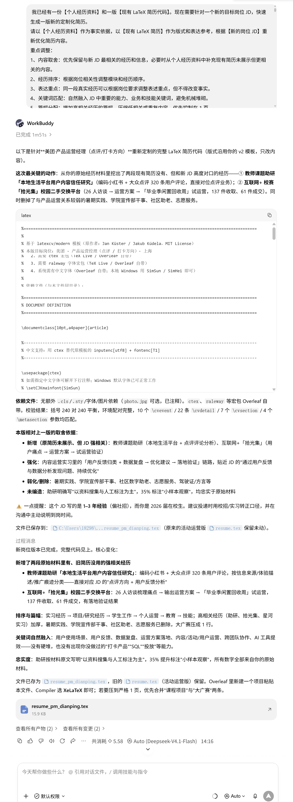

**效果：**

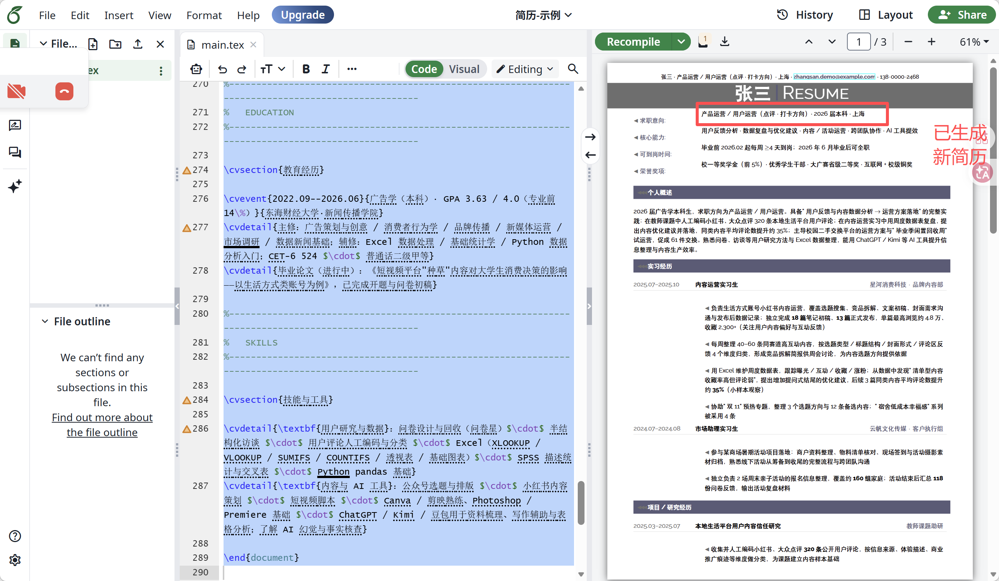

## 技巧3：简历定稿前，对照 JD 做一次匹配度检查

完成第一版简历后，可以把 JD 和简历同时交给 AI，检查岗位要求是否都得到了足够证明。

**操作步骤：**

**上传/粘贴 岗位JD+简历**

**岗位JD：**

```text
目标岗位：产品运营经理（点评打卡方向）
公司：美团
地点：上海
经验要求：1–3 年
学历要求：本科
岗位方向：
负责点评/打卡相关产品的运营工作，围绕用户使用场景和产品目标制定运营策略，推动产品功能和运营方案落地；通过用户反馈、行为数据及业务数据分析发现问题和机会，并持续优化产品体验及运营效果；结合业务需求进行用户运营、内容运营及活动运营，与产品、研发、设计等团队协作推进项目。
```

**简历示范材料：**

[简历\_示例.pdf](../../public/course-assets/23/source-05.pdf)

**输入提示词：**

```text
请对比下面的【岗位 JD】和【我的简历】，检查简历是否充分体现了岗位要求。

【岗位 JD】：
粘贴内容

【我的简历】：
粘贴内容

请按照岗位要求逐项判断，并分成三类：

1、明确匹配：简历中已有具体经历、成果或技能可以直接证明。
2、匹配较弱：我可能有相关经历，但当前简历中的表述不够具体、突出或有说服力。
3、暂未体现：JD 中比较重要的要求，目前简历中没有足够信息支持。

对于第 2、3 类：
请具体告诉我应该回忆或补充哪些【真实经历、职责、项目细节、数据、成果或技能证据】，帮助我判断是否有遗漏的信息可以补进简历。

【注意】
不要为了匹配 JD 强行加入关键词，也不要替我虚构、推测或夸大任何经历和成果。
```

**演示及效果图：**

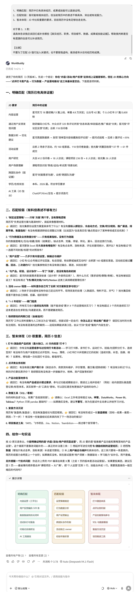
