# 24 AI辅助设计问卷

[官网课程](https://www.datawhale.cn/learn/content/382/7913)

> 让 AI 帮你把一份问卷从想法做到能发放：理清调研目标、搭出问卷框架、生成题目、检查常见错误。

## **一、总览**

## **Part 1｜主要应用场景与人群**

| **场景** | **对应人群** | **具体需求** |
| --- | --- | --- |
| 课程作业 / 毕业论文调研 | 大学生、研究生 | 导师要求做问卷，不知道从哪问起、该问多少题 |
| 客户 / 员工满意度调查 | 市场、运营、HR | 要快速产出一份专业问卷，回收的数据能直接用 |
| 产品需求与用户反馈收集 | 产品经理、创业者 | 验证想法、收集需求，题目不能带引导性 |
| 活动报名 / 信息登记 | 行政、社团负责人、教师 | 表单该收哪些信息 |

## **Part 2｜AI 辅助的主要环节**

| **序号** | **环节** | **AI 做什么** | **人做什么** |
| --- | --- | --- | --- |
| 1 | 明确调研目标 | 把你的想法整理成“要回答什么问题、问谁、得出什么结论” | 判断目标是不是你真正想调研的 |
| 2 | 搭建问卷框架 | 把目标拆成 3～5 个调查维度，列出每个维度该问什么 | 挑选保留哪些维度，确定重点 |
| 3 | 生成问卷初稿 | 逐题写出题干、选项和题型，并控制题量与填写时长 | 通读一遍，删掉不合适的题 |
| 4 | 检查问卷质量 | 逐题找出歧义、引导性提问、一题多问、选项漏洞 | 判断哪些建议采纳，最后定稿 |

## **Part 3｜可以使用什么工具**

只需要两类工具：一个能对话的 AI，一个能发问卷的平台。

→ 设计问卷：[DeepSeek](<https://chat.deepseek.com/>)、[Kimi](<https://kimi.moonshot.cn/>)、[豆包](<https://www.doubao.com/>)、[腾讯元宝](<https://yuanbao.tencent.com/>) 等任意通用AI，都能免费用，直接按下面的提示词操作。

→ 发放回收：[问卷星](<https://www.wjx.cn/>)、[飞书问卷](<https://wenjuan.feishu.cn/?utm_source=chatgpt.com>) 或 [腾讯问卷](<https://wj.qq.com/>)，把定稿的题目复制进去即可，检查和调整格式即可。

→ 有条件使用国外工具：[ChatGPT](<https://chatgpt.com/>)，用法完全一样。

推荐路线：AI 对话工具设计问卷 → 问卷星 / 腾讯问卷发放回收。

## **二、基础案例：从一句想法到一份能发放的问卷**

以《大学生 AI 工具使用情况调查》为例。

## **第一步：先梳理清楚要调研什么**

```text
我要设计一份问卷《大学生 AI 工具使用情况调查》，用于课程作业，受访者是在校大学生，回收后要做统计分析和课堂汇报。
请帮我：
1）用一句话明确这份问卷要回答的核心问题；
2）把它拆成 3～5 个调查维度，说明每个维度想了解什么；
3）指出哪个维度对课堂汇报最重要。这一步只给框架，先不要写题目。
```

**演示及效果：**

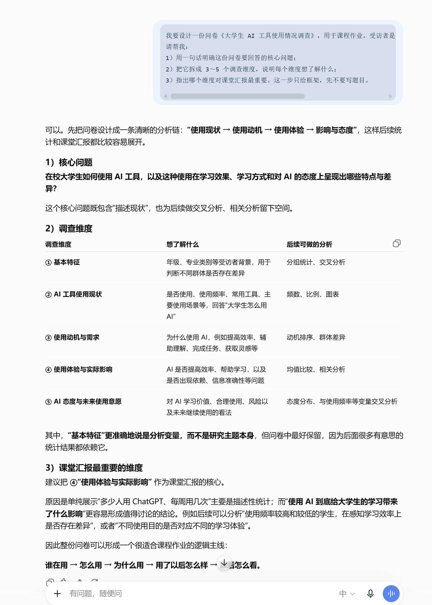

**验收：**看 AI 给的维度里有没有你根本不想调研的，直接让它删掉，如果维度超过 5 个，说明目标还不够聚焦，可以先缩到 3 个。

## **第二步：按框架生成题目**

框架确认之后，让 AI 一次性写出全部题目，并把题量和填写时长控制在合理范围。

**提示词**

```text
就按上面确定的调查维度，生成《大学生 AI 工具使用情况调查》完整问卷。
要求：
1、题量控制：总题量【20 题以内】，预计填写时间不超过 3 分钟。
2、题型设计：根据各维度合理选择单选、多选、量表和开放题；态度、体验类问题尽量使用统一的 5 点量表，方便后续统计分析。
3、题目质量：题干简洁明确，避免诱导、歧义、重复和双重问题；选项尽量互斥、完整，多选题选项不宜过多。
4、分析适用：题目应支持后续的频数统计、交叉分析和简单比较，并适当突出“AI 工具使用体验与实际影响”这一核心维度。
5、开放题：最多 1 道，放在最后。
6、输出要求：只输出【可直接发放的纯净版完整问卷】，包括问卷标题、简短填写说明、题目和完整选项；不要输出设计思路、题型理由或统计建议。
```

**演示及输出：**

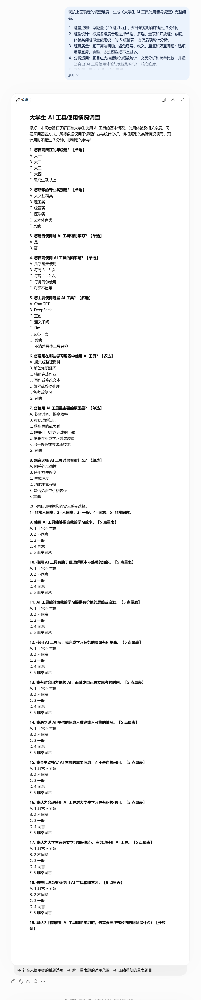

**验收：**把题目从头读一遍，能顺畅回答说明合格；如果有题目你自己都不想填，就让 AI 换一种问法。

## **第三步：模拟填写、逐题检查并修改问卷**

**提示词：**

```text
请扮演问卷调查专家，并模拟一名目标受访者，对上面的问卷进行审查和修改。
1、模拟填写：先以真实受访者身份完整填写一遍，重点判断哪些题目难理解、难选择、容易随意作答或想跳过。
2、题目审查：检查是否存在歧义、引导性提问、一题多问、表述复杂、选项不互斥或不完整等问题。
3、作答体验：找出容易误解、漏答、乱填、机械作答或造成填写疲劳的题目。
4、修改方案：对每个确有问题的题目，给出【明确、可直接选择的修改方案】；如存在多种合理改法，可提供 2～3 个方案，并简要说明差异。
5、保持目标：修改时尽量保留原有调查维度、研究目的和统计分析价值，不随意增加题量。
6、第一阶段输出：只列出需要修改的题目，按“题号｜问题类型｜原因｜修改方案”整理，不重复没有问题的题目。

最终输出：在我选定修改方案后，直接整合全部修改，只输出【修改后的完整、纯净版问卷】，包括标题、简短填写说明、全部题目和完整选项，不再输出分析过程、修改说明或其他内容。
```

**演示图：**

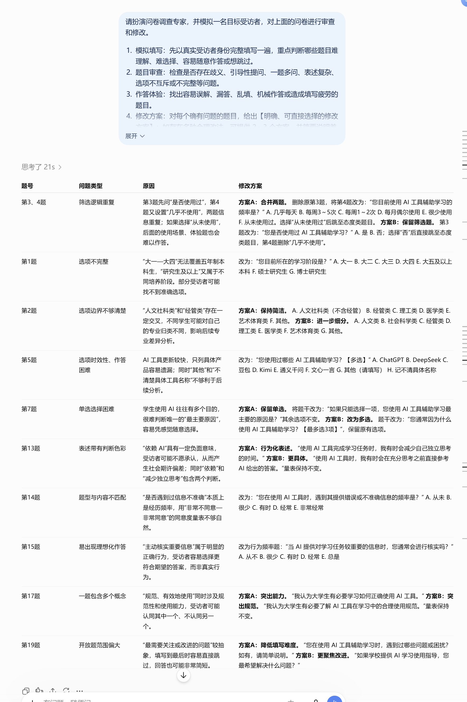

**选择修改方案，进行二轮修改：**


## **第四步：导入问卷平台，发放**

**1、问卷星创建问卷**

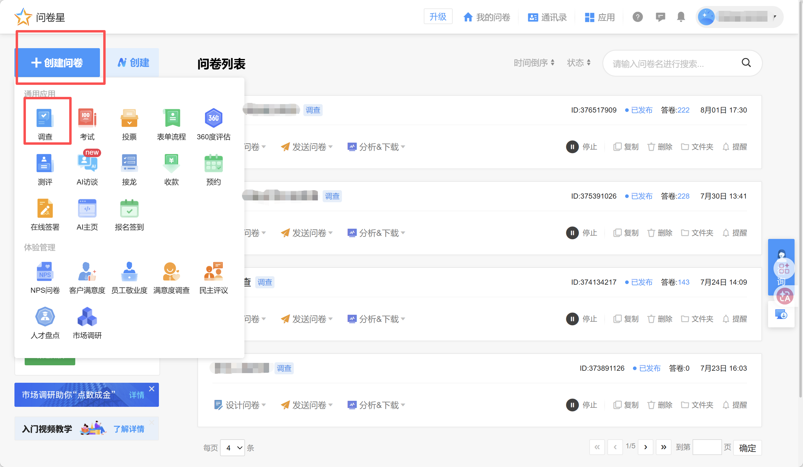

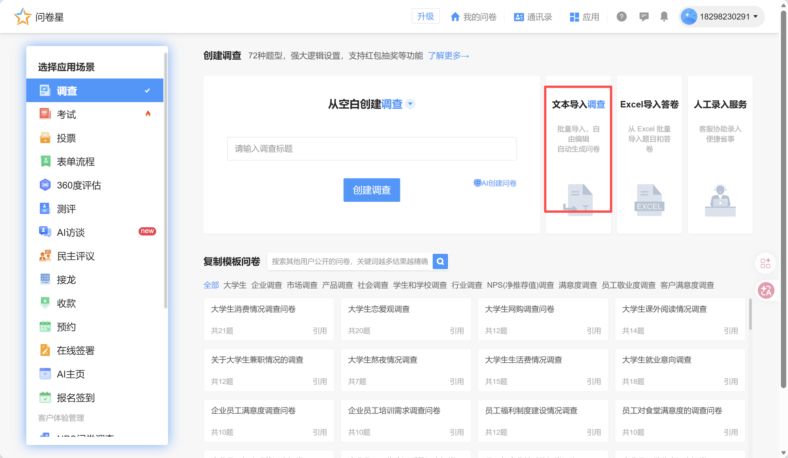

**2、清空占位示例文本**

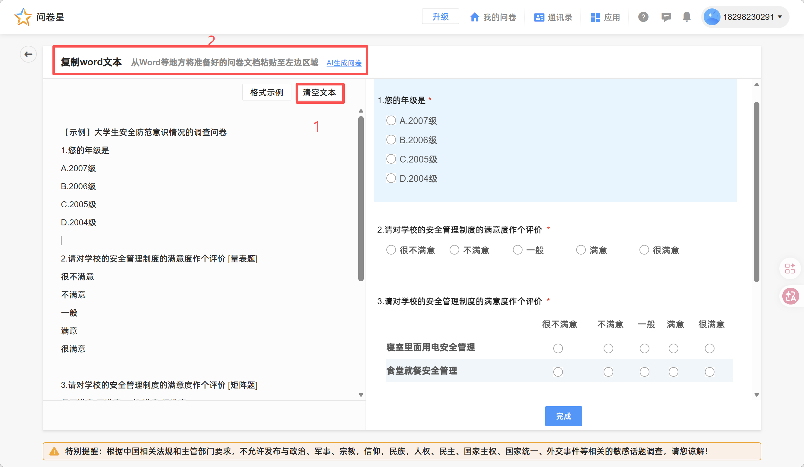

**3、回到AI对话窗口，复制问卷内容**

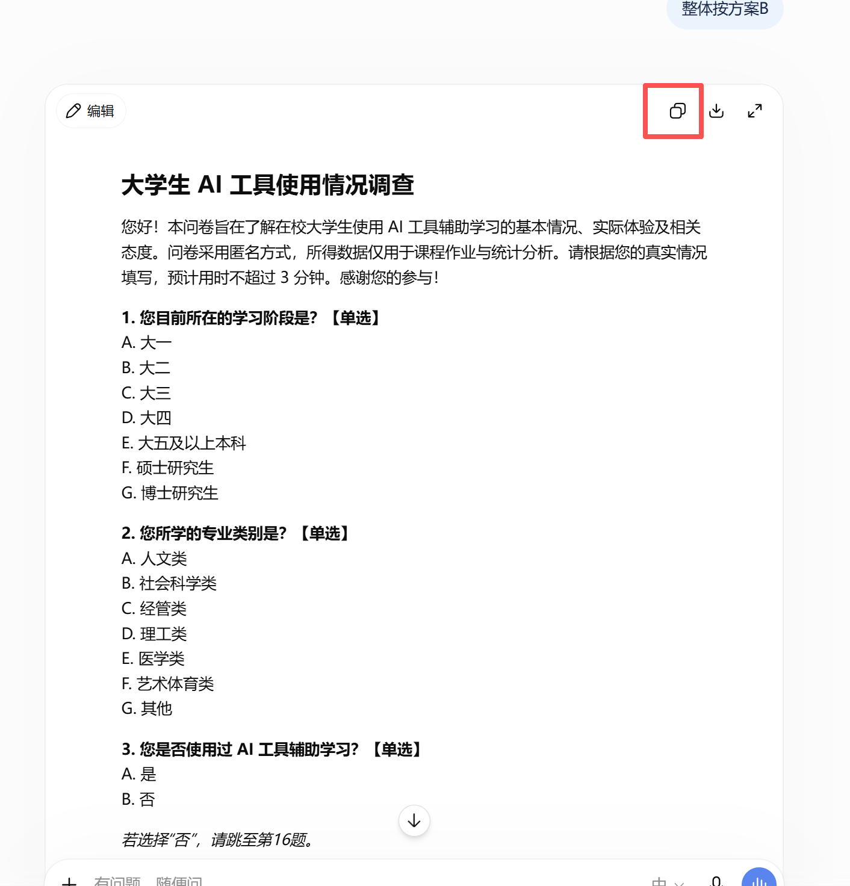

**4、问卷星中粘贴问卷并检查修正**

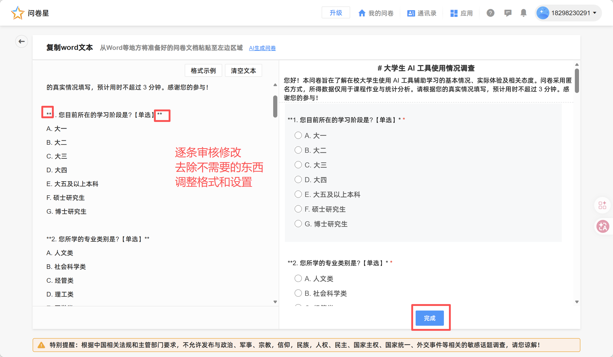

**5、预览审核通过后，发布**

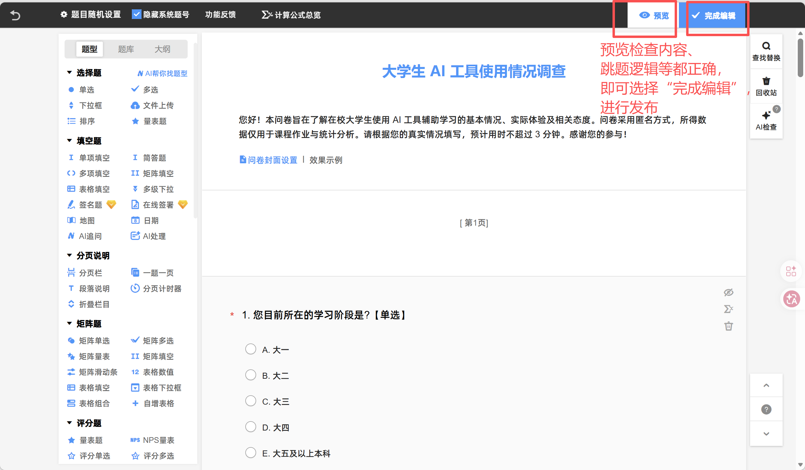

## **三、进阶：四个能立刻用上的小技巧**

## **技巧一、AI 追问：把敷衍回答变成具体信息**

开放题里填写者常答“还行”“不错”。问卷星的「AI 追问」题型会在填写者作答后自动追问，把客套话挖成具体反馈。

**如图：**

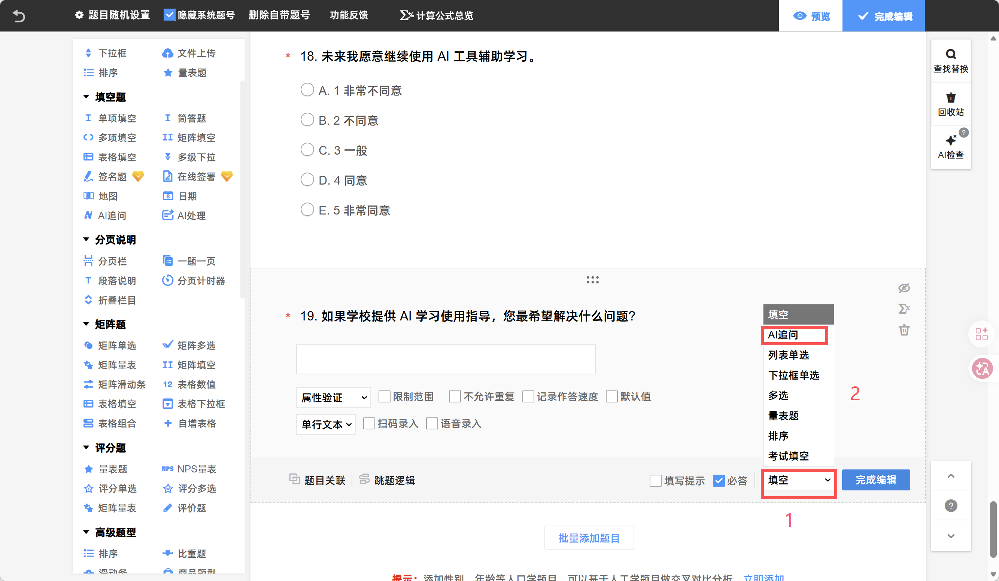

## **技巧二、不知道如何设置矩阵题，直接截图问 AI**

**如图，想要把14、15题变成类似9-13的矩阵题，不指导怎么做**

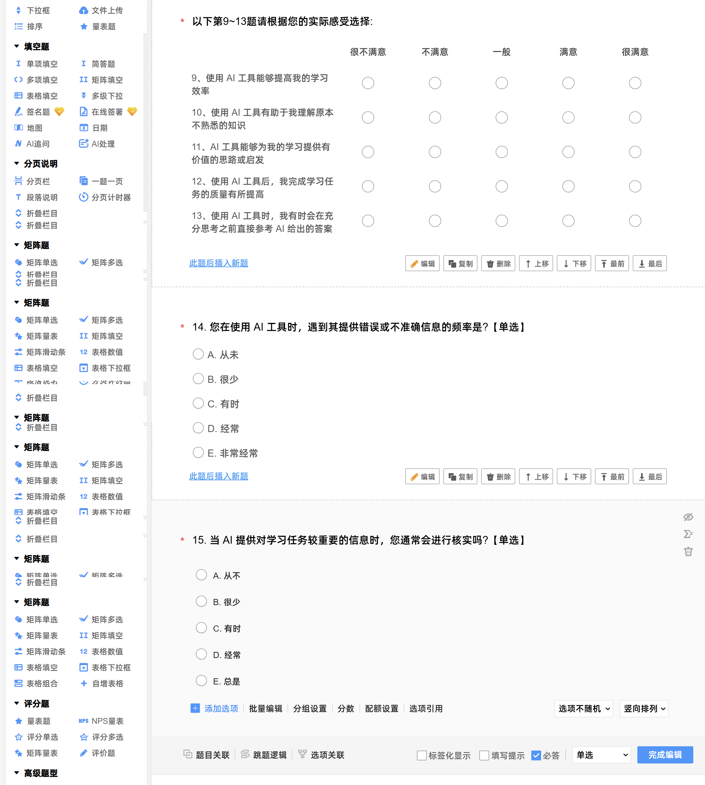

**提示词：**

```text
如图，如何把14、15题变成类似上面9-13的矩阵题，详细具体告诉我每一步应该点哪里，怎么做
```

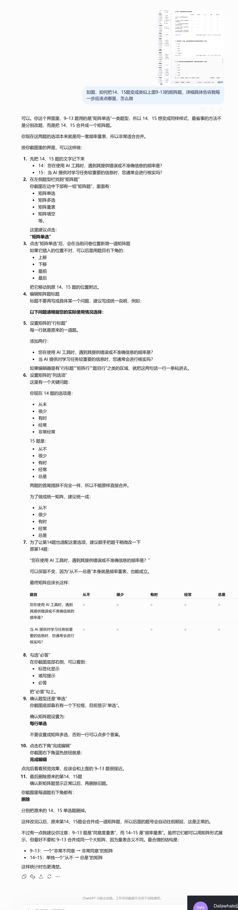

**按步骤操作即可，遇到问题卡住，则继续截图问AI**

```text
【上传图片】
这是怎么回事？告诉我下一步具体该怎么做。/ 告诉我这个页面具体应该点哪里
```

## **参考资料**

1. [问卷星《杀疯了！DeepSeek7天用户破亿！用AI玩转问卷调查（建议收藏）》](<https://mp.weixin.qq.com/s/dBBoFO7-OHc0OPqX9DuexQ>)

2. [问卷星《王炸！比ChatGPT更“爽”的「AI创作问卷」功能来了！》](<https://mp.weixin.qq.com/s/n7Di3BAHg0dSxUiCGvYYyA>)

3. [问卷星《千问送奶茶送崩服务器，你做调研还在熬夜手动改卷？》](<https://mp.weixin.qq.com/s/r5AEyh4EDxEBzkODjsHJIQ>)

4. [问卷星《ChatGPT上线大半年，你居然还在996？》](<https://mp.weixin.qq.com/s/3Nizoe_D1FhV90n45jwU5Q>)

5. [问卷星《重磅！用这三个AI神器做调查问卷，效率翻倍》](<https://mp.weixin.qq.com/s/7pASlXR0VuMz45vw6Z_aFg>)
