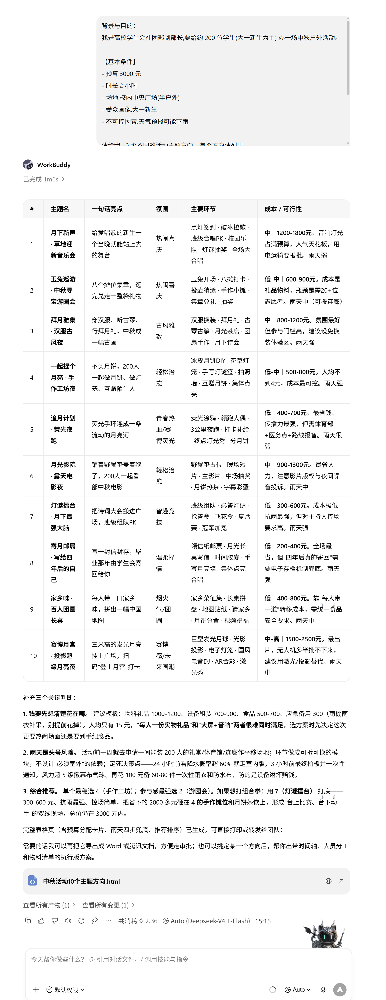
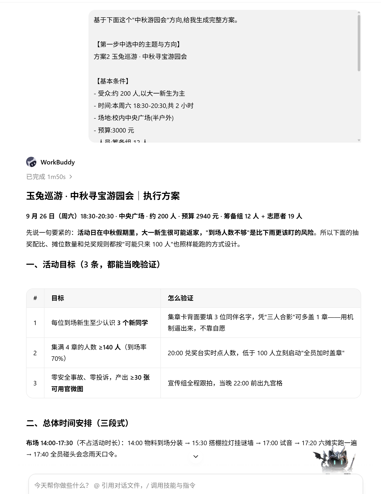
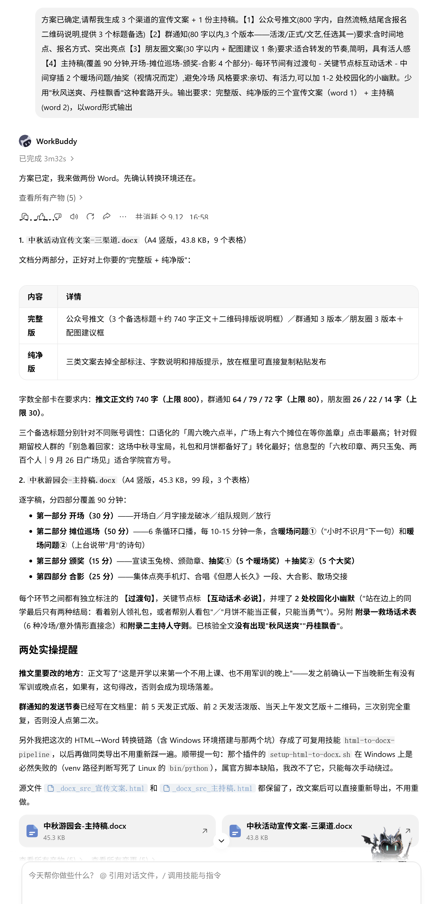
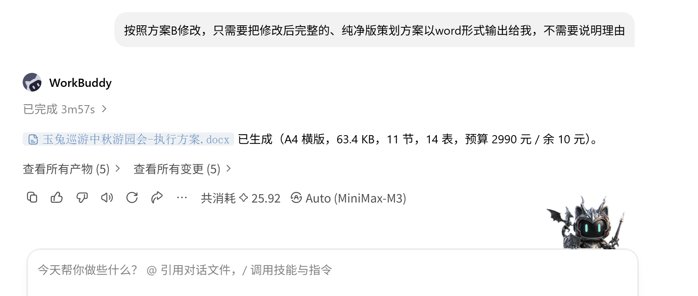
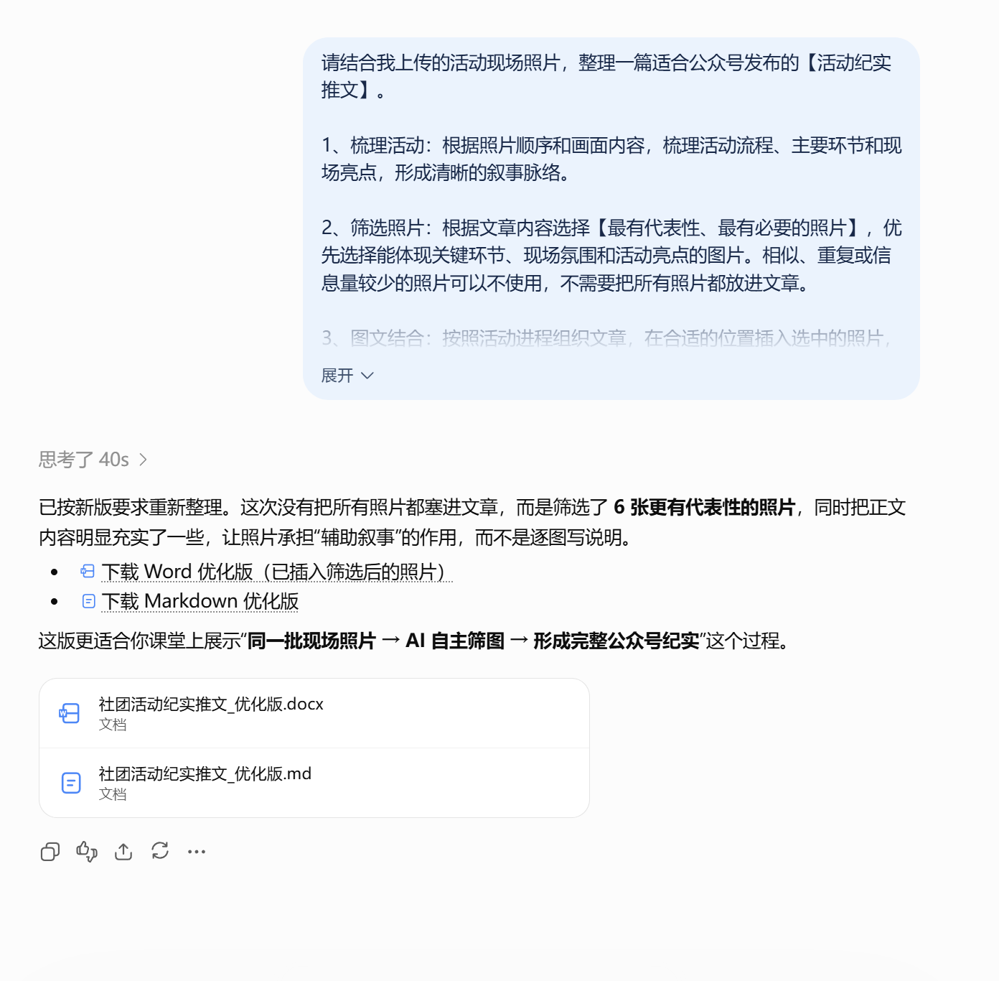

# 25 做社团活动策划方案

[官网课程](https://www.datawhale.cn/learn/content/382/7914) · [飞书源稿](https://datawhaler.feishu.cn/wiki/XQIywwn7uiYgZdkaiSFcmZdJnGd?from=from_copylink)

## **一、总览**

### **Part 1｜主要应用场景与人群**

| **场景类型** | **典型活动示例** | **常见负责人** |
| --- | --- | --- |
| 招新破冰 | 招新宣讲、新人破冰 | 社长、副社长、新任部长 |
| 节日活动 | 中秋游园、圣诞晚会、新年晚会 | 活动部、文体部 |
| 兴趣学术 | 讲座、读书会、桌游之夜、剧本杀 | 学术部、兴趣社团部长 |
| 比赛竞技 | 演讲赛、辩论赛、运动会、编程马拉松 | 竞赛部、社团骨干 |
| 公益实践 | 支教、社区服务、爱心义卖 | 实践部、志愿者队长 |
| 社团纪念 | 周年庆、换届大会、毕业欢送 | 会长、秘书长 |

### **Part 2｜AI 辅助的主要环节**

| **序号** | **环节** | **AI 做什么** | **人做什么** |
| --- | --- | --- | --- |
| 1 | **活动定位与创意** | 同时给多个主题方向、起标题、定调 | 选方向、定核心目标 |
| 2 | **方案撰写** | 一次性出完整方案、流程表、预算表、风险预案 | 核对数字、敲定分工 |
| 3 | 宣传推广 | 一稿出多渠道文案、配图建议 | 选平台、定推送时间 |
| 4 | 现场执行 | 写主持稿、互动游戏、应急话术 | 现场应变、把控氛围 |

### **Part 3｜可以使用什么工具**

**对话类 AI**（任选）：[腾讯元宝](<https://yuanbao.tencent.com/>) / [Kimi](<https://www.kimi.com/>) / [通义千问](<https://www.qianwen.com/>) / [文心一言](<https://yiyan.baidu.com/>) / [豆包](<https://www.doubao.com/>) / [ChatGPT](<https://chatgpt.com/>)

**文档协作**：[Microsoft Word](<https://www.microsoft.com/microsoft-365/word>) / [WPS](<https://www.wps.cn/>)（本地编辑方案）+ 在线文档（可选，适合多人协作）。

**进阶工具**：[XMind](<https://xmind.app/>)（流程图、思维导图）+ [创客贴](<https://www.chuangkit.com/>) / [稿定设计](<https://www.gaoding.com/>) / [Canva](<https://www.canva.com/>)（海报、配图与视觉设计）。

**推荐路线：**
对话类 AI（任选其一）+ [WPS](<https://www.wps.cn/>) → 进阶时配合 [XMind](<https://xmind.app/>) + [创客贴](<https://www.chuangkit.com/>) / [稿定设计](<https://www.gaoding.com/>) / [Canva](<https://www.canva.com/>)

如果社团想把活动策划 AI 流程沉淀成可复用的团队模板，可以使用 [WorkBuddy](<https://workbuddy.ai/>) / [Codex](<https://openai.com/codex/>) 等智能体工具，把整套提示词进一步封装成内部 Skill，方便之后的新成员直接复用。

## **二、基础案例 : 做完一场"中秋游园会"策划方案初稿**

**场景**:高校学生会社团部承办一场面向 200 人的中秋游园会,预算 3000 元,2 小时内含 6 个互动摊位 + 颁奖 + 合影。

**目标**:用 AI 完成从创意到方案的整套产出,最后产出：一份活动方案、一份宣传文案、一份主持稿。

### **第一步 · 让 AI 开拓思维，提供多个主题方向**

**输入提示词:**

```markdown
背景与目的：
我是高校学生会社团部副部长,要给约 200 位学生(大一新生为主) 办一场中秋户外活动。

【基本条件】
- 预算:3000 元
- 时长:2 小时
- 场地:校内中央广场(半户外)
- 受众画像:大一新生
- 不可控因素:天气预报可能下雨

请给我 10 个不同的活动主题方向。每个方向请列出:
1. 主题名(朗朗上口、带点文化味)
2. 一句话亮点
3. 整体氛围(轻松治愈/热闹喜庆/古风雅致/赛博感 等)
4. 主要环节(用 5-7 个短词概括)
5. 成本与可行性评估(中低中高)
以表格形式呈现
```

**演示及效果图**:



[中秋活动10个主题方向.html](../../public/course-assets/25/source-01.html)

**挑出最契合需求的方向,再做下一步。**

### **第二步 · 确定方向后，给出完整方案**

**参考提示词：**

```markdown
基于下面这个"中秋游园会"方向,给我生成完整方案。

【第一步中选中的主题与方向】
(把上一步挑出的主题贴在这里)

【基本条件】
- 受众:约 200 人,以大一新生为主
- 时间:本周六 18:30-20:30,共 2 小时
- 场地:校内中央广场(半户外)
- 预算:3000 元
- 人员:筹备组 12 人
- 不可控:天气预报可能下雨

【需要包含】
1. 活动目标(不超过 3 条)
2. 总体时间安排(开场-中段-收尾三段式)
3. 6 个互动摊位的具体玩法(每个 50 字内,含所需物资)
4. 完整预算明细表格
5. 物料清单(含数量、负责人)
6. 风险预案(按"下雨/设备故障/报名不足/冷场"四种情况给应对方案)
7. 当天人员分工表

要求:详细具体可执行，不要用"形式新颖、内容丰富"这种空话，用 word 文件格式输出。
```

**演示及效果图**:



**输出文件：**

[玉兔巡游中秋游园会-执行方案.docx](../../public/course-assets/25/source-02.docx)

### **第三步 · 高效产出多渠道文案 + 主持稿**

**参考提示词**:

```text
方案已确定,请帮我生成 3 个渠道的宣传文案 + 1 份主持稿。

【1】公众号推文(800 字内，自然流畅,结尾含报名二维码说明,提供 3 个标题备选)

【2】群通知(80 字以内,3 个版本——活泼/正式/文艺,任选其一)
要求:含时间地点、报名方式、突出亮点

【3】朋友圈文案(30 字以内 + 配图建议 1 条)
要求:适合转发的节奏,简明，具有活人感

【4】主持稿(覆盖 90 分钟,开场-摊位巡场-颁奖-合影 4 个部分)
- 每环节间有过渡句
- 关键节点标互动话术
- 中间穿插 2 个暖场问题/抽奖（视情况而定）,避免冷场

风格要求:亲切、有活力,可以加 1-2 处校园化的小幽默。
少用"秋风送爽、丹桂飘香"这种套路开头。

输出要求：完整版、纯净版的三个宣传文案（word 1） + 主持稿(word 2)，以word形式输出
```

**演示及效果图**:



**输出文件：**

[中秋游园会-主持稿.docx](../../public/course-assets/25/source-03.docx)

[中秋活动宣传文案-三渠道.docx](../../public/course-assets/25/source-04.docx)

## **三、进阶技巧**

### **进阶 1 · 多角度审核与优化方案初稿**

方案初稿完成后，让 AI 分别站在多类利益相关人（如指导老师、社团负责人、参与学生、宣传人员、执行人员）的角度找问题，再根据反馈修改方案，让活动安排更周全。

上传前面生成的策划方案

**输入提示词：**

```markdown
请审核我刚才生成的活动策划方案。
1、角色判断：根据方案的活动类型、参与对象和执行场景，自行判断【5 个最关键的利益相关者角色】，不要局限于固定身份。
2、分别评审：站在每个角色的真实立场，指出他们最可能关注的问题、风险或不足，避免泛泛而谈。
3、建议分级：每个角色的意见分为：
🔴 必须修改：可能影响活动效果或正常执行的问题
🟡 可选优化：修改后能明显提升方案质量
⚪ 可以保留：目前方案合理、无需调整的部分
4、汇总修改：最后整合各角色意见，列出【最优先修改的 3—5 项】，并给出具体修改建议和修改方案供我选择。
```

**演示：**

![图片展示的是“玉兔巡游中秋游园会 - 执行方案”文档内容。文档详细列出了活动时间、地点、参与人员、活动流程、活动预算、活动物资、活动流程、活动流程、活动流程、活动流程、活动流程、活动流程、活动流程、活动流程、活动流程、活动流程、活动流程、活动流程、活动流程、活动流程、活动流程、活动流程、活动流程、活动流程、活动流程、活动流程、活动流程、活动流程、活动流程、活动流程、活动流程、活动流程、活动流程、活动流程、活动流程、活动流程、活动流程、活动流程、活动流程、活动流程、活动流程、活动流程、活动流程、活动流程、活动流程、活动流程、活动流程、活动流程、活动流程、活动流程、活动流程、活动流程、活动流程、活动流程、活动流程、活动流程、活动流程、活动流程、活动流程、活动流程、活动流程、活动流程、活动流程、活动流程、活动流程、活动流程、活动流程、活动流程、活动流程、活动流程、活动流程、活动流程、活动流程、活动流程、活动流程、活动流程、活动流程、活动流程、活动流程、活动流程、活动流程、活动流程、活动流程、活动流程、活动流程、活动流程、活动流程、活动流程、活动流程、活动流程、活动流程、活动流程、活动流程、活动流程、活动流程、活动流程、活动流程、活动流程、活动流程、活动流程、活动流程、活动流程、活动流程、活动流程、活动流程、活动流程、活动流程、活动流程、活动流程、活动流程、活动流程、活动流程、活动流程、活动流程、活动流程、活动流程、活动流程、活动流程、活动流程、活动流程、活动流程、活动流程、活动流程、活动流程、活动流程、活动流程、活动流程、活动流程、活动流程、活动流程、活动流程、活动流程、活动流程、活动流程、活动流程、活动流程、活动流程、活动流程、活动流程、活动流程、活动流程、活动流程、活动流程、活动流程、活动流程、活动流程、活动流程、活动流程、活动流程、活动流程、活动流程、活动流程、活动流程、活动流程、活动流程、活动流程、活动流程、活动流程、活动流程、活动流程、活动流程、活动流程、活动流程、](../../public/course-assets/25/img-04.png)

**选择修改方案：**

```text
按照方案B修改，只需要把修改后完整的、纯净版策划方案以word形式输出给我，不需要说明理由
```

**演示图：**



**输出文件：**

[玉兔巡游中秋游园会-执行方案.docx](../../public/course-assets/25/source-05.docx)

### **进阶 2 · 结合现场照片，快速整理活动纪实**

活动结束后，把现场照片交给 AI，帮助梳理活动流程、提炼亮点并整理成图文纪实初稿，减少后续整理和撰写总结的时间。

**上传现场图片 + 活动策划方案/活动记录**

**素材下载：**

[社团活动现场模拟照片.zip](../../public/course-assets/25/source-06.zip)

[玉兔巡游中秋游园会-执行方案.docx](../../public/course-assets/25/source-07.docx)

**提示词：**

```text
请结合我上传的活动现场照片，整理一篇适合公众号发布的【活动纪实推文】。
1、梳理活动：根据照片顺序和画面内容，梳理活动流程和主要环节，并选择有代表性的照片。
2、图文对应：按照活动进程组织内容，将选中的照片安排在合适位置，并注明对应的照片文件名。
3、完成推文：包括开头、活动过程和结尾回顾，重点呈现现场氛围、参与情况和活动亮点，结构清楚、自然好读。
4、真实准确：【只写照片中能够确认或我已经提供的信息】。无法确认的活动环节、人数、数据、人物身份等不要自行补充或猜测。
5、表达自然：减少套话和宣传腔，不使用“圆满成功”“精彩纷呈”等模板化表述，语言自然、有现场感。
6、补充标题：提供 3 个推文标题，并推荐 1 张适合作为公众号封面的照片，简要说明理由。
输出文件：完成后同时提供【Word 文件】和【Markdown 文件】，两份内容保持一致。Word 文件将选中的照片插入正文对应位置；Markdown 文件保留清晰的标题层级、图片位置及照片文件名，方便后续公众号排版。
```

**演示：**



**输出文件：**

[社团活动纪实推文\_优化版.docx](../../public/course-assets/25/source-08.docx)

[社团活动纪实推文\_优化版.md](../../public/course-assets/25/source-09.md)
