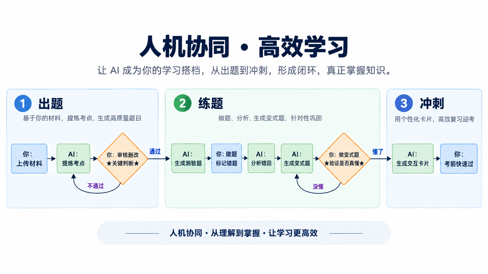
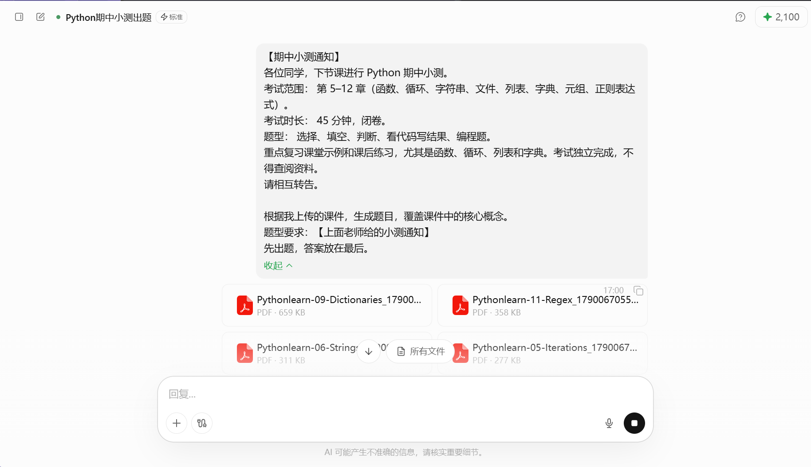

# AI备考小测

[官网课程](https://www.datawhale.cn/learn/content/382/7915)

**教程定位**：2小时内，从"随便问问AI"到"用AI产出可交互的复习材料"。

**适用范围**：期末考、考证、资格考等有明确范围的考试。

## 第一部分：基础认知与核心路线（30分钟）

### 1.1 什么场景下用到

**三个典型痛点**：

- **知识点散**：课件、笔记、教材各讲各的，不知道重点在哪
- **刷题没方向**：错了也不知道是哪个知识点的漏洞
- **材料难坚持**：纯文字笔记看两遍就烦

**AI备考小测解决什么**：用你手上的材料（课件/笔记/教材），快速生成可交互的复习工具，把"看"变成"练"。

### 1.2 AI和人协作的环节流程

**关键边界**：机器给出数据和内容，人负责解释和决定优先度。AI说"这个考点重要"，你可以说"不对，老师强调过另一个"，然后让它改。



### 1.3 产品组合（一条明确路线）

**路线**：豆包/千问（生成）+ 题库（刷题）组合。

| 环节 | 工具 | 用途 | 链接 |
| --- | --- | --- | --- |
| 出题+交互材料生成 | **deepseek** | 上传材料、生成测验、产出HTML卡片代码 | [跳转安装](<https://chat.deepseek.com/>) |
| 备选出题工具 | **千问** | 拍题答疑、举一反三精准练 | [跳转安装](<https://www.tongyi.com>) |

**为什么是这套组合**：千问/Deepseek免费、支持长文本、能生成HTML代码；有国内考试题库，避免纯AI出题"飘"的问题。两者配合，AI负责"根据你的材料定制"，题库负责"验证知识点覆盖"。

### 1.4 基础案例（5分钟）

**场景**：python小测

**操作**：

1. 获取老师、课程规定中对于小测的安排，如：

```bash
【期中小测通知】
各位同学，下节课进行 Python 期中小测。
考试范围： 第 5–12 章（函数、循环、字符串、文件、列表、字典、元组、正则表达式）。
考试时长： 45 分钟，闭卷。
题型： 选择、填空、判断、看代码写结果、编程题。
重点复习课堂示例和课后练习，尤其是函数、循环、列表和字典。考试独立完成，不得查阅资料。
请相互转告。
```

1. 打开千问办公、workbuddy等AI，选择内置的skill

比如：

1. 上传备考材料

[python.zip](../../public/course-assets/26/source-01.zip)

[Pythonlearn-04-Functions.pdf](../../public/course-assets/26/source-02.pdf)

[Pythonlearn-05-Iterations.pdf](../../public/course-assets/26/source-03.pdf)

[Pythonlearn-06-Strings.pdf](../../public/course-assets/26/source-04.pdf)

[Pythonlearn-07-Files.pdf](../../public/course-assets/26/source-05.pdf)

[Pythonlearn-08-Lists.pdf](../../public/course-assets/26/source-06.pdf)

[Pythonlearn-09-Dictionaries.pdf](../../public/course-assets/26/source-07.pdf)

[Pythonlearn-10-Tuples.pdf](../../public/course-assets/26/source-08.pdf)

[Pythonlearn-11-Regex.pdf](../../public/course-assets/26/source-09.pdf)

超出大小的了怎么办？换本地桌面端Agent，将文件放在本地文件夹中

1. 输入提示词：

```text
根据我上传的课件，生成题目，覆盖课件中的核心概念。
题型要求：【上面老师给的小测通知】
先出题，答案放在最后。
```



1. 你做一遍，对答案，错的地方追问"解释一下这道题考的知识点"。
   
   [Python期中小测\_c0312844.md](../../public/course-assets/26/source-10.md)

## 第二部分：进阶案例（90分钟）

### 进阶案例1：散乱笔记 → HTML交互知识卡片（25分钟）

**解决的问题**：过去笔记抄在Word里，复习就是盯着看。现在AI用你的笔记内容，生成单文件HTML，双击打开，点击卡片翻面看答案。不需要编程，只需要复制粘贴+保存为.html文件。

**素材准备**：随便选一段你的笔记（比如"计算机网络OSI七层模型"的笔记文字）。

**可复制的提示词**：

```text
你是一个学习工具生成器。请根据我提供的笔记内容，生成一个单文件HTML知识卡片网页。

要求：
1. 卡片正面显示问题/关键词，点击后翻面显示答案/解释
2. 深色背景，保护眼睛，卡片有轻微阴影和圆角
3. 显示"第X / 共Y张"的进度提示
4. 键盘空格键可以翻面，左右箭头可以切换卡片
5. 所有代码写在一个HTML文件里，不依赖任何外部文件

笔记内容如下：
[粘贴你的笔记]
```

**真实效果说明**：生成后得到一个HTML文件，用浏览器打开，看到一张卡片。点击它，翻转，看到答案。按空格翻面，按→进入下一张，按←回到上一张。翻过的卡片有进度记录。

### 进阶案例2：课件 → 预测考题模拟卷（25分钟）

**解决的问题**：考前想"猜题"，只能靠感觉。现在让AI读完你上传的课件/笔记/教材章节，生成一份带解析的模拟卷。

**可复制的提示词**：

```text
你是一个考试出题专家。请根据我上传的材料，生成一份模拟测验。

规则：
- 材料中反复出现、篇幅较长的内容，视为重点，必须出题
- 生成8道选择题 + 4道判断题
- 每题标注：题号、题干、选项（选择题）、答案、解析（说明为什么对/为什么错）
- 解析中要指出该知识点在材料中的大致位置

材料已上传，请开始。
```

**素材**：上传任意课件PDF/粘贴笔记文字。

### 进阶案例3：错题 → 针对性训练（20分钟）

**解决的问题**：刷完一套题，发现"分式方程去分母"错了3道，但题库里没法精准只练这个点。现在把你错的题喂给AI，它针对同一个知识点重新出题。

**可复制的提示词**：

```text
我刚才做错了以下题目，它们都涉及"分式方程去分母"这个知识点。

[粘贴你的错题]

请：
1. 先解释我可能哪里理解错了（分析原因，不是直接给答案）
2. 然后针对这个知识点出3道新题，难度从易到难
3. 新题给答案和详细步骤

不要出和原题一模一样的题。
```

**真实效果说明**：AI先诊断你的错误模式（比如"你可能忘了去分母时要乘最小公倍数"），然后给3道变式题。做完这3道，如果都对了，说明这个点补上了。

### 进阶案例4（可选）：直接用现成的知识卡片生成器（20分钟）

**解决的问题**：你觉得"让AI写HTML代码再自己保存"还是有点麻烦。

**国内可用工具**：mulerun平台上的"educard generator（教育卡片生成器）"。

**操作**：输入主题关键词、面向人群（如大学生）、卡片风格（如漫画/复古/手账），它直接生成卡片图像。

**真实效果说明**：有用户实测用它生成计算机网络的TCP/IP协议对比卡片，英文效果可用，中文会有乱码风险，但作为快速生成可视化复习材料的手段，值得一试。

```bash
Build a single-file HTML flashcard app called Cardine that reads PDFs (pdf.js), DOCX (mammoth.js), and images (Tesseract.js OCR) to extract Q&A pairs using prefix patterns like Q:/A:, and presents them as flip cards with keyboard navigation.
```

**链接**：mulerun.com，搜"educard generator"
