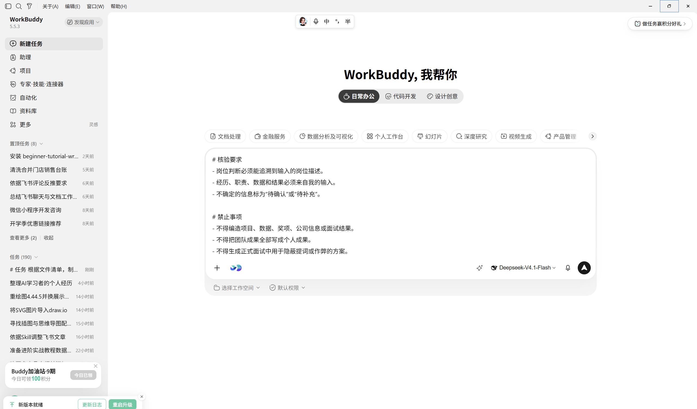
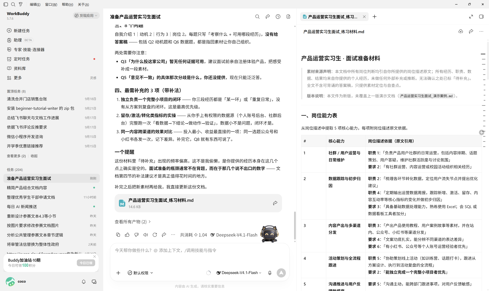

# 27 AI 准备面试

[官网课程](https://www.datawhale.cn/learn/content/382/7916)

## 第一部分：用 AI 准备面试

本教程面向第一次求职或缺少系统面试经验的读者。你将用 AI 分析岗位要求、整理真实经历、预测问题并完成一次模拟面试，最终得到一份可复用的面试准备包。

## 1. 什么时候适合使用

- **第一次参加校招或实习面试：**不知道该准备哪些问题，需要先建立基本框架。
- **跨行业或跨岗位求职：**需要把已有经历重新对应到新岗位要求。
- **收到面试邀请但准备时间有限：**需要快速找出岗位重点，优先练习高相关问题。
- **回答容易跑题或过于啰嗦：**需要把经历整理成结构清楚、证据具体的回答。
- **想提前适应追问：**需要模拟面试官根据回答继续提问，并针对薄弱点反复练习。

AI 可以辅助整理、提问和反馈，但不能替你虚构经历，也不能保证面试结果。正式面试时是否可以使用 AI，应以招聘方规则为准。

## 2. AI 准备面试的基本环节

| 步骤 | AI 或工具做什么 | 人要确认什么 |
| --- | --- | --- |
| 1. 准备材料 | 读取岗位描述、简历和公司公开资料 | 隐私信息是否已脱敏，岗位信息是否仍然有效 |
| 2. 拆解岗位 | 提取职责、能力、关键词和可能的考察重点 | 哪些要求是核心，哪些只是加分项 |
| 3. 整理经历 | 把项目、实习、校园和志愿经历整理成素材库 | 经历、职责、数据和结果是否真实 |
| 4. 生成问题 | 根据岗位与简历生成基础题、行为题和专业题 | 问题是否与岗位相关，是否遗漏关键能力 |
| 5. 模拟练习 | 一次只提一个问题，并根据回答继续追问 | 用自己的话回答，不背诵 AI 生成稿 |
| 6. 复盘改进 | 按相关性、结构、证据和表达给出反馈 | 反馈是否合理，修改后是否仍符合真实经历 |

> 基本环节共 6 个。至少完成一轮“回答—追问—复盘—重答”，再进入正式面试。

## 3. 核心方法与规范

- **岗位—问题—证据：**从岗位描述提取要求，预测相关问题，并为每个问题找到一段真实经历；没有证据就标“待补充”。
- **STAR 回答法：**行为题按情境（S）、任务（T）、个人行动（A）、结果（R）组织，重点讲清自己做了什么；数据和团队成果必须如实表述。
- **模拟与复盘：**让 AI 一次问一题，先自己回答，再根据“是否切题、结构是否清楚、证据是否具体、表达是否自然”改进。AI 反馈仅作练习参考。
- **信息边界：**上传前删除身份证号、联系方式和未公开业务信息；公司与岗位事实回到官网或招聘页面核验，正式面试遵守招聘方规则。

## 4. 产品组合推荐

初学者先选一个能够读取岗位描述和简历、支持连续对话的国内 AI 助手即可，不需要同时使用多个同类产品。

1. **主要任务：**[Kimi](<https://www.kimi.com/>)。适合集中处理岗位描述、简历和面试素材，并持续进行多轮问答。官方帮助中心说明其支持常见文档上传和语音通话；具体能力与额度以当前页面为准。
2. **口头练习：手机自带录音。**不需要额外购买工具。录制回答后，自己检查停顿、口头语、语速和是否超出面试要求。

如果你的材料已经存放在其他平台，也可以直接选用熟悉的国内 AI 助手。使用前查看该产品的隐私政策和数据处理说明。

## 5. 基础案例：准备产品运营实习生面试

下面使用模拟岗位和模拟经历，目标是在 30～45 分钟内得到“岗位能力清单、8 个面试问题、3 个经历素材和一轮模拟反馈”。

### 第一步：准备输入

**模拟岗位描述：**

> 协助内容运营和用户活动；跟踪活动数据并形成复盘；与设计、产品团队协作推进项目；要求沟通清晰、对数据敏感、有责任心。

**模拟个人经历：**

> 曾负责校园公众号选题和排期；组织过一次校园分享会；用问卷收集参与者反馈。具体人数、阅读量和改进结果需要由本人填写。

实际使用时，将模拟内容替换为真实岗位描述和已经脱敏的简历。

### 第二步：使用提示词

```text
# 任务
请帮助一名初学者准备“产品运营实习生”面试。先分析岗位，再整理真实经历，最后生成练习问题。不要直接替我编写可背诵的完美答案。

# 输入或处理范围
岗位描述：
【粘贴岗位描述】

个人经历：
【粘贴脱敏后的简历或经历】

# 处理规则
1. 提取不超过 5 项核心能力，并引用岗位描述中的对应依据。
2. 将个人经历与核心能力逐项匹配；没有证据时标记“待补充”。
3. 按 STAR 结构整理 3 个可用经历，只整理本人提供的事实。
4. 生成 8 个面试问题，包括自我介绍、求职动机、行为题和岗位题。
5. 为每个问题说明“考察什么”和“可使用哪段真实经历”。

# 输出格式
依次输出：
1. 岗位能力表；
2. 经历素材表；
3. 8 个面试问题；
4. 最需要补充的 3 项信息。

# 核验要求
- 岗位判断必须能追溯到输入的岗位描述。
- 经历、职责、数据和结果必须来自我的输入。
- 不确定的信息标为“待确认”或“待补充”。

# 禁止事项
- 不得编造项目、数据、奖项、公司信息或面试结果。
- 不得把团队成果全部写成个人成果。
- 不得生成正式面试中用于隐蔽提词或作弊的方案。
```



### 第三步：检查结果

- 每项核心能力是否能在岗位描述中找到依据；
- 每个经历是否确实由自己参与，个人行动是否清楚；
- 数字、时间、职责和结果是否真实，缺失处是否标为“待补充”；
- 8 个问题是否覆盖岗位重点，而不是一组通用面试题。

从问题清单中选 1 道行为题，复制下面的指令；先用自己的话回答，再把反馈记入复盘记录。

```text
请从刚才生成的 8 个问题中选 1 道行为题，一次只问这一题。等我回答后，检查是否切题、行动是否具体、结果是否有证据；引用我的原话指出 1 个最需要改进的问题。不要替我补造经历。
```

### 第四步：定向修正

```text
请保留已经核实的内容，只修正以下问题：
1. 删除没有岗位描述依据的能力判断；
2. 将所有没有真实证据的经历和数据标为“待补充”；
3. 根据刚才的模拟反馈，指出我的回答中一处最需要改进的地方，并给出重答提示，不替我编造内容；
4. 重新检查问题与岗位要求的对应关系，不改动无关内容。
```

按提示再口头回答一次，并对照原回答检查是否更切题、更具体。

### 第五步：保存与复用

建立一个“公司—岗位—日期”文件夹，保存岗位描述、脱敏简历、能力表、经历素材、问题清单和复盘记录。每次面试后只补充新的真实问题和改进项，不覆盖原始记录。



## 第二部分：进阶实战

### 进阶实战 1：生成 1 分钟自我介绍提纲

练习把岗位需求和个人优势连接起来，同时保留自然表达空间。

```text
请根据下面的岗位描述和真实经历，为我生成一份约 1 分钟的自我介绍提纲。

要求：
1. 只包含“当前身份—两项岗位相关优势—一个证据—应聘动机”；
2. 使用口语短句，不写成可机械背诵的文章；
3. 每项优势必须能在我的真实经历中找到证据；
4. 公司和岗位信息无法核验时标记“待确认”；
5. 输出“提纲、必须由我补充的信息、容易显得空泛的句子”三部分；
6. 不得编造经历、数字、奖项或求职动机。

岗位描述：【粘贴】
真实经历：【粘贴】
```

**预期结果：**得到一份四段式口语提纲；每项优势都有真实证据，缺失内容被明确标记。

### 进阶实战 2：进行一轮追问式模拟面试

练习在没有完整题稿的情况下组织回答，并适应面试官追问。

```text
请扮演【岗位名称】的面试官，依据我提供的岗位描述和脱敏简历进行模拟面试。

规则：
1. 一次只问一个问题，等我回答后再继续；
2. 共进行 5 个主问题，每个主问题最多追问 2 次；
3. 问题覆盖岗位动机、真实经历、行为题和岗位能力；
4. 不要在我回答前给提示或标准答案；
5. 全部结束后，按相关性、结构、证据、表达、真实性五项反馈；
6. 引用我的原话说明问题，并给出一个可执行的改进动作；
7. 发现经历或数据前后矛盾时指出，不替我补造事实。

岗位描述：【粘贴】
脱敏简历：【粘贴】
现在请开始第一个问题。
```

**预期结果：**完成 5 个主问题及必要追问，得到一份包含原话证据和改进动作的复盘。

### 进阶实战 3：面试后形成下一轮改进清单

把一次真实面试转化为下一次可以执行的练习计划。

```text
请根据我的面试回忆整理复盘。不要猜测面试官的真实评价或录用结果。

面试回忆：【按记忆写下问题、我的回答、卡顿点和面试官公开反馈】

请输出：
1. 问题与回答摘要；
2. 表现较好的地方及原话证据；
3. 需要改进的地方及原话证据；
4. 无法确认的信息，标为“待确认”；
5. 下一次面试前最优先练习的 3 个动作；
6. 需要补充到经历素材库的新内容。

不得编造面试官态度、评分、公司内部标准或录用概率。
```

**预期结果：**得到一份区分事实与推测的复盘，以及 3 个下一次面试前可完成的练习动作。

## 6. 学习收获

- 能够从岗位描述中提取核心能力，并为每项能力找到真实证据；
- 能够使用 STAR 方法整理至少 3 个面试经历；
- 能够让 AI 进行逐题提问、追问和基于证据的反馈；
- 能够识别 AI 编造、过度包装和隐私泄露风险；
- 能够保存并持续更新自己的面试素材库与复盘记录。

## 参考来源

1. 哈佛大学 Mignone 职业成功中心：[AI for Interviews and Offers](<https://careerservices.fas.harvard.edu/ai-interviews-and-offers/>)
2. 宾夕法尼亚大学职业服务中心：[Using the STAR Technique to Answer Interview Questions](<https://careerservices.upenn.edu/blog/2019/12/02/using-the-star-technique-to-answer-interview-questions/>)
3. 加州大学伯克利分校职业中心：[Interview Preparation](<https://www.career.berkeley.edu/prepare-for-success/interviewing/interview-preparation/>)
4. 广东工商职业技术大学就业指导中心：[@即将面试的你，这些准备要做好](<https://jyzd.gdbtu.edu.cn/contents/1071/41813.html>)
5. 中央网络安全和信息化委员会办公室：[生成式人工智能服务管理暂行办法](<https://www.cac.gov.cn/2023-07/13/c_1690898327029107.htm>)
6. Kimi 帮助中心：[Kimi 概览](<https://www.kimi.ai/zh-hans/help/getting-started/overview>)
