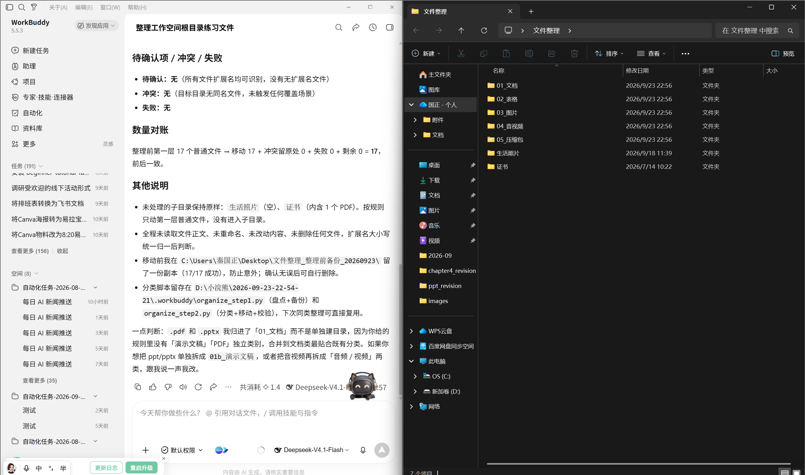

# 28 用 AI 整理文件

[官网课程](https://www.datawhale.cn/learn/content/382/7918)

## 第一部分：用 AI 整理电脑文件

本教程面向 Windows 初学者，帮助你用 AI 整理桌面、下载文件夹或项目资料。完成后，你将得到一个结构清楚的练习文件夹、一套统一命名规则，以及可以重复使用的整理提示词。

## 1. 什么时候适合使用

- **下载文件堆积：**PDF、图片、表格、安装包混在一起，不知道从哪里开始整理。
- **文件名难以识别：**存在大量“新建文档”“最终版2”“IMG\_1234”等名称。
- **项目资料分散：**合同、会议纪要、素材和交付文件放在不同位置。
- **周期性归档：**每周或每月都要整理相似文件，希望复用同一套规则。

在你选定的练习文件夹内，AI 可以按明确规则一次完成分类和移动；遇到冲突或无法判断的文件应保留并列入“待确认”。删除、覆盖和操作工作空间之外的文件仍需你判断。

## 2. 用 AI 整理电脑文件的基本环节

| 步骤 | AI 或工具做什么 | 人要确认什么 |
| --- | --- | --- |
| 1. 限定范围 | 读取你选定的练习文件夹 | 文件夹内是否包含隐私、机密或系统文件 |
| 2. 生成清单 | 盘点文件名、类型和数量 | 文件是否都在本次整理范围内 |
| 3. 设计规则 | 按提示词确定分类目录 | 规则是否足够明确，模糊项能否归入“待确认” |
| 4. 自动归档 | 创建目录并移动符合规则的文件 | 遇到权限确认时核对操作路径；异常项保持原位 |
| 5. 复核结果 | 汇总各目录文件数和操作记录 | 抽查文件能否打开、数量是否对应 |

> 不要第一次就整理整个磁盘。先用 10～20 个非敏感文件试运行，规则稳定后再扩大范围。

## 3. 核心方法与安全规范

1. **范围清楚即可一次执行。**选定小型练习文件夹并写清分类规则后，可让 AI 一次完成普通分类移动；删除、覆盖和无法判断项不自动处理。
2. **按用途分类，按格式辅助。**优先区分工作、学习、生活、安装包等用途；无法判断时再按文件类型归入“待确认”。
3. **文件名保持一致。**可采用 ` 日期_主题_版本.扩展名 `，例如 ` 2026-09-23_项目周报_v01.docx `。日期或主题无法确认时，不要猜测。
4. **不改变扩展名。**` .docx `、` .pdf `、` .xlsx ` 等扩展名决定文件类型，不能为了整齐随意修改。
5. **不直接删除。**重复文件、旧版本和疑似无用文件统一放入“待确认”或输出候选清单，由人工处理。

## 4. 产品组合推荐

对初学者，建议用 WorkBuddy 整理已选定的工作空间，再配合 Windows 自带的文件管理和备份能力。

1. **主要整理：WorkBuddy。**它支持在授权的工作空间中读取、写入和整理本地文件。开始前只选择本次练习文件夹，并保持默认权限。[WorkBuddy 官方介绍](<https://www.workbuddy.cn/docs/workbuddy/Overview>) · [工作空间与权限说明](<https://www.workbuddy.cn/docs/workbuddy/From-Beginner-to-Expert-Guide/Function-Description/Permission-Modes>)
2. **备份与恢复：Windows 文件历史记录。**在开始批量操作前，可将重要文件备份到外接硬盘或网络位置。[文件历史记录说明](<https://support.microsoft.com/en-US/Windows/Experience/Backup-Recovery/backup-and-restore-with-file-history>)
3. **可选批量重命名：PowerToys PowerRename。**当文件名变化具有固定规律时，它能提供重命名预览和撤销能力；少量文件不必额外安装。[PowerRename 文档](<https://learn.microsoft.com/windows/powertoys/powerrename>)

如果文件属于单位、客户或研究项目，应先遵守所在组织的数据规定。未经允许，不要让任何 AI 工具读取机密文件、身份证件、账号凭据或含个人隐私的材料。

## 5. 基础案例：整理一个杂乱的下载文件夹

本案例只整理一个包含 10～20 个非敏感文件的练习文件夹。你只需选定工作空间并发送一次指令，WorkBuddy 就会按文件类型创建分类目录、移动能明确识别的文件，并把不确定项留在“待确认”目录。

### 第一步：准备输入

1. 新建文件夹 ` AI文件整理练习区 `。
2. 从下载文件夹中复制 10～20 个非敏感文件进去，不要剪切原文件。
3. 可包含 PDF、Word、Excel、图片、压缩包和安装包，以便观察分类效果。
4. 在 WorkBuddy 新建任务，将 ` AI文件整理练习区 ` 选为本次工作空间；保持默认权限，不要开启“完全访问”。

### 第二步：使用提示词

```text
# 任务
请直接整理当前工作空间根目录中的练习文件，一次完成分类目录创建、文件分类移动和结果汇总，不需要先停下来等待我逐项确认。

# 处理范围
- 仅处理当前工作空间根目录第一层的普通文件，不访问上级目录、其他磁盘、隐藏目录或子文件夹。

# 处理规则
1. 按文件类型创建以下目录（只创建有对应文件的目录）：01_文档、02_表格、03_图片、04_音视频、05_压缩包、06_安装包、90_待确认。
2. 只根据文件扩展名分类，不读取文件正文，不猜测内容用途；无法判断类型的文件放入“90_待确认”。
3. 保留原文件名和扩展名；不删除、不覆盖、不合并文件。
4. 发现目标目录中有同名文件时，不覆盖，冲突文件留在原处并列入待确认。

# 输出格式
完成移动后输出简短结果：各目录文件数、已移动文件清单、待确认项、冲突或失败原因。移动前后文件总数必须能对应；如有权限或风险确认弹窗，停止并告诉我需要确认的具体路径和操作。

# 禁止事项
- 不访问工作空间以外的文件。
- 不删除、覆盖、重命名或改动文件内容。
- 不编造文件信息或声称未完成的操作已经完成。
- 无法确认的信息标为“待确认”。
```



### 第三步：检查结果

- 查看 WorkBuddy 的执行摘要和结果区，确认各分类目录及文件数。
- 在资源管理器中抽查各目录的文件是否能正常打开。
- 检查冲突和待确认文件是否仍留在原处或被归入待确认目录，没有被覆盖或删除。

### 第四步：定向修正

如果发现误分类，只需指出文件名和正确目录，让 WorkBuddy 修正这一项：

```text
请只修正以下文件的分类：【文件名】应放入【目标目录】。
仅在当前工作空间内移动这一个文件，不要改名、删除或覆盖其他文件。完成后更新分类数量和操作记录。
```

### 第五步：保存与复用

将分类规则和提示词保存为 ` 文件整理规则.md `，下次选择新的练习工作空间后即可再次使用。抽查文件仍是必要的最后一步；不需要逐个批准普通分类移动，但 WorkBuddy 的安全权限弹窗仍需按提示确认。

## 第二部分：进阶实战

### 进阶实战 1：批量规范项目文件名

适合整理名称混乱、但属于同一项目的一批文档。

```text
# 任务
直接为当前工作空间中的项目文档批量重命名，并输出原名与新名对照记录。

# 规则
- 命名格式：YYYY-MM-DD_项目名_内容主题_vNN.原扩展名。
- 日期优先使用文档中能够确认的日期，其次使用文件修改日期，并在依据中注明。
- 不改变扩展名；遇到同名冲突时保持原名并标为“待确认”；版本无法确认时不猜版本号。
- 临时文件、快捷方式和无法打开的文件保持原名。
- 除符合规则且信息可确认的文件外，不改动其他文件。

# 输出
原文件名｜实际新文件名｜日期依据｜主题依据｜冲突情况｜待确认项

# 核验
改名文件数与操作记录一致；列出所有同名冲突；不得编造项目名、日期或版本；不得删除或覆盖文件。
```

**预期结果：**符合规则的文件已实际重命名，并生成原名与新名对照表；冲突和无法确认项保持原样并被单独标出。

### 进阶实战 2：整理项目资料并生成索引

适合把会议纪要、需求、合同、数据和交付物整理成一个易查找的项目资料包。

```text
# 任务
直接按下列目录结构整理当前工作空间中的项目资料，并生成项目文件索引。

# 分类规则
- 建议目录：01_需求、02_会议、03_数据、04_合同、05_过程稿、06_交付物、90_待确认。
- 根据文件名和可确认的内容判断用途；依据不足时进入“90_待确认”。
- 重复文件和旧版本只做标记，不删除；同名冲突或去向不明的文件不移动，标为“待确认”。
- 只处理当前工作空间内的文件，不访问其他目录；不覆盖或删除任何文件。

# 索引格式
文件名｜建议目录｜内容摘要（不超过30字）｜版本关系｜负责人或来源｜待确认项

# 核验要求
- 索引文件数与扫描文件数一致。
- 摘要只能来自实际可读取内容。
- 负责人、来源或版本无法确认时写“待确认”。
- 列出无法读取、疑似重复和可能包含敏感信息的文件。
```

**预期结果：**项目文件已按明确类别归档，并生成可检索的文件索引；冲突和去向不明的文件保持原位并被标为“待确认”。

### 进阶实战 3：每周检查下载文件夹

适合规则已经稳定、需要定期发现新增文件的用户。

```text
# 任务
检查当前选定的下载文件夹，只整理最近7天新增或修改的文件，先输出预览，不自动执行。

# 规则
- 沿用“文件整理规则.md”中的分类和命名规范。
- 已在历史清单中出现且未变化的文件不重复处理。
- 只标记疑似重复、安装包、超大文件和超过30天未使用的文件，不删除。
- 涉及移动、覆盖或删除的操作必须等待人工确认。

# 输出
新增文件｜建议操作｜目标位置｜判断依据｜风险｜是否需要确认

# 核验要求
报告扫描范围、开始与结束时间、成功读取数、跳过数和异常数；无法确认的信息写“待确认”。
```

**预期结果：**得到一份只包含近期变化的巡检报告。先连续手动运行两三次，结果稳定后再考虑设置周期性任务。

## 6. 学习收获

- 能够限定 AI 的文件访问范围，并在操作前准备可恢复的副本；
- 能够设计简单、一致、可长期复用的文件夹和文件命名规则；
- 能够让 AI 先输出变更预览，再核查误分类、同名覆盖和待确认项；
- 能够完成小范围文件整理，并把规则复用于项目归档和周期性巡检。

## 参考来源

1. WorkBuddy：[WorkBuddy 简介](<https://www.workbuddy.cn/docs/workbuddy/Overview>)
2. WorkBuddy：[默认权限与安全沙箱](<https://www.workbuddy.cn/docs/workbuddy/From-Beginner-to-Expert-Guide/Function-Description/Permission-Modes>)
3. WorkBuddy：[实践一：文件内容识别与处理](<https://www.workbuddy.cn/docs/workbuddy/From-Beginner-to-Expert-Guide/Practice-Cases/Practice-One>)
4. 腾讯云：[WorkBuddy 入门指南](<https://cloud.tencent.com/document/product/1831/134389>)
5. Microsoft：[使用文件历史记录备份和还原](<https://support.microsoft.com/en-US/Windows/Experience/Backup-Recovery/backup-and-restore-with-file-history>)
6. 美国国家档案馆：[文件与文件夹命名建议](<https://www.archives.gov/records-mgmt/bulletins/2015/2015-04-appendix-b.html>)
7. NIST：[备份文件的维护与恢复建议](<https://csrc.nist.gov/pubs/other/2020/04/24/protecting-data-from-ransomware-and-other-data-los/final>)

### 公众号参考文章

1. 量子位：[天选 Windows 打工 AI 来了！实测完 Claude Cowork 国产版](<https://www.qbitai.com/2026/02/376227.html>)（2026-02-05；公众号互动数据不可见）
2. [试遍全网 Agent，发现 Marvis 才是文件管理的效率神器](<https://mp.weixin.qq.com/s/OYtUwFL3FzmprmKisgtmGQ>)（2026-07-20；公众号互动数据不可见）
3. 果核剥壳：[Windows 桌面整理工具，DeskTidy 软件体验](<https://mp.weixin.qq.com/s/kjndDcI_UfHIFXVv2jUQzg>)（2026-01-30；公众号互动数据不可见）
4. Python 自动化办公社区：[自动给文件分类，整理文件夹](<https://mp.weixin.qq.com/s/AVFttFz-IjZD1Ra3K-580A>)（2023-03-18；公众号互动数据不可见）
5. 小白书签：[几款好用的文件/文件夹批量重命名工具](<https://mp.weixin.qq.com/s/Zxx9ssgEn2fjSIKT9z7VzQ>)（2024-07-18；公众号互动数据不可见）
