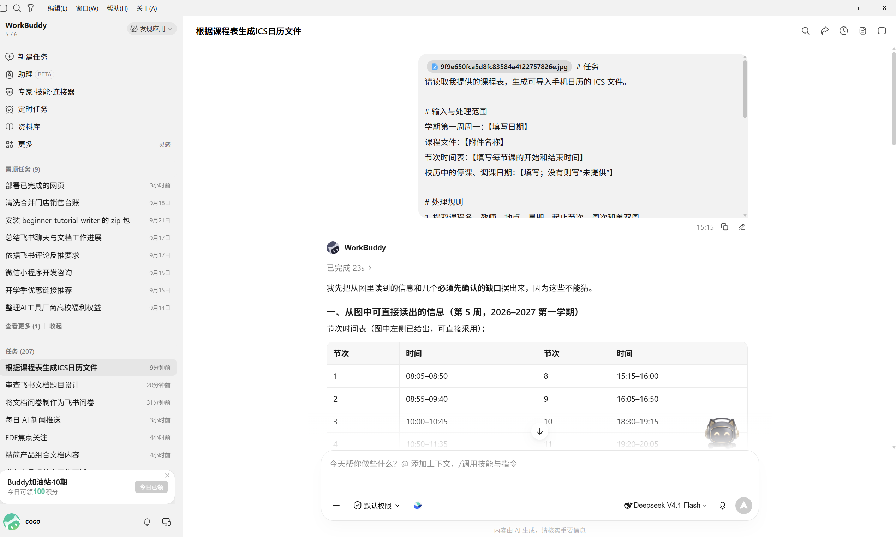
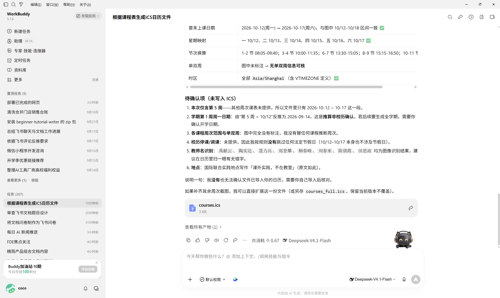
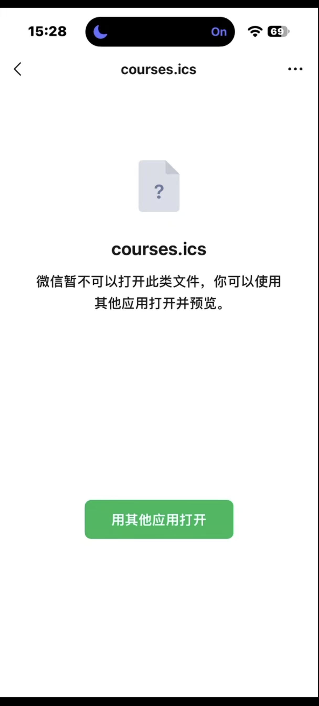
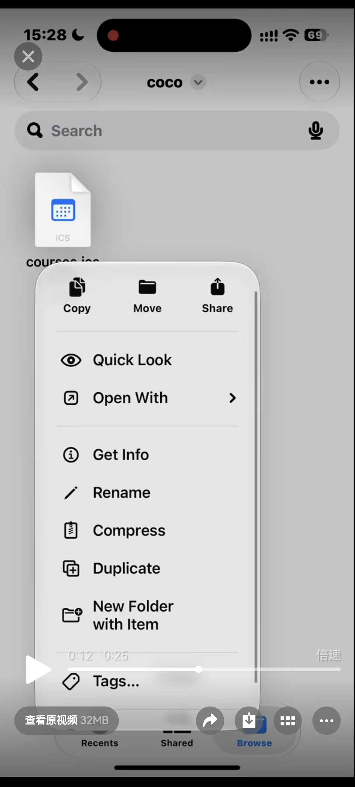
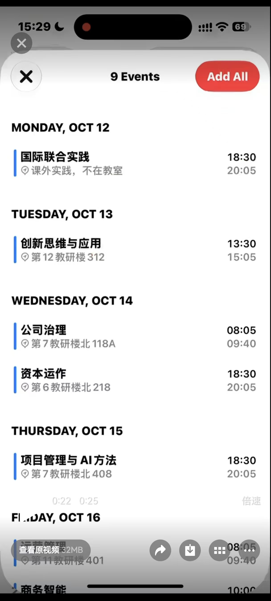
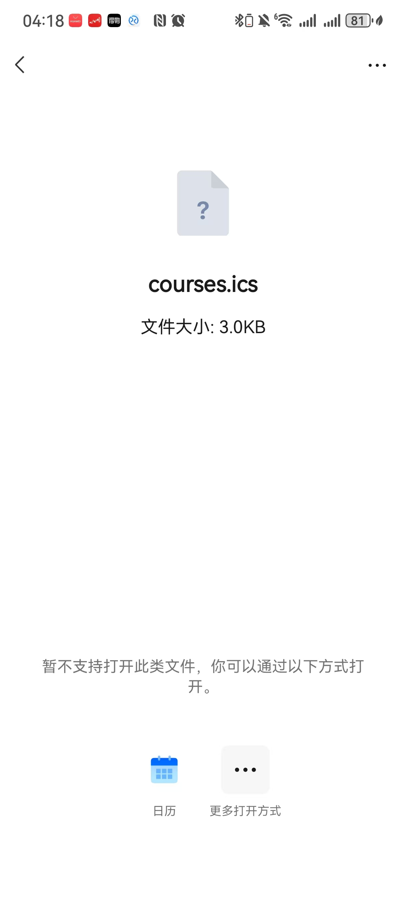
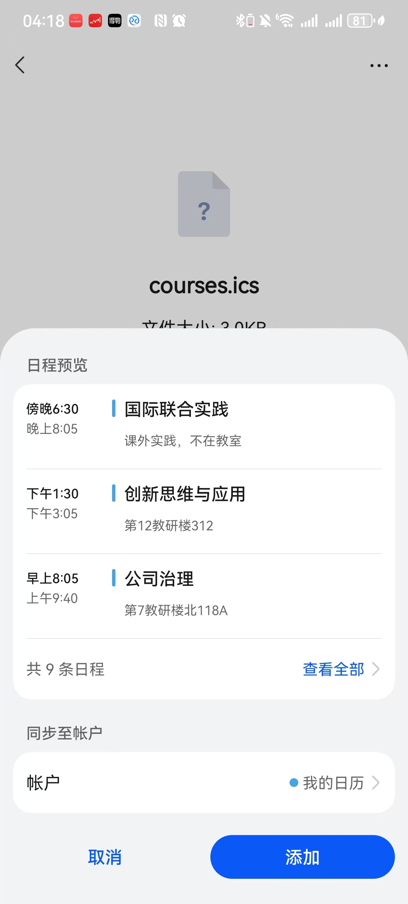

# 日程管理 一键导入课程文件

[官网课程](https://www.datawhale.cn/learn/content/382/7919)

## 第一部分：做日程管理——把课程文件转成 ICS 导入手机日历

### 1. 什么时候适合使用

- **学校只发了 PDF 或 Excel 课表：**把整学期课程批量加入日历。
- **课表是图片或截图：**先让 AI 识别，再检查课程名称、周次和教室。
- **单双周课程较多：**将每次上课转换成具体日期，减少重复录入。
- **想统一查看课程和个人安排：**把课表导入系统日历，并单独放进“课程表”日历。

AI 可能看错图片、周次或日期；导入前要核对原课表。

### 2. 把课程文件转成日历的基本环节

| 步骤 | AI 或工具做什么 | 人要确认什么 |
| --- | --- | --- |
| 1. 准备课表 | 读取 PDF、表格或清晰截图 | 学期、开学日期是否明确 |
| 2. 提取课程 | 整理课程名、星期、节次、周次和地点 | 图片识别和单双周是否准确 |
| 3. 补全时间 | 根据学校作息表换算上课起止时间 | 节次对应的具体时间 |
| 4. 生成 ICS | 按具体日期生成课程事件 | 是否漏课、错课或误加假期课程 |
| 5. 导入日历 | 在手机或日历服务中导入文件 | 是否选对日历、是否出现重复 |
| 6. 试查并修正 | 检查日历显示结果 | 随机抽查首周、单双周和最后一周 |

### 3. 核心方法与规范

- **先补齐关键日期。**至少确认学期第一周周一的日期、课程周次范围和学校节次时间表；缺少信息时先补充，不让 AI 猜。
- **优先生成具体上课日期。**单双周、节假日和调课容易出错，逐次生成比设置重复规则更方便初学者核对。
- **把课表放进独立日历。**例如新建“课程表”，出错时更容易查找、关闭或批量删除。
- **ICS 是日历交换文件格式。**文件通常以 ` .ics ` 结尾；导入后是日程副本，源课表变化时通常不会自动更新。
- **不要把“导入”当成“同步”。**如果要持续同步，需要日历订阅链接；单次 ICS 文件导入不会自动跟随课表更新。

### 4. 产品组合推荐

最小组合是一个能读取课程文件并输出文本或文件的 AI 工具，加手机自带的日历 App。用哪款 AI 工具取决于你能否上传课表，以及它是否能创建可下载文件；不需要为了完成这件事额外安装多个工具。

- **WorkBuddy：**可在授权目录中读取课表文件，并将生成结果保存为文件。打开 [WorkBuddy 官网](<https://www.workbuddy.cn/>)，授权课程文件所在目录后，指定课表文件，按基础案例中的提示词生成 ICS 文件；如果当前任务无法直接创建文件，复制完整 ICS 内容，保存为 .ics 文件。
- **手机日历：**负责预览和保存课程。导入方式因手机和日历 App 而异，按设备当前提供的入口操作。
- **导入备用方案：**Google 日历官方帮助说明，ICS 文件导入需在电脑上操作；导入后再通过账号同步到手机。iPhone 可按 Apple 支持文档，从邮件导入 ` .ics ` 文件。

### 5. 基础案例：把一学期课程表导入手机日历

准备课表文件、学期第一周周一日期、节次起止时间，以及学校公布的调休或停课安排。不要把包含学号等不必要个人信息的文件上传给不信任的工具。

#### 第一步：准备输入

在课表文件中确认每门课的名称、星期、开始和结束节次、起止周、单双周、教室。找不到的信息留空并标记“待确认”，不要自行推断。

#### 第二步：使用提示词

```text
# 任务
请读取我提供的课程表，生成可导入手机日历的 ICS 文件。

# 输入与处理范围
学期第一周周一：【填写日期】
课程文件：【附件名称】
节次时间表：【填写每节课的开始和结束时间】
校历中的停课、调课日期：【填写；没有则写“未提供”】

# 处理规则
1. 提取课程名、教师、地点、星期、起止节次、周次和单双周。
2. 将节次换算为具体起止时间，时区使用 Asia/Shanghai。
3. 按具体上课日期生成事件；不要自行跳过法定节假日，除非校历明确说明停课。
4. 对缺失或互相矛盾的信息先列出问题，不要猜测。
5. 每个事件包含课程名、开始和结束时间、地点（如有）；每个事件使用唯一 UID。

# 输出格式
优先创建可下载的 courses.ics 文件。
如果无法创建文件，请输出完整、未经省略的 ICS 纯文本，不要加 Markdown 代码围栏。

# 核验要求
生成前后核对课程数量、周次、单双周、首末上课日期和节次时间。
在文件之外列出待确认项及核对结果，不要把解释文字写进 ICS 文件。

# 禁止事项
- 不得编造开学日期、节次时间、地点、周次或调课信息。
- 无法确认的信息标为“待确认”。
- 不得声称文件已导入日历；只有我实际导入后才能确认。
```

如果 AI 返回的是文本而不是文件，将纯文本复制到文本编辑器，保存为 ` courses.ics `。确认文件没有被保存成 ` courses.ics.txt `。





#### 第三步：检查结果

- 对照课表随机抽查至少 3 门课，检查星期、周次、单双周和时间。
- 检查学期首周、末周及校历中的停课、调课安排。
- 用文本编辑器确认 ICS 内容包含日历开始和结束标记，且没有把说明文字混入文件。

#### 第四步：导入并定向修正

在打开方式中选用日历打开，即可导入课程~











## 第二部分：进阶实战

### 进阶实战 1：把考试安排表生成 ICS

适合将 PDF 或表格中的考试时间、地点和科目批量加入日历。

```text
请读取考试安排文件，为每场考试生成一个日历事件，并创建 .ics 文件。
提取科目、考试日期、开始和结束时间、考场、座位号（如有）。
遇到缺失或冲突的信息标记“待确认”，不得猜测。
时区使用 Asia/Shanghai；每场考试生成唯一 UID。
输出可下载的 .ics 文件；若无法创建文件，则输出完整 ICS 纯文本。
另列出考试场数、待确认项，并让我能对照原文件逐项核验。
```

**预期结果：**一个可导入的考试日历文件，以及一份待确认项清单。

### 进阶实战 2：为调课生成补充日程

适合临时换时间或教室，不必重做整学期课表。

```text
请根据我提供的调课通知，生成只包含变更事项的 .ics 文件。
提取原课程、变更后的日期、开始和结束时间、地点及变更说明。
不要改写或删除原课程事件；信息不完整时标记“待确认”并先提问。
输出可下载的 .ics 文件；无法创建文件时输出完整 ICS 纯文本。
最后列出新增事件数量和每项变更，供我与通知原文核对。
```

**预期结果：**一个只包含本次调课事项的 ICS 文件，且每项变更都能对应到通知原文。

## 6. 学习收获

- 能整理课程表生成 ICS 所需的日期、节次、周次和地点信息；
- 能检查 AI 生成的日历文件是否与原课表一致；
- 能区分文件导入、日历同步和订阅更新。

## 参考来源

公众号检索未找到可核验的相关公众号文章链接。本教程使用了已审核的公开案例及官方资料；案例仅用于提炼操作思路，不作为规范或工具能力的唯一依据。

1. 抖音「[ios怎么把课表导入日历快捷指令](<https://www.douyin.com/shipin/7296706914967144487>)」（乐豪数码，2026-05-10；页面呈现互动数字，但字段标签无法确认，热度不可判定）。
2. 抖音「[ios如何将课表导入日历](<https://www.douyin.com/shipin/7277757070743750656>)」（科达通讯温州苍南银泰城店；页面互动数据有限，热度不可判定）。
3. 知乎：[如何向手机自带日历批量添加课程表与生日？](<https://www.zhihu.com/tardis/jm/art/2010280224668022691>)。
4. GitHub：[课表转日历 kebiao2ics](<https://github.com/hc-ui/kebiao2ics>)。
5. 少数派：[把课程表做成通用日历，灵活安排学习计划](<https://sspai.com/post/59694>)。
6. Apple 支持：[在 iPhone 上设置邮件、通讯录和日历账户](<https://support.apple.com/zh-cn/guide/iphone/-ipha0d932e96/ios>)；[在 Mac 上导入或导出日历](<https://support.apple.com/zh-cn/guide/calendar/-icl1023/mac>)。
7. Google 日历帮助：[导入活动](<https://support.google.com/calendar/answer/37118?hl=zh-Han>)。
8. WorkBuddy 官方文档：[产品简介](<https://www.workbuddy.cn/docs/workbuddy/Overview>)。

> 资料访问日期：2026-10-08。手机系统与日历 App 的导入入口可能随版本调整，请以设备当前界面和官方说明为准。
