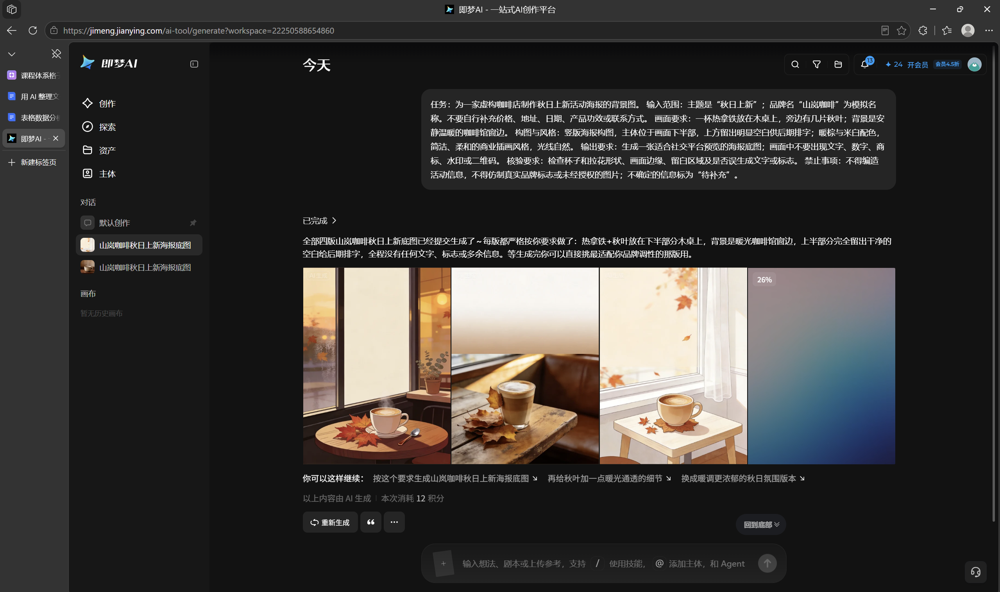
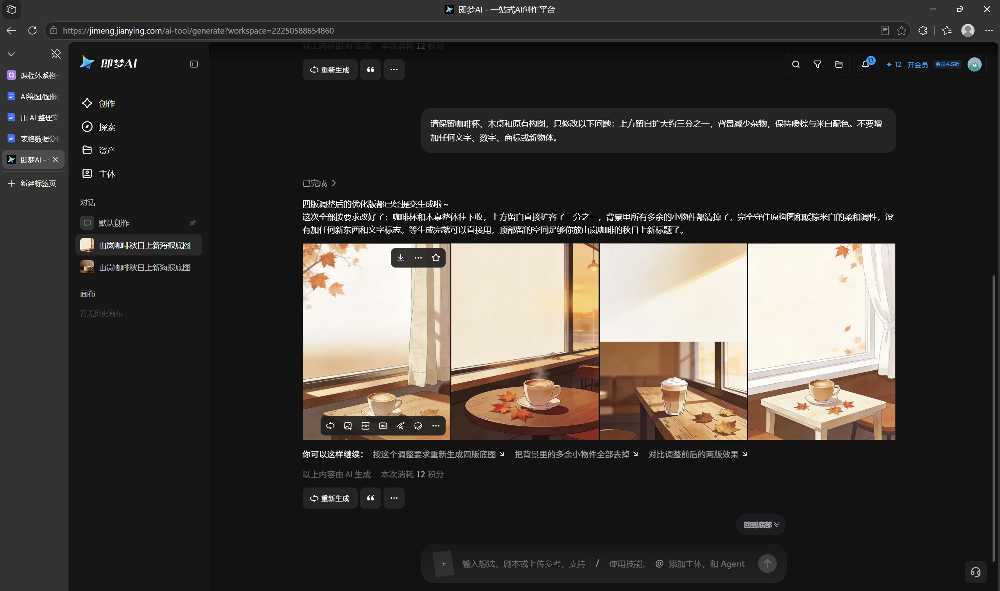

# AI绘图/图像生成

[官网课程](https://www.datawhale.cn/learn/content/382/7920)

## 第一部分：AI 绘图与图像生成

这份入门教程适合没有设计经验、想用 AI 做海报、插画、头像或短视频素材的初学者。你将学会写清楚画面需求、控制基本风格、逐轮修改结果，并在发布前检查素材使用和标识要求。

## 1. 什么时候适合使用

- **活动海报：**先生成背景和主体，再自行添加准确的标题、时间、价格和地址。
- **文章插画：**为科普文章、课程介绍或社交内容生成主题配图。
- **头像与角色设定：**制作个人头像、虚拟角色或故事人物的视觉草图。
- **短视频素材：**生成一张关键画面，再让视频工具补充简单动作和镜头运动。

AI 适合快速探索视觉方向；重要文字、事实信息、人物肖像和商业使用权仍要由你检查。

## 2. AI 绘图的基本环节

| 步骤 | AI 或工具做什么 | 你要确认什么 |
| --- | --- | --- |
| 1. 明确需求 | 整理用途、受众、画幅；海报先列活动主题、时间、地点、亮点和行动方式 | 事实是否准确；缺失信息标为“待补充”，不让 AI 编造 |
| 2. 找参考图 | 可协助提炼参考图的主体、构图、配色和风格特征 | 图片来源和使用权限；明确希望借鉴的视觉特征 |
| 3. 生成提示词 | AI 根据需求和参考图起草提示词 | 自己精简、修正提示词，删掉不需要或互相冲突的要求 |
| 4. 生成画面 | 图像工具生成若干候选图 | 工具入口、可用额度、隐私和授权条款 |
| 5. 选择与修改 | 按反馈重绘或局部调整 | 每轮只改一两个问题，避免整体跑偏 |
| 6. 排版与导出 | 用 Canva 可画等工具添加准确文字并导出 | 检查文字、细节、版权、标识和画幅 |

## 3. 核心方法与规范

**提示词结构：**写清主体、动作、场景、构图、风格、光线和画幅，避免堆词。

**风格控制：**用具体特征描述风格，避免冲突混搭；保持角色一致时固定外观并核对结果。

**逐轮修改：**每轮聚焦一项，说明保留什么、修改什么。

**文字与版权：**文字后期排版核对；素材先确认授权，商用先查平台条款。发布时按要求标识 AI 内容，不移除标识。

## 4. 产品组合推荐

本教程用即梦完成基础图片练习；需要视频素材时再加可灵。Lovart 可作为多步骤设计和多轮编辑的备选。根据自己的任务选择即可，不必同时注册全部产品。

- **图片主工具：即梦。**适合中文描述下的图片生成及简单视觉探索。[即梦官方入口](<https://www.jimeng.com/>)
- **视频补充工具：可灵 AI。**适合尝试文生视频或图生视频。使用前确认当前账号可用功能和计费规则。[可灵 AI 官方入口](<https://klingai.kuaishou.com/>)
- **多步骤设计备选：Lovart。**适合希望在同一画布中生成和修改多种设计素材的场景；使用前查看服务条款和数据处理说明。[Lovart 官方入口](<https://www.lovart.ai/zh>)

不要把个人敏感照片或未公开的商业资料上传到不熟悉的平台。商业项目需单独核对平台授权范围和素材来源。

## 5. 基础案例：做一张咖啡店秋日活动海报底图

以下练习中的“山岚咖啡”和活动文案均为模拟信息。先生成无文字的海报底图，再用[Canva 可画](<https://www.canva.cn/create/posters/>)等排版工具排入文字，避免错字影响发布。

### 第一步：准备输入

目标是制作一张用于社交平台的竖版海报。先写清模拟活动主题“秋日上新”、受众和发布平台；时间、地点、优惠、联系方式均标为“待补充”，不得让 AI 编造。再找一张自己有权使用的参考图，并说明想借鉴的配色、构图或风格。

### 第二步：让 AI 起草提示词

把活动信息和参考图交给豆包等 AI 助手，让它先生成提示词初稿。参考图只用于说明想要的构图、配色或风格；收到初稿后，你只需删减和修正，不必从空白开始写。

```text
你是图像提示词助手。请根据以下活动信息和我附上的参考图，起草一条可用于 AI 绘图的海报底图提示词。
活动信息：主题“秋日上新”；品牌“山岚咖啡”（模拟）；时间、地点、优惠和联系方式均待补充。
参考图：只提炼配色、构图和风格，不照搬其中的标志、文字或作品。
要求：竖版构图，主体清楚，上方留白；画面不生成文字、数字、商标、水印或二维码。
输出：一条简洁提示词；另列出待补充的信息。不得编造活动事实，避免互相冲突的视觉要求。
```

### 第三步：精简提示词并生成

```text
任务：为一家虚构咖啡店制作秋日上新活动海报底图。
输入范围：主题“秋日上新”；品牌名“山岚咖啡”为模拟名称。时间、地点、优惠、联系方式待补充，不得自行编造。
参考图：只借鉴暖棕与米白配色、简洁插画风和上方留白，不照搬具体作品、文字或标志。
画面要求：一杯热拿铁放在木桌上，旁边有几片秋叶；背景是安静温暖的咖啡馆窗边。
构图与风格：竖版海报构图，主体位于画面下半部，上方留白供后期排字；简洁、柔和的商业插画风格，光线自然。
输出要求：生成适合社交平台预览的无字底图，不出现文字、数字、商标、水印或二维码。
核验要求：检查主体、留白、画幅和细节，确认没有误生成文字或标志。
禁止事项：不得编造信息、仿制真实品牌标志或使用未经授权的图片；缺失信息标为“待补充”。
```




### 第四步：检查结果

- 主体是否清楚，留白是否足够后期排字；
- 是否意外生成了文字、数字、商标或水印；
- 画面比例是否符合计划发布的平台，细节是否有明显变形。

### 第五步：定向修正

```text
请保留咖啡杯、木桌和原有构图，只修改以下问题：上方留白扩大约三分之一，背景减少杂物，保持暖棕与米白配色。不要增加任何文字、数字、商标或新物体。
```



### 第六步：排版、保存与复用

保存最终图片、提示词和修改记录。可用 [Canva 可画](<https://www.canva.cn/create/posters/>)等排版工具手动添加已确认的活动文字；发布前复核文案、平台 AI 内容标识和图片授权。下次制作同类海报时，只替换主题、主体和配色，不沿用未核实的信息。

## 第二部分：进阶实战

### 进阶实战 1：设计一个风格统一的虚拟角色头像

练习固定人物特征和画面风格，生成头像草案；不要使用他人照片来冒充本人或制作误导性身份素材。

```text
任务：为虚构角色“小禾”生成一张方形头像插画。
角色设定：短发青年，圆框眼镜，穿浅绿色外套，表情自然友善。每次生成都保留这些外观特征。
画面规则：胸像，正面视角，浅米色纯色背景，扁平插画，深绿色细线条，柔和配色。画面只出现一个人，不加文字、徽标、水印或装饰边框。
输出格式：一张 1:1 头像候选图。
检查要求：核对人物数量、眼镜、发型、服装颜色、五官比例和背景干净程度；有偏差时只修改对应细节。
禁止事项：不模仿具体艺术家的独特风格，不使用未经授权的真人照片或角色形象，不编造授权信息。
```

**预期结果：**一张主体清楚、设定要素齐全的虚构角色头像草案，并保存提示词及选图理由。

### 进阶实战 2：让静态插画变成短视频素材

使用自己生成或已获授权的插画，练习描述简单动作和镜头运动，避免一次要求太多动作。

```text
任务：将我上传且有权使用的咖啡插画制作成 5 秒竖版短视频素材。
输入范围：只使用当前上传图片中的咖啡杯和桌面场景，不新增人物、品牌或文字。
动作与镜头：热气缓慢上升，窗外树叶轻轻摆动；镜头平稳缓慢推近咖啡杯，主体保持在画面中央，动作幅度小，光线和原图配色保持一致。
输出格式：一段 9:16、约 5 秒的短视频，不添加配音、字幕或音乐。
核验要求：检查杯子形状是否稳定，运动是否自然，画面是否闪烁、出现多余物体或未经要求的文字。
禁止事项：不得把生成画面描述为真实拍摄；不得添加未提供的品牌、活动信息或人物。
```

**预期结果：**一段主体和风格基本稳定、只有热气与树叶轻微运动的竖版视频素材；生成效果需实际运行后检查，不预设工具必然达到该效果。

## 6. 学习收获

- 能够把海报、头像、插画或视频素材需求拆成可执行的提示词；
- 能够依据构图、风格和细节问题逐轮修改，并检查输出；
- 能够在发布前核对文字、素材授权、平台条款和 AI 内容标识。

## 参考来源

- 即梦：[官方产品页](<https://www.jimeng.com/>)（图片与视频创作入口及能力说明）。
- Lovart：[新手项目指南](<https://www.lovart.ai/docs/getting-started/design-your-first-project>)；[服务条款](<https://www.lovart.ai/statement/d705ff351b5840b9a4bea502e8919b39>)。
- 快手：[可灵 3.0 系列发布资料](<https://ir.kuaishou.com/zh-hans/node/11216/pdf>)。
- 国家互联网信息办公室等：[《人工智能生成合成内容标识办法》](<https://www.cac.gov.cn/2025-03/14/c_1743654684782215.htm>)。
- 最高人民法院知识产权法庭：[人机共生背景下 AIGC 可版权性的司法判定](<https://enipc.court.gov.cn/zh-cn/news/view-5662.html>)。
- 可灵 AI 公众号文章线索《可灵AI入门教程：5分钟生成第一条短视频》：[可访问的二次整理页面](<https://www.dbyun.net/tutorial/9531>)。原公众号页面与互动数据未能核验，仅参考其入门讲解角度，不作为功能或法律事实依据。
- 其他教程写法参考：[即梦新手教程](<https://www.jiaochengshe.com/aigc/aijiaocheng/2026-08-17/607.html>)；[通义千问文生图教程（页面标注来源为公众号“IT小舟”）](<https://post.smzdm.com/p/agol284w/>)；[优设 AI 绘画提示词教程](<https://www.uisdc.com/prompt>)。公众号互动数据均不可见。
