# 31 视频生产：把拍过的素材更快变成可发布的视频

[官网课程](https://www.datawhale.cn/learn/content/382/7922)

## 01｜这份内容能帮我解决什么？

## 我遇到的问题

我遇到的问题不只是不会剪辑，其实，我一直有视频输出的想法。自己学到的知识、参加的活动、正在做的事情，都希望通过视频分享出来。

我也尝试过剪映，但对我来说，上手还是有些难度。哪些地方需要加速、哪些片段应该删掉、怎样把不同素材接起来，都需要自己一点点编辑。于是，每次拍了很多素材，虽然想剪，却常常卡在工具的使用上，没有继续往下做。

更让我在意的是时效性。有些内容明明应该及时发，但因为剪辑不顺畅，一拖就是很久。等到终于想起来处理，才发现已经过了适合发布的时间。

> 不是没有素材，也不是没有表达的想法，而是从“我想发”到“我能发”之间，有一个一直迈不过去的门槛。

后来，我尝试用 Codex 配合 ChatCut 做视频。这个过程中让我感受很明显的是：原来可以直接用自然语言描述想要的效果，让 AI 帮我理解和处理素材、判断哪些地方需要剪掉，再完成剪辑、字幕和配乐。我不必一开始就自己操作好每一个细节，而是先看到一个版本，再告诉它哪里需要调整。

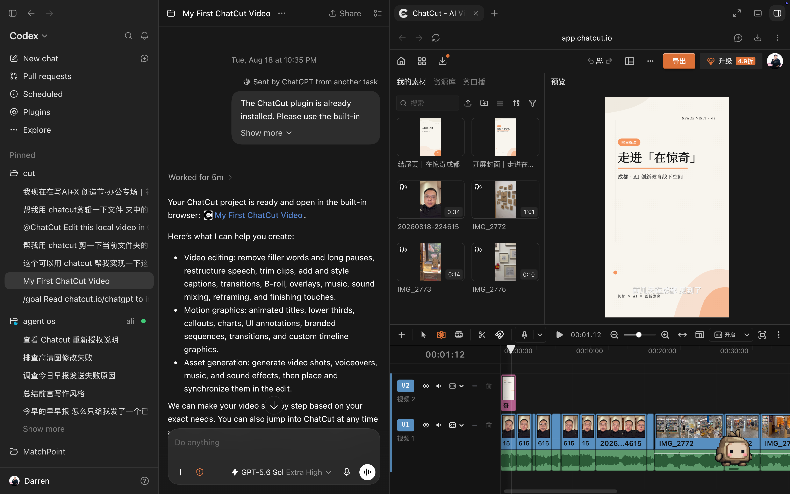

而且，我对很多视频并不要求特别精美。内容准确、表达清楚、观看顺畅，能够在合适的时候发出去，对我来说就已经很有价值了。通过这种方式，我觉得剪辑速度、效果和时效性都更符合自己的需要。本次内容希望能够帮助大家同样解决这样的问题。这是我使用 AI 后剪辑的视频，相比之前高产了特别多


## 本次要完成的任务

选一组你已经拍摄、但尚未整理发布的同主题素材，借助 AI 完成内容取舍、初版剪辑和必要修改，形成一条达到自己发布要求的视频。

适合有内容输出需求、但被剪辑操作和制作时间卡住的运营、活动组织者、讲师及内容创作者。无需从事对应岗位，也不要求先掌握专业剪辑软件。

第一次练习建议选择主题明确、内容容易核对的短素材。有完整口播的素材和零散现场镜头。

## 02｜开始前需要准备什么？

## 先看懂：在哪里提要求，在哪里看视频

> 本篇使用的是 **Codex＋ChatCut 来实现视频剪辑的功能**。当然你也可以通过常用的工具实现，下面也写了在千问办公中如何接入 ChatCut 实现剪辑功能，workbuddy 等工具同理。

整个流程是，我在 Codex 对话里说明需求，Codex 会调用 ChatCut 完成剪辑操作；我在 ChatCut 编辑器里播放、检查和继续调整视频。对话和编辑器可以并排打开。这里介绍的接法与 ChatCut Desktop 原生桌面编辑器的本地连接不同。

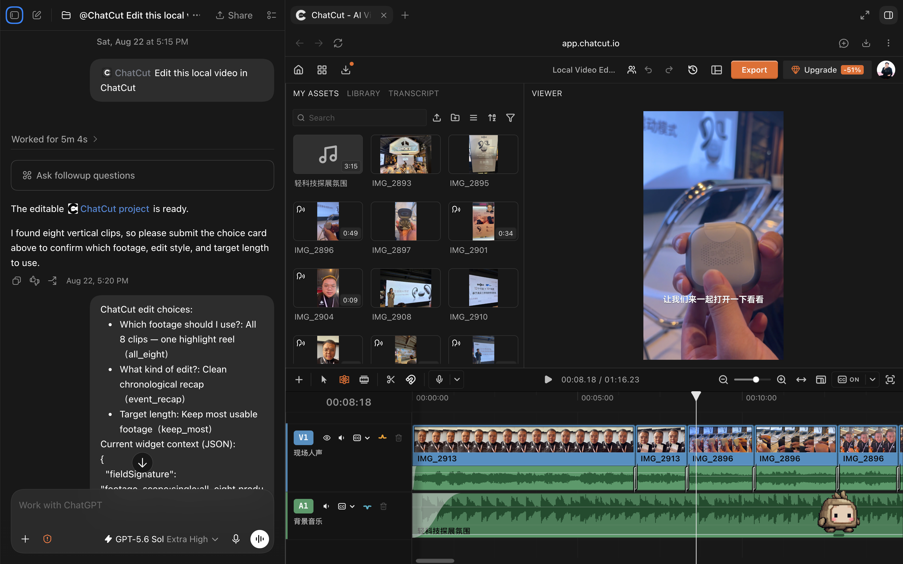

你可以在右侧点击播放按钮，看剪辑内容的效果，有不满意的部分继续在对话里提出修改，也可以自己动手微调。

## 把 ChatCut 接到 Codex

1. 登录 [ChatCut 网页](<http://chatcut.io/zh>)，打开右上角头像菜单中的 **Agent Plugin**。
2. 复制 **ChatGPT/Codex** 对应的安装指引，粘贴到 Codex 桌面应用的新任务中。
3. 按引导，在打开的 ChatCut 官方页面完成登录与授权。
4. 完成后进入新任务，明确说“使用 ChatCut”，再开始剪辑。

可以用这句话检查：

> 请检查当前任务是否能实际调用 ChatCut。能调用的话，列出我可访问的项目；如果不能，请说明是没有加载工具、需要重新授权，还是连接出错。

接通后，再用一小段练习素材试一次导入和播放。能列出项目，和能完整处理视频，是不同的检查步骤。

> **千问办公如何接入 ChatCut：****[如何通过千问办公链接 ChatCut](https://datawhaler.feishu.cn/wiki/LdbPwD9rhib3svktTM7c03ZdnGd)****，接入后，后续的操作也是通过对话的方式完成**


## 03｜怎样一步步完成这项任务？

实际操作时，我通常这样推进：**说明目标和素材 → 看初版 → 改关键问题 → 补字幕与包装 → 导出并准备发布。**

## 第一步：建立项目，讲清楚这条视频想表达什么

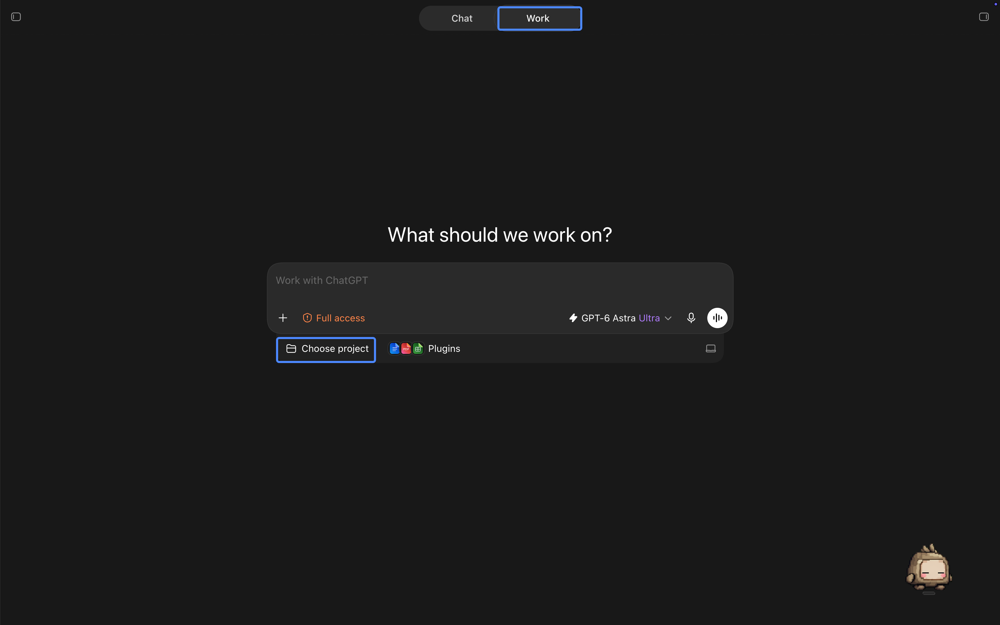

首先先在你常用的工具中选择一个办公空间，我在桌面创建了一个文件夹，名为 cut，这样后续我可以把我所有拍好的素材都放在这个文件夹下，方便 AI 获取信息。

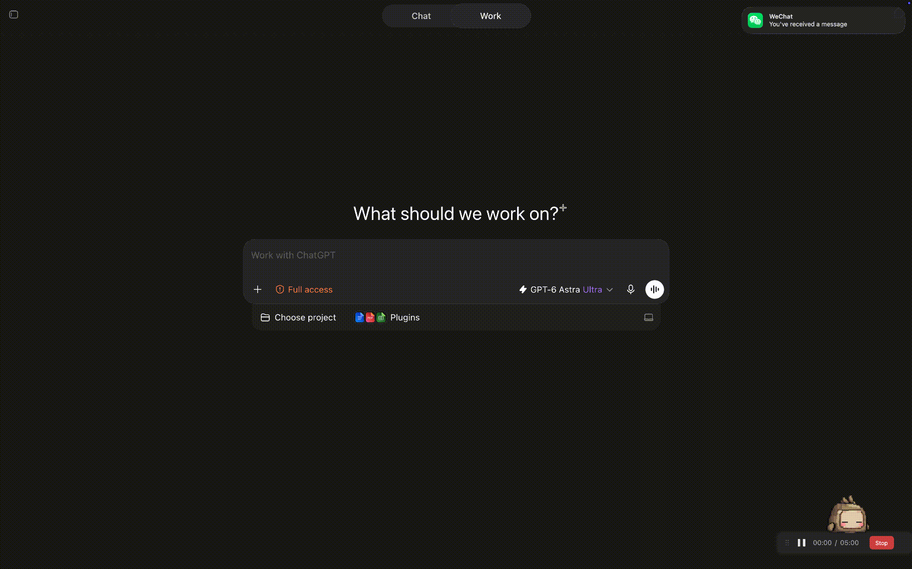

第一次剪探访视频时，我的开场要求很简单：“我现在上传了四个视频，帮我剪成一个视频吧。我计划传到视频号上。”随后，AI 根据素材提出了竖屏探访短片的方向和结构，我确认后开始剪辑。

给第一次练习的朋友，我会建议多补一点信息，让第一版更容易接近自己的想法：

> 请用 ChatCut，把这个文件夹里的四段探访素材做成一条适合手机观看的短视频。
> 
> 
> 
> 
> 
> 
> 
> 观众是对 AI 学习和线下空间感兴趣、但没有去过现场的人。我最想表达的是：这个空间有哪些值得关注的学习方式。请保留我的真实口吻和最有信息量的现场画面。
> 
> 
> 
> 
> 
> 
> 
> 请读取素材中的讲话，并检查与主题相关的画面。按“文件／原片时间段、说了什么或拍了什么、建议用途、保留或缩短的理由”整理给我。

他分析完素材后，会给你一段他的理解与描述，你可以看一下他的理解是否正确

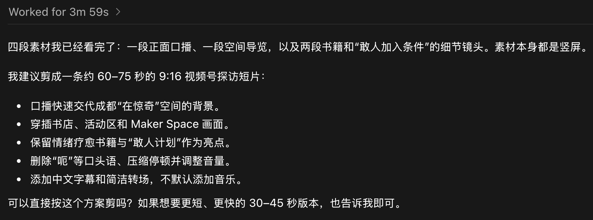

## 第二步：让 AI 把素材变成你能核对的剪辑方案

对于不同素材，AI 均可以充分理解，比如我前几天拍了一个千问办公的操作视频，我同样可以把素材上传之后他来给出建议

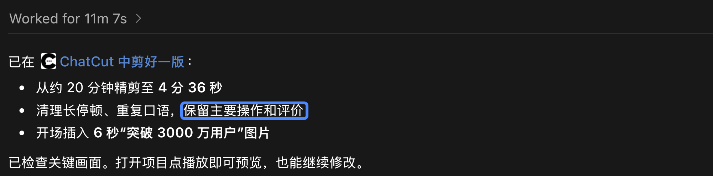

**不同素材，可以这样补要求：**

| 素材类型 | 剪辑重点 | 可以追加的要求 |
| --- | --- | --- |
| 口播、采访 | 观点完整，语气自然 | 删除明显重录和重复解释，保留必要停顿；涉及观点取舍先给我看 |
| 屏幕操作讲解 | 看懂输入、操作和结果 | 压缩加载、等待和无效尝试，保留关键点击与结果；人声保持自然速度 |
| 活动和探访 | 有一条清楚的线索 | 围绕一个发现组织镜头，不按文件顺序简单拼接 |
| 只有现场画面 | 先确定画面承载什么信息 | 我会补充背景；缺少解释时，先提旁白提纲，不替我编造现场发生的事 |

## 第三步：先做出一条可以完整观看的初版

如果你觉得他的分析方向没有问题，可以继续和他说

> 按上面的方向完成初版，完成后告诉我保留了哪些内容、主要缩短了哪些部分，以及初版时长，并打开项目供我播放检查。

他执行完成后会给你一段这样的结果，这时候一般会自动弹出 ChatCut 的 剪辑页面，如果他没有弹出你也可以点击查看

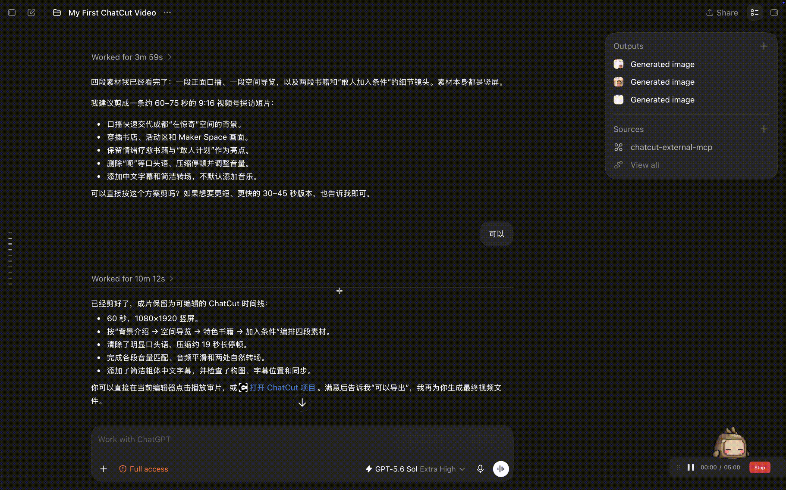

**这一步怎么检查：** 在 ChatCut 里从头播放一遍，先关注内容是否连贯。遇到问题，记下大致时间、那句话，或者那个画面。此时先不用纠结封面是不是足够漂亮。

## 第四步：把观看感受变成可以执行的修改

大致浏览了一遍视频后，你通常会知道哪里看着不舒服。

剪探访视频时，我看完初版说：“结尾那里有点突兀，其余都蛮好。”接下来，AI 延长了最后一个镜头，在话说完后保留一点停顿，不是画面结束后直接黑掉，他给画面和声音增加淡出。之后，我又提出增加开头和结尾页面，让这条视频更完整。

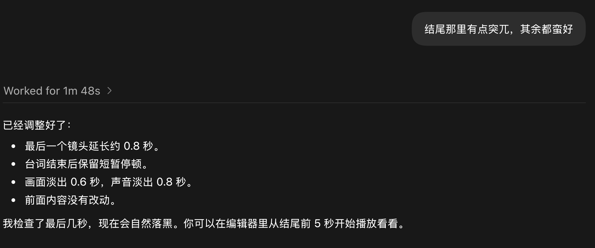

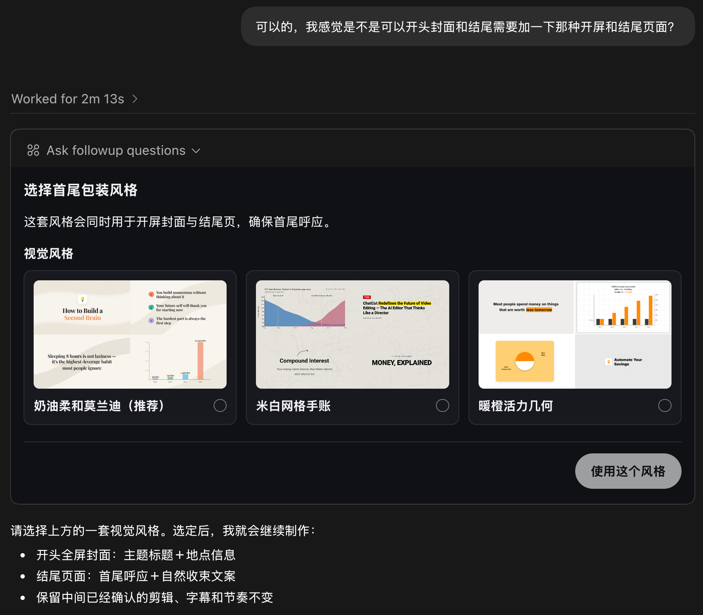

反馈可以整理成一个很实用的句式：**在哪里＋哪里不合适＋希望怎样改＋这次改动范围。**

| 观看时的感觉 | 可以直接说的修改要求 |
| --- | --- |
| 结尾突然停了 | 最后一句话说完后，让现场画面再停留一点，再自然淡出。只调整最后几秒 |
| 开头不知道在讲什么 | 开头先交代本期要回答的问题，以及看完能知道什么，再进入演示 |
| 字幕跳得太快 | 把连贯表达合并成完整语义，避免两三个字频繁切换；检查手机上能否来得及读 |
| 动画还在动，但没新信息 | 大约 1:53—2:15 这一段没有内容推进，请核对实际范围后缩短，并同步后面的声音和字幕 |
| 补充 B-Roll 镜头让人分心 | 撤掉这次新增的补充画面，保留已经确认的主体剪辑和结尾 |
| B-Roll 画面切换不相关 |  |

## 第五步：字幕要能看懂，也要跟内容对得上

一般建议把字幕的产生放到最后，因为这样能够保证你整体视频已经连贯的情况下，充分呈现字幕内容，可以使用类似如下风格的提示词，来规范字幕的效果。

> 请给当前版本加中文字幕。专有名词统一使用：千问办公、n8n、 Agent。
> 
> 
> 
> 
> 
> 
> 
> 字幕按完整语义断句，不要拆得太碎；采用容易阅读的样式，避开人脸和关键操作区域。请检查出现这些专有名词的片段，并标出仍听不清的位置。

词表需要换成你自己的名称、术语和数字。自动转写的文字可能有误，关键内容要对照原声。

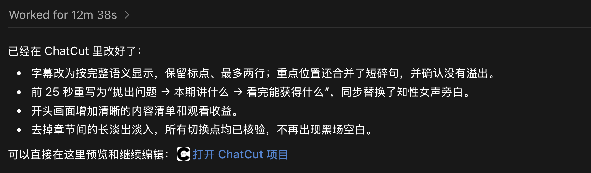

## 第六步：按需要加声音、首尾页面和配图

我的不同视频采用过不同的包装方式。探访视频后来增加了首尾页面；活动视频加入了轻背景音乐；千问办公视频则在成片第 3—9 秒覆盖显示我提供的用户数据图片，同时保留讲解声音。

可以根据缺少的元素告诉 AI 继续操作：

> 给这条探访视频补简洁的开头和结尾页面，沿用同一套颜色与文字风格。开头尽快进入内容，结尾自然收住。

> 加一段轻、无歌词的背景音乐，说话时压低音量，结尾与画面一起淡出。先给我确认音乐方向和可能产生的费用。

> 在讲到这张图片对应的信息时插入它，让观众有时间看清，随后回到原来的操作画面。保留相关讲解声音。

这些要求对应不同需求，不用一次全加。插图要与原话相符，音乐要让人声听得清，首尾页面要帮助观众理解主题。配乐的使用范围也应符合实际发布用途。

## 第七步：把封面和发布文字一起准备好

剪完之后，我通常还会继续让 AI 准备封面、短标题和发布描述，这样离真正发布又近了一步。

封面曾经是我反复修改最多的地方。千问办公那条视频先做了一版主题封面，后来尝试加本人形象，再改成卡通风格。过程中出现过表情不自然、人物比例夸张、不像本人等问题，最后回到原始人像参考，调整成了轻卡通效果。

做人物封面时，提前给一张自己认可的照片，比让 AI 随便从讲话画面中抓一个瞬间更省返工。

> 请根据最终视频内容，准备一张封面、一个短标题和一段发布描述。
> 
> 
> 
> 
> 
> 
> 
> 封面只突出一个主题，人物以我提供的照片为准，保留本人特征，文字不要压住脸。先给我一版构图，不需要一次生成很多版本。
> 
> 
> 
> 
> 
> 
> 
> 标题和描述用真实体验的口吻，不增加视频里没有的结论。封面尺寸按我提供的发布入口要求制作，并检查裁切后的标题与人物是否完整。


我们也遇到过封面比例不符合发布入口的情况。因此，**视频画幅、封面比例和平台上的实际裁切，要分别确认。横屏视频的封面不一定也是同样比例，也不要把某一次使用的尺寸当成所有平台的固定标准。**

## 第八步：确认最终版本，再导出发布文件

千问办公那条视频最后，我确认封面后说：“视频可以导出了，我要先发到抖音上。”最终交付整理成了一个文件夹，里面有视频、封面和独立字幕。

自己在联系时，可以这样提出交付要求：

> 当前版本已确认。请把这条时间线导出为 MP4，保留中文字幕。
> 
> 
> 
> 
> 
> 
> 
> 等渲染完成后给我下载文件，并把视频、最终封面、发布文案放在同一个交付文件夹。有独立字幕的话也一起保存。请列出实际生成的文件，检查时长、画面、字幕和音轨。

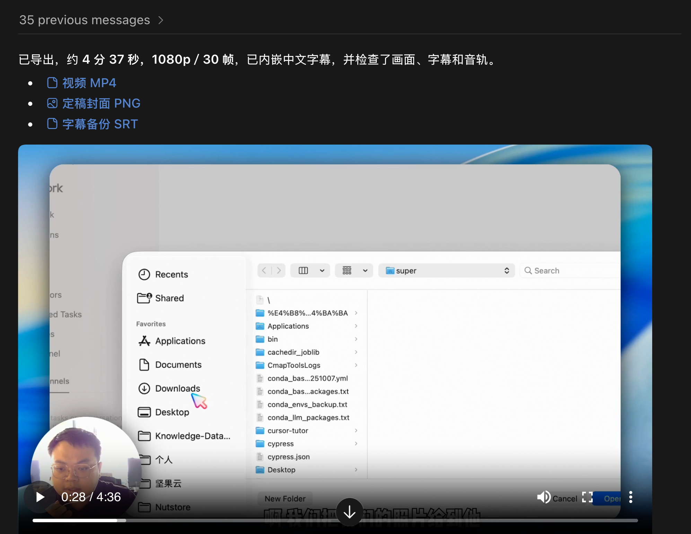

文件可以这样整理：

```text
本次发布素材/
  视频-最终版.mp4
  封面-最终版.png
  字幕.srt
  发布文案.md
  项目链接与修改记录.md
```

## 04｜怎样判断成果已经可用？

我对视频的要求是：内容准确、表达清楚、观看顺畅，能在合适的时候发出去。达到这个标准后，就可以停止为不必要的细节反复返工。

**把导出的 MP4 从头到尾播放一遍**，尤其要听人声、看字幕，而不是只拖动进度条看几个画面。

| 检查方向 | 怎么检查 | 怎样算通过 |
| --- | --- | --- |
| 表达 | 看开头是否说明主题，中间是否有支撑内容，结尾是否完整 | 目标观众能说出这条视频想分享什么 |
| 准确性 | 对照原声核对观点、名字、数字和重要术语 | 没有因为删剪改变意思，没有字幕与原声相互矛盾 |
| 观看体验 | 完整播放，重点听切口、音乐和结尾 | 人声清楚，字幕读得完，没有明显黑场、残音或突然截断 |
| 画面用途 | 在手机上查看，并检查准备使用的上传入口 | 关键操作、人物和标题没有被裁掉或挡住 |
| 发布材料 | 打开最终视频与封面 尺寸等，核对标题和描述 | 文件齐全、版本正确，文字与视频内容一致 |
| 使用范围 | 确认素材、音乐和可公开的信息 | 适合此次发布用途，没有带出不应公开的内容 |

我会特别看三处：**开头有没有给人继续看的理由；中间有没有“画面还在动、信息却没有推进”的部分；最后一句有没有说完整，结尾能不能自然过渡。**

## 05｜下次怎样复用，还能继续学什么？

反复做过几条之后，我会更清楚自己的偏好：真实、自然，不需要很多装饰；原声讲得明白；字幕不要太碎；结尾不要突然停；封面要像我，也要和内容有关。

下次可以直接复用这份模板，替换括号里的内容：

> 请用 ChatCut 处理这组素材。
> 
> 
> 
> 
> 
> 
> 
> 素材位置／已有项目链接：【填写】
> 
> 
> 
> 
> 
> 
> 
> 视频给谁看：【填写】
> 
> 
> 
> 
> 
> 
> 
> 最想表达的一件事：【填写】
> 
> 
> 
> 
> 
> 
> 
> 必须保留的内容或原话：【填写】
> 
> 
> 
> 
> 
> 
> 
> 可以缩短的部分：【填写】
> 
> 
> 
> 
> 
> 
> 
> 发布用途、画幅与大致时长：【填写】
> 
> 
> 
> 
> 
> 
> 
> 需要核对的名字、产品名和术语：【填写】
> 
> 
> 
> 
> 
> 
> 
> 我的偏好是表达自然、结构清楚、人声容易听清。口播不要统一加速，字幕按完整语义断句，结束时保留自然收尾。
> 
> 
> 
> 
> 
> 
> 
> 先读取素材并说明结构；方向明确后推进到可预览初版。接着根据我的反馈修改，再完成需要的字幕、配图和声音。
> 
> 
> 
> 
> 
> 
> 
> 最终交付需要：【视频／封面／短标题／描述／独立字幕，按需选择】。

## 遇到卡点，先判断卡在哪里

| 遇到的问题 | 下一步怎么做 |
| --- | --- |
| 显示已连接，当前任务却不能剪 | 先让 Codex 检查实际可调用的工具；安装或更新后新开任务，再判断是否需要授权 |
| 导入迟迟没完成 | 看清是上传、转码还是转写在等待；检查当前文件状态，再决定是否重试，避免重复上传 |
| 项目里有素材，视频里看不到 | 确认素材有没有放到正确时间线、对应时间段是否有画面 |
| 剪完很短，但关键内容没了 | 回到主题和必留内容，要求恢复必要上下文，再讨论时长 |
| 讲话有残音，字幕跟不上 | 指出具体切口，核对剪辑边界；修改结构后同步检查字幕和声音 |
| 加了画面和动画，反而更乱 | 让每个新增元素说明用途，撤掉不能帮助理解的部分 |
| 封面不自然、不像本人 | 换一张自己认可的人像参考；缩小修改范围，先定构图和人物，再修风格 |
| 导出显示完成，交付还不齐 | 核对下载结果、文件是否存在及能否打开，逐项补齐缺少的文件 |

## 后续可以探索：不露脸的视频，以及同一内容的不同版本

做过已有素材的剪辑后，我还尝试过用讲稿、旁白和动画制作知识视频。这个过程中，仍然需要看初版、判断内容、提出修改。例如开头没有交代清楚看完能获得什么，字幕拆得太碎，或者动画持续了很久却没有新信息，都需要继续调整。

我们也做过把中文横屏内容重新组织成英文竖屏短版的尝试。面向不同观众和观看方式，需要重新选择内容、调整节奏和画面，而不只是替换语言。

这两类任务适合在完成第一条已有素材剪辑后继续练习：先核对讲稿，再制作旁白和画面；先选清楚一条短视频要表达的核心，再考虑生成和包装。

对我来说，最有价值的变化，是有了值得表达的内容之后，我可以快速先把它做出来，再通过一轮轮具体反馈让它变得清晰。

希望大家都能积极对世界发生！
