# 32 数据复盘：小红书账号数据分析

[官网课程](https://www.datawhale.cn/learn/content/382/7924) · [飞书源稿](https://magicyang.feishu.cn/wiki/HWqRwlN7gi7poAkJbCecmqnynOf)

作为自媒体创业者，常常觉得流量是个谜，发同一个热点，为什么其他人的帖子能够火起来，而自己的却不能。创作者平台虽然提供了部分数据，但依然看不透数据背后的原因。这里介绍一个skill：[**social-account-doctor**](<https://github.com/JuneYaooo/social-account-doctor>) **，**你可以对自己的小红书账号或的对标博主账号进行一次详细的账号内容诊断。

> https://github.com/JuneYaooo/social-account-doctor

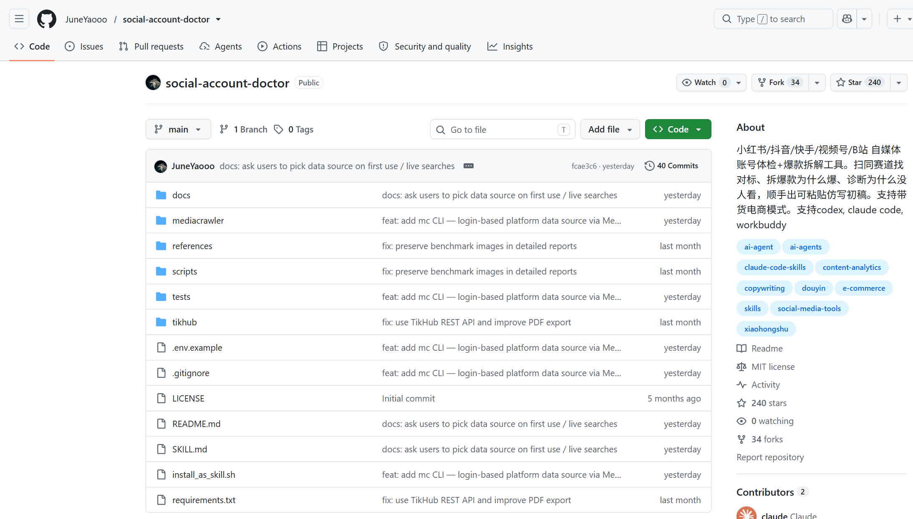

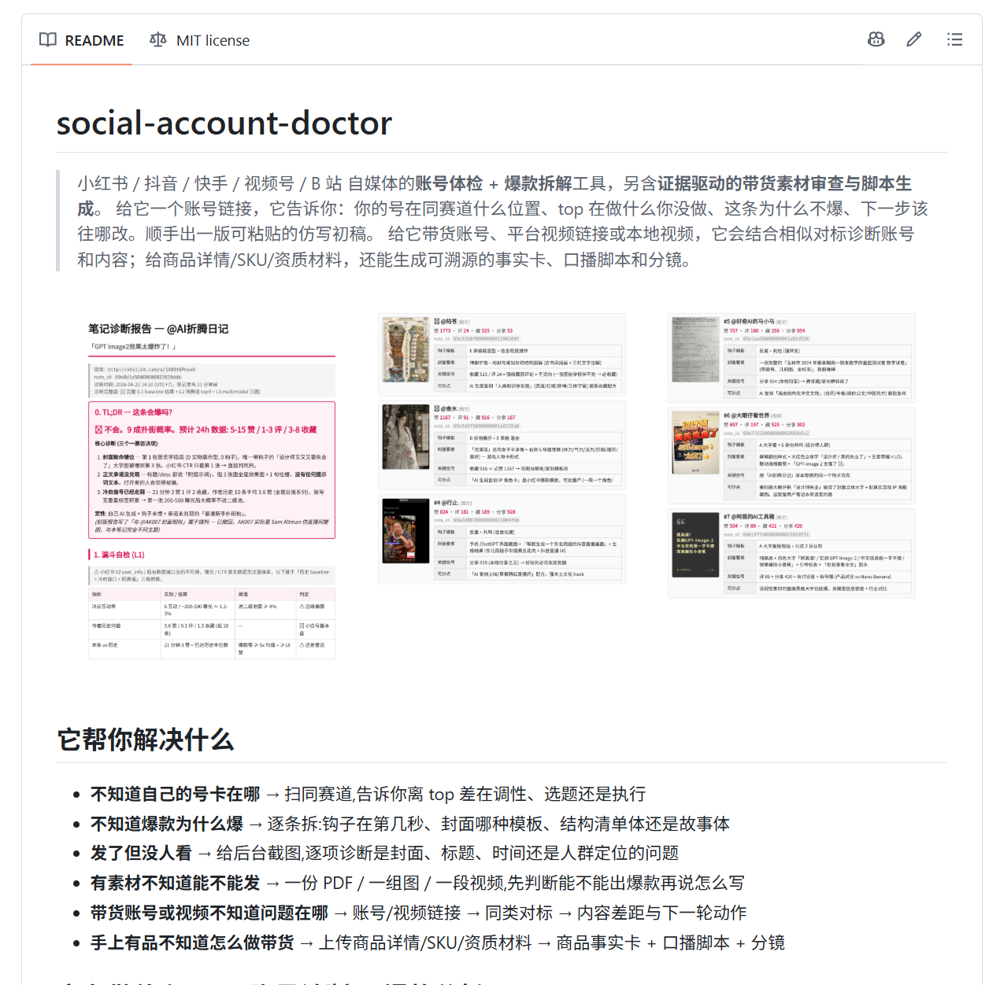

**本次，我们将要完成以下内容。**

| 阶段 | 操作 |
| --- | --- |
| 准备工具 | 安装 Skill配置并验证接口 |
| 分析数据 | 读取账号数据找同类对标拆解内容差异 |
| 使用结果 | 整理复盘和下一步行动 |

---

## 预备篇：这个 Skill 是做什么的

` social-account-doctor ` 是一个**自媒体账号体检与爆款拆解工具**。你给它账号或作品，它会结合公开数据与实际内容，帮助你找到差异和改进方向。

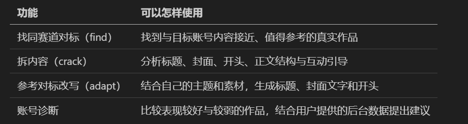

> 这里需注意：这个skill可以抓取到标题、正文、时间及实际返回的点赞、收藏、评论等公开信息。但是无法得到别人的创作者后台曝光、点击率和涨粉。

本次先体验小红书公开数据与内容比较。

## 第一步｜安装 Skill

### 打开 WorkBuddy，新建任务

准备能正常运行 WorkBuddy 的 Windows 电脑，并保持联网。

在本地新建一个文件夹命名，并通过workbuddy的“+”号打开这个文件夹，接下来的操作&amp;各类记忆、产出文档全部存在这个文件夹下。

教程选用的模型是：Deepseek-V4.1-Flash，可以根据自己的情况修改。

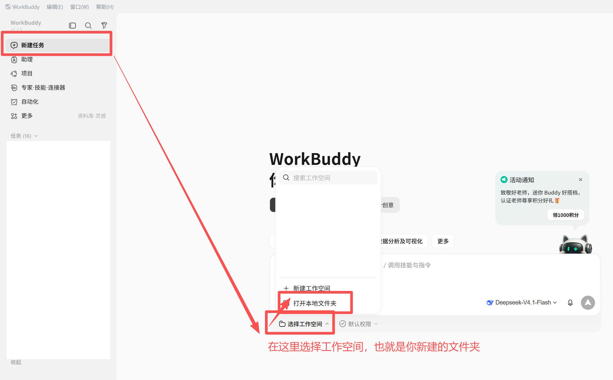

### 等待执行，按提示完成本机操作

复制下面的安装请求：

```text
帮我在 WorkBuddy 里安装 social-account-doctor：
https://github.com/JuneYaooo/social-account-doctor

数据源用 mc —— 扫码登录我本人的小红书账号，不用 TikHub。
依赖和浏览器都装在 WorkBuddy 专用目录里，别碰系统：不装系统 Python / Git / 浏览器，不改 PATH。
装之前先过一遍源码安全审计，重点找硬编码的兜底第三方地址；装完验证工具真能启动。
```

WorkBuddy 如果报告具体错误，就先处理错误，不要继续发送后面的分析请求。**Agent通常都可以自己解决这些问题，只要记住一个核心，“能让我正常使用这个skill”的目标就好，剩下工作交给Agent“自洽”。**

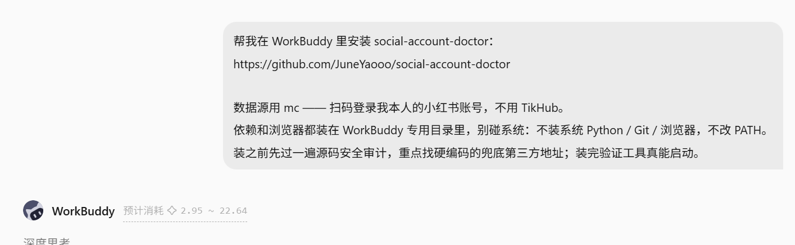

### 检查完成结果，重启 WorkBuddy

【方法一】

在workbuddy左侧目录栏点击“技能”，查看“我的技能”，若出现[**social-account-doctor**](<https://github.com/JuneYaooo/social-account-doctor>)**，则代表这个skill已经安装成功。**

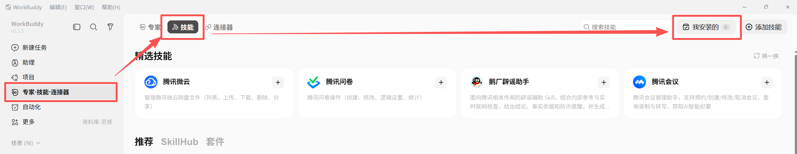

![图片展示的是WorkBuddy左侧目录栏中“技能”下的“我安装的”页面。页面中列出了多个技能，如agent - reach、dwg - inspect等，每个技能旁边都有开关按钮。其中，social - account - doctor技能被红色框突出显示，其开关按钮为开启状态，下方有对该技能的简要说明，即“小红书/抖音/快手/视频号自媒体「\[compose - 素材打包→我对标→拆解数→害自己\]四命令闭环，另交...」”。该图片与上文“检查完成结果，重启WorkBuddy”中方法一的内容相关，用于说明若出现social - account - doctor技能，代表skill已安装成功。](../../public/course-assets/32/img-07.png)

【方法二】

在聊天框输入“/skill”，可以看到已经安装了social-account-doctor这个skill。

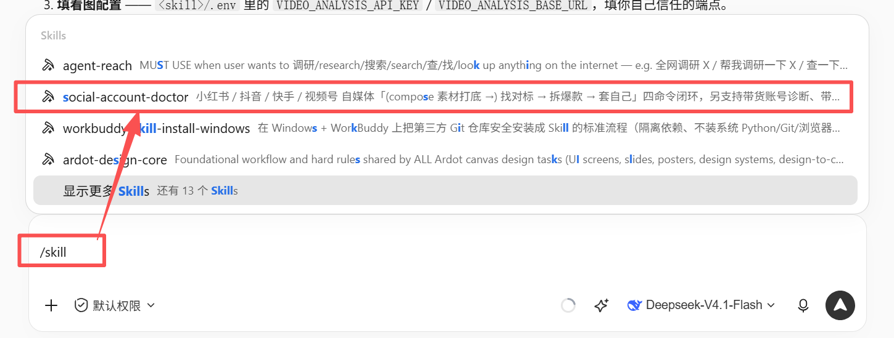

---

然后用下面这句提示词测试是否能够读取该skill的skill.md，顺便在这里可以让AI解读一下这个skill到底是做什么的。复制下面的内容：

```text
请使用 social-account-doctor，简单介绍它能做什么，先不要获取数据。
```

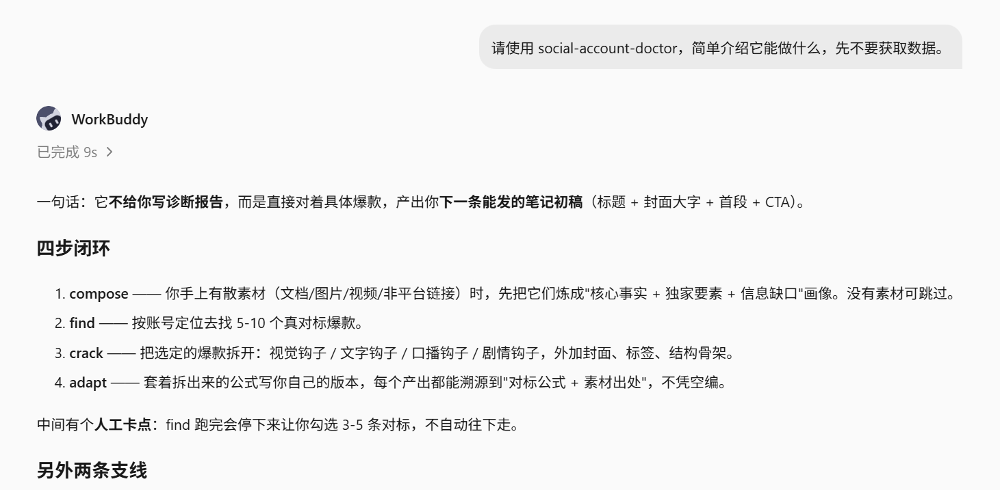

如果能够像图片这样正常给到一些返回内容，就证明skill的具体内容他也读取成功了。

到这里，可以关闭Wokrbuddy，重启进入一下。

## 第二步｜配置接口，做一次真实验证

**这里必须要配置Key，否则会触发小红书风控。**

**这里必须要配置Key，否则会触发小红书风控。**

**这里必须要配置Key，否则会触发小红书风控。**

官方给出的配置要求如下：


本教程**选择新版 mc 路径**：用本人小红书账号扫码获取公开信息，不需要购买 TikHub Key。

> 这里的 **mc** 指的是 **MediaCrawler**，是这个 Skill 为 MediaCrawler 数据采集工具提供的命令入口。它会打开浏览器，让你用自己的小红书账号扫码登录，再根据你提供的账号或笔记链接，读取公开内容及点赞、收藏、评论等数据。

### 配置Key

复制下面的提示词：

```text
帮我配置 social-account-doctor 的看图接口，告诉我当前运行环境中的填写方式，不展示完整密钥。
运行分析脚本前请加载有效配置，不修改系统环境变量。
直接告诉我需要我在哪里填什么。
```

Agent会这样回答，此时把地址栏的内容复制粘贴一下，打开后按自己实际情况填写。


**这三行都要根据实际情况填写（Key，地址，模型名称）**，保证是一个可以支持看图的大模型，教程里采用的是Gemini 3.1 pro。在这里将Key配置好并保存。

### 上传一张测试封面

自己在小红书截取一张公开封面截图，用于检测多模态Key是否配置成功。

复制下面的提示词。

```text
请用 social-account-doctor 的看图脚本分析这张封面，验证接口实际可用；失败就说明错误。
```

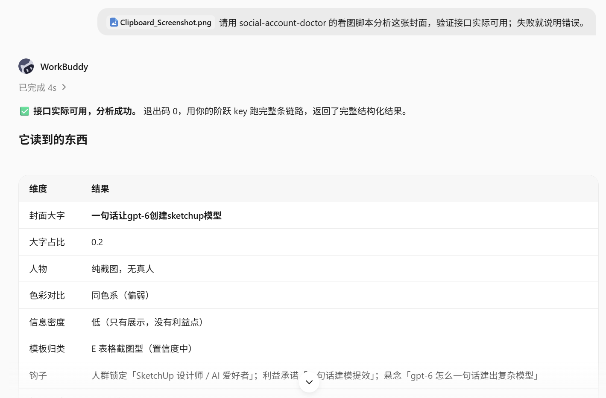

AI给出了“接口实际可用，分析成功”的回答，证明测试成功。

接下来都在当前同一个任务中继续，不反复安装。

## 第三步｜提供账号，先看真实数据

在小红书 App 中打开目标账号主页 →  复制链接。保留完整链接即可。（自己或别人的都可以）

> 扫码账号与研究账号可以不同。研究别人的公开作品不需要对方密码，也得不到对方后台。

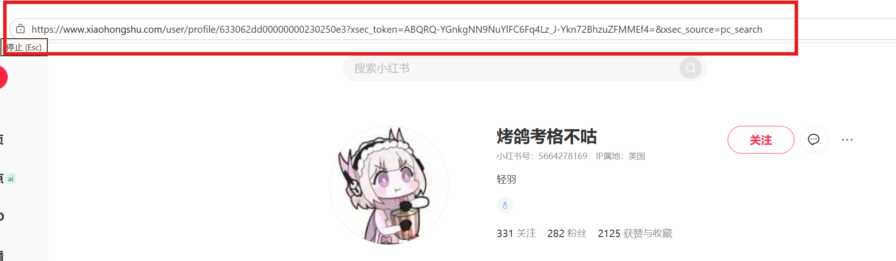

复制下面提示词，注意把要查询的账号地址链接替换到提示词中。注意，这里我们只展示图文，视频阅读会麻烦一些。

```text
用 social-account-doctor 查看这个小红书账号的公开作品数据：[粘贴主页完整链接（红色框中内容）]
用 mc 获取约20篇（只要图文，不要视频）（若数量总数小于20，则全部获取）的小批量样本，展示标题、发布时间、点赞、收藏、评论，保存原始结果；缺失数据注明。
任务完成后，给出运行中产出文件的使用清单，并给出产物。
```

首次会弹出浏览器。用你本人的小红书 App 扫码，在手机上确认，按页面提示完成验证，**并给Agent回复一句“扫完码了”**，保持窗口打开等待结果。

如果一直没有给出数据结果或产物，可以询问AI是否已经整理完成。

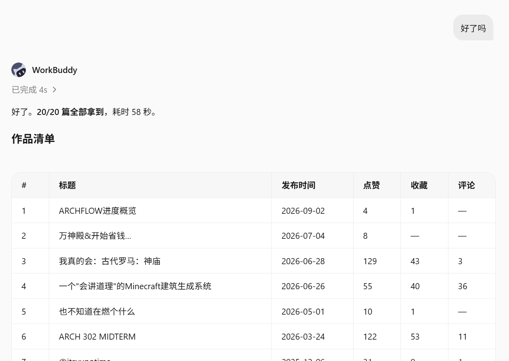

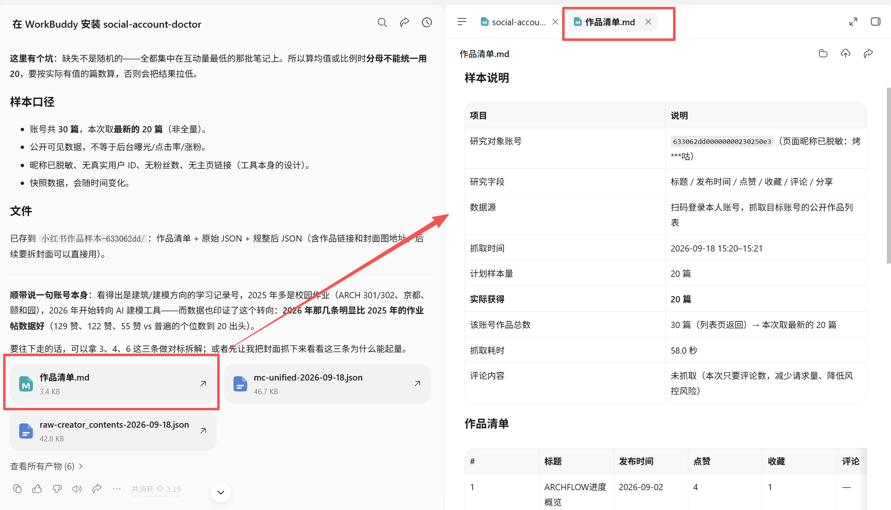

AI会给出一个“作品清单.md”的产出文档，里面的内容就是这个账号被扫描过后的全部数据内容。感兴趣的小伙伴可以在这里直观查看自己的账号发布内容清单。

## 第四步｜找对标，判断哪些内容值得比较

同类内容可以帮助你看见另一种做法，提出新的想法。对标的并不是所有高赞、高收藏内容，而是主题、形式和可能阅读的人群比较相似，可以学习借鉴的内容。

### 扫同类对标

这一步让你看到同类内容的其他做法。对标应该在主题和形式上接近，不只是点赞高。

复制以下提示词，会自动使用“find”功能。

```text
用 social-account-doctor 扫一下刚才这个账号的同赛道。
给我真实候选作品、公开互动数据和入选理由（只要图文，不要视频），等我选择后再继续；优先复用已有材料。
任务完成后，给出运行中产出文件的使用清单，并给出产物。
```

这一步时间可能会有些长，以教程所选账号为例，通常等待5分钟左右。此时，AI会先给出一大段描述的文字，真正结果还需等待，若5分钟后仍然看不到，**需要主动提醒AI，“结果出来了吗”。**

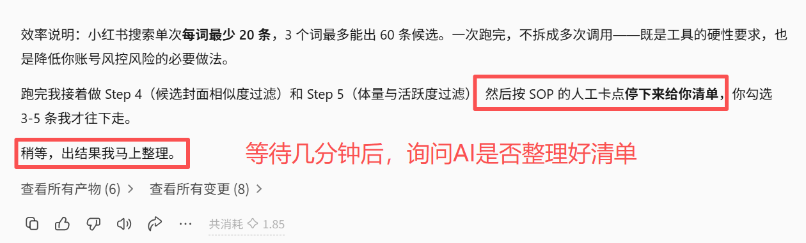

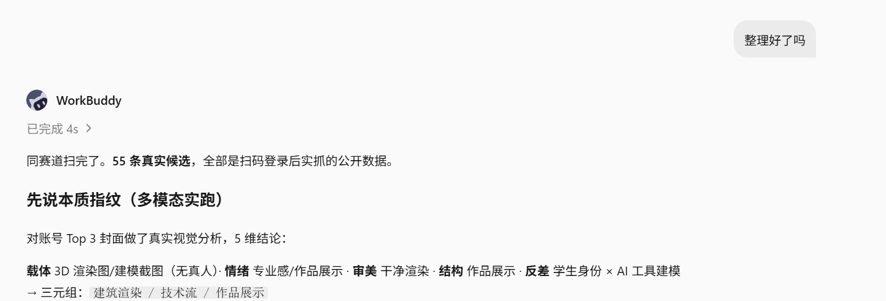

### 打开候选，选3篇

在AI产出的` find-对标候选.md `中找到【六、推荐候选】，选择3-5篇，记住序号，只用将序号发给AI。这里示例选择1,2,3 这三篇。

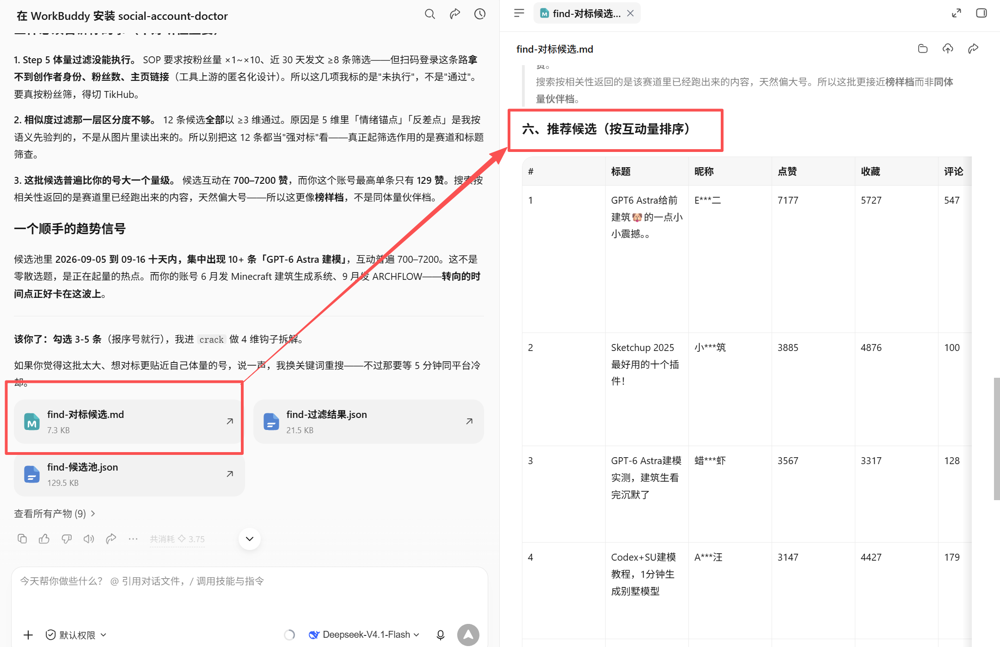

### 拆解内容差异

把下方三个编号替换成刚选定的作品编号，复制提示词。

```text
我选第[编号]、第[编号]、第[编号]篇。
用 social-account-doctor 拆解它们，并与目标账号已有样本中表现较好和较弱的同类作品比较。
告诉我标题、封面、开头和结构有哪些具体差异，附内容证据；缺数据就注明。
```

AI会产出一个拆解对比的文件，可以停下来阅读了解，也可以直接进入下一步。

### 保存结果，看下一步能做什么

复制下面的提示词并发送：

```text
把这次分析整理成公开数据表和简短复盘，保存到当前工作区，告诉我文件位置或下载方式。
复盘分开写数据事实、待验证解释和下一步建议；选一个最值得尝试的改动，说明依据。
给出html版本和详细的md版本。
```

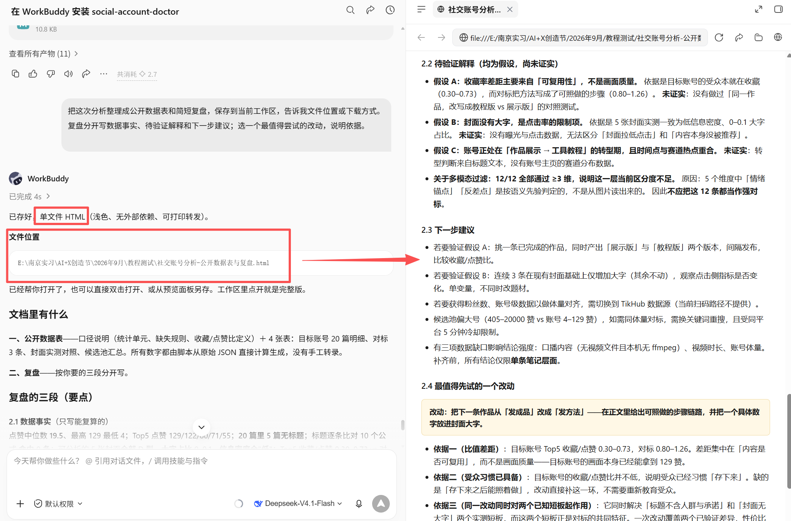

这张图就是最终得出的报告（多种格式，以实际产出为准），可以根据报告及AI回答的内容，了解账号目前的现状，并进行下一步探索。

它能告诉你你现在的处境、与同类优质账号的差距量化在哪、以及最值得先优化哪一处。

最后，可以让Agent再次整理一下整个流程的产物。

## 附：

1、这个skill（social-account-doctor）的Github地址，感兴趣的小伙伴可以研究更多内容~

https://github.com/JuneYaooo/social-account-doctor

推荐和AI交互后尝试【保存钩子库】和【生成下一篇笔记初稿】。

2、Tikhub可以抓取多个自媒体平台的数据，感兴趣的小伙伴也可以继续尝试。

https://tikhub.io/

配置好Key后，可以根据该skill的官方使用说明，完成后续操作。
