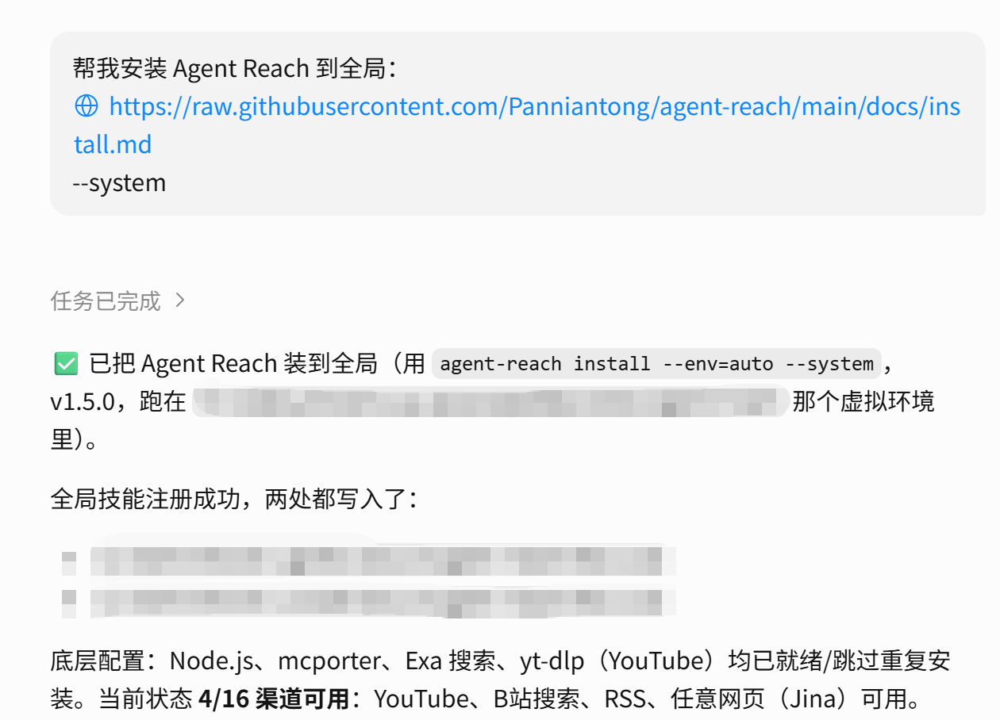
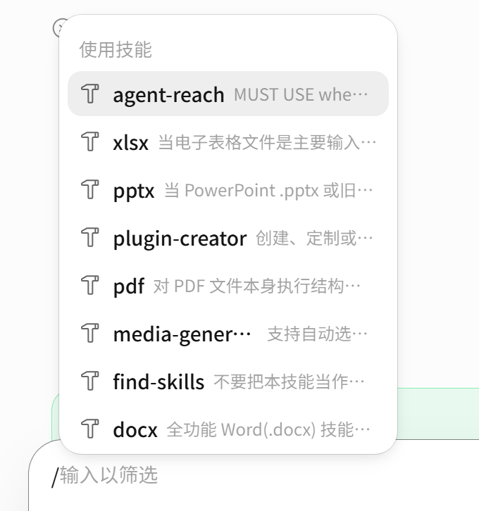
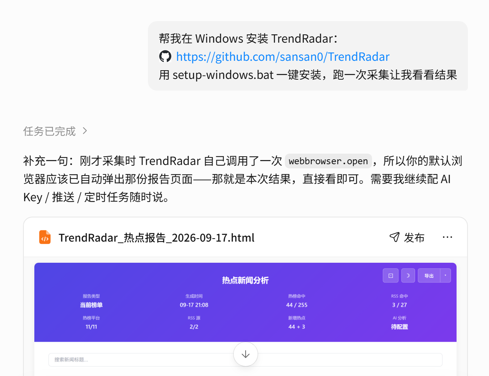
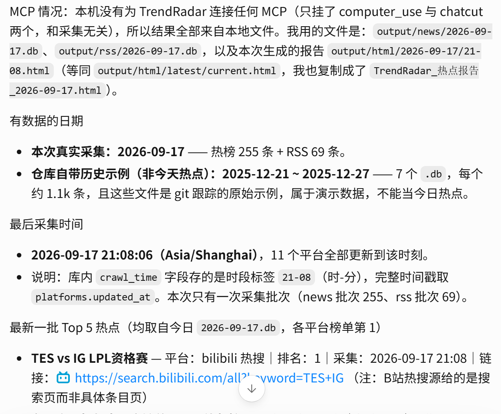
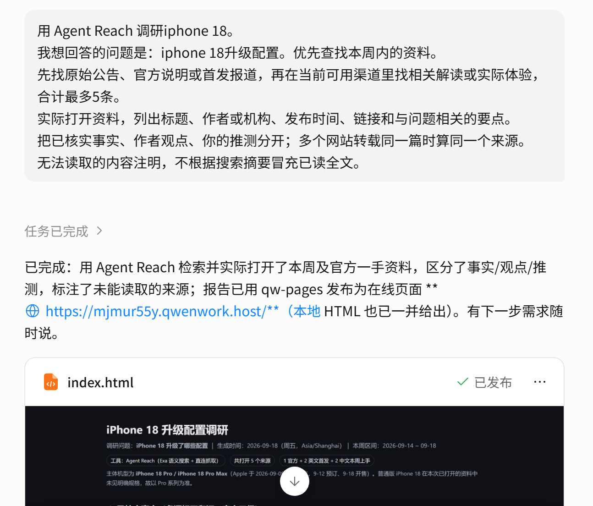
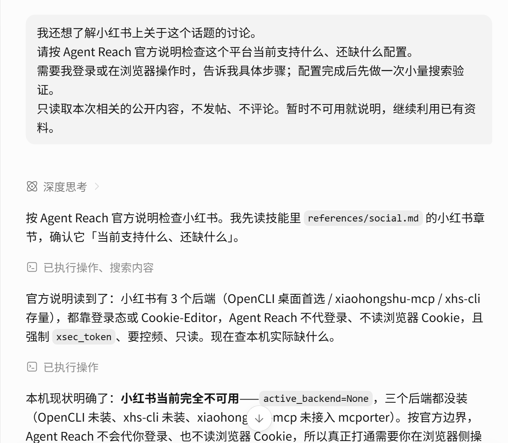
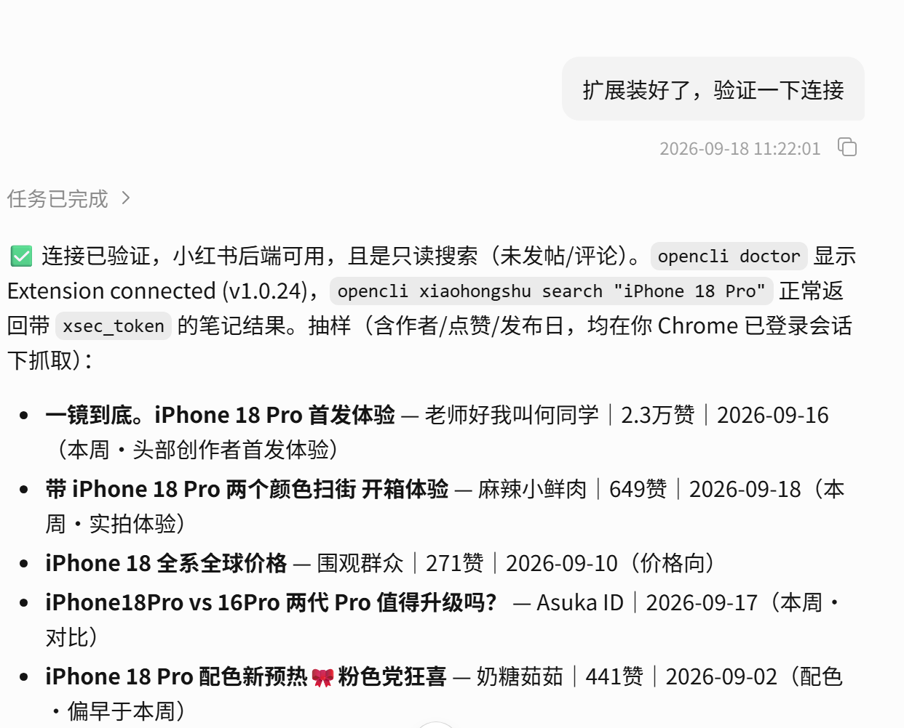

# 选题发现：自动检索热点并找到值得做的选题

[官网课程](https://www.datawhale.cn/learn/content/382/7926)

做自媒体最头疼的就是找选题。热点那么多，不知道哪些值得追，更不知道从哪个角度切入。读完这篇教程，你能用两个工具自动抓取热点、找到原始资料、筛选出真正值得做的选题，最后留下一张**选题清单**和一份**选题说明**。

| 阶段 | 操作 |
| --- | --- |
| 准备工具 | 安装 Agent Reach 和 TrendRadar |
| 查找选题 | 看热点、查原文与讨论、选内容角度 |
| 使用结果 | 保存选题和资料 |

## 第一步｜安装 Agent Reach

## 1. 打开 千问办公，新建任务

复制下面的安装skill提示词：

```text
帮我安装 Agent Reach 到全局：https://raw.githubusercontent.com/Panniantong/agent-reach/main/docs/install.md --system
```

## 2. 按提示完成安装

千问办公会自动检查 Python、下载工具并处理依赖等安装skill的必要环境，遇到具体报错，也会先解决再往下走。当agent回复“安装成功”后，该skill便可以在电脑中的所有agent使用。



## 3. 重启后做一次真实搜索

安装完成后，完全退出并重新打开千问办公。在会话话框输入“/”并输入“agent-reach”，该技能出现在技能栏，回车即可使用技能。



## 第二步｜安装 TrendRadar

上一步安装的 Agent Reach 帮你去网上找资料，而 TrendRadar 可以帮你收集热榜、保存记录，再查看同一话题的变化。TrendRadar 是需要在电脑本地运行的热点工具，官方仓库提供 MCP 接口，并不是和 Agent Reach 一样直接注册的 Skill。MCP 可以理解为连接 AI 与外部工具的"插座"。接通后，AI 就能直接查询 TrendRadar。

| 对比项 | Agent Reach | TrendRadar |
| --- | --- | --- |
| 类型 | Skill（AI 技能） | 独立热点采集工具 |
| 安装方式 | MCP 注册到 AI | 本地运行 / Docker |
| 运行位置 | AI Agent 内部 | 本机或服务器 |
| 核心功能 | 全网搜索、网页阅读 | 热榜采集、去重、推送 |

## 1. 让 千问办公 完成本地安装

这里选择在本机运行，先完成一次采集。复制：

```text
帮我在 Windows 安装 TrendRadar：https://github.com/sansan0/TrendRadar
用 setup-windows.bat 一键安装，跑一次采集让我看看结果
```

当默认浏览器自动弹出采集结果，表明安装成功。



## 2. 确认数据时间，查看前5条

复制下面的提示词：

```text
请检查刚才的 TrendRadar 采集结果，列出实际有数据的日期和最后采集时间。
如果 MCP 已连接，通过工具查询；否则读取本次生成的本地报告，并说明使用了哪个文件。
展示最新一批中的5条热点，包含标题、平台、榜单排名、采集时间和原始链接。缺失字段注明。
区分本次新采集的数据与仓库自带的历史示例，不把示例当作今天的热点。
```

## 3.检查数据的有效性

先看采集时间，再看标题。采集时间说明工具何时看到了这条信息，不等于事件发生时间，也不一定等于文章发布时间。点开一条链接，再核对正文日期。

第一次采集就可以开始看热点；而之后判断该热点"最近一周是否升温"则需要覆盖相应日期的历史记录。

刚装好只有一批数据时，先做当前热点筛选即可。



**过关判断：**至少一个数据源实际返回新数据，结果能回查，且知道 千问办公 是通过 MCP 还是本地报告读取。只显示"连接成功"或只有旧示例，不算完成。

## 装好后，这两个工具能帮我做什么

| 我想做什么 | 主要用谁 | 能得到什么 |
| --- | --- | --- |
| 看目前有哪些相关热点 | TrendRadar | 已接入平台的热榜条目、排名与来源 |
| 看一个话题是否持续出现 | TrendRadar | 在已有采集记录范围内，对比日期和平台 |
| 找原文、视频与相关讨论 | Agent Reach | 实际可用渠道中的搜索结果、正文或字幕 |
| 把信息变成选题建议 | agent配合两者 | 基于真实材料提出内容角度和待核实问题 |

## 两个工具的能力边界

Agent Reach 可帮助读取 GitHub 项目、YouTube 字幕和订阅源；但小红书、Reddit、X 等部分能力**需另行配置登录状态**。支持某个平台，**不等于该平台的所有内容都能读取**。

TrendRadar 尚未实现资讯订阅、跨平台去重、摘要和推送。虽然它也能读取部分文章正文，但本次统一用 Agent Reach 做补充搜索，便于沿用同一套提问方式。两个工具都**不能保证**预测下一条爆款。

## 第三步｜提供方向，先看真实热点

## 1.查找相关领域热点

复制以下提示词，将【】内容替换成自己感兴趣的方向，如"科技"。

```text
用 TrendRadar 查找与【内容方向】有关的热点。
先检查现有数据范围，优先使用今天最新一批；不是今天的数据就明确告诉我。
给我最多10条，列出标题、平台、榜单排名、采集时间和原始链接。
同一事件在多个平台出现时合并展示，保留各平台的来源和排名。
如果使用本地报告，说明它是否经过关键词筛选；找不到就说明，不为凑数补造。先展示结果，不写文案。
```


## 2. 看结果，选一个话题

先找"我能看懂、愿意继续查"的话题。出现的平台多，可以提示它值得关注，但不能据此认定所有用户都在讨论它。不同平台的榜单排名也不能直接当作同一种热度分数相加。

复制以下提示词，将【】内容替换成你的选择。

```text
我选第【编号】条。
请用现有 TrendRadar 记录检查它在哪些平台、哪些时间出现过，附来源。
如果只有一批数据，就只描述当前情况；有多次记录再说明变化，并列出缺失日期。
区分"记录显示的现象"和"你的判断"，不要把缺少记录解释成没有热度。
```

**过关判断：**选中的话题真实存在，有来源和时间；你能说出想进一步回答的一个问题。数据不足时，保留"当前值得了解"的判断，不硬写成"持续升温"。

## 第四步｜用 Agent Reach 查原文与讨论

## 1. 围绕同一个话题找资料

复制以下提示词，将【】内容替换成你要调研的具体内容。

```text
用 Agent Reach 调研【话题名称】。
我想回答的问题是：【具体问题】。优先查找【时间范围】的资料。
先找原始公告、官方说明或首发报道，再在当前可用渠道里找相关解读或实际体验，合计最多5条。
实际打开资料，列出标题、作者或机构、发布时间、链接和与问题相关的要点。
把已核实事实、作者观点、你的推测分开；多个网站转载同一篇时算同一个来源。
无法读取的内容注明，不根据搜索摘要冒充已读全文。
```



便可以获取包含事实、观点和推测的调研报告，来源均可考证。

如果你关心视频里的具体做法，可以补充一个视频链接，要求**读取可用字幕**。若视频无可用字幕，只能分析标题和简介，不能声称看过完整视频。

## 2. 需要小红书等特定平台时，再按需配置

Agent Reach上一步的调研范围为无需登录的平台，如普通网页、抖音、B 站搜索；而对于需要登录的平台，如小红书、Twitter 等），则还需进一步配置。

如果确实需要某个平台的内容，复制以下提示词，将【】内容替换成目标平台名称。

```text
我还想了解【平台名称】上关于这个话题的讨论。
请按 Agent Reach 官方说明检查这个平台当前支持什么、还缺什么配置。
需要我登录或在浏览器操作时，告诉我具体步骤；配置完成后先做一次小量搜索验证。
只读取本次相关的公开内容，不发帖、不评论。暂时不可用就说明，继续利用已有资料。
```





按照agent的提示完成配置。注意：登录由你**本人**完成；无需把账号密码或登录凭据贴agent。若平台配置失败，也可以提供自己打开的文章链接、文字或截图，并注明材料是手动补充的。

**过关判断：**至少有一条可回查的原始材料或可靠报道；已有材料能支持哪些事实、还有哪些问题没有答案，都写清楚。几条网友留言不能代表整个平台用户。

## 第五步｜从一个热点，选出值得做的角度

同一个热点，能否做，取决于**目标读者**需要以及**你已有的证据、素材。**比如同样是工具更新，可以讲新手怎么用、与旧方法有什么差别，也可以做真实体验。

## 1. 让 AI 提出3个角度

复制以下提示词，将【】内容替换成你的具体情况。

```text
结合前面的 TrendRadar 记录和 Agent Reach 资料，围绕【话题名称】提出3个选题角度。
我想讲给【目标读者】听，准备做成【内容形式】。
我现有的素材或经验是：【简述；没有就写暂无】。
每个角度写清：回答什么问题、读者为什么需要、已有依据、还缺什么、一个暂定标题。
附来源，不虚构亲身体验；没有体验材料时，不写成"我实测"。
```

## 2. 选一个你真正能做的

优先选"问题具体、证据够用、素材能补齐"的角度。

复制以下提示词，将【】内容替换成你的选择。

```text
我选第【编号】个角度。
把它整理成一张简短选题卡：目标读者、核心问题、已有证据、内容顺序、待补素材和待核实事实。
告诉我开写前最需要完成的一件事。先不生成完整成稿。
```

**过关判断：**你能说清"讲给谁、回答什么、依据在哪、还缺什么"，而不是只剩一个热闹的标题。

## 第六步｜保存选题，把资料留给下一次创作

这一步是明确要求 AI 保存文件。不能因为它在聊天里展示了表格，就认为电脑上已经有文件。

复制以下提示词，将两个【】内容替换成保存地址和今天的日期。

```text
把本次已核实材料整理成选题清单和简短选题说明。
清单包含3个候选角度、目标读者、核心问题、主要来源链接、资料日期、采集时间、待核实事项和是否选用。
说明中保留我选中的选题卡，标出事实、观点和创作建议；保留 TrendRadar 的实际数据范围和 Agent Reach 的实际读取情况。
只整理已经得到的结果，不为填满表格补造信息。
将选题清单和选题说明保存到【桌面的热点选题练习文件夹】，不覆盖已有文件。
清单存为中文 Excel 能正常打开的 CSV；说明存为 Markdown，并列出原始资料链接。
文件名加上今天的日期【例如：2026-09-17】，告诉我文件绝对路径。
```

**过关判断：**文件能打开、关键说法有依据，你能说出一个值得继续做的选题及下一步。完成练习不要求当场发布内容。

## 拓展阅读｜需要时再增加能力

熟悉主流程后，可以让 Agent Reach 增加自己经常使用的平台；给 TrendRadar 添加资讯订阅源、积累连续日期的数据，再练习周度比较。资讯订阅源（RSS）可以理解为网站提供的更新列表。

想每天收到简报时，再配置定时运行与飞书等通知渠道。本机工具需要在约定时间实际运行才会产生新记录。TrendRadar 独立运行的 AI 筛选、分析和翻译需要另行配置模型接口，用量与费用以你选择的服务为准。
