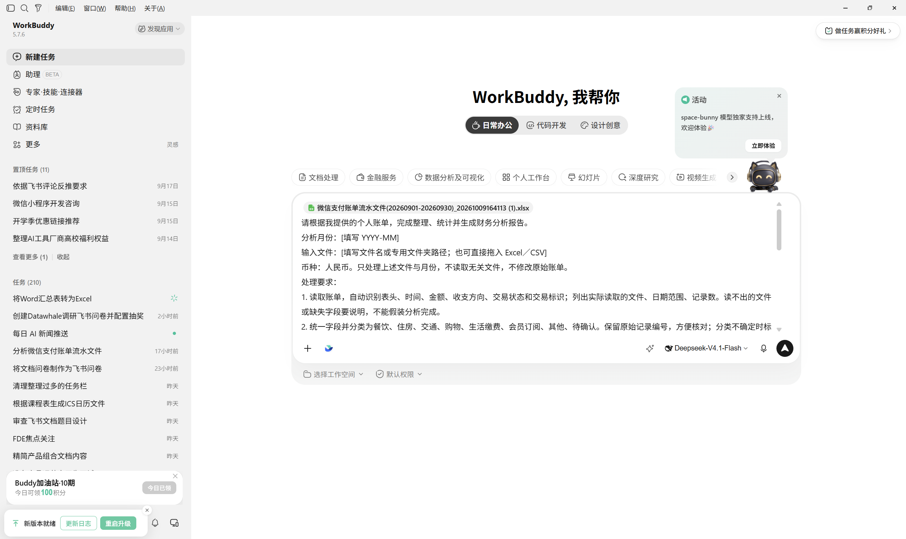
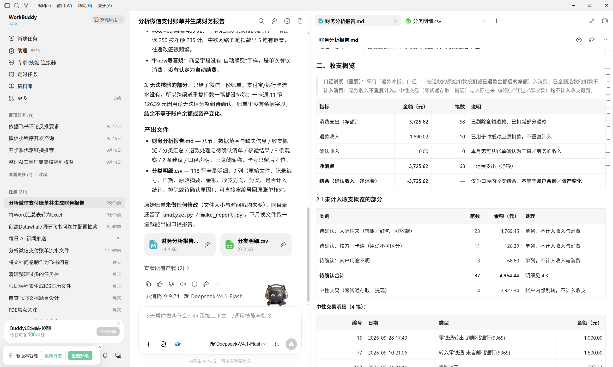

# 36 依据个人账单生成财务分析报告

[官网课程](https://www.datawhale.cn/learn/content/382/7946) · [飞书源稿](https://datawhaler.feishu.cn/wiki/TJSLwdRBfi5YgskcSHPcecrvnse)

## 第一部分：依据个人账单生成财务分析报告

适合希望看清“钱花在哪里”的初学者。通过整理一个月的个人账单，完成一份包含收支汇总、消费结构和改进建议的月度报告。

## 1. 什么时候适合使用

- **月底复盘：**查看本月主要开销，找出值得调整的支出。
- **合并账单：**统一整理微信、支付宝和银行卡记录，避免只看到一个平台的消费。
- **检查扣费：**查找重复付款、大额消费和疑似周期性扣费。
- **制定预算：**根据实际支出，安排下个月的消费额度。

账单只能反映已提供的交易。没有完整的账户余额、资产和负债资料，就不能据此判断净资产或整体财务健康。

## 2. 账单分析的基本环节

| 环节 | 怎么做 | 检查重点 |
| --- | --- | --- |
| 1. 导出账单 | 导出同一个月的微信、支付宝账单；需要时补充银行流水。 | 时间范围一致，账户没有漏选。 |
| 2. 提交任务 | 把文件拖入 WorkBuddy，填写月份并粘贴下方提示词。 | 文件能读取，范围说清楚。 |
| 3. 整理与统计 | 让 AI 识别字段、去重、分类，单独处理退款和转账。 | 有疑问的交易标为待确认。 |
| 4. 生成报告 | 输出财务分析报告和分类明细。 | 结论有数字和对应记录支撑。 |
| 5. 检查与复用 | 核对结果，有误时定向修正；保存报告和提示词。 | 分类金额对得上，不覆盖原始账单。 |

## 3. 核心方法与规范

1. **先定范围。**从一个完整月份、人民币账单开始；未覆盖的账户和现金支出写入报告。
2. **避免重复计算。**同一平台优先按交易单号核对重复记录。银行卡扣款与支付平台订单可能对应同一笔消费，不能只凭金额相同就删除。
3. **区分资金用途。**本人账户互转不算收入或消费；退款冲减对应消费。借款、还款、投资划转单列，避免混入日常消费。
4. **固定计算口径。**净消费支出＝有效消费金额－对应退款；各类别净支出之和应等于总净支出。本教程的“收支结余”指确认收入减净消费支出，不代表账户余额或净资产。
5. 保护隐私：只提供本次分析需要的账单，不上传支付密码、验证码等信息；尽量移除姓名、账号等身份信息，但保留金额、时间和核验所需的交易标识。本地文件被 AI 读取不等于完全离线处理，使用前了解产品的数据处理规则。不确定的交易标为“待确认”。

跨月退款要说明计入哪个月份，并保持前后一致；无法匹配原消费时单列待确认。

## 4. 产品组合推荐

推荐组合：WorkBuddy 完成账单整理、统计和报告；WPS 仅用于需要时核对明细。

| 产品 | 用途 | 为什么选它 |
| --- | --- | --- |
| [WorkBuddy](<https://www.codebuddy.cn/workbuddy>)：主工具 | 读取导出的 Excel／CSV，按提示词整理数据并生成报告。 | 可直接拖入文件或指定文件路径，减少手动整理步骤。 |
| [WPS Office](<https://www.wps.cn/>)：可选 | 打开原始账单或结果明细，核对可疑记录。 | 方便查看表格，不需要先做透视表。 |

初次练习只分析一个月。只授权访问账单所在文件夹，不提供无关文件；生成的报告仍需自己核对。

## 5. 基础案例：生成一份月度收支报告

练习目标：用一个月的个人账单，生成一份简短的财务分析报告和可核对的分类明细。

### 第一步：准备输入

先导出你要分析的同一个月账单，保留原始文件，不必提前合并或分类。

#### 1. 从支付平台导出账单

选择同一个完整月份，例如 2026年9月1日至9月30日，交易类型尽量选“全部”，保留收入、消费和退款记录。

| 来源 | 操作路径 | 获取的文件 |
| --- | --- | --- |
| 微信 | 我 → 服务 → 钱包 → 账单 → 客服中心或常见问题 → 下载账单 → 用于个人对账 | 按页面提示下载，或从通知、邮件中获取账单 |
| 支付宝 | 我的 → 账单 → 右上角“···” → 开具交易流水证明 → 用于个人对账 | 选择交易类型和日期，按提示下载 Excel 账单 |
| 银行卡 | 在对应银行 App 中查找“交易明细”“流水”或“明细导出” | 优先选择可编辑的表格文件；入口因银行而异 |

不同版本的入口名称和下载方式可能变化，以当前页面为准。收到压缩包时，按官方通知中的说明解压。

优先下载用于“个人对账”的 Excel／CSV 文件；如果工资只在银行卡中体现，再补充对应银行流水。将解压后的文件放在一个专用文件夹，后面的整理交给 WorkBuddy。

[微信支付账单流水文件(20260901-20260930)\_20261009164113 (1).xlsx](../../public/course-assets/36/source-01.xlsx)

### 第二步：使用提示词

打开 WorkBuddy，把导出的 Excel／CSV 文件直接拖入对话，或填写账单文件夹路径并按提示授权。复制下面这一段提示词，替换月份和文件信息后提交。

```text
请根据我提供的个人账单，完成整理、统计并生成财务分析报告。
分析月份：[填写 YYYY-MM]
输入文件：[填写文件名或专用文件夹路径；也可直接拖入 Excel／CSV]
币种：人民币。只处理上述文件与月份，不读取无关文件，不修改原始账单。
处理要求：
1. 读取账单，自动识别表头、时间、金额、收支方向、交易状态和交易标识；列出实际读取的文件、日期范围、记录数。读不出的文件或缺失字段要说明，不能假装分析完成。
2. 统一字段并分类为餐饮、住房、交通、购物、生活缴费、会员订阅、其他、待确认。保留原始记录编号，方便核对；分类不确定时标为待确认，不猜测用途。
3. 排除未产生收支的失败／关闭交易。同平台按交易标识去重；微信／支付宝与银行流水中疑似重复的扣款，只有证据明确时才排除，无法确认的单列说明。
4. 自己账户之间的转账、借款、还款和投资资金往来单独列示，不当作工资收入或日常消费。无法判断的转账标为待确认。
5. 单列退款并尝试关联原交易。原账单已扣减的退款不能再扣一次；跨月退款注明所属月份和处理口径。无法关联时说明限制。
6. 在口径明确的记录范围内计算收入、消费支出、退款、净消费和结余（收入－净消费），并按分类统计净消费和占比。分母为零时不计算占比。金额保留两位小数，用计算工具核算，不凭文字估算。
7. 核验分类金额之和是否等于已分类净消费；列出待确认记录的笔数、金额，以及排除记录和理由。范围不完整时明确标注，结余不等于账户余额或资产变化。
输出：
- 财务分析报告.md：数据范围与缺失信息、收支概览、分类汇总、最多3条有数字依据的观察、最多2条可执行建议、核验结果。
- 分类明细.csv：原始文件和记录编号、日期、原始摘要、金额、收支方向、分类、是否计入统计、排除理由或待确认原因。报告隐藏姓名、账号等身份信息。
无法生成文件时，直接给出对应内容并说明原因，不能声称文件已保存。
不要编造缺失收入、历史数据、资产余额或交易用途；仅凭一次扣费不能认定为自动续费。不提供投资推荐，不自动发送、发布报告或覆盖原始文件。
```



### 第三步：检查结果

打开生成的报告和分类明细，重点检查下面四项。AI 生成文件不代表数字一定正确。

| 检查项 | 怎么判断 |
| --- | --- |
| 读取范围 | 文件、月份、记录数与原始账单一致；遗漏文件有说明。 |
| 统计金额 | 分类金额之和与已分类净消费一致，待确认金额单列。 |
| 特殊交易 | 退款没有重复扣减，自己转账、借还款和重复扣款没有误算为日常消费。 |
| 报告结论 | 每条观察能找到对应数字；没有编造收入或把结余当作资产增长。 |

真实账单的结果如果与平台月报不同，先检查双方是否采用相同的退款、转账和日期口径。



### 第四步：定向修正

发现错误时，指出具体记录和规则：

```text
请只修正以下问题，保留其他正确内容：
- 原始文件／记录编号：[填写定位信息]
- 错误内容：[填写错误分类、重复计入或退款处理等问题]
- 正确处理：[填写你已核实的处理方式及依据]
修正后重新计算受影响的汇总和占比，更新报告与分类明细，并列出修改前后差异。
仍无法确认的信息标为“待确认”，不要猜测，不修改原始账单。
```

### 第五步：保存与复用

- 原始账单文件和生成的分类明细 CSV，分开保存。
- 月度收支报告\_2026-09.md：复核后的报告。
- 分类规则和提示词：下个月沿用相同口径。

真实报告要写明缺失数据。例如：“未包含现金支出及另一张银行卡，因此结余仅代表已提供账单的统计结果。”

## 第二部分：进阶实战

### 进阶实战 1：比较两个月，找到支出变化来源

适合已经完成一次月度分析，希望看清“这个月为什么多花了钱”的读者。

```text
# 任务
比较我提供的两个月已核实账单汇总，找出净消费支出的主要变化来源。

# 输入
【粘贴两个月的月份、类别、消费原额、退款、净支出及数据范围】

# 规则
先检查月份是否完整、账户范围是否一致、分类与退款口径是否相同。
范围不一致时先说明限制，不直接解释为消费习惯变化。
按类别计算：
变化金额＝本月净支出－上月净支出；
变化比例＝变化金额÷上月净支出。
上月为0时不计算变化比例，标注“无可比基数”。

# 输出
1. 可比性检查；
2. 类别对比表；
3. 按变化金额列出主要增加项与减少项；
4. 需要查回明细的项目；
5. 最多2条下月观察建议。

# 核验与禁止事项
各类别变化金额合计必须等于总净支出变化金额。
事实与推测分开，不得凭类别金额判断冲动消费或消费动机。
不编造明细、历史数据或变化原因；无法确认写“待确认”。
```

**预期结果：**一张可以复算的两个月对比表，以及有明确数据依据的变化说明。

### 进阶实战 2：根据实际支出制定下月预算

适合已经核实收入和开支，希望将报告转化为具体行动的读者。

```text
# 任务
根据已核实的月度报告，拟定一份下月预算草案。

# 输入
【粘贴本月类别净支出】
【填写下月预计收入、必须支付的费用、还款、一次性开支和目标结余】
未提供的内容不能自行假设。

# 规则
先列出缺失信息，再区分必须支付、可调整和一次性项目。
必需程度由我确认，不能仅凭类别名称判断。
预算要包含已确认的还款和一次性开支，避免只统计日常消费。
在信息完整时检查：
预计收入－全部计划对外支出≥目标结余。
目标无法满足时说明差额，并提供最多2个调整方案。
不得擅自削减必要医疗、基本生活或到期还款。

# 输出
预算表：项目、本月金额、下月计划、调整理由、待确认事项。
附预算合计、预计结余，以及一周后需要检查的2个指标。

# 核验与禁止事项
展示合计与计算过程。
预算是计划，不是保证能实现的结果。
不得编造收入、还款或开支，不推荐投资产品。
未知信息写“待补充”，条件不足时只输出待完善草案。
```

**预期结果：**一份金额可核对、调整理由明确、需要本人确认的下月预算草案。

## 6. 学习收获

- 导出同一个月的账单，并交给 AI 读取和整理。
- 核对 AI 的分类、去重和退款处理，区分消费与资金往来。
- 能复算月度收入、净消费支出和类别占比。
- 能检查 AI 报告，区分数据事实与未经证实的推测。
- 能完成月度比较，并制定有数据依据的预算草案。

## 参考来源

1. [WorkBuddy 官方：实践三——数据分析并可视化](<https://www.codebuddy.cn/docs/workbuddy/From-Beginner-to-Expert-Guide/Practice-Cases/Practice-Three>)：说明 Excel／CSV 的文件输入与分析报告生成方式。访问日期：2026-10-09；产品能力可能调整，以官网说明为准。
2. iCost 开发者帮助文档：[微信账单导出教程](<https://help.icostapp.com/guide/import/wechat.html>)。提供个人对账申请和文件下载的界面示例；不是微信官方说明。
3. iCost 开发者帮助文档：[支付宝数据导出教程](<https://help.icostapp.com/guide/import/alibao.html>)。提供个人对账和导出范围的界面示例；不是支付宝官方说明。
4. 美国消费者金融保护局（CFPB）：[Spending tracker](<https://files.consumerfinance.gov/f/documents/cfpb_your-money-your-goals_spending_tracker_2018-11_ADA.pdf>)。参考记录支出、分类统计、观察规律后再调整预算的方法。
5. CFPB：[Creating a cash flow budget](<https://www.consumerfinance.gov/documents/10038/cfpb_creating-cash-flow-budget_tool_2021-08.pdf>)。参考收入与支出时间安排的方法；现金流指资金何时流入、何时流出。
