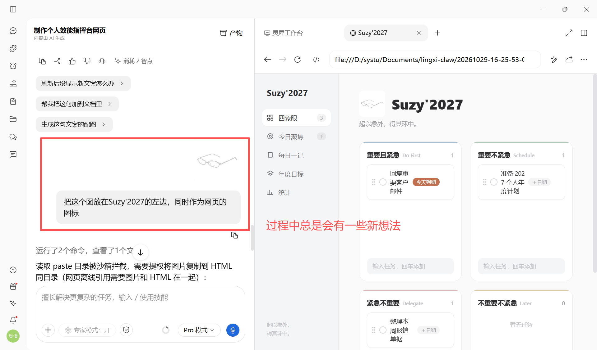
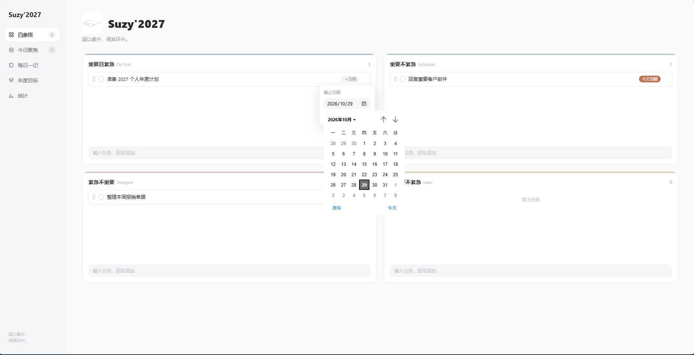
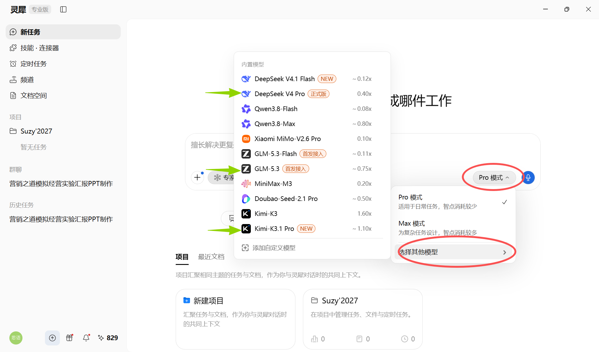
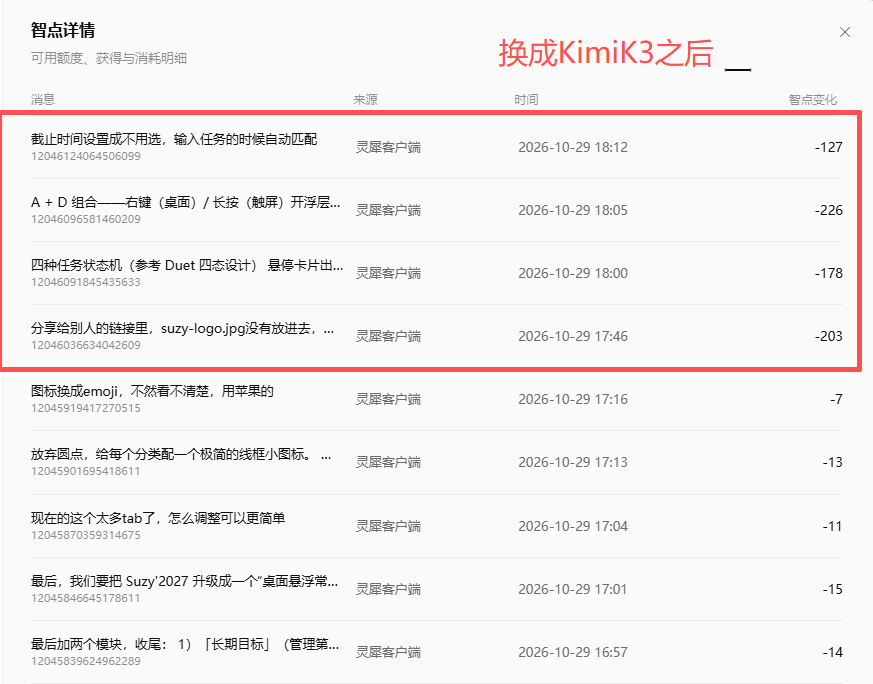
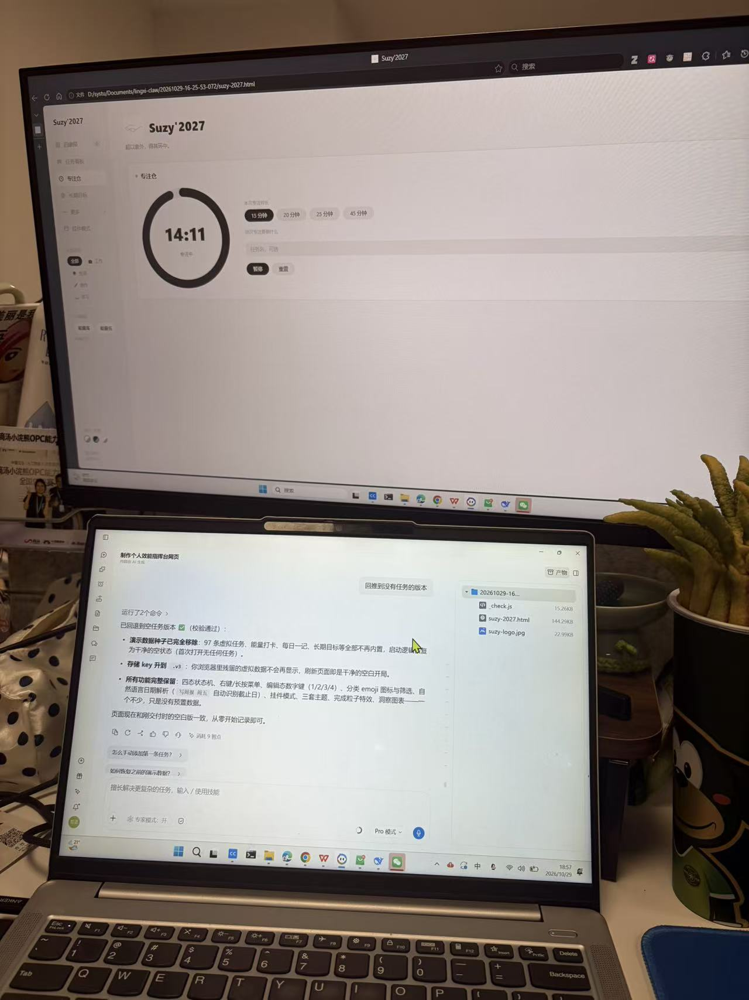
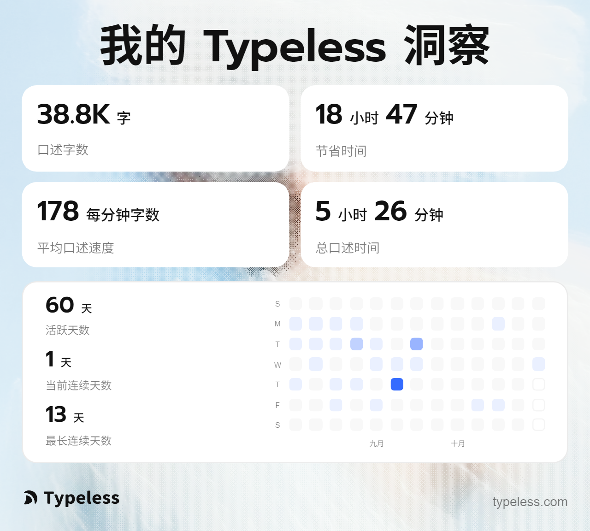
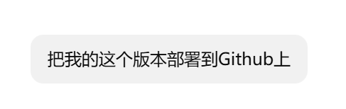

# 开发AI工作台

**用本地端来开发「Suzy'2027」工作台的核心优势：**

- 能直接“够到”你本机的文件系统，
- 生成完的 HTML 文件可以同步预览，
- 而且整个开发过程的数据不出本机，
- 灵犀可以在你完成应用之后帮你部署到线上，省去租服务器和部署的成本🤔

体验最终效果：https://publish.lingxispace.cn/webpages/edb7d521b1d716ba

最终成品下载：[suzy-2027.html](../../public/course-assets/37/suzy-2027.html)（下载后双击即可在浏览器中使用）

在我的基础上直接修改：[个人工作台.zip](../../public/course-assets/37/个人工作台.zip)

**具体的工作台实现步骤：**

### 第 1 轮：定骨架、极简 UI 风格、技术约束

```Markdown
帮我做一个个人效能指挥台网页，名叫「Suzy'2027」，双击本地 HTML 即可打开使用。

【视觉与 UI 规范（极其重要）】
请严格参考现代科技社区的极简留白风格（类似 Apple 设计语言 + Founder&Build 社区风）：
1. 颜色：背景用暖白色（如 #FAFAFA 或 #F5F6F8），任务卡片用纯白色（#FFFFFF），大面积留白。
2. 字体：使用系统无衬线字体（-apple-system, PingFang SC等），主标题加粗黑灰，次要信息用中灰/浅灰。
3. 卡片与线条：所有模块和任务必须是“大圆角”（圆角值在 12px-16px 之间）；边框使用极细的浅灰色（如 #EBEBEB）或极淡的阴影。
4. 点缀色克制：四个象限不使用大面积色块，而是通过标签（Tag）或卡片顶部的一条极细的彩边来区分（用低饱和的莫兰迪色：比如灰蓝、灰绿、灰粉、灰黄）。
5. 按钮样式：无边框，主按钮用深黑色或浅灰底黑字，胶囊形状。

【整体布局】
单页应用，左侧一条窄边栏（极简图标+文字，背景和主区做微弱的色差区分），右侧主内容区。
页面顶部左侧是加粗的主标题「Suzy'2027」，下方一行浅灰色小字欢迎语："超以象外，得其环中"

【核心功能：艾森豪威尔四象限】
右侧第一屏是四象限，2×2 网格布局：
- 四个象限分别标注：重要且紧急 / 重要不紧急 / 紧急不重要 / 不重要不紧急。
- 每个象限是一个大的白色圆角面板，内部：顶部标题+任务计数，中间是任务列表，底部是一个极简的输入框（无边框，浅灰底色）。
- 输入框里打字回车即添加任务，任务默认归属该象限。
- 任务卡片设计：必须是带小圆角的白色卡片，带极细边框，有轻微的悬浮阴影感。
- 每个任务卡片上显示：拖拽手柄（六个点，灰色）、任务名（黑灰字）、截止日期标签（未设置则不显示，红色或橙色小字标识紧急度）。
- 任务支持在四个象限之间拖拽移动，拖过去就改变归属，拖动时有微微放大的动效。
- 任务支持点击设置/修改截止日期（日期选择器），到期当天在卡片上有醒目提示。

【技术要求】
- 纯前端，数据存 localStorage，刷新不丢。
- 无外部依赖或只用 CDN 引入，保证离线双击可用。
- 页面显示名用 Suzy'2027；建议文件名 suzy-2027.html。
- 先搭好数据模型（任务对象至少含：id、标题、象限、截止时间、完成状态、创建时间），后续模块都复用它。
- 做完后自己走查一遍，确保 UI 干净、没有各种土味阴影、没有过多的颜色，有问题自己修。
- 代码复用开源项目：如果接下来来的开发版本中，涉及到相关功能，遵循：
参考 GSD Task Manager（[https://github.com/vscarpenter/gsd-task-manager](https://github.com/vscarpenter/gsd-task-manager)）的四象限数据模型和拖拽逻辑，
参考 Duet（[https://github.com/Duet-App/duet-app](https://github.com/Duet-App/duet-app)）的四种任务状态设计，
参考 Zebar（[https://github.com/glzr-io/zebar](https://github.com/glzr-io/zebar)）的桌面小组件交互形态。
但技术栈严格保持纯 HTML/CSS/JS + localStorage，不要引入任何构建工具或后端。
```

UI的参考在哪里找？

其实可以直接问有搜索功能的AI，这里推荐直接用 https://chat.deepseek.com/ 网页版开智能搜索问就行，不用付费额度。或微信搜一搜勾选AI搜索，有最新高质量的信息源。



第一轮效果：非常简洁



### 第 2 轮：极简任务看板（同步执行层）

```Plain Text
在四象限之外，加一个「任务看板」视图，通过左侧边栏切换，和四象限共用同一份任务数据，任何一边变动实时同步。

【风格延续要求】
依然保持极简白卡、大留白、细边框的设计，拒绝花哨的看板背景色。

【看板功能】
- 按时间线分组展示：今天 / 接下来 7 天 / 更晚 / 无截止日期，四向排列。
- 每张任务卡左侧有一个极简的圆形 Checkbox，点击后打勾，任务标记完成并淡出/折叠进“已完成”区。
- 已完成区在底部，文字颜色变浅灰，可以折叠。
- 卡片上能看到它属于哪个象限（用一个 6px 的小圆点标识，放在任务名前面）。
- 支持点击卡片就地编辑标题和截止日期。
```

### 第 3 轮：专注仓与能量打卡（极简仪表盘）

```Plain Text
加两个模块，UI 继续沿用黑白灰+大圆角卡片+留白的设计：

1）「专注仓」番茄钟：
- 设计成一个居中的极简圆形倒计时（类似苹果手表的计时圆环）。
- 预设时长（15/20/25/45），点击开始后圆环倒计时。
- 旁边有一个极简输入框，输入这次专注要做的任务名。

2）「能量打卡」：
- 放在侧边栏底部或主页顶部，两个大圆角胶囊按钮：“能量高”和“能量低”。
- 点击后状态变为已打卡，选中状态用黑色背景白字或极淡的底色区分。
- 记录每天的能量状态，供后续统计。
```

### 第 4 轮：数据洞察（图表也要高级）

```Plain Text
加一个「洞察」视图。图表千万不要用默认的鲜艳配色，要用低饱和度的灰黑、灰蓝配色。

- 近 30 天完成趋势：极简的折线图或柱状图（类似 GitHub 贡献图的质感，或者苹果健康里的图表风格）。
- 工作日节奏分析：用柔和的区块展示哪天效率最高。
- 能量打卡日历：类似朋友圈的热力图日历。
```

### 第 5 轮：长期目标与闲时队列（收尾）

```Markdown
最后加两个模块，收尾：

1）「长期目标」（管理第二象限）：
- 类似个人主页的卡片列表，每个长期目标是一张白底大圆角卡片（比如“背单词”、“健身”）。
- 卡片上显示目标名称、连续打卡天数、进度条（进度条要细，颜色低调）。
- 点击卡片弹出极简浮层，可以记录今日打卡或修改计划。

2）「闲时任务队列」（侧边栏入口）：
- 收纳琐事的列表，文字极简，类似一个备忘录。
- 状态用极小的灰色标签标注（排队中、处理中）。

最后整体自检：
- 各个模块切换流畅。
- 没有丑陋的默认边框、没有高饱和度的刺眼颜色，所有 UI 看起来像一个售价几百块的 iOS 效率 App。
```

### 第 6 轮：桌面悬浮形态、多维分类、状态机与换肤特效（最终整合）

```Markdown
最后，我们要把 Suzy'2027 升级成一个“桌面悬浮常驻”的效率挂件，加入以下功能，并保持之前极简、高级的视觉质感：

【1. 桌面悬浮形态适配（Widget 模式）】
- 增加一个“极简挂件模式”切换开关。开启后，页面隐藏所有边缘留白和复杂导航，变成一个紧凑的悬浮卡片（宽约 320px，高度自适应）。
- 挂件模式下，默认只展示“今天/待办”的任务，并支持“点击穿透/窗口置顶”的提示引导（如果是在普通浏览器中，提示用户可以使用 Mac 的 Safari 添加到桌面或使用专门的小组件软件）。
- 界面设计要像 macOS 或 iOS 的桌面小组件，圆角加大，背景做轻微的毛玻璃（backdrop-filter: blur）效果。

【2. 多维度分类管理】
- 给每个任务增加一个“分类”属性：Work（工作） / Life（生活） / Content（创作） / Study（学习）。
- 在任务卡片上，用极简的彩色小圆点或小标签（Tag）展示分类。
- 在顶部或侧边栏增加分类筛选器，点击可快速过滤对应类别的任务。

【3. 四种任务状态机（放弃单一的勾选）】
- 任务状态从“未完成/已完成”升级为四种：To-do（待办） / Pending（进行中/卡住） / Completed（已完成） / Cancelled（已取消）。
- 交互：在任务卡片右侧增加一个极简的状态切换小图标或下拉菜单。
- 视觉反馈：
  - To-do：正常黑灰文字。
  - Pending：文字变浅，带一个黄色小点或图标。
  - Completed：文字带删除线，颜色变浅灰，卡片折叠到最底部。
  - Cancelled：文字变浅灰，无删除线，卡片折叠到最底部。

【4. 自定义皮肤与主题（Skin）】
- 在设置里增加“皮肤/主题”切换功能，至少提供两套主题：
  1. “日常极简”（默认）：暖白底+黑白灰+莫兰迪点缀。
  2. “圣诞限定”或“暗黑模式”：支持深色背景，文字变成浅色，可以加一点红绿点缀。
- 主题切换要全局生效，且数据依然存在 localStorage 中。

【5. 炫酷微交互：任务完成特效】
- 当任务被标记为 Completed 时，不仅在状态上变化，触发一个微小的粒子特效（比如雪花特效，雪花用emoji❄️，或者纸屑飘落效果）。
- 注意：特效必须用 Canvas 或 CSS 实现，轻量、不卡顿，且不能遮挡操作。在极简模式下特效也要保留。

【最终全局自检】
- 检查所有视图（四象限、看板、洞察、专注仓、长期目标）的数据是否依然是双向同步的。
- 检查四种任务状态在切换时，UI 是否都有对应的正确反馈。
- 检查分类标签在四象限和看板里是否都能正常显示。
- 给出一个功能清单说明，告诉我如何在桌面端开启悬浮效果。
```

---

## 常见FAQ

### 本工作台用的默认的pro模式生成，你还可以试试

**灵犀接入了很多模型：最推荐 GLM-5.3 或 Kimi-K3.1 Pro，其次是 DeepSeek V4 Pro。**

Kimi-K3.1 Pro 的 UI 审美设计很棒，同学们在做原型设计讨论的时候可以用 Kimi-K3.1 Pro，原型设计好之后可以交给又快又便宜的 deepseek v4.1 flash





### 推荐习惯1：买个显示器，作为第二屏幕，认真批改AI的作业



### 推荐习惯2：习惯语音输入，更容易启动



### 推荐习惯3：Vibecoding灵感池放到每日一记里

比如：

想做一个电子版本的五年日记本，Muji风格，设计一个有创意的前端

想把常用的手动拼图创意，变成小红书上的小工具，目标是多和用户互动，做迭代

想做一个工作台，记录我新加入公司/实习，协作中看到的、产出的高质量成果文档汇总，为转正汇报做准备

### 推荐习惯4：加入开源生态，build in public



第一步，注册一个github账户给你的Agent用
https://github.com/signup，Github开放了Cli，参与开源协作变得更加轻松

