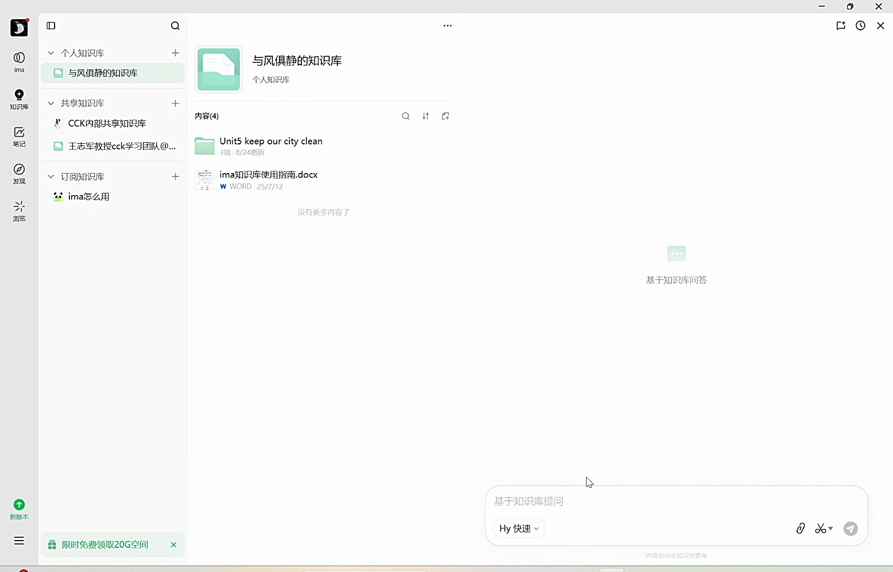
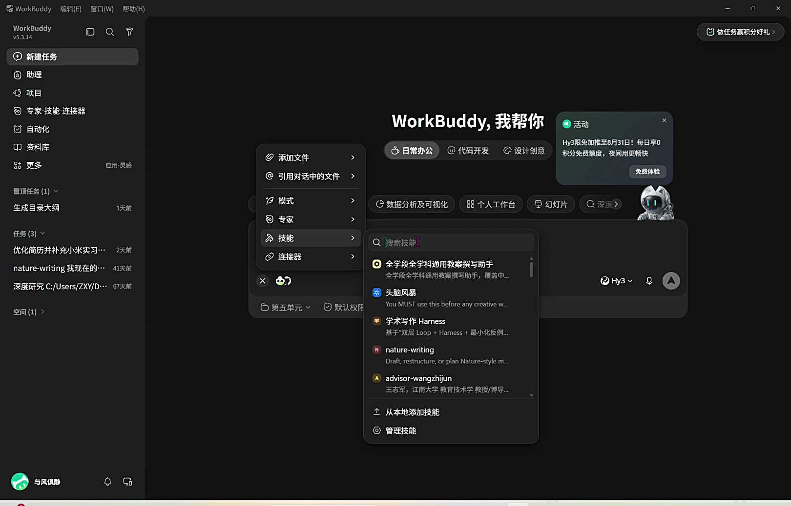
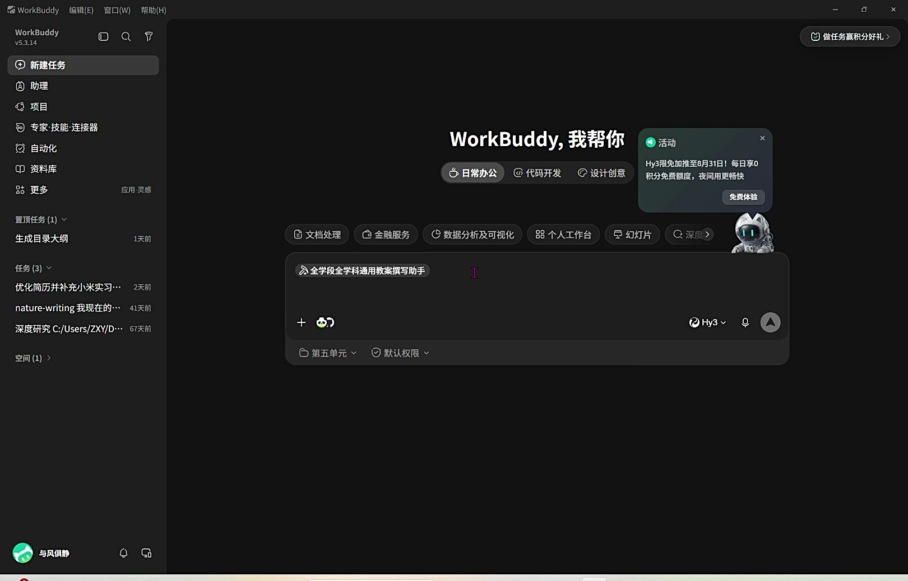
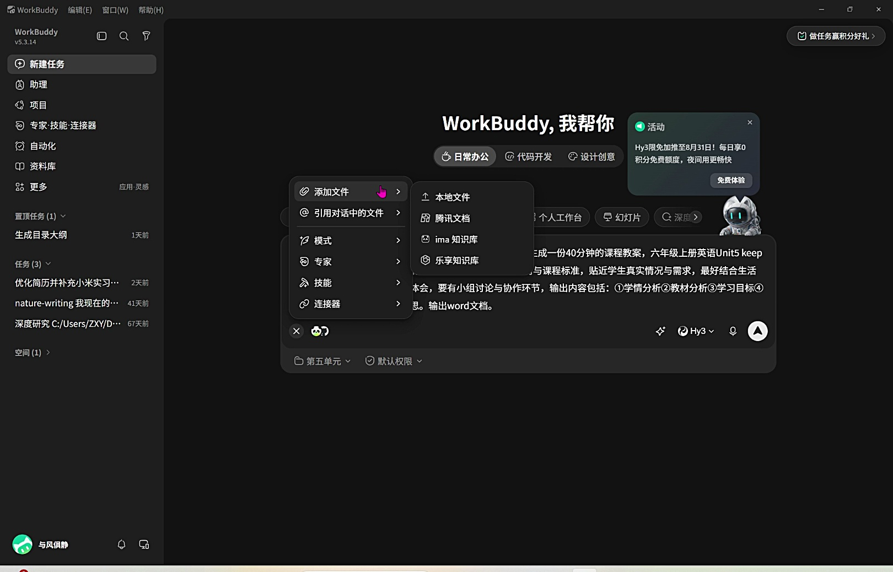
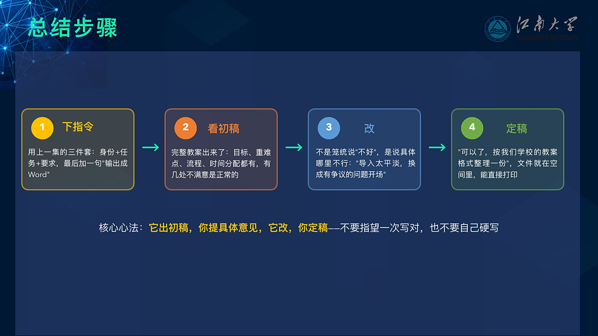
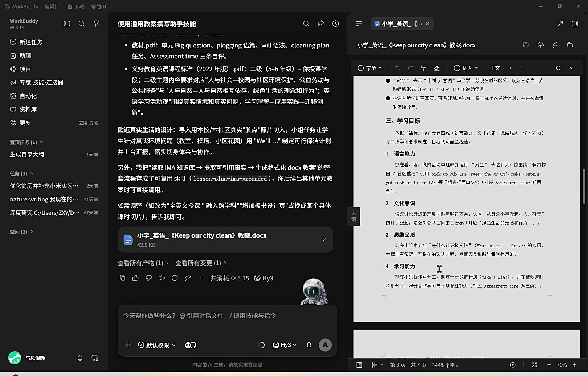
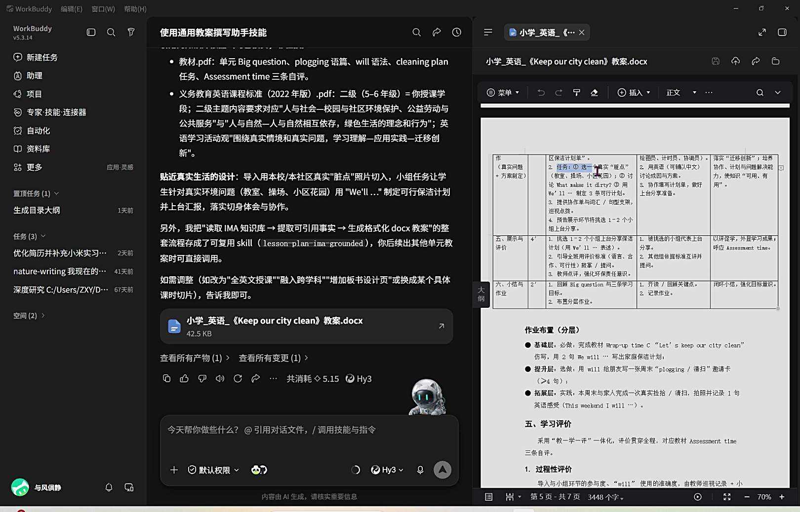

# 备课提示词与教案

> **解决的问题：**教研员明天来听课？教材改版？想创新性地上一节课？把「写教案」变成「改教案」。
>
> **学习时长：**约 6 分钟

[📺 观看本课视频（微信视频号）](https://weixin.qq.com/sph/AnVYxvgXAF)

## 一、这些场景你肯定遇到过

- 明天**教研员要来听课**，教案要连夜重构
- 教材内容改动，课程内容跟着变
- 想创新性地上一节课，却不知道怎么改
- 手动修改：费时、改完不满意、还缺创新

最耗的不是写，是改——写二十分钟，改来改去能改两个小时。

解决办法：让 AI 出初稿，**你来改**。它能直接生成**可用、可修改、可编辑、可保存的 Word 文档**，这是它与普通对话式 AI 最大的区别。

## 二、开工前，先备好三样东西

### 1. 知识库：喂材料

新建课程文件夹（示例：小学六年级英语·第 5 单元），把**课程标准、教案模板、教材**全部放进去。



<p class="fig-caption">知识库文件夹：课程标准、教案模板、教材三件套</p>

- **课程标准** —— 用学校统一下发的《义务教育英语课程标准（2022 年版）》

- **教材** —— 本单元教材页的 PDF 或拍照，用自己班级正在用的版本即可
- **教案模板** ——（九栏目空白表格，点击下载后可直接放进知识库；也可换成学校统一模板）

[📎 下载附件：教案模板_空白 .docx](../../public/course-assets/38/source-01.docx)

### 2. 工作空间：建专场

新建「第 5 单元」工作空间，这节课所有的**文件和对话记录**都归在这里，对话时直接选择。

### 3. 技能：请帮手

选用**全学段全学科通用的「教案撰写助手」**技能，专业的事交给专业的模板。发送前还可以让 AI 先帮你把指令打磨一轮。



<p class="fig-caption">在「技能」菜单中选择「全学段全学科通用教案写助手」</p>

## 三、指令公式：身份 + 任务 + 要求

「我是（身份），帮我做（任务），要求是（详细要求），最后输出 Word。」

- **身份：**小学英语老师
- **任务：**生成某一课的教案（写明题目）
- **要求：**符合学段学情、贴近真实课堂、结合生活问题、包含小组讨论和写作环节
- **输出：**学情分析、教材分析、学习目标……最后输出成 Word 文档
- **引用：**点左下角「添加」，挂上知识库里的教材和课程标准

要求写得越详细，初稿就越接近你要的样子。记住：最后一定要加一句「输出成 Word」。

```Plain Text
我是小学英语教师，帮我生成一份40分钟的课程教案，六年级上册英语Unit5 keep our city clean，要求：符合学段学情，引用知识库中的教材与课程标准，贴近学生真实情况与需求，最好结合生活问题来设计，使学生具有切身体会，要有小组讨论与协作环节，输出内容包括：①学情分析②教材分析③学习目标④活动设计⑤学习评价⑥教学反思。输出word文档。
```





## 四、四步成稿

**下指令 → 看初稿 → 提意见 → 定稿。**



<p class="fig-caption">课程 PPT 总结：四步成稿流程与核心心法</p>

### 1. 下指令

用身份 + 任务 + 要求的指令，最后加一句「输出成 Word」。过程中别忘了挂技能、开工作空间、引用知识库。

### 2. 看初稿

目标、重难点、流程、时间分配都会出来，有几处不满意是正常的。此环节要发挥教师的主导作用。



<p class="fig-caption">生成的：语言能力、文化意识、思维品质、学习能力四维目标</p>

[📎 下载附件：Keep our city clean_教案.docx](../../public/course-assets/38/source-02.docx)

### 3. 提具体意见

不要笼统说「不好」，要说具体哪里不行，比如「导入太平淡，换成有争议的问题开场」。也可以把要改的内容详细粘贴给它，说明期望与目的，例如希望任务与校园生活相关、后续能沉淀为校本课程。



按具体意见修改后的活动设计表格与「作业布置（分层）」

### 4. 定稿

对 AI 说「可以了，按我们学校的教案格式整理一份」。如有学校模板也可以投喂给它。打开文件夹，得到的就是 Word 文档，可随时修改、直接打印。

## 五、核心心法与小练习

**核心心法：它出初稿，你提具体意见，它改，你定稿。不要指望一次写对，也不要自己硬写。**

**小练习：**让 AI 帮你写下周要上的那一课的教案；写完挑一处不满意的地方，用一句具体的话告诉它怎么改。
