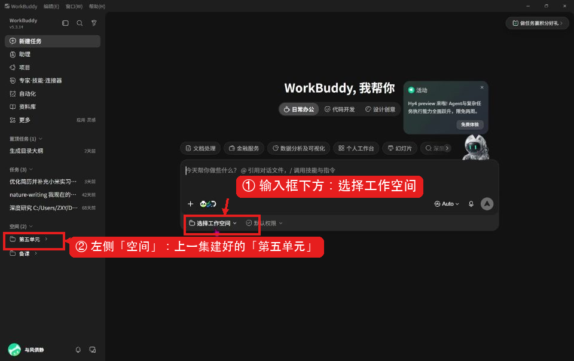
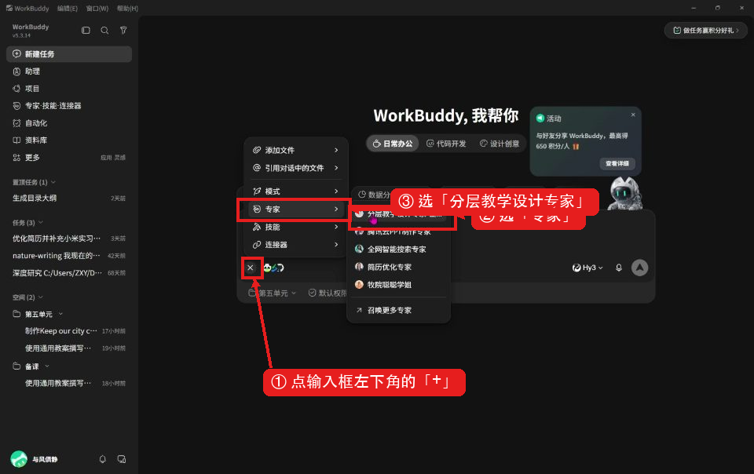
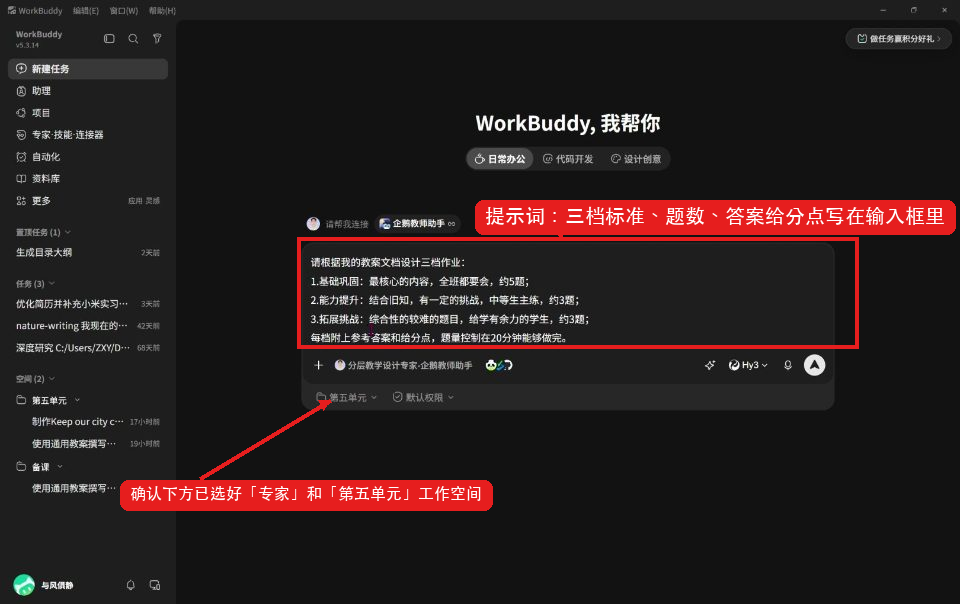
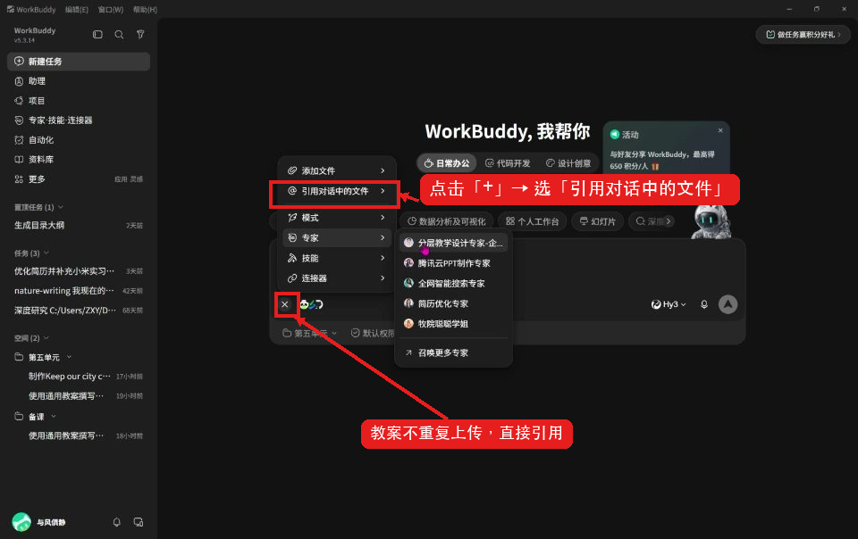
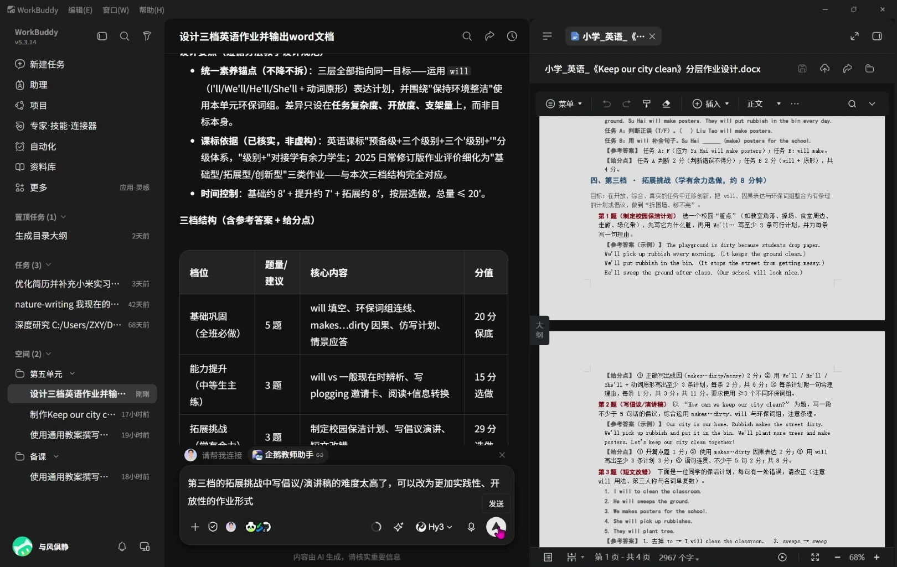
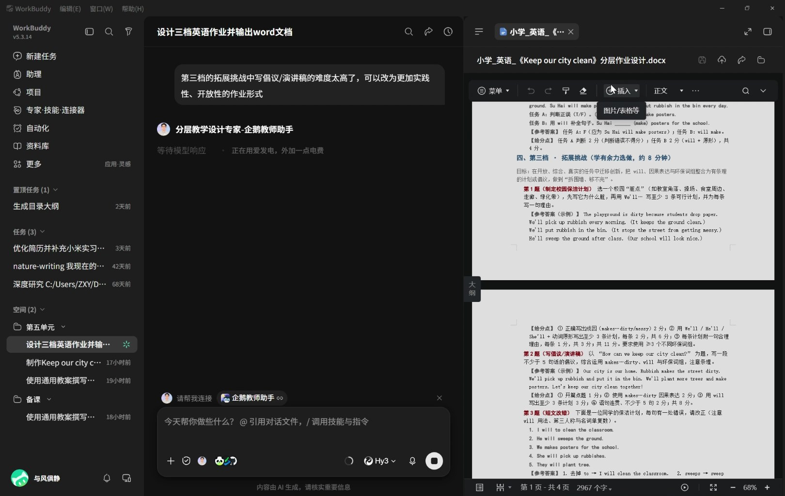
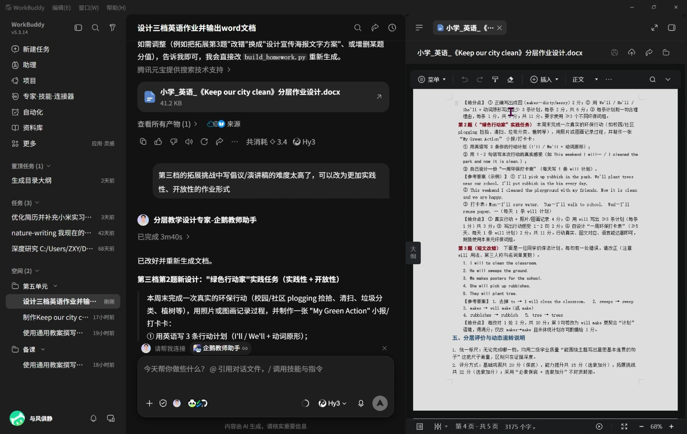
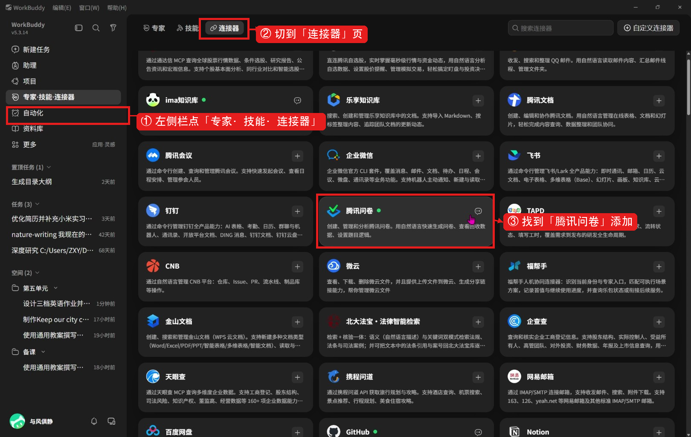
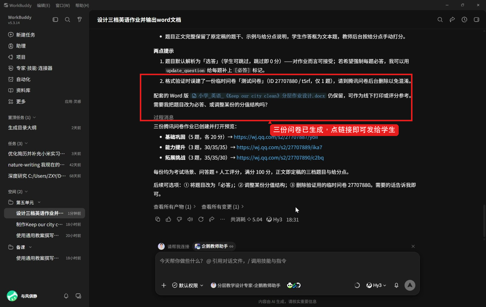
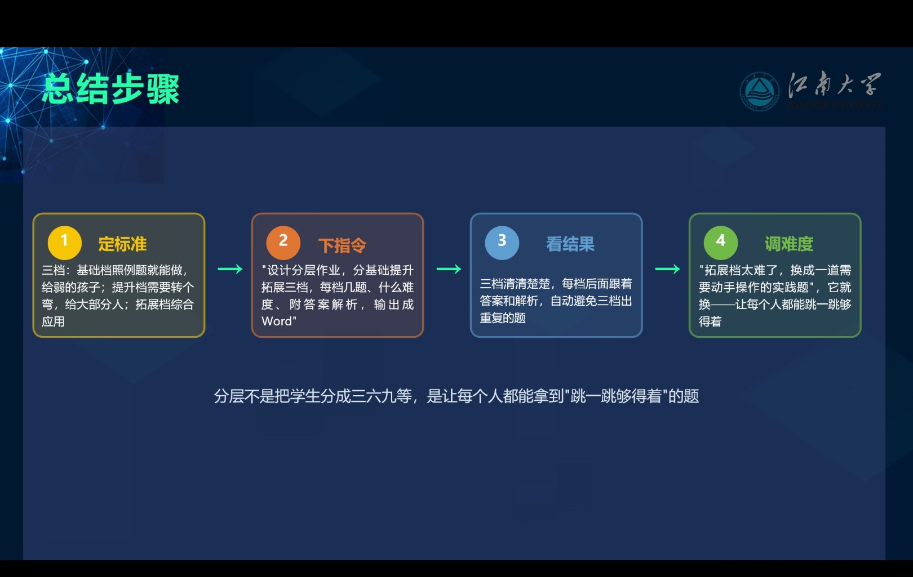

# 分层作业与随堂测

> **解决的问题：**一个班四十人水平差一大截，布置一样的作业——好的发呆，弱的写到十点还错一半。
>
> **学习时长：**约 7 分钟

[📺 观看本课视频（B站）](https://www.bilibili.com/video/BV1HJsb6JE7b/?p=2)

## 一、先说痛点

我们今天要讲的，是如何去做分层的作业与随堂测。

在布置作业的时候，我们可能会发现这种情况：学习好的同学能够在很短的时间内完成作业；而一些基础比较薄弱的同学呢，可能写到非常晚，耗费了非常多精力，但是还达不到学习的效果。

我们知道要因材施教，可以把作业进行分层。但真到我们动手的时候，会发现**时间和精力都是不够用的**。

那今天呢，我们就可以学习如何用 WorkBuddy 去解决这个问题。

同样，我们用到的还是文件读写的能力。但这回它要给我们产出的，是**多个针对性的、不同的文档内容**——通过让 WorkBuddy 出题进行分层，我们再把这个内容发到学生的手里，去完成作业。

## 二、还是那个备课空间，多请一位专家

### 1. 还是选第 5 单元的工作空间

首先，我们用到的还是刚才建立好的备课工作空间，也就是以第 5 单元的内容为例。<cite doc-id="Q9ECw31Cii9a16kx2eYcD9GVnff" file-type="wiki" title="AI备课的提示词怎么写出Word版好结果？✅教案更准确" type="doc"></cite>



<p class="fig-caption">沿用上一集建好的「第五单元」备课空间，继续接着上文做</p>

### 2. 这次请的是「分层教学设计专家」

为了让我的分层内容更具有针对性和专业性，我这里引入了一个专家——**分层教学设计专家**。

这个专家呢，就能很好地帮助我去做分层次的作业设计和安排。老师们也可以尝试拿这个专家去做分层次的教学设计，然后撰写相应的提示词。



## 三、提示词：分几档、什么标准、几道题

我们要详细地告诉它，作业要分成几个档次。我这里分的是三个档次：**基础巩固、能力提升和拓展挑战**。

每一部分都要告诉它你的标准是什么：

- **基础巩固**：最核心的内容，全班都要会，约 5 题
- **能力提升**：要有一定的挑战，中等生主练，约 3 题
- **拓展挑战**：综合性且较难的题目，给学有余力的学生，约 3 题

如果需要参考答案，就要求它**每档附上参考答案和给分点**；题量尽量控制在 **20 分钟之内能做完**——这就是给它的限制条件。内容没有问题了，让它输出 Word 文档。

```Plain Text
请根据我的教案文档设计三档作业：
1.基础巩固：最核心的内容，全班都要会，约5题；
2.能力提升：综合旧知，有一定的挑战，中等生主练，约3题；
3.拓展挑战：综合性的较难的题目，给学有余力的学生，约3题
每档附上参考答案和给分点，题量控制在20分钟能够做完，最后输出成Word文档
```



## 四、教案不用重新上传

既然是在我们的工作空间里，之前已经生成了教案文档的话，就不需要再去重复上传了——这就是学习空间带给我们的好处。

点击加号里的「**引用对话中的文件**」，就能看到我们在这个过程中生成的全部文件。找到那份教案，直接放进来，发送给 WorkBuddy，让它帮我们生成。



## 五、看结果，调难度

现在它已经基于我们的教学设计，生成了**设计说明以及三档详细的作业题目**。我们可以看一下有没有什么问题。



三档结构清清楚楚：基础巩固 5 题 20 分、能力提升 3 题 15 分、拓展挑战 3 题 29 分，每档附参考答案和给分点当我们觉得某一部分有问题、需要修改的时候，可以直接和它交互。这里我以第三档的拓展挑战为例：

```Plain Text
「第三档的拓展挑战中写倡议/演讲稿的难度太高了，可以改为更加实践性、开放性的作业形式。」
```



不笼统说「太难」，说清是哪一档、哪类题、想改成什么样现在它已经根据我的要求修改了相应的部分，把我觉得比较难的题目改为了一个**实践性的任务**。确认没有问题以后，这就可以作为我们的作业了。



## 六、进阶：用腾讯问卷做成随堂测

作业出好了，要发给学生的时候，可以把这份作业打印下来。但如果不想打印、想直接用平板分发给相应的学生，也可以用 WorkBuddy 来实现。

这时候需要增加一个连接器——**腾讯问卷**，把它加入进来。需要注意的是，调用腾讯问卷的功能需要登录微信获取权限，跟着步骤做就好。



连接成功以后，在刚才的对话里追加一段内容：告诉它需要用腾讯问卷创建三份作业，分别的标题是什么，以及每份作业的满分和正文内容——也就是上面的三档题目。

现在它就已经帮我们生成了这三份腾讯问卷。



三份问卷生成完毕：基础巩固 5 题、能力提升 3 题、拓展挑战 3 题，各自带链接和分值学生就可以在这里提交作业。这比较适合平时在课堂上拿着平板做**随堂测**，也可以当作课堂作业或课后作业，让同学们通过电子的形式提交。

等同学们提交结束以后，我们还可以直接在对话界面里和 WorkBuddy 交互，让它给我们**出数据的总结**——我们可以很清晰地看到学生在哪里薄弱、哪里容易出错。

## 七、四步总结

我们来总结一下随堂测和分层作业的步骤。

1. **定标准**：大部分老师需要的是三档——基础档、提升档、拓展档。
2. **下指令**：引用库内的专家团队帮我们更专业化地设计，说清每档几题、什么难度、要不要答案解析，输出成 Word 文档。
3. **看结果**：看它是不是符合我们班级的真实情况。
4. **调难度**：把题目换成学生在自己现有基础上能够往上够一够、能够达到的程度。



课程 PPT 总结：定标准 → 下指令 → 看结果 → 调难度后续还可以用腾讯问卷把作业做成电子形式发给学生做随堂测，或者课上课后的作业，也是非常方便的。

## 八、留一个小练习

最后，给各位老师布置一个小的练习任务：

让它给你下周要教的那一课出一份**分层作业**。基于我们的工作空间，说清楚三档各几题、要不要答案等限制性的要求，最终产出一份可以直接用的分层作业。
