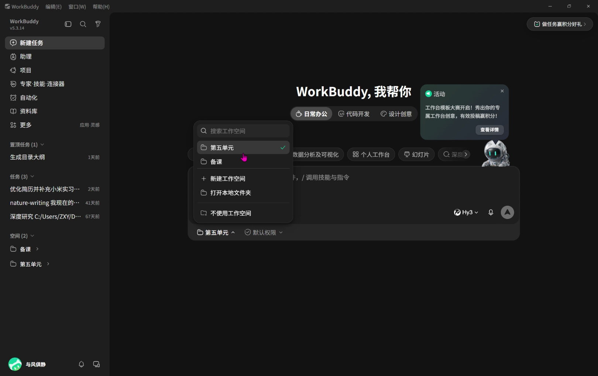
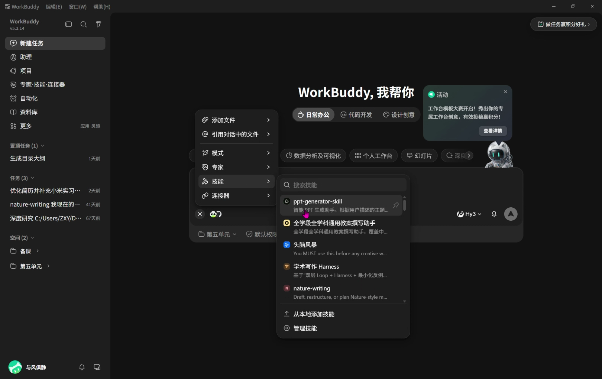
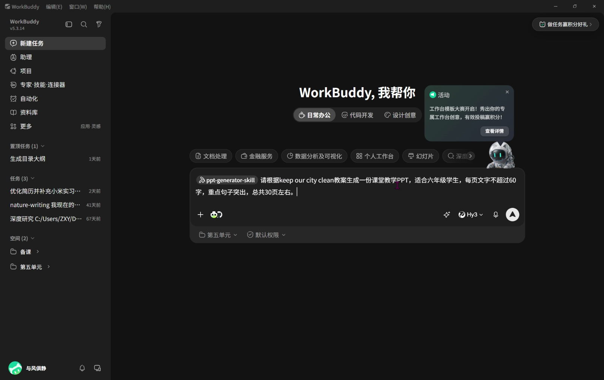
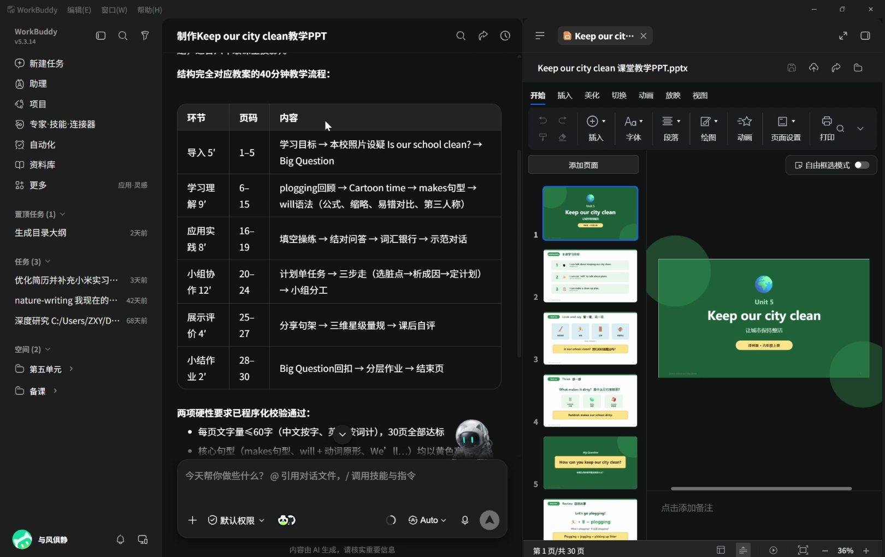
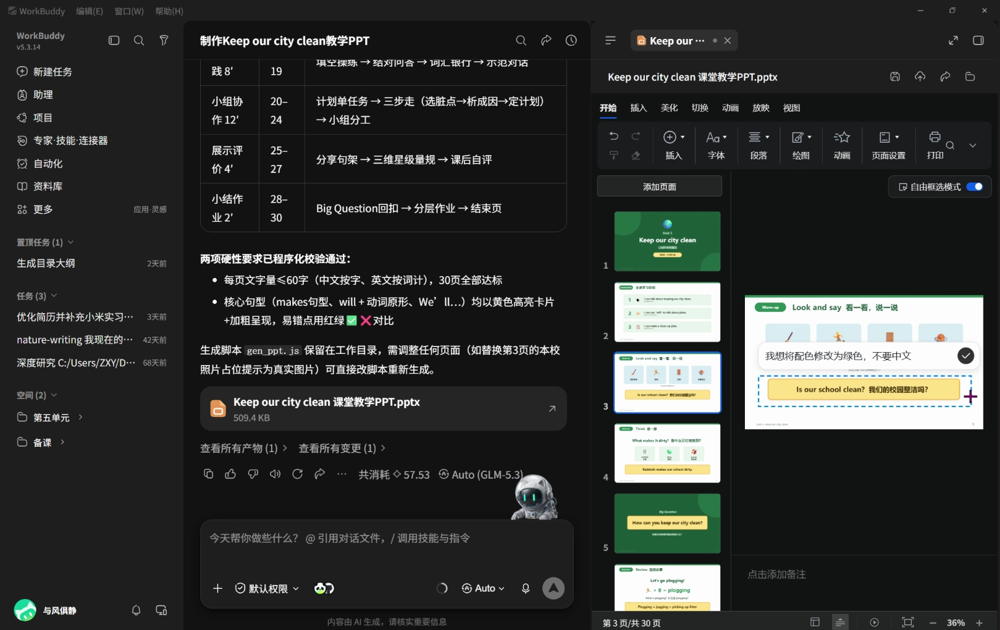
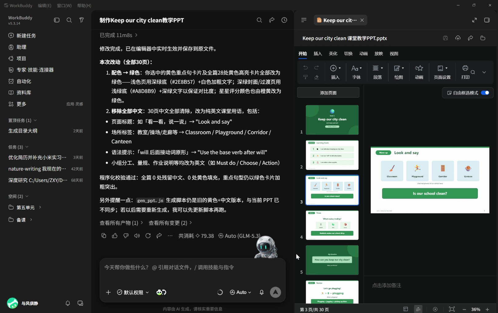
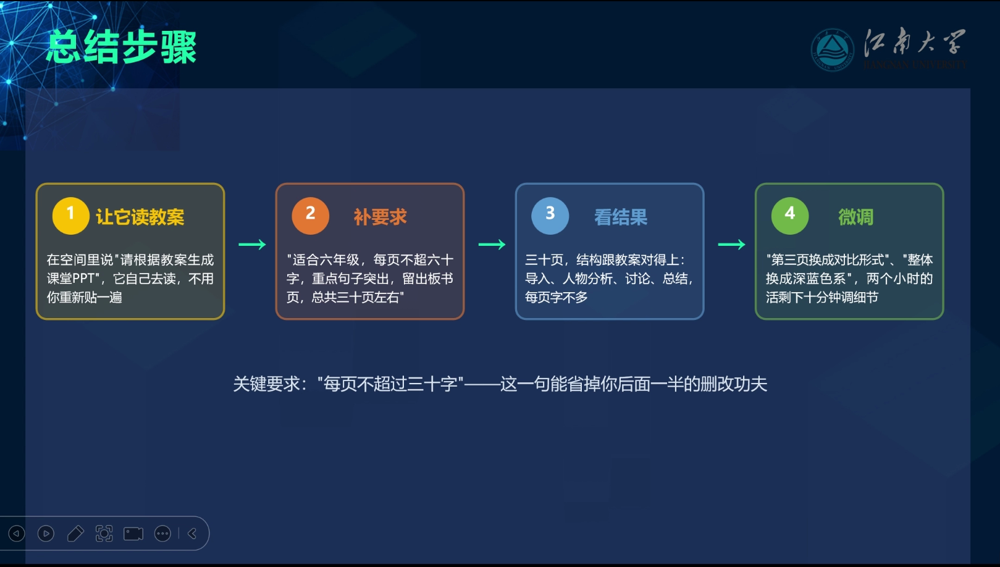

# 从教案到课件

> **解决的问题：**教案写完只是第一步，做课件才是真磨人？把找图排版这两小时，交给它。
>
> **学习时长：**约 5 分钟

[📺 观看本课视频（B站）](https://www.bilibili.com/video/BV1HJsb6JE7b/?p=3)

## 一、先说痛点

我们这一次要讲的，是从教案到课件。

可能当我们的教学设计和教案做完了以后，我们要去做课件。但是**找图、排版和一页一页去调**，可能是我们最磨人的环节了。

- 做课件的时间里，和教学价值相关的思考只有 5\~10 分钟
- 剩下的全是重复的、非脑力的劳动

做课件最磨人——找图、排版、一页一页调，两小时起步，真正有教学价值的思考可能就十分钟。

那这些呢，我们同样可以交给 WorkBuddy 去实现。

## 二、这次它生成的是 PPT

这次其实还是涉及到 WorkBuddy 的文件读写能力。

和教学设计不同的是：**它生成的是 PPT，而教学设计生成的是文档**。

而且，我们可以接着教案去生成课件——这也正是上一集和大家介绍如何去建工作空间的一个关键点：**把前一步的产物，直接用到后一步**。

## 三、接着上次的备课空间开工

### 1. 还是选那个工作空间

首先打开 WorkBuddy 界面，我们仍然要选择我们的「第 5 单元」的工作空间，接着上文内容去进行处理。



### 2. 这次要换一个技能

这里需要注意的一个点是：我们需要引用做 PPT 的技能来帮我们生成内容。

这里我选择的是 **ppt-generator-skill**，用这个技能去帮助我们智能地生成 PPT。



<p class="fig-caption">在「技能」菜单中选择 ppt-generator-skill</p>

### 3. 提示词：基于教案 + 限制条件

接下来就到了输入提示词的部分。这里我是直接让它**根据我的教案内容**，生成一份课堂教学的 PPT，适合六年级学生——然后给它详细的限制信息、要求条件：

- 每页的文字**不超过 60 字**
- 重点句子**突出**
- 总共 **30 页左右**

```Plain Text
「请根据 keep our city clean 教案生成一份课堂教学 PPT，适合六年级学生，每页文字不超过 60 字，重点句子突出，总共 30 页左右。」
```



## 四、看它生成的结果

现在它已经帮我们完整地生成了这个 PPT 的内容，并且输出了整个教学流程——包括我们的环节、对应的页码和相应的内容，我们可以根据这个来调整内容。

可以看到，我们的课件现在是处于一个**可编辑的状态**，我们就可以实时对它进行修改。



## 五、自由框选，实时改

在右上方，我们点击打开「**自由框选模式**」——也就是说，我们可以实时地和它对话，直接框选内容，让它帮我们修改。

比如我框选这个部分，我希望把这部分的配色修改为绿色，且不要中文，然后点击发送。



框选第 3 页，直接输入「将配色修改为绿色，不要中文」我们就可以看到，修改已经完成了，是**完全按照我的标准去进行修改的**。



30 页全部改完：配色统一为绿色、移除全部中文，在编辑器中实时生效如果觉得内容还有需要修改或者补充的地方，我们还可以沿用这种形式和它进行交互。但是我们的**提示词是一定要详细的**——即使不用自由框选模式，我们也要和它说明：要改的内容在第几页、具体是什么内容。

## 六、四步总结

接下来我们再来复习一下这个步骤。

1. **让它读教案**：这一部分不需要我们重新去上传给它，而是在我们刚才的备课空间里，直接让它生成。
2. **补要求**：适合的年级、页数，以及具体的内容要求。
3. **看结果**：是不是 30 页的内容？结构和教案能不能对得上？每页的字多不多，是否符合我们第二步所讲的要求？
4. **微调**：用自由框选模式，或者在对话框里直接输入某一页的哪一个内容需要仔细修改。



课程 PPT 总结：让它读教案 → 补要求 → 看结果 → 微调而在整个过程中，我们需要注意的一点就是：**我们要对它有限制性的条件**，比如每一页的字数、具体的页数限制。这样会省掉我们很多后续去进行删改和补充的时间和精力。

## 七、留一个小练习

最后，给各位老师布置一个小的练习任务：

让它把我们刚刚写的那份教案做成 PPT。也要记得把**字数限制和页数**详细地和它交互出来，生成一份直接可用的 PPT 文件。

内容整理自《从教案到课件》课程（第 7 集）
主讲：周馨玥 · 江南大学联通主义学习研究团队
