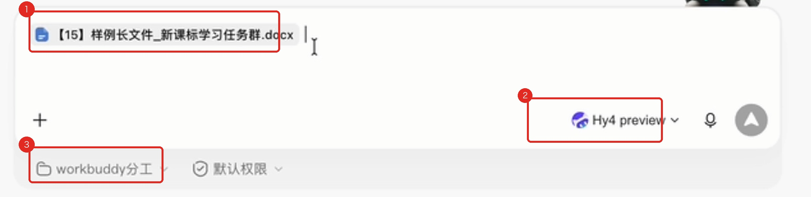
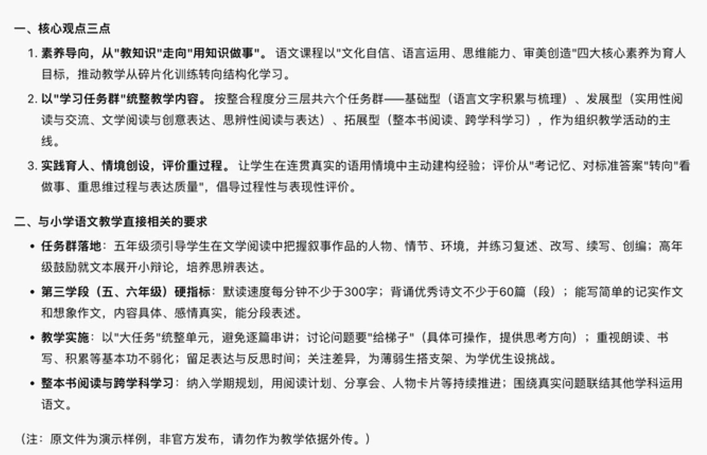
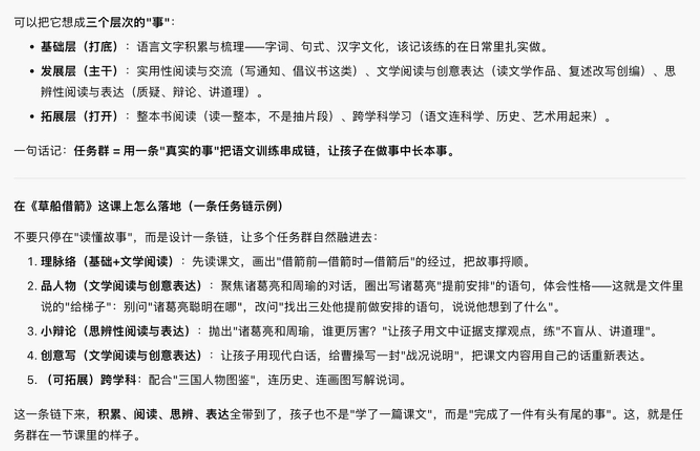
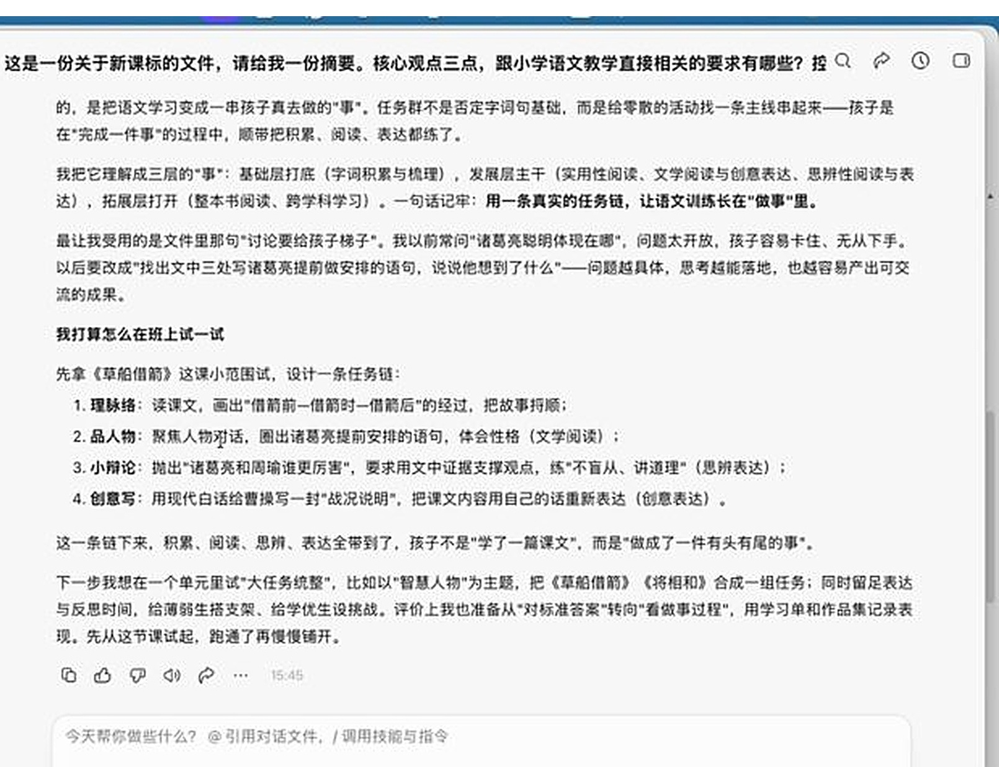
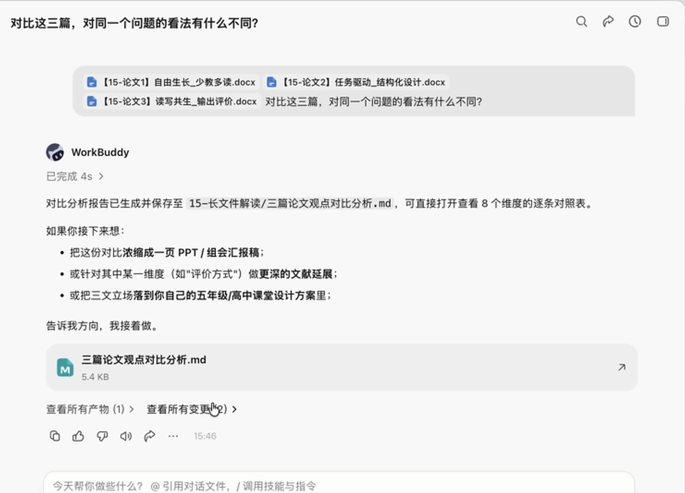
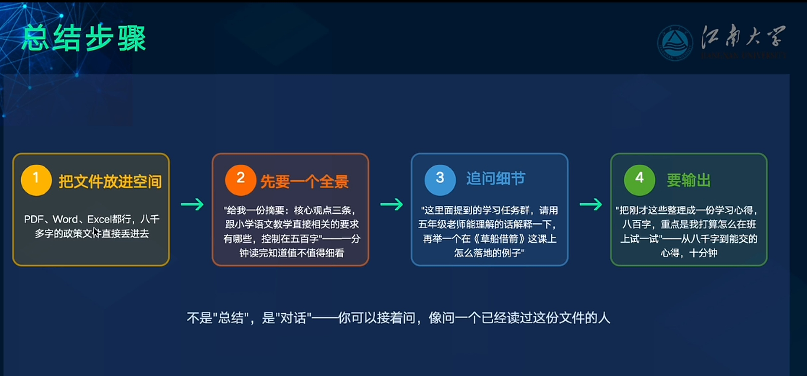

# 政策论文精读

> **解决的问题：**这节课讲怎么用 AI 读长文件：政策文件、参考文献、培训材料，都能先啃一遍再决定要不要细看。
>
> **学习时长：**约 4 分钟

[📺 观看本课视频（微信视频号）](https://weixin.qq.com/sph/AXYQDyV5hN)

## 一、先说痛点

群里发下来一份新文件，八千多字；或者你要写一篇论文，找了十几篇参考文献，每篇都是长文；又或者学校发了一份培训材料，明天就要交学习心得。你知道里面有用，但看到那个长度，心里就先放弃了。大部分文件最后都躺在文件夹里，再没打开过。

这里我们要用到的是读写文件的能力。你把文件丢给它，它读完之后不是给你一段摘要就完了，而是你可以接着问——像问一个已经读过这份文件的人。**这才是关键：不是总结，是对话。**

那今天呢，我们就用 WorkBuddy 的读写文件能力，让它先把这份长文件啃一遍——再决定要不要细看。

## 二、把文件放进空间

首先我们打开 WorkBuddy，然后选择工作空间，把文件丢给它。PDF、Word、Excel 都行，八千多字的政策文件可以直接丢进去。

我选择的样例长文件是一份关于新课标「学习任务群」的文件。

[📎 下载附件：新课标学习任务群_单元教学设计（五下名著单元）.docx](../../public/course-assets/41/source-01.docx)



## 三、先要一个全景

第二步先要一个全景。我的提示词是这样的：

```Plain Text
「这是一份关于新课标的文件，请给我一份摘要。核心观点三点，跟小学语文教学直接相关的要求有哪些？控制在 500 字。」
```



全景摘要：核心观点三条＋直接相关的要求，一分钟读完就知道值不值得细看500 字，一分钟读完，就知道这份文件值不值得细看了。

## 四、追问细节，这才是精华

接下来接着问它

```Plain Text
「这里面提到的学习任务群，请用五年级老师能理解的话解释一下，再举一个在《草船借箭》这课上怎么落地的例子。」
```



追问结果：把概念讲成人话，还落到《草船借箭》的一节课任务链上你看，它不只是解释概念，还能给你落到具体某一课的例子。

## 五、要输出

第四步，问它要输出

```Plain Text
「把刚才这些整理成一份学习心得，800 字，重点是我打算怎么在班上试一试这部分。」
```



输出结果：一份带「我打算怎么在班上一试」的学习心得从 8000 字到一份能交的心得，十分钟。

## 六、进阶：三篇论文对比

还有一个用法：你可以同时丢进去三篇论文，让它对比这三篇对同一个问题的看法有什么不同。



对比结果：三篇论文的观点差异被整理成一份分析文档，对写论文特别有用这个对写论文特别有用。

## 七、还能读什么

同样的办法，它还能读课程标准、教育政策、学术论文、会议纪要、培训讲义、学校的规章制度等等。凡是长而密的东西，你都可以丢给它，让它先啃一遍，然后再决定要不要细看。

## 八、四步总结



1. 总结步骤：把文件放进空间 → 先要一个全景 → 追问细节 → 要输出**把文件放进空间**：PDF、Word、Excel 都行，八千多字的政策文件直接丢进去；
2. **先要一个全景**：「给我一份摘要：核心观点三条，跟小学语文教学直接相关的要求有哪些，控制在五百字」——一分钟读完知道值不值得细看；
3. **追问细节**：「请用五年级老师能理解的话解释一下，再举一个在《草船借箭》这课上怎么落地的例子」；
4. **要输出**：「把刚才这些整理成一份学习心得，八百字，重点是我打算怎么在班上试一试」——从八千字到能交的心得，十分钟。

记住：不是「总结」，是「对话」——你可以接着问，像问一个已经读过这份文件的人。

## 九、小练习

现在试一下，30 秒：把你文件夹里那份一直没打开的长文件丢进去，先问它要一份 500 字的摘要。熟练之后，还可以同时丢三篇论文，让它对比对同一个问题的看法有什么不同。

内容整理自《11集 AI 教学课程》第15集「读长文件：政策论文速读」，主讲：田婉悦（江南大学联通主义学习研究团队）。
