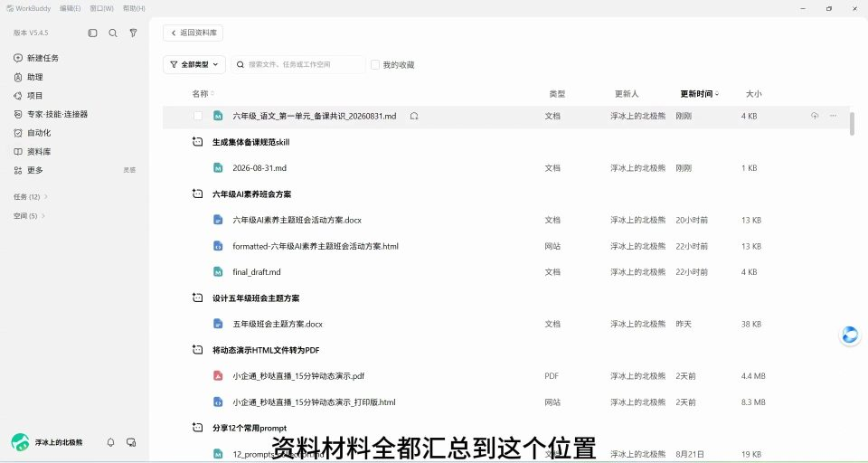
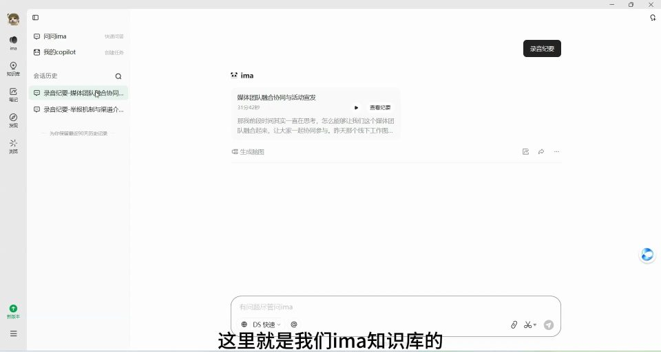
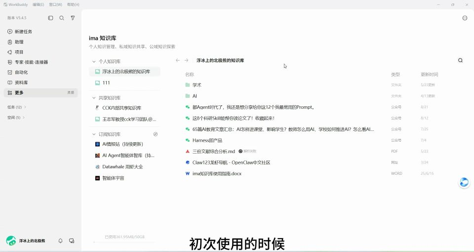
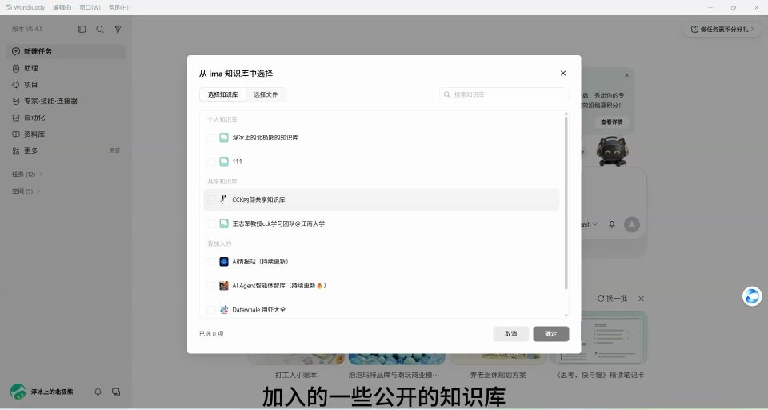
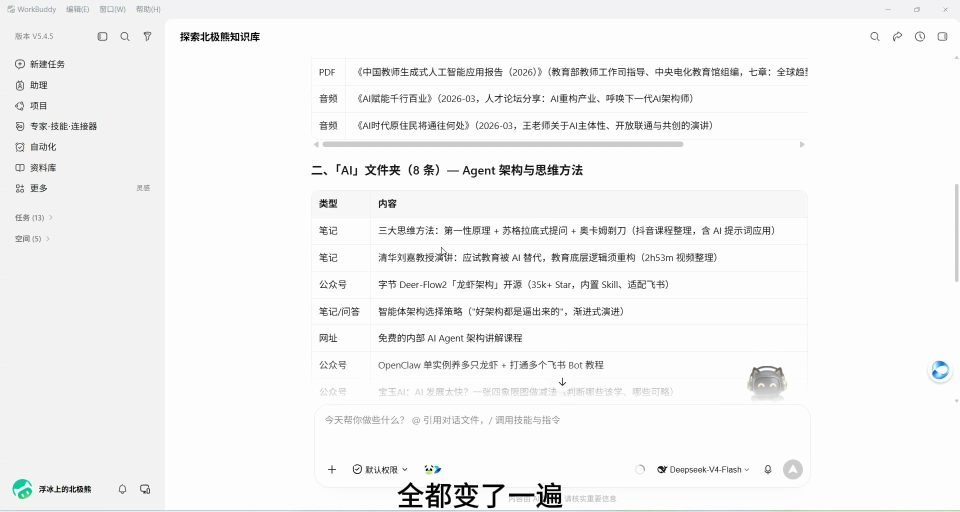
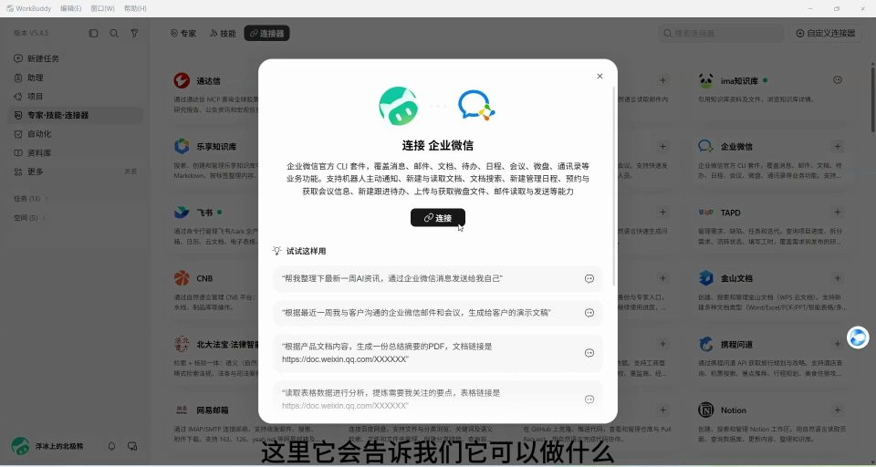
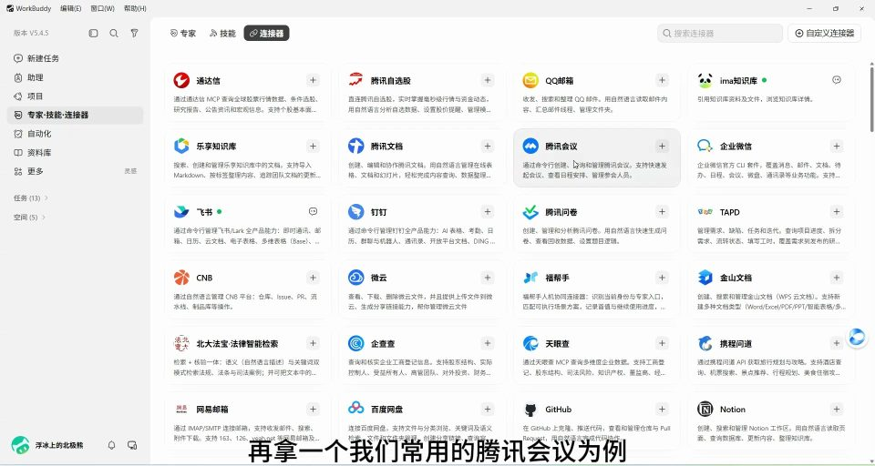

# 教学知识库搭建

> **解决的问题：**别每次都从零开始——把你的积累接进 WorkBuddy，让 AI 更懂你。
>
> **学习时长：**约 5 分钟

[📺 观看本课视频（B站）](https://www.bilibili.com/video/BV1HJsb6JE7b/?p=5)

## 一、先说痛点

各位老师在电脑里可能已经有了非常多的教案，微信里可能也收藏了不少好文章。但每次使用 AI 的时候，可能都需要从 0 开始：「我的教案格式是这样的」「我喜欢怎么怎么样分析学情」——这些话每次都要重新说一遍。

对大多数老师来说，建立自己的教学知识库是非常重要的。建立知识库，就可以**让 AI 找到你长期积累的资料，并且总结你的使用习惯**。

## 二、第一种方式：WorkBuddy 内置资料库

打开 WorkBuddy，建立知识库我推荐两种形式。第一种就是它自带的「资料库」功能：我们在任务中生成的一些资料、材料，全都汇总到这个位置，方便我们查找。

点击搜索，可以筛选我们之前已经生成过的文件；这里也会按照文件类型来分类。

## 三、第二种方式：接上 ima 知识库

第二种方式，就是和 ima 知识库进行连接，在 WorkBuddy 里直接调用 ima 知识库中的东西。

它和本地文件夹的区别是：**可以上传公众号文章、网站内容**。上传好之后，它会自动帮我们生成一个 AI 摘要——这样无论是 AI 读取，还是我们自己想看的时候，都可以先看摘要，判断到底是不是我们需要的内容，然后再阅读或者调用。

## 四、绑定，然后在对话里调用

ima 知识库的位置在这里：点左侧的「更多」，再点击「ima 知识库」。初次使用的时候，需要对 ima 知识库进行绑定。绑定好之后，就可以直接在 WorkBuddy 里调用了。

绑定后的 ima 知识库页面：个人知识库、共享知识库、订阅知识库一目了然怎么调用呢？点击左下角的加号，点击「添加文件」，这里就可以选择 ima 知识库。可以看到个人知识库、共享的知识库，以及我们加入的一些公开知识库——**可以选择一整个知识库直接导入，也可以只选单一的文件**。

「从 ima 知识库中选择」：三种知识库都能选，整库或单文件都可以

## 五、让 AI 先把你的知识库读一遍

我们先选择一整个知识库，点击确定，直接说「帮我总结一下」。

可以看到，它会直接读取我们的知识库，把里面的所有内容都过了一遍。如果我们后面想问什么问题，就可以直接带着知识库来提问。

总结结果：按类型把知识库里的内容全部梳理成清单，之后提问就有了依据

## 六、连接器：把外部应用接进来

说到 ima 知识库，需要引入一个非常重要的概念——**连接器**。

连接器的意思，就是它可以把 WorkBuddy 和外部的一些应用打通，然后直接通过 WorkBuddy 的一句话，来调用外部应用的功能。

点击「专家·技能·连接器」这个按钮，找到连接器，可以看到里面已经有很多做好的连接器了：企业微信、腾讯会议、腾讯文档等等。

连接器列表：腾讯会议、企业微信、腾讯文档、ima 知识库、金山文档……点开即用

## 七、以企业微信为例

点击企业微信，这里它会告诉我们它可以做什么、怎么使用。直接点击「连接」，它会自动安装相关的依赖，安装好之后就可以直接使用了。

腾讯会议和 ima 知识库也是同理。

企业微信连接器：说明它能做什么，还给出「试试这样用」的现成指令

## 八、连上之后能做什么

再拿我们常用的腾讯会议为例。连接腾讯会议之后，它可以直接通过 WorkBuddy 来创建会议、查看会议安排；如果腾讯会议中开启了转录，它还可以直接读取腾讯会议中的转录内容，帮助我们进行总结。

## 九、留一个小练习

课后可以建立一个自己的知识库，并且把它连接到 WorkBuddy 里面。这样可以让我们的 AI 更懂你，也可以提高我们的工作效率。

内容整理自 AI 教学课程第 25 集《知识库与连接器》。图片取自课程操作录屏。
