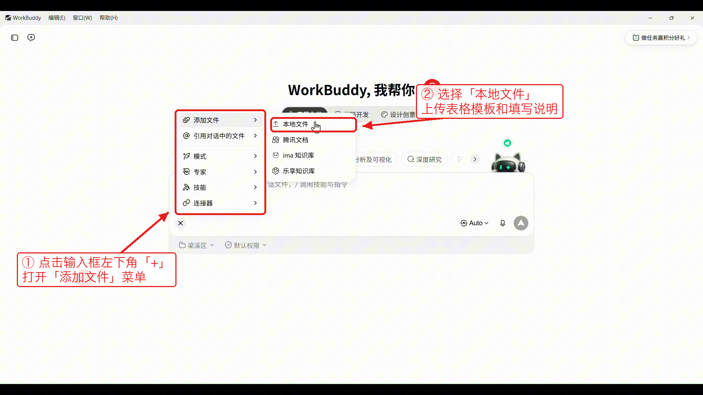
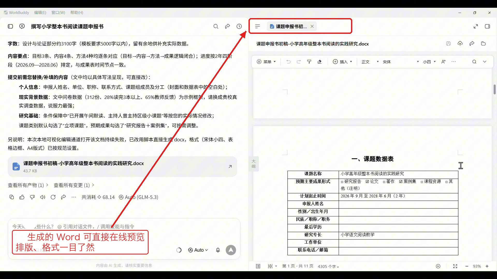
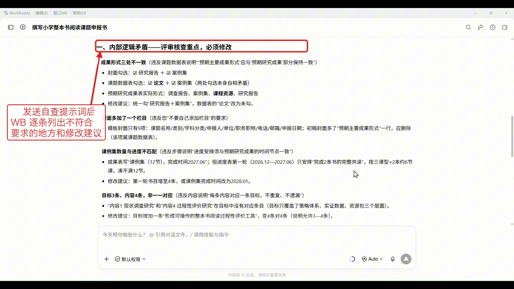

# 行政材料与填表

> **解决的问题：**这节课讲怎么用 AI 填表：课题申报书、评优评审表、学习台账、迎检材料，先把规则喂进去，再让它写。
>
> **学习时长：**约 4 分钟

[📺 观看本课视频（微信视频号）](https://weixin.qq.com/sph/A9x1sapZdl)

## 一、先说痛点

又要交材料了：课题申报表、评优评审表、学习台账、迎检材料，每份材料都有填写说明。字号、行距、字数、栏目，一个都不能错。

真正耗时间的往往不是内容，而是反复凑格式——内容写了一个小时，格式又调了 40 分钟。这种耗时的格式活，可以交给 WorkBuddy。


课题申报书、评优评审表、学期台账、迎检材料……真正拖住你的，往往不是内容，而是一遍遍凑格式

## 二、方法很简单：先把规则喂进去，再让它写

先把模板和填写规则交给它，再让它按规则填写。顺序很关键——规则先进去，它才知道栏目、字数和边界。

写教案可以让它自由发挥，填申报表、整理材料，就让它戴着镣铐跳舞。核心心法就一条：**先把规则喂进去，再让它写。规则给得越全，返工就越少。**

## 三、第一步：把要求给它

我把那份模板和填写说明上传给 WorkBuddy——点输入框的「添加文件」，选本地文件就行。



## 四、第二步：说清楚任务

我的要求是这样的：

「这是一份区级课题申报书的模板和填写说明。我要申报的课题是**小学高年级整本书阅读的实践研究**，请按照模板的格式要求帮我完成初稿。注意：

1. 严格按照模板的栏目来，不要自己添加栏目；
2. 每栏的字数按说明里的要求控制；
3. 语言要用规范的书面语，但不要空话，要写具体做法。」

注意看，**「按模板的栏目来」和「字数按说明控制」这两条，是填表专用的关键指令。**

```Plain Text
这是一份【表格名称】的模板和填写说明。我要申报/填报的是【事项名称】，请按照模板的格式要求帮我完成初稿。注意：
1. 严格按照模板的栏目来，不要自己添加栏目；
2. 每栏的字数按说明里的要求控制，写完逐栏核对字数；
3. 语言要用规范的书面语，但不要空话，要写具体做法；
4. 具体做法写到"怎么做"这一层，不写口号；
5. 我没提供的信息用【待补充：××】占位，不要编造，文末集中提醒；
6. 全部写完先按填写说明自查一遍，问题列在文末。
输出 word 文档，保留模板原有栏目与顺序。
```

## 五、第三步：看结果

让 WorkBuddy 生成之后，它直接给我们出好了一份完整的 Word 文档。



生成结果：左边是产出说明（字数、待补充项提示），右边是《课题申报书初稿》Word 文档

我们可以看到，它的排版格式填写得非常完整，也很详细——而且给的是一整个 Word 文档，基本格式不需要我们再去一个个复制粘贴。

不过，由于它在过程中还可能存在一些问题，所以我们需要自己检查一下。

## 六、第四步：让它自查一遍

如果自己检查之后还是不放心，可以这样问它：「请逐条对照填写说明，检查有没有不符合要求的地方，列出来。」让它自己去筛一遍。

```Plain Text
「请逐条对照填写说明，检查有没有不符合要求的地方，列出来。」
```



## 七、同样的办法还能填什么

评优评审表、年度考核表、课题中期报告、迎检材料清单，还有学校要求的各种台账——都可以用同样的办法。

记住这句话：**格式的事交出去，判断的事留给自己。**

## 八、小练习

现在请暂停视频，给自己 30 秒：把你最近要交的表格模板丢进去，让它按照栏目和字数要求出一版初稿。

内容整理自《11集 AI 教学课程》第18集「填表申报与材料整理」。
