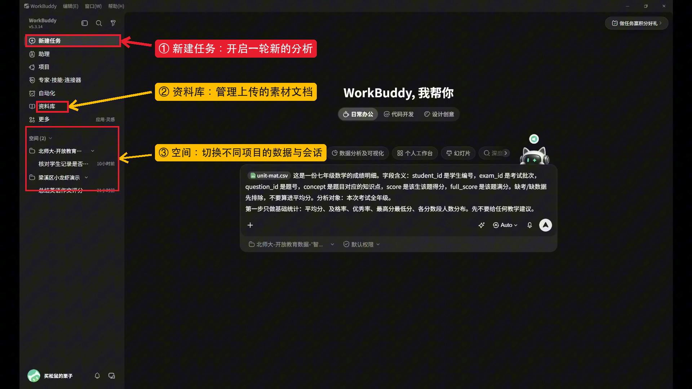
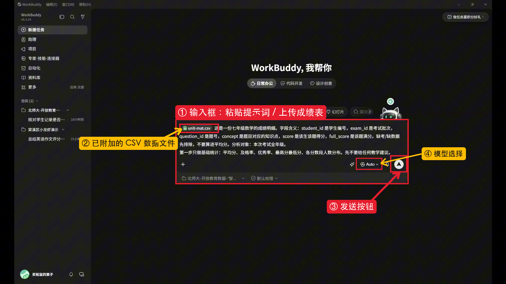
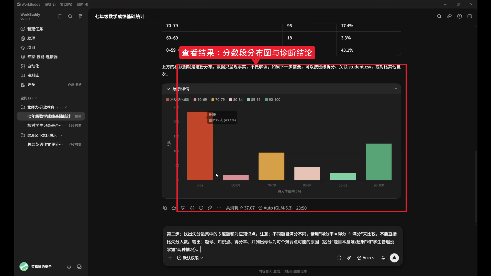
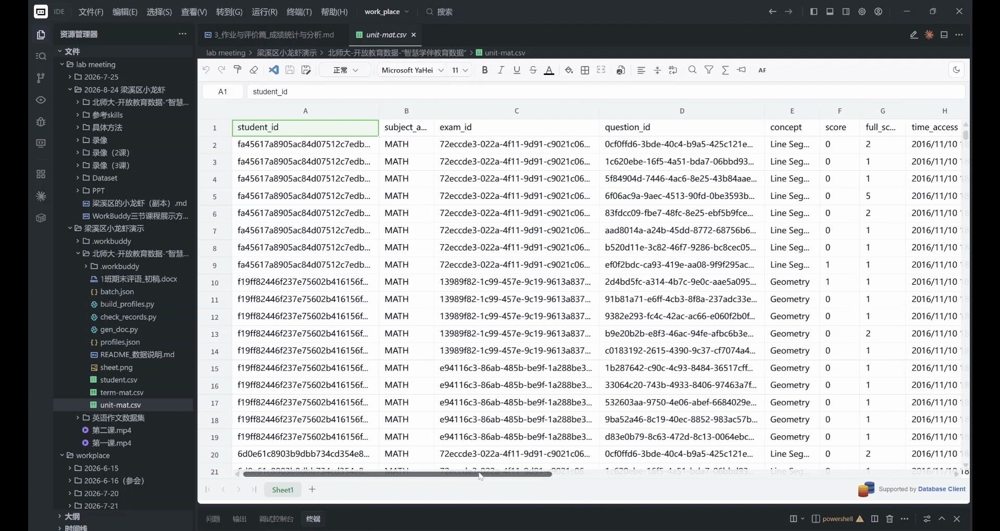
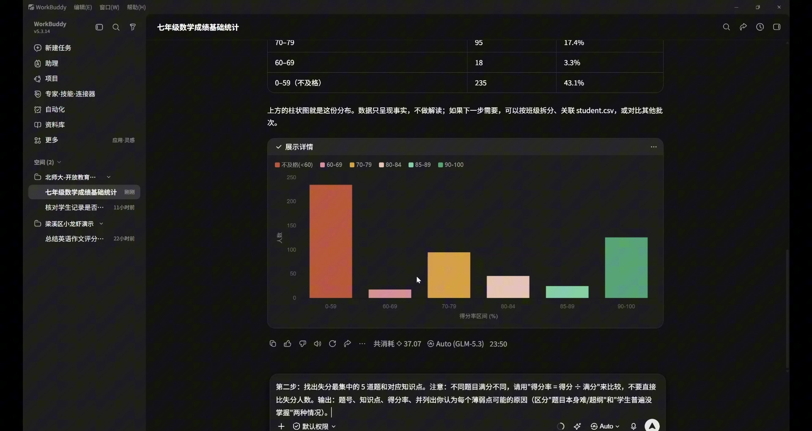
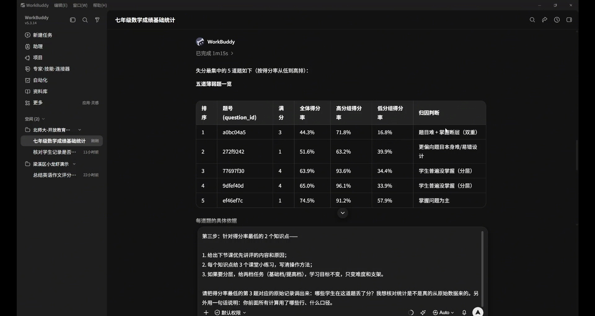
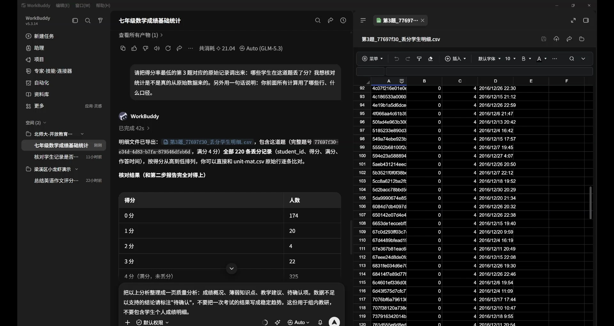
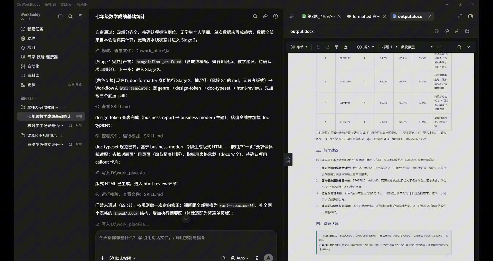
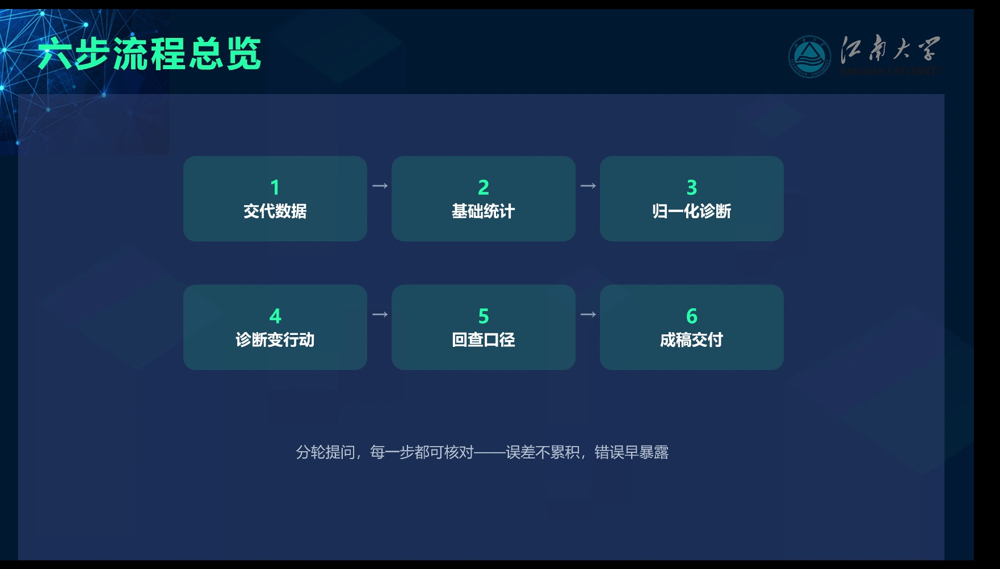

# 成绩统计与学情分析

> **解决的问题：**这节课讲怎么用 AI 完成从成绩表到教学决定的完整流程。
>
> **学习时长：**约 5 分钟

[📺 观看本课视频（微信视频号）](https://weixin.qq.com/sph/AADRYCve5C)

## 零、功能在哪里：WorkBuddy 界面速览

正式开始之前，先认识一下这节课会用到的几个功能位置。后面每一步的操作，都发生在这些地方。

### 1. 左侧：新建任务与资料库

**新建任务**开启一轮新的分析；**资料库**用来管理上传的素材文档（成绩表、口径卡等）；**空间**用于切换不同项目的数据与会话。红框与箭头标出了具体位置。



### 2. 对话区：输入框、附件与发送

每一轮的提示词都粘贴在**输入框**里；成绩表等文件以附件形式附加（图中“unit-mat.csv”）；确认无误后点**发送按钮**；右上角可切换**模型**。



### 3. 结果区：读取统计与诊断输出

AI 的回复直接显示在对话区：分数段分布图、按得分率排序的薄弱题表、归因判断与教学建议，都在这里逐轮呈现。



## 一、先说痛点

每一次考完试，成绩表就躺在电脑里：导出来、透视一遍、做一张分布图，一个班一套；换个班，再重做一遍。及格线怎么算、不同满分怎么比、缺考怎么处理——口径一变，整套表就得重算。

更耗人的是诊断。哪几道题失分最多？是题目难，还是这个知识点根本没讲透？单看失分人数，大分值题一排上去，真问题反而被淹没了。

统计是起点，诊断是中间，行动才是终点。AI 能做的，是整表读取——五十八万行一次读完，把统计翻译成薄弱点诊断，再把诊断翻译成可执行的课堂动作；但它不能替你判断教学重点是否符合本班节奏，不能对字段误读负责，也不能替你保护学生隐私。

可现实里，大部分时间都花在起点上：表算完了，中间和终点还空着。那今天呢，我们就用 WorkBuddy 把这一段接起来。

## 二、原则还是四步走，这次加两步

从原则上来看，我们依旧是四步走：给材料、给标准、给输出、留复核，这和前两节课是相同的。

- **给材料**：成绩表＋字段含义＋分析范围（哪次考试、哪个班）——字段语义决定分析质量；
- **给标准**：统计口径，及格线怎么算、不同满分怎么比、缺考怎么处理；
- **给输出**：分轮要结果，先统计、再诊断、再建议，最后成一页分析单；
- **留复核**：抽查原始记录、核对口径、敏感数据不外传。

与之不同的是，我们可以在四步走的原则上再增加两步，也就是交代数据、基础统计，以及归一化诊断和诊断变行动这两步，然后呢，我们正常做我们的回查口径和成稿交付。同样的，这里我们直接用案例代替解释，大家直接看实操。

## 三、先看数据长什么样

我们还是用这个数据集作为我们的测试对象。这是一次期末大考的数据：student_id 是学生编号，然后是数学学科、考试的编号、题号，以及得分、满分是多少，最后是考试的时间。



演示数据：七年级数学成绩明细（学生、考试、题号、得分、满分，全部匿名编号）这份材料一共三份 CSV：unit-mat（5.7 万行）、term-mat（58 万行）、student（4830 人）——全部匿名编号。接下来我们分轮让它处理。

[📎 下载附件：数据口径卡.docx](../../public/course-assets/44/source-01.docx)

[📎 下载附件：unit-mat_示例.csv](../../public/course-assets/44/source-02.csv)

[📎 下载附件：term-mat_示例.csv](../../public/course-assets/44/source-03.csv)

[📎 下载附件：student_示例.csv](../../public/course-assets/44/source-04.csv)

## 四、第一轮：交代数据，只做基础统计

我们这里先说明一下这份题目的背景：这是一个七年级数学的成绩明细，然后把各字段的含义交给 AI，再向它说明第一步的要求——我们第一步只做基础的统计，避免让它一步跨太大导致幻觉很多。

所以先让它得出平均分、及格率、优秀率、最高分、最低分这些内容。这一步的关键是拆成可验证的小步，误差不累积；如果少了这一步，错误就埋在长篇输出里，诊断全建立在错数上。

```Plain Text
告诉我这份表有多少个考试批次、各多少学生、考什么知识点、总体得分率。先复述你理解的字段口径，再开始计算平均分、及格率、优秀率、最高分、最低分、各分数段人数分布。先不要给任何教学建议。
```



## 五、第二轮：归一化诊断，区分“题目难”和“没掌握”

在它生成完基础统计之后，我们还要做一个归一化处理。因为我们不能确定到底是题目比较难，还是学生普遍没有掌握，所以我们需要用得分率来对数据做处理：得分率＝得分÷满分，归一化之后再排序。

注意：不同题目满分不同，请用“得分率”比较，不要直接比失分人数。单看失分人数，大分值题会霸榜，真问题反而被淹没；试卷的难度问题也会被当成教学问题。

```Plain Text
计算每题得分率（得分÷满分）从低到高排序，输出题号、知识点、得分率；同时给出高分组和低分组的得分率对比，判断是“题目难”还是“掌握断层”。不要直接比失分人数。
```



第二轮结果：失分最集中的5道题，按得分率从低到高排，并附归因判断可以看到，它不光给出了每道题的全体得分率，还给出高分组得分率和低分组得分率的对比——这样就能判断到底是题目难，还是掌握断层。比如第一题，高分组 71.8%、低分组只有 16.8%，归因是“题目难＋掌握断层（双重）”；而有的题两组得分率都高、只有低分组偏低，那就是学生普遍没掌握。根据这些，我们就能看到到底是哪些知识点没有讲透，还是单纯题目比较难。

## 六、第三轮：把诊断变成课堂动作

完成了这一步之后，我们就可以进行下一步：针对得分率最低的 2 个知识点——

1. 给出下节课优先讲评的内容和原因；
2. 每个知识点给 3 个课堂小练习，写清操作方法，不要一般性建议；
3. 如果要分层，给一个基础档的题目，也给一个提高档的题目——学习目标是不变的，变的只是难度和支架。

这样对掌握得比较差的知识点做一个补强。因为我的数据集里没有具体的题目内容，所以这一步暂时不给大家展示，我们直接进入下一步。

```Plain Text
针对最薄弱的2个知识点：优先讲评的内容和原因；各给3个有操作方法的小练习（不要一般性建议）；给两档分层任务（基础档+提高档），学习目标不变。
```

## 七、第四轮：回查口径

我们要求 AI 把得分率最低的那道题对应的原始记录调出来，看看哪些学生在这道题丢了分，从而检验它给出的结果到底是不是正确的。

```Plain Text
把得分率最低那题的原始记录调出来；用一句话复述你的统计口径。整理成一页质量分析，包含成绩概况、薄弱知识点、教学建议、待确认项；数据不足的结论标“待确认”，使用学号不传姓名
```



回查结果：整题 220 条失分记录被逐行调出，核对结果与第二轮报告完全对得上可以看见，它已经把失分明细找出来了——这道题一共 220 条失分记录，按得分从高到低排列。核对结果和第二轮报告完全对得上，基本可以证明它的数据没有问题。回查就是用最小的成本验证整条数据链路，防止“一本正经地编造”——比如编造的知识点、悄悄变化的统计范围。

## 八、最后：成稿交付

一旦确认没有问题之后，我们就需要把前面做的所有工作整理成一页质量分析：成绩概况、薄弱知识点、教学建议、待确认项，汇聚成一个可以交付的文件。同时交代两句：数据不足的结论标“待确认”，不要把一次考试的结果写成稳定趋势——单次波动不等于稳定趋势；另外，用学号不传姓名，成绩是敏感数据。



最终交付：一页《质量分析》，概况、薄弱点、建议、待确认项四部分齐全我们看它生成的整个情况：第一部分成绩概况——平均分、及格率、优秀率，以及纳入统计一共有多少人；第二部分薄弱知识点，因为它没有拿到具体题目内容，所以把题号全部列了出来，并做了归因判断——到底是题目比较难，还是这个知识点我们涉及的比较少；第三部分教学建议给出了一些相关的建议；最后在待确认项里说明子知识点的缺失，提醒我们并没有给出具体题目内容。这些我们可以一条一条去确认。

## 九、六步总结



1. 六步流程总览：交代数据 → 基础统计 → 归一化诊断 → 诊断变行动 → 回查口径 → 成稿交付**交代数据**：这份表是什么＋每个字段含义＋分析范围＋缺失值处理，让 AI 先复述口径；
2. **基础统计**：平均分、及格率、优秀率、分数段，明确“先不要给建议”；
3. **归一化诊断**：得分率＝得分÷满分，排序后再比较，区分“题目难”和“没掌握”；
4. **诊断变行动**：优先讲评内容＋原因、3 个课堂小练习、两档分层任务（目标不变）；
5. **回查口径**：调出高错题原始记录核对，让 AI 一句话复述全部计算口径；
6. **成稿交付**：一页质量分析（概况／薄弱点／建议／待确认项），用学号不传姓名。

分轮提问，每一步都可核对——误差不累积，错误早暴露。从 58 万行，到一页能带进教研室的分析单，整个作业的评价和分析就都做完了。

内容整理自《11集 AI 教学课程》第14集「成绩统计与分析」，主讲：邱俊浩（江南大学联通主义学习研究团队）。
