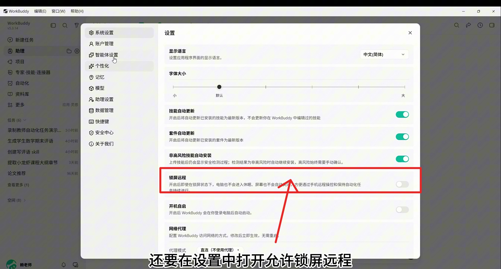
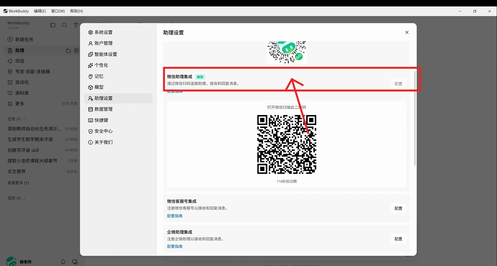
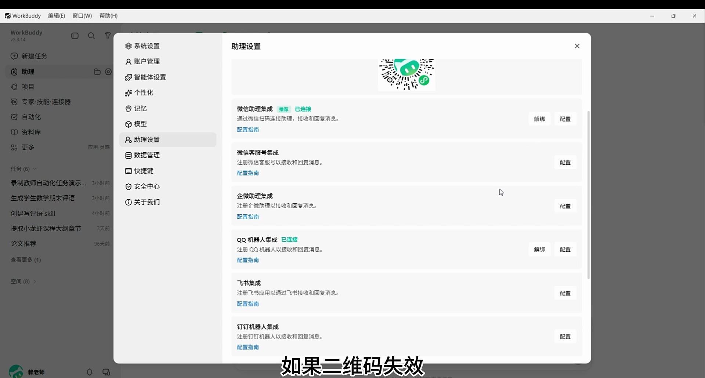
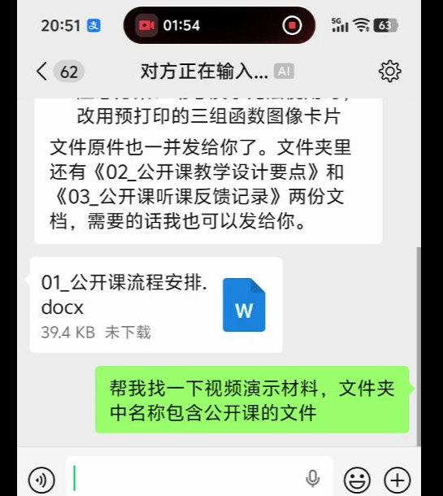
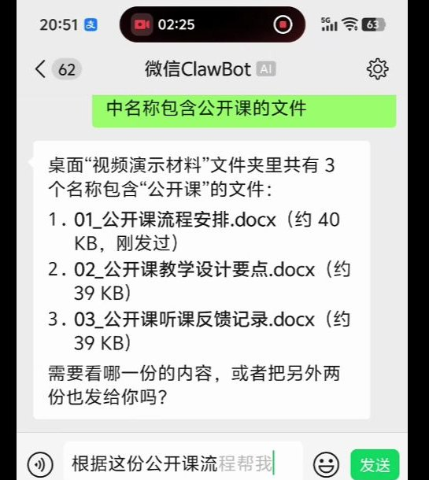
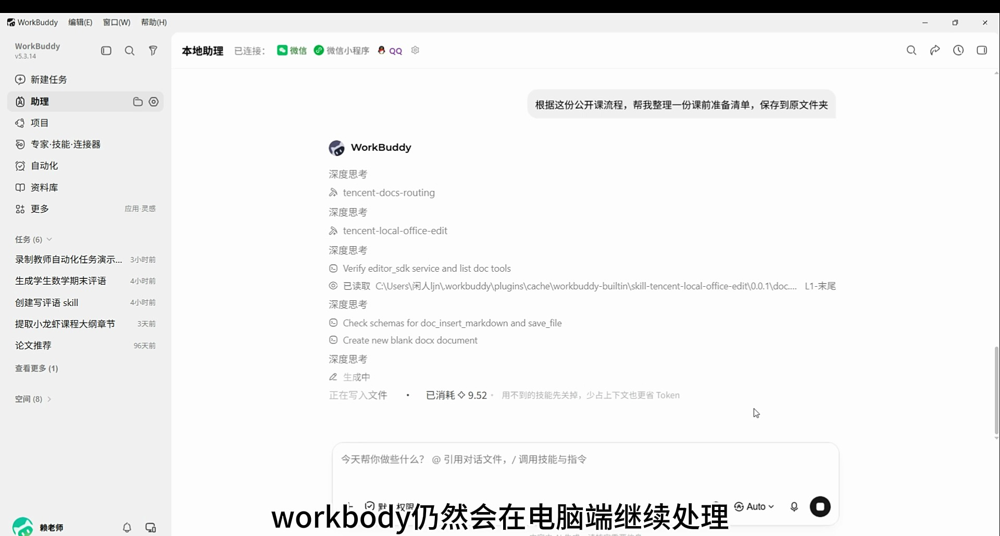
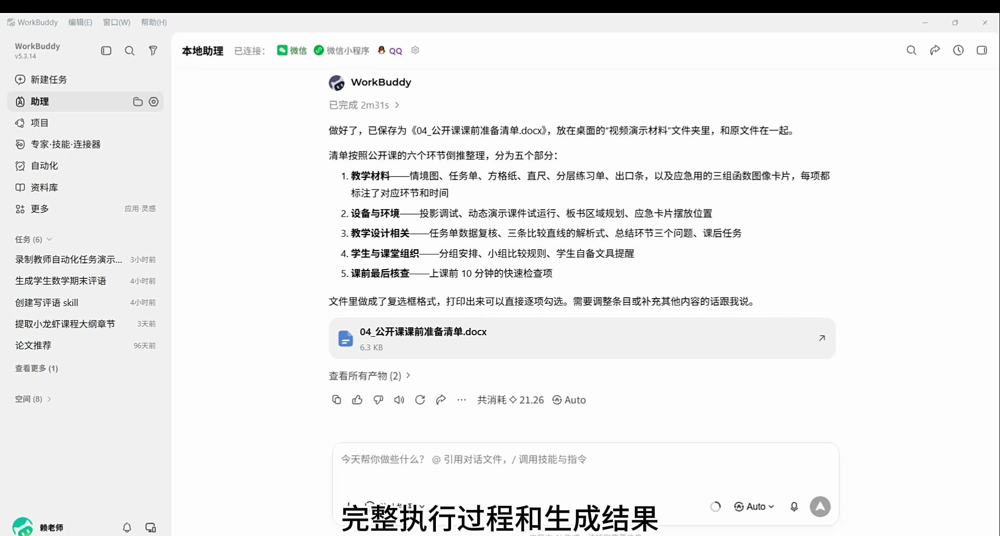
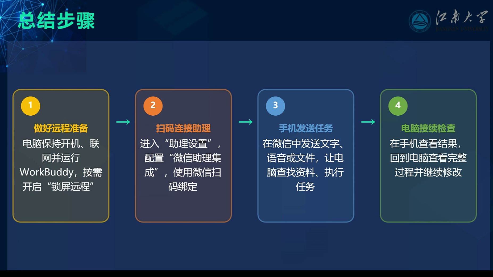

# 手机端移动办公

> **解决的问题：**通勤路上、开会途中，手机上发一句话，电脑上的 WorkBuddy 就开工。
>
> **学习时长：**约 5 分钟

[📺 观看本课视频（微信视频号）](https://weixin.qq.com/sph/AXc402VEfn)

## 一、先说痛点

前面的操作，我们都是坐在电脑前完成的。但教师的真实工作并不总发生在办公室：通勤路上突然想起一份材料没有整理；开会时临时需要电脑里的文件；或者离开工位后，WorkBuddy 还在执行任务，想看看进度、补充一句要求——总不能每次都重新回到电脑前。

今天我们就来解决这个问题：**用手机微信远程操控电脑上的 WorkBuddy。**

## 二、它和远程桌面不一样

这项功能叫「助理远程任务」。手机负责发送指令、查看进度和确认操作，真正读取文件、调用技能和执行任务的，仍然是电脑上的 WorkBuddy。

它和普通远程桌面最大的区别是：**你不需要在手机上操作电脑界面，只要告诉 WorkBuddy 要做什么，它就会在电脑端自主完成。**

## 三、开始前，确认三件事

1. 电脑已经安装并登录最新版 WorkBuddy。
2. 电脑保持开机、联网，并且 WorkBuddy 正在运行。
3. 手机微信和电脑端使用同一账号登录，或者已经完成账号关联。

如果需要在电脑锁屏后继续运行任务，还要在设置中打开「允许锁屏远程」。



<p class="fig-caption">系统设置里的「锁屏远程」开关——打开后电脑锁屏也不中断任务</p>

## 四、扫码连接微信助理

打开电脑端 WorkBuddy，进入左侧的「助理」页面，点击齿轮图标，打开「助理设置」。在集成列表中找到「微信助理集成」，点击右侧的「配置」。稍等片刻，页面会生成一个二维码。

打开手机微信扫一扫，扫描这个二维码。绑定成功后，电脑端的状态会显示为「已连接」。如果二维码失效，重新点击配置生成即可。





## 五、第一个场景：临时要电脑里的文件

连接完成后，我们来测试一个教师经常遇到的场景。我在手机微信中输入：「请把电脑"视频演示材料"文件夹中的《公开课流程安排》发送到当前对话。」WorkBuddy 会在电脑端查找这个文件，并将结果返回到微信。

```Plain Text
「请把电脑"视频演示材料"文件夹中的《公开课流程安排》发送到当前对话。」
```

即使记不清完整文件名也没关系，可以描述大概的位置和关键词，比如：「帮我找一下"视频演示材料"文件夹中，名称包含"公开课"的文件。」如果找到多个文件，WorkBuddy 会让我们进一步选择。

```Plain Text
「帮我找一下"视频演示材料"文件夹中，名称包含"公开课"的文件。」
```

<grid>
<column width-ratio="0.500000">

</column>
<column width-ratio="0.500000">

</column>
</grid>

## 六、第二个场景：直接在手机上布置任务

除了找文件，还可以直接在手机上布置任务。我输入：「根据这份公开课流程，帮我整理一份课前准备清单，保存到原文件夹。」

```Plain Text
「根据这份公开课流程，帮我整理一份课前准备清单，保存到原文件夹。」
```

任务发出以后，我可以退出当前页面，WorkBuddy 仍然会在电脑端继续处理。



<p class="fig-caption">人已经离开电脑，任务仍在电脑端一步步执行</p>

## 七、回到电脑，接续检查

回到电脑后，在「助理」页面可以看到刚才从微信发起的会话、完整执行过程和生成结果，还可以在电脑上继续修改。这就是**跨设备接续**。



<p class="fig-caption">电脑端看到的完整结果：《公开课课前准备清单》按六个环节整理成五大部分，已存到原文件夹</p>

## 八、总结步骤

1. **做好远程准备：**电脑保持开机、联网并运行 WorkBuddy，按需开启「锁屏远程」。
2. **扫码连接助理：**进入「助理设置」，配置「微信助理集成」，使用微信扫码绑定。
3. **手机发送任务：**在微信中发送文字、语音、图片或文件，让电脑查找资料、执行任务。
4. **电脑接续检查：**手机端适合快速发送指令和查看进度，完整的执行过程、数据来源和文件格式，最好回到电脑端进一步核对和修改。



<p class="fig-caption">四步总结：做好远程准备 → 扫码连接助理 → 手机发送任务 → 电脑接续检查</p>

## 九、留一个小练习

在手机微信中连接自己的 WorkBuddy，然后发送一个简单任务，比如「帮我找到"教学资料"文件夹中，名称包含"教研"的文件」。观察手机能否收到结果，再回到电脑端查看完整会话。

注意：电脑需要保持开机、联网并运行 WorkBuddy。

内容整理自 AI 教学课程第 24 集《多端接入：手机电脑都能用》，主讲：赖佳妮（江南大学联通主义学习研究团队）。图片取自课程 PPT 与操作录屏。
