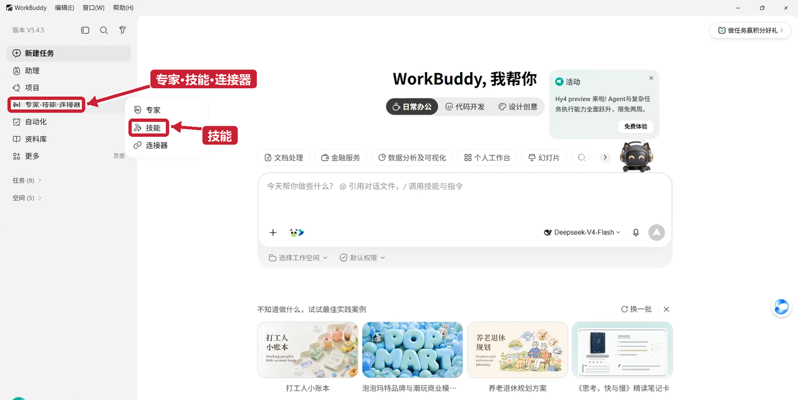
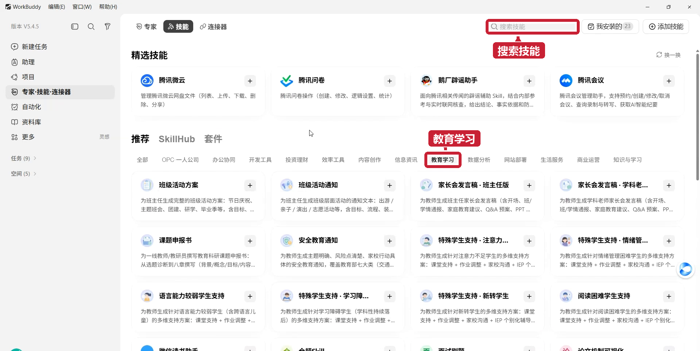
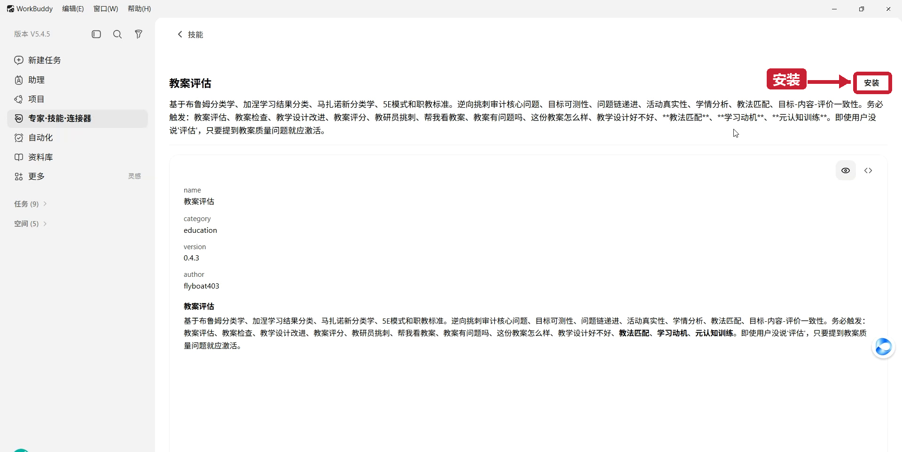
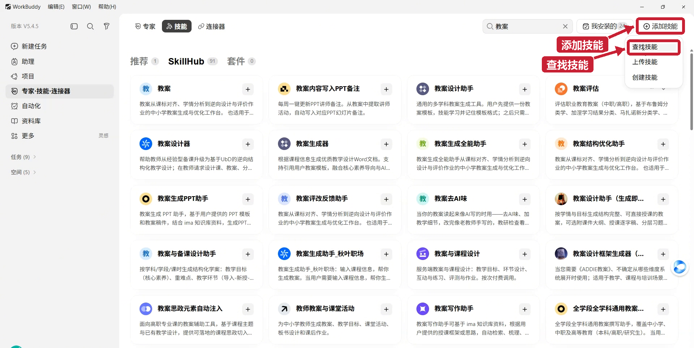
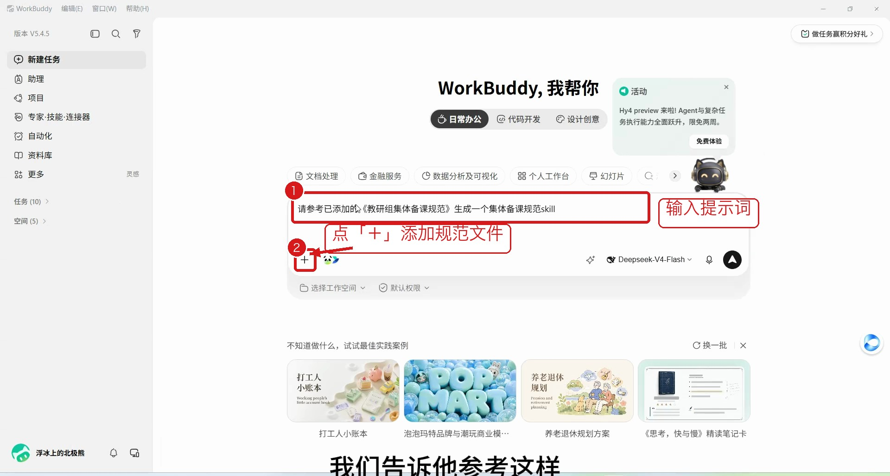
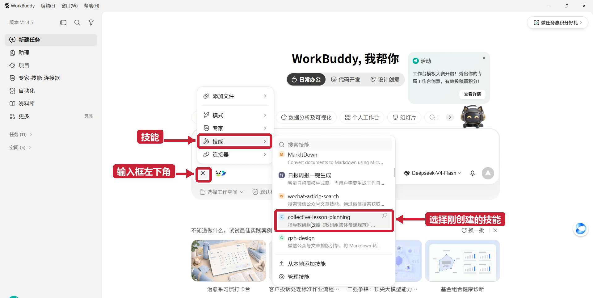
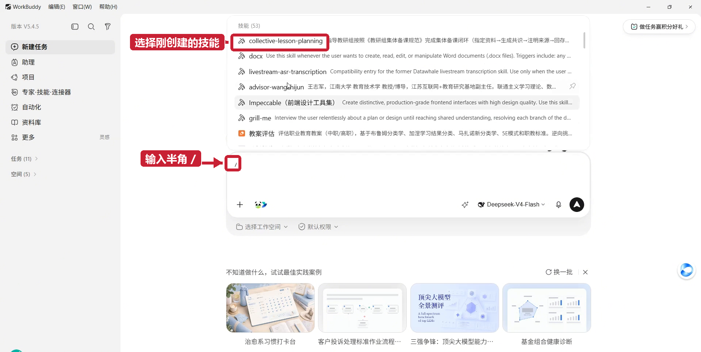
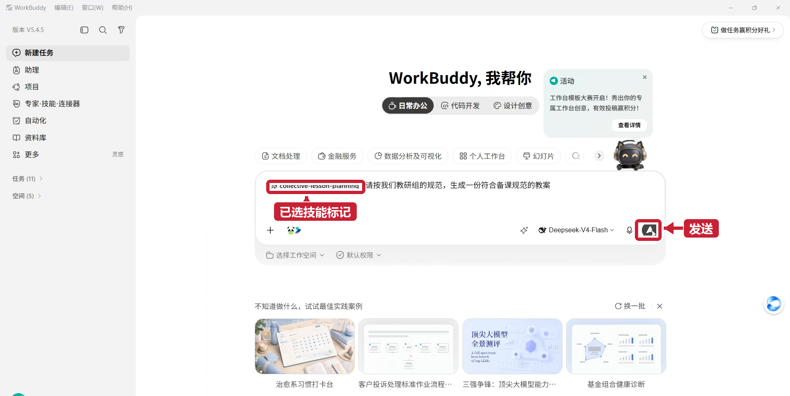
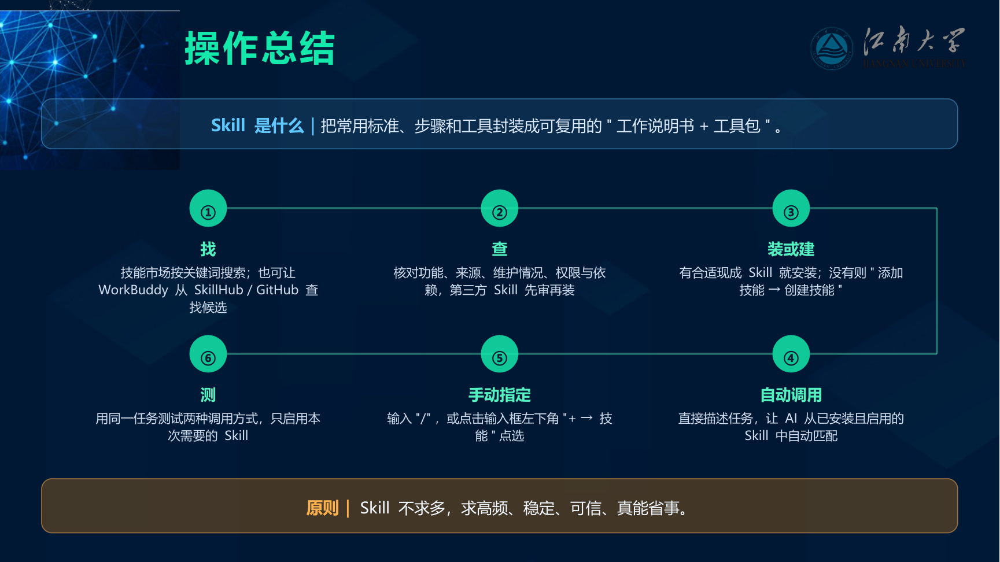

# 一键调用常用流程

> **解决的问题：**这节课讲 Skill（技能）：把常用的标准、步骤和工具固定下来，下次遇到同类任务，不用从头解释。
>
> **学习时长：**约 8 分钟

[📺 观看本课视频（微信视频号）](https://weixin.qq.com/sph/AwJdVnln0h)

## 一、先说痛点

我们在平常使用 AI 的时候，可能经常会遇到一个问题：做一个标准相同的东西，每次都要跟 AI 说相同的需求——出题要符合学校的难度标准，教案要套用教研组的模板，家长会通知要符合学校的格式，等等。

第一次说没有什么问题，但后面还会遇到很多次相似的要求。这个时候，我们就可以使用 Skill，也就是**技能**，把这套方法固定下来。

## 二、Skill 是什么

Skill 可以理解为**给 AI 准备的一份工具说明书**：它告诉 AI 按照什么样的标准和步骤来执行；这样的一个工作包，可以让它在授权的范围内读取材料、处理文件，或者调用其他的能力。

以后如果遇到相同类型的任务，就不需要从头解释了。

## 三、去技能市场找

从哪里获得 Skill？点击「专家·技能·连接器」，再点「技能」。可以看到这里面已经有很多人上传了他们实测过、可以稳定使用的 Skill。在「教育学习」这个板块，能找到适合自己的，比如班级活动方案、家长会发言稿、课题申报书等等。





点开一个技能，会有对它的具体介绍——它是做什么的、触发场景是什么。如果想用，点击「安装」就可以了。



## 四、找不到？让它帮你查

还有一种方式：直接在对话框点「查找技能」，输入我们想要的 skill。可以先不让它安装，先让它查找——它会从技能库里选，也可能从别的 skill 库里选。



它会把查找的结论告诉我们：目前市场没有专门的自动生成这类内容的 skill，但有可以替代的。如果觉得可以，就按它给出的方案，直接输入对应的字母就可以了。

## 五、自己做一个

没有现成的，我们可以自己制作。

```Plain Text
「请参考已添加的《教研组集体备课规范》，生成一个集体备课规范 skill。」
```

再给它一份材料——把集体备课规范文件发过去，帮助它更好地生成我们想要的 skill。



直接说：参考，生成一个集体备课规范 skill

[📎 下载附件：01-教研组集体备课规范（练习版）.docx](../../public/course-assets/47/source-01.docx)

这样，下次要生成集体备课方案的时候，就可以一键调用这个 skill 了。

## 六、怎么调用：两种方式

安装好 skill 之后如何使用？

1. **手动指定**：新建任务里点左下角的加号，选「技能」，所有安装过的技能都在里面，点击我们刚创建的那个即可；还有一种更快的，输入一个斜杠「/」，它就会自动出现所有技能，点击就好；





1. **自动调用**：直接描述任务，让 AI 从已安装且启用的 Skill 中自动匹配。



技能出现之后，给它一个提示词；输入框里出现这个标号，就说明它已经在调用这个 skill 来写文件了。生成好之后的 skill 也可以对它进行优化。给 skill 的要求不同，最后生成的文件和形式也是不同的，要根据对应的情况来调整。

## 七、总结



六步总结：找 → 查 → 装或建 → 自动调用 → 手动指定 → 测Skill 是把常用的标准、步骤和工具，封装成一个可用的「工具说明书＋工具包」。先在技能市场里找，也可以让 WorkBuddy 从 SkillHub 上找候选；了解清楚这个 skill 到底是做什么的、是不是安全的，再安装；装好之后调用——自动匹配或手动指定；然后测试，测试没有问题，后续就可以直接调用。

## 八、Skill 不是越多越好

Skill 并不是越多越好。装得越多，AI 选择的成本就越高，无关的 skill 也可能对我们造成干扰。

选择 skill 的时候，可以问自己 4 个问题：

1. 这个事情是不是自己高频做的？
2. 这个 skill 能不能稳定地复用？
3. 它的来源和权限是不是可信的？
4. 它是不是真的比直接下指令更省事？

**如果这 4 个里面有 2 个答不上来，就可以先不用安装。**原则就一条：Skill 不求多，求高频、稳定、可信、真能省事。

## 九、小练习

四选一：出题 / 教案 / 家长会通知 / 成绩分析。完成动作：安装或创建 1 个 Skill → 自动调用 1 次 → 手动指定 1 次。验收时问自己两个问题：能不能说清触发场景、来源和权限是否已核对？输出是否符合学校的难度、教研组模板或你的分析维度？

注意：不要批量安装无关 Skill；变化的单元内容不要写死进 Skill。
