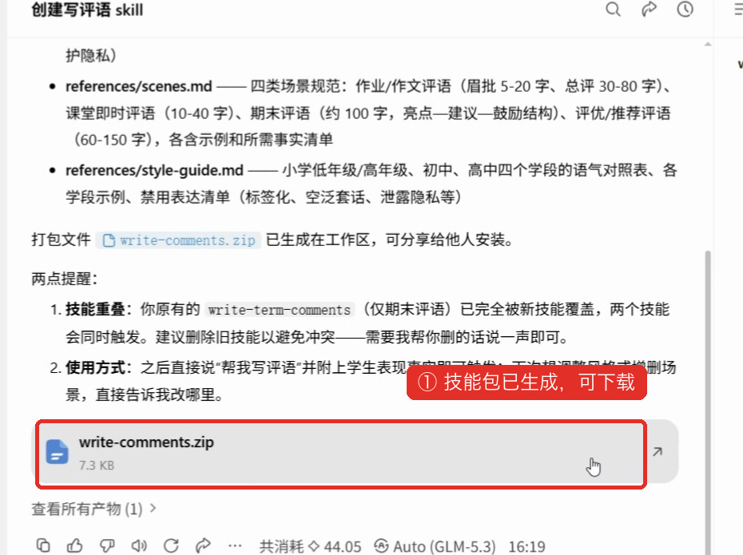
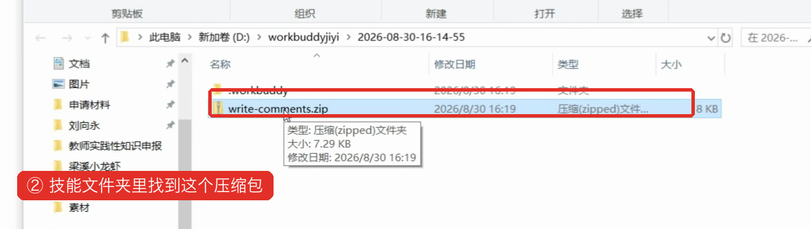
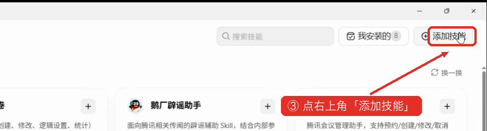
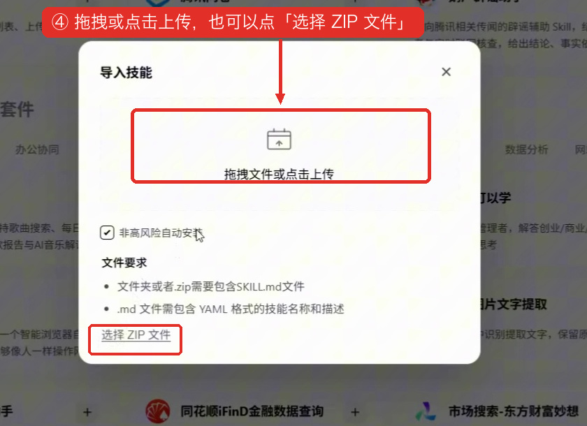
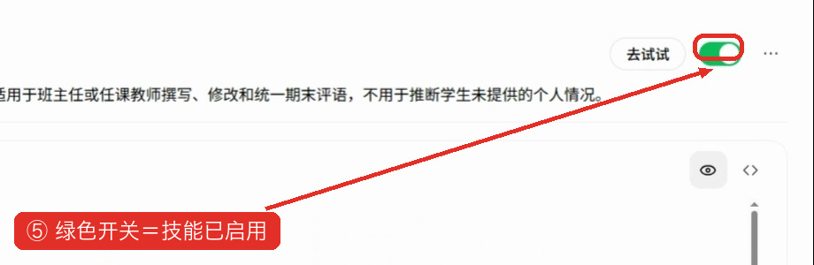
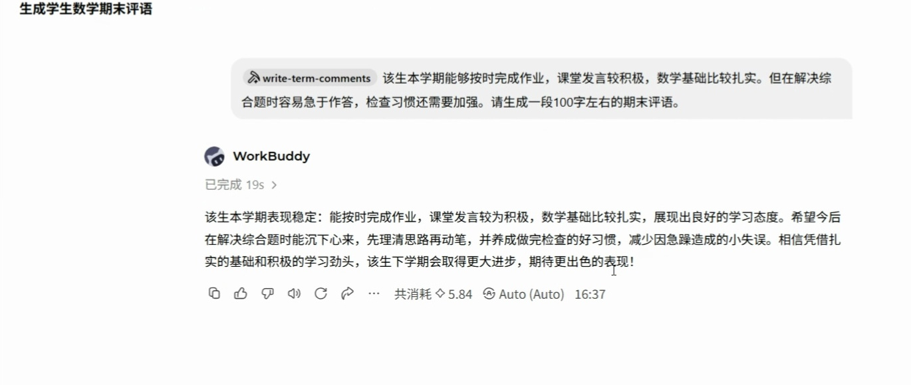
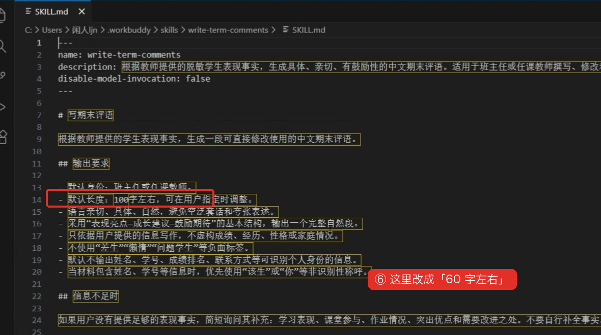
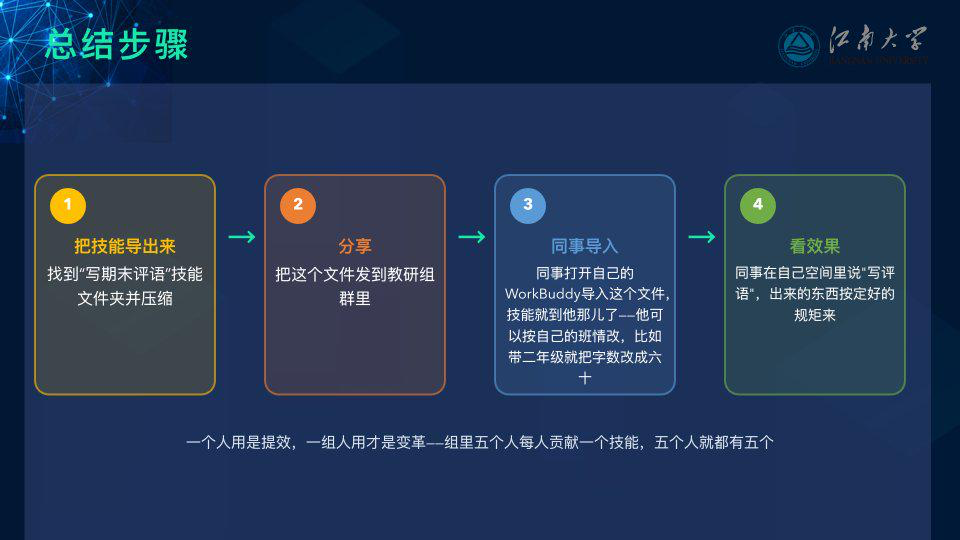

# 课题组技能共享

> **解决的问题：**一个好方法不该只留在一个人的电脑里——把技能做成工具传出去，才是真正的传帮带。
>
> **学习时长：**约 5 分钟

[📺 观看本课视频（微信视频号）](https://weixin.qq.com/sph/AAInlfQ2QR)

## 一、先说痛点

<cite doc-id="Dmt3dDY3Sok2UmxeE3jcd8xE6mf" file-type="docx" title="重复任务：Skill一键调用常用流程" type="doc"></cite>上一集我们把自己反复使用的方法做成了一个技能。比如我制作了一个「写期末评语」技能，以后在写评语时，WorkBuddy 就能按照我设置好的身份、字数、语气和格式完成任务。

但新的问题也出现了：这么好用的方法，现在只有我一个人能用。组里其他老师还在每次从头说明要求，还在问你——「那个评语是怎么写的？」

**一个人使用是提高效率，全组都能复用，才能真正减少重复劳动。**

## 二、项目和技能，分工不一样

在 WorkBuddy 中，项目和技能的作用并不一样。项目是围绕一项长期工作建立的协作空间——比如我们可以创建一个「八年级数学教研」项目，在里面集中处理备课、作业分析和教学总结。技能则是项目中可以反复调用的方法，比如写期末评语、生成教学周报，或者分析学生共性问题。

简单来说：**项目负责把人和任务组织起来，技能负责把优秀的方法保存下来。**

## 三、共享有两条路

如果你使用的是支持团队协作的版本，可以把技能配置为**项目级技能**，让项目成员共同使用。如果暂时没有团队项目，也可以通过**导出和导入技能包**完成共享。

下面演示第二种更通用的方法。

## 四、第一步：把技能导出来

技能本质上就是一个文件夹。找到提前制作好的技能，检查内容后，把整个技能文件夹压缩成 zip 发出去——这个文件里保存的就是我们设置好的 skill。

```text
请帮我创建一个技能，名字叫 write-term-comments（写期末评语）。
技能用途：根据我提供的学生表现事实，生成一段可以直接改用的中文期末评语。
输出要求：
1. 默认身份：班主任或任课教师。
2. 默认长度：100 字左右，我指定字数时按要求调整。
3. 语言亲切、具体、自然，避免空泛套话和夸张表达。
4. 结构：表现亮点—成长建议—鼓励期待，写成一个完整自然段。
5. 只依据我提供的信息写作，不虚构成绩、经历、性格或家庭情况；信息不足时先问我补充。
6. 不使用"差生""懒惰""问题学生"等负面标签。
7. 默认不出现姓名、学号、成绩排名、联系方式；材料里有姓名时用"该生"或"你"。
另外请附带两个参考文件：references/scenes.md（四类评语场景的写法与示例）、references/style-guide.md（四个学段的语气对照、字数参考、禁用表达清单）。
最后请自检：是否有事实依据、亮点是否具体、建议是否可行动、语气是否尊重、是否泄露个人信息。
```





## 五、第二步：分享出去

可以把这个技能文件发送到教研组群里，或者放进教研项目的共享资料库。

## 六、第三步：同事导入

现在切换到另一位老师的 WorkBuddy。打开「专家 · 技能 · 连接器」，点右上角「添加技能」，把收到的 zip 包拖进窗口，或点「选择 ZIP 文件」选中它。WorkBuddy 会先做一次安全检测，通过后自动完成配置。





## 七、检查启用，跑一次看效果

导入以后，先检查并启用这个技能。现在输入一段学生表现描述，再请 WorkBuddy 生成期末评语。





## 八、按自己的班情接着改

同时，这位老师还可以根据自己的班级情况继续修改。比如他教的是二年级，就可以把评语调整到 60 字左右，语言更加简单亲切。

修改完成后，还可以重新导出，再分享给组内其他成员。



把输出要求里的默认长度从「100 字左右」改成「60 字左右」，就是他自己的版本

有一点要注意：**修改后的技能不会自动同步给原作者**，需要重新分享，或者更新项目中的技能版本。

## 九、总结步骤

1. **把技能导出来：**找到已经制作好的技能，检查内容后压缩成压缩包。
2. **分享：**把导出的技能文件发给同事，或放进共享资料库。
3. **同事导入：**同事打开自己的 WorkBuddy 导入这个技能文件，导入后还可以根据自己的班级情况调整。
4. **看效果：**同事在自己的空间中调用这个技能，输入指令，判断 WorkBuddy 是否按照需求完成任务。



四步总结：把技能导出来 → 分享 → 同事导入 → 看效果

一个人用是提效，一组人共同使用才能带来真正的改变。这才是真正的传帮带——不只是把方法讲给同事听，而是**把方法做成一个可以直接使用、继续修改的工具**。组里五个人每人贡献一个技能，五个人就都有五个。

## 十、留一个小练习

请把自己制作好的一个技能导出，分享给同组的一位老师。请对方导入并运行一次，检查技能能否按照原有规则完成任务。

注意：导出的技能里，不要包含学生姓名、成绩这些信息。

内容整理自 AI 教学课程第 23 集《技能共享：全组一键复用》，主讲：赖佳妮（江南大学联通主义学习研究团队）。截图取自课程录屏与 PPT，涉及操作位置的地方用红框、箭头和编号标出，可对照着一步步做。
